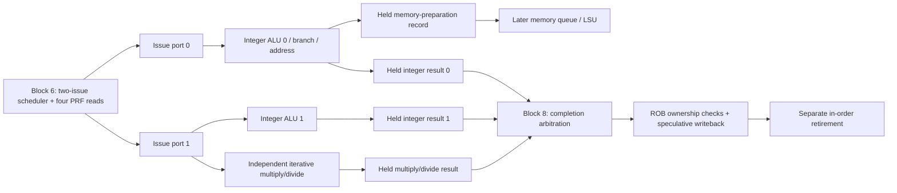

# Block 7: independent integer execution and iterative multiply/divide

This is the execution hardware inside the EX section. The issue queue from block 6 now sends
selected instructions to real arithmetic circuits. Two integer paths can accept a pair, while
an independent iterative multiply/divide unit keeps working on an earlier instruction.

The connected demonstration uses real execution results. It feeds legitimate decoded
instructions directly into rename because instruction fetch is a later block. Completion
selection in that testbench is a temporary test driver; the production arbiter is block 8.

## 1. Your example: ADD finishes while an older DIV keeps running

```asm
# Earlier ADDI instructions establish x1=100, x2=4, x3=7, x4=9.
div x5, x1, x2       # Older: 100 / 4 = 25, iterative execution.
add x6, x3, x4       # Independent: 7 + 9 = 16, integer execution.
add x7, x5, x6       # Dependent: waits for both physical results, then produces 41.
```

DIV uses issue port 1 to enter the multiply/divide unit. ADD uses issue port 0 to enter the
first integer ALU on the same edge. Once DIV is inside its unit, that unit's busy state does
not reserve either integer ALU. A later independent integer pair can use both ALUs while
DIV continues its iterations.

On acceptance, DIV leaves its IQ slot but keeps its ROB entry. Its execution unit retains the
full identity until completion, while the freed IQ capacity can admit more work.

The divider's intermediate state is private to that instruction. ADD's completed result has
its own output register and its own ROB/physical destination identity. Neither result can
accidentally replace the other when completion timing differs.

The connected test prints this measured sequence:

| Test cycle | Actual hardware event | Architectural consequence |
|---:|---|---|
| 6 | DIV enters iterative unit; independent ADD enters integer ALU | Both remain speculative |
| 7 | ADD completion is accepted, value 16 | Its physical register is ready; older DIV still blocks retirement |
| 39 | DIV completion is accepted, value 25 | Dependent ADD wakes and issues using completion bypass |
| 40 | Dependent ADD completion is accepted, value 41 | DIV and independent ADD retire together, in order |
| 41 | Dependent ADD's registered completion is eligible | Dependent ADD retires with value 41 |

These are testbench cycle numbers measured at acceptance boundaries. A unit's registered
result can become valid just after an edge and be accepted on the next edge. The divider
accepts at E0, performs iterations at E1 through E32, then offers its result for acceptance.
Do not count the acceptance edge as the first iteration.

## 2. Where this block connects



Port 0's completion and memory-preparation outputs share one occupied slot; only one is valid
at a time. Port 1 selects either ALU 1 or multiply/divide for its newly issued instruction.
The resources have independent retained state, so an already-running DIV and later ALU 1
instructions can overlap. Issue remains limited to two new instructions per edge.

There can be three completed arithmetic results at once: an older DIV can finish on the same
edge as a younger integer pair. Three completion channels therefore feed the future two-wide
arbiter. Each producer retains an unaccepted result. Three available results do not imply
three write ports or three issues per cycle.

## 3. Modules and signal ownership

rv32_integer_execute is instantiated twice. CONTROL_ENABLE=1 enables integer, branch, jump,
and address work on port 0. CONTROL_ENABLE=0 supports integer work on port 1. An accidentally
misrouted class becomes an illegal-instruction completion and a diagnostic; it is not silently
consumed without an owner/result.

rv32_muldiv_execute has its own arithmetic registers and state machine. rv32_execution_cluster
connects these resources to the two scheduler ports and combines cancellation acknowledgments.
There is no CSR/system engine in this block; the scheduler's system sink remains a later connection.

| Unit signal | Width | Source → destination | Meaning |
|---|---:|---|---|
| clk_i, rst_ni | 1 each | Common clock/reset → unit | Rising-edge state; active-low asynchronous reset |
| request_i | 364 | IQ/PRF → unit | Renamed instruction plus two raw 32-bit source values |
| request_valid_i | 1 | Selected issue port → unit | Capture pulse on an advertised-ready edge |
| request_ready_o | 1 | Unit → scheduler | Capacity available before instruction selection |
| completion_o | 222 | Unit → completion arbiter | Full owner, destination intent, value, exception, actual next PC |
| completion_valid_o, completion_ready_i | 1 each | Unit ↔ arbiter | Retained result and consumer acceptance |
| memory_o | 190 | Port-0 unit → later memory queue | Prepared byte address, store value, access/fault/control metadata |
| memory_valid_o, memory_ready_i | 1 each | Port-0 unit ↔ memory queue | Retained preparation record and acceptance |
| cancel_i | 1 | Recovery controller → unit | Stop publication/admission; clear executing and buffered work at edge |
| cancel_done_o | 1 | Unit → recovery controller | Registered acknowledgment of the cancellation edge |
| busy_o | 1 | Unit → status | Arithmetic in progress or an output still held |
| quiescent_o | 1 | Unit → recovery controller | No executing owner and no held output remains |
| protocol_error_o | 1 | Unit → integration diagnostics | Issue without capacity, or a misrouted operation |

The cluster presents issue_fire_i[1:0] and issue_packet_i to these units. Its alu0_ready_o,
alu1_ready_o, and muldiv_ready_o connect directly to the matching block-6 inputs.
memory_ready_o advertises the shared port-0 slot's capacity; it differs from memory_ready_i,
which acknowledges a previously prepared output. An empty slot may capture one address while
the downstream memory queue is temporarily unable to accept it.

The cluster exports a pair of ALU completions and a separate multiply/divide completion,
with independent readiness inputs. busy_o[0], [1], [2] describe ALU 0, ALU 1, and multiply/divide.
Cluster quiescence and cancellation acknowledgment require all three units to agree.

The shared memory_entry_t record gains control_flow in this block. The memory engine must
preserve the verified next PC and possible stale-prediction mismatch until it completes the
load/store. A prepared address must not mark the ROB instruction complete before the memory
response arrives.

## 4. Integer execution at circuit level

The block-2 ALU and branch comparator are reused rather than reimplemented. Each integer
instance has operand-selection multiplexers ahead of its ALU:

- Operand A selects raw rs1, zero for LUI, or the instruction PC for AUIPC.
- Operand B selects raw rs2 or the decoder's sign-extended immediate.
- The ALU control selects addition/subtraction, shift, comparison, or Boolean logic.

The combinational result enters a registered output slot on the accepted issue edge. That
slot includes all completion metadata, so changing the next request cannot change the held
result. No architectural register storage is written in this module.

When an old result is accepted, the integer slot can capture a new instruction on the same
edge. This supports one result per integer path per cycle after filling, subject to issue and
writeback capacity. A busy integer slot can therefore still be request-ready if its old output
will be accepted. The iterative unit uses a simpler contract and does not refill on its result-pop edge.

The long combinational path can include accepted-result wakeup, IQ selection, PRF bypass/read,
operand muxes, and the ALU before the execution-result register. Its actual timing must be
checked in Vivado; simulation alone does not prove the 50 MHz target.

## 5. Branches, jumps, and next-PC verification

Branches compare the two raw register values, independently of the integer operand muxes.
A taken branch selects PC + immediate; a not-taken branch selects PC + 4. JAL selects its
PC-relative target and returns PC + 4 as the link value. JALR adds rs1 + immediate, clears target
bit 0, and returns the link value. With this core's four-byte instruction alignment, a taken
branch/jump whose final target has nonzero low two bits produces an instruction-address fault.
A not-taken branch does not fault because its unused target is misaligned.
These rules follow the [RV32I specification](https://docs.riscv.org/reference/isa/v20260120/unpriv/rv32.html).

The completion contains actual next PC, control-flow type, direction, and whether next PC
matched the carried prediction. Ordinary integer operations also compare PC + 4 against the
prediction: a stale BTB entry on an instruction that is no longer a branch must be recoverable.
The multiply/divide and memory-preparation paths preserve this check too.

This block reports the resolution; it does not directly flush fetch or restore rename maps.
The ROB records it, and the later recovery controller applies the retirement-based policy.
Faults take priority: a fault completion does not simultaneously request prediction recovery.
A faulting JAL/JALR retains its decoded destination intent for ROB ownership checks, while
exception.valid prevents the later PRF write.

## 6. Address generation is separate from a memory transaction

Loads and stores calculate the original byte address as rs1 + immediate. Store data remains
the raw, unshifted rs2 value. A byte address can use any byte lane; halfwords require bit 0=0,
and words require bits [1:0]=00. Misalignment records load/store cause 4/6 and the original
address in exception.tval. Byte-lane selection, write strobes, load extension, bus faults, and
exactly-once transactions belong to the later LSU.

The retained memory record contains prepared=1 and its complete ROB tag. It carries the
size, signed/unsigned-load flag, physical destination intent, store value, address, exception,
and actual-next-PC information. No AXI signal is generated here. Even a prepared wrong-path
store has no external effect. Actual transactions remain restricted to the live incomplete
ROB head by the agreed memory-engine design.

An existing fetch exception is retained ahead of newly discovered target/alignment faults.
Unsupported routed classes become illegal-instruction faults. Fault values are unusable;
accepted completion gating, not a convenient numeric result, controls physical writes and wakeup.

## 7. Iterative multiplication: reuse an adder over 32 cycles

The multiply datapath has a 64-bit product accumulator, a 64-bit shifted multiplicand, a
32-bit multiplier, a five-bit iteration counter, and a final sign-correction path. Counts 0
through 31 represent the 32 iterations; the counter does not need to hold the value 32.

```text
 multiplier bit 0 ----> select add / retain accumulator
                            |
 product register ------> 64-bit adder <------ shifted multiplicand register
                            |
                     next product register
 multiplier shifts right             multiplicand shifts left
```

For each iteration, add the multiplicand when the current multiplier bit is one, then move
to the next bit. After 32 iterations, every multiplier bit has contributed. Signed variants
first convert the required operands to unsigned magnitudes, then conditionally negate the
complete 64-bit product before selecting its architectural half. MUL needs only the low half;
its low bits are identical under signed and unsigned interpretation.

| Operation | Interpretation and selected result |
|---|---|
| MUL | Low 32 product bits |
| MULH | High 32 bits, signed × signed |
| MULHSU | High 32 bits, signed rs1 × unsigned rs2 |
| MULHU | High 32 bits, unsigned × unsigned |

These result definitions come from the
[RISC-V M specification](https://docs.riscv.org/reference/isa/v20260120/unpriv/m-st-ext.html).
The iterative algorithm is this project's implementation choice. The synthesizable module
uses no multiply, divide, remainder, or exponent operator. It describes shifts, additions,
subtractions, comparisons, registers, and control. No DSP inference or resource count is
claimed without synthesis.

## 8. Iterative division: shift, compare, subtract

Division uses a 33-bit partial remainder, 32-bit quotient register, divisor magnitude, sign
flags, and the same iteration count/control machinery. Initially the quotient register contains
the dividend magnitude. On each iteration:

1. Shift the partial remainder left and bring in the next unprocessed dividend bit.
2. Compare that trial value with the zero-extended divisor.
3. If subtraction fits, retain the difference and shift a one into the quotient; otherwise
   retain the trial remainder and shift in zero.
4. After 32 iterations, apply the quotient and remainder sign rules and select the result.

The extra remainder bit retains the carry produced by the shift before comparison. Once a
nonzero divisor has been subtracted as needed, the next retained remainder again fits in 32 bits.

For an easily followed four-bit illustration of 13 / 3, the same algorithm consumes 1101:

| Input bit | Trial remainder | Subtract 3? | Next remainder | Quotient bit |
|---:|---:|---|---:|---:|
| 1 | 1 | No | 1 | 0 |
| 1 | 3 | Yes | 0 | 1 |
| 0 | 0 | No | 0 | 0 |
| 1 | 1 | No | 1 | 0 |

The quotient bits are 0100 = 4 and the remainder is 1. The actual module applies this recurrence
to all 32 bits; this small example is an explanation, not another configurable hardware variant.

Signed DIV rounds toward zero; REM follows the dividend's sign. DIVU and REMU use unsigned
operands. Division by zero returns all-one quotient bits or the original dividend as remainder.
The signed overflow pair 0x80000000 / 0xffffffff returns 0x80000000 with remainder zero. These
conditions produce defined values without an arithmetic trap, as required by the
[M specification](https://docs.riscv.org/reference/isa/v20260120/unpriv/m-st-ext.html).

This module uses 32 iterations even for these edge cases. A divide-by-zero flag selects the
required final value. The magnitude/sign datapath naturally produces the signed-overflow result.
There is no early-out, quotient/remainder fusion, or multiply/divide pipelining in this version.

## 9. State machines, output holding, and cancellation

The iterative control states are IDLE → MULTIPLY or DIVIDE → RESPONSE → IDLE. A valid request
captures one owner in IDLE; RESPONSE retains its completion until accepted. It cannot accept
a new owner on the response-pop edge. An unexpected inherited fault or misrouted class responds
without arithmetic iterations, retaining the original owner and precise fault metadata.

The integer path uses valid and is_memory state rather than a multicycle arithmetic state
machine. Its one slot retains either a completion or address record. The selected consumer's
ready signal permits removal or same-edge replacement; the other consumer cannot pop it.

The request interface is the scheduler's capture pulse, not a producer holding valid through
backpressure. Capacity must be advertised first; issue only pulses for an accepting resource.
An issue pulse without capacity is diagnosed and cannot overwrite a held owner. Completion
outputs use ordinary retained valid/ready semantics: all payload bits stay stable while valid
and not accepted, except when cancellation withdraws the speculative work.

Cancellation masks request-ready and publication-valid immediately. At the edge, it clears
arithmetic progress and output slots, and registers cancel_done. Quiescent reports the actual
empty state, so it does not become true merely because cancel is asserted before that edge.
The cluster acknowledges only after all three units have cleared. A simultaneous new issue or
completion-ready cannot defeat cancellation.

The later recovery controller must also stop IQ issue, deal with completion arbitration and
memory ownership, and only then apply ROB/rename/IQ restoration and permit resource reuse.
This block's local cancellation is one part of that barrier, not the full recovery controller.

## 10. Tests and waveform guidance

The standalone testbench compares multiply/divide against behavioral wide multiplication,
division, and remainder. Those operators appear only in the test oracle. It also verifies
integer operand muxes, ALU operations, branch conditions, jump alignment, address records,
inherited-fault priority, backpressure, replacement, reset, and cancellation boundaries.

The connected test uses rename, ROB, physical registers, IQ, these execution units, and trace.
Real ADDI instructions initialize the source values; results are not injected into the PRF.
It checks the opening DIV/ADD example, dependent wakeup, in-order retirement, three simultaneous
held results, cancellation-before-reuse, and ROB generation changes. Its temporary completion
selector is explicitly test-only and is not the block-8 implementation.

```sh
python3 scripts/run_checks.py --block 7
python3 scripts/run_checks.py --block 7 --waves
```

Current Icarus evidence is **121,060 standalone checks + 658 connected checks = 121,718 checks,
zero failures**. Reports contain separate case counts and exact source hashes. Optional waveforms are under
build/block07. The standalone waveform records the lead example and selected boundary cases,
pausing recording during the large arithmetic sweep to keep file size manageable. The connected
waveform records the complete demonstration.

Start with issue_fire, issued packets, unit ready/busy, all three completion-valids, accepted
ROB completions, physical write enables, retire_fire, and trace.order. In the iterative module,
inspect state_q, iteration_q, quotient_q, remainder_q, and product_q. Watch the ADD result while
state_q remains DIVIDE, then observe that completion acceptance and retirement occur separately.

For Vivado XSim on Linux, source your Vivado settings first, then run the standalone case:

```sh
xvlog --sv rtl/rv32_ooo_pkg.sv rtl/rv32_alu.sv rtl/rv32_branch_compare.sv \
  rtl/rv32_integer_execute.sv rtl/rv32_muldiv_execute.sv tb/tb_block07.sv
xelab tb_block07 -s block07_sim
xsim block07_sim --runall
```

The connected test additionally needs rv32_rename.sv, rv32_physical_regfile.sv,
rv32_reorder_buffer.sv, rv32_trace_recorder.sv, rv32_issue_queue.sv, and
rv32_execution_cluster.sv before tb_block07_integration.sv. No decoder is instantiated in
that case: the test directly supplies the documented decoded controls.

Vivado/XSim, synthesis, timing, DRC, and bitstream generation remain unverified here. These
execution tests do not establish whole-core ISA compliance, fetch correctness, memory-bus
behavior, CSR/interrupt delivery, or complete recovery coordination.

## 11. Interview questions

**How can two-issue hardware have three execution units?** The issue width limits new work per
edge. An older multicycle operation can remain active while later issues use other resources.

**Why keep three completion channels with only two write ports?** Different-latency operations
can finish together. Arbitration selects at most two; every other producer retains its result.

**Does ADD completing first violate program order?** No. Its physical write is speculative;
the ROB still retires older DIV first and preserves precise exceptions.

**Why use an iterative multiplier on an FPGA?** It demonstrates arithmetic-state reuse and
limits parallel arithmetic hardware. Throughput is lower than a pipelined multiplier; actual
FPGA area/timing tradeoffs require synthesis measurements.

**How is MULHSU different from MULH?** Only rs1 is signed for MULHSU. Treating rs2 as signed
would corrupt high-half results when rs2 has its top bit set.

**Why is the partial remainder 33 bits?** Shifting a 32-bit remainder and inserting a dividend
bit can temporarily require one additional bit before compare/subtract.

**Why is divide by zero not a trap here?** RV32M defines its quotient/remainder values.
The execution unit returns them normally; software may add a branch if its language needs a check.

**Why preserve destination intent on a fault?** The ROB checks it against the allocated owner.
The separate exception flag suppresses the physical write and wakeup.

**Why can't cancellation simply reset the iteration counter?** A result may already be held
in RESPONSE. Cancellation must remove both arithmetic state and every buffered owner/result.

**What prevents a prepared wrong-path store from writing a peripheral?** Address preparation
has no bus interface. Only the later memory engine can issue a transaction at the ROB head.

**Is the 50 MHz target proved now?** No. Cycle-accurate functional simulation and FPGA timing
analysis answer different questions. Vivado implementation must measure the actual path delays.

## 12. Source ownership

These modules are custom RTL, with ISA behavior checked against the primary RISC-V references
linked above. No third-party RTL was copied. Naming, procedural blocks, and intent-focused
comments follow the project's established lowRISC-inspired style.

## Complete integer/control/address execution

Source: `rtl/rv32_integer_execute.sv`.

```systemverilog
// Registered integer/control/address execution with one retained output slot.
// Port 0 enables control/address work; port 1 reuses the integer-only configuration.
`timescale 1ns / 1ps

module rv32_integer_execute
  import rv32_ooo_pkg::*;
#(
  parameter bit CONTROL_ENABLE = 1'b1
) (
  input  logic            clk_i,
  input  logic            rst_ni,
  input  logic            request_valid_i,
  output logic            request_ready_o,
  input  execute_packet_t request_i,
  output logic            completion_valid_o,
  input  logic            completion_ready_i,
  output completion_t     completion_o,
  output logic            memory_valid_o,
  input  logic            memory_ready_i,
  output memory_entry_t   memory_o,
  input  logic            cancel_i,
  output logic            cancel_done_o,
  output logic            busy_o,
  output logic            quiescent_o,
  output logic            protocol_error_o
);

  logic valid_q, is_memory_q;
  completion_t completion_q, calculated_completion;
  memory_entry_t memory_q, calculated_memory;
  word_t operand_a, operand_b, alu_result;
  logic branch_taken;
  logic calculated_is_memory, supported, bad_size;

  // These muxes select architectural operands; PRF reads remain raw register values.
  always_comb begin
    case (request_i.uop.decoded.src_a)
      SRC_A_ZERO: operand_a = '0;
      SRC_A_PC:   operand_a = request_i.uop.decoded.fetch.pc;
      default:    operand_a = request_i.rs1_value;
    endcase
    operand_b = request_i.uop.decoded.src_b == SRC_B_IMMEDIATE
                ? request_i.uop.decoded.immediate : request_i.rs2_value;
  end

  rv32_alu alu (
    .a_i(operand_a), .b_i(operand_b), .op_i(request_i.uop.decoded.alu_op),
    .result_o(alu_result)
  );
  rv32_branch_compare comparator (
    .rs1_i(request_i.rs1_value), .rs2_i(request_i.rs2_value),
    .op_i(request_i.uop.decoded.branch_op), .taken_o(branch_taken)
  );

  always_comb begin : calculate
    decoded_uop_t decoded;
    word_t sequential_pc, target, address;
    logic target_taken, misaligned;

    decoded = request_i.uop.decoded;
    sequential_pc = decoded.fetch.pc + 32'd4;
    target = sequential_pc;
    address = request_i.rs1_value + decoded.immediate;
    target_taken = 1'b0;
    misaligned = 1'b0;
    bad_size = 1'b0;
    supported = decoded.op_class == UOP_INTEGER;
    calculated_is_memory = CONTROL_ENABLE
                           && (decoded.op_class == UOP_LOAD || decoded.op_class == UOP_STORE);
    calculated_completion = '0;
    calculated_completion.rob_tag = request_i.uop.rob_tag;
    calculated_completion.pdst = request_i.uop.pdst;
    calculated_completion.writes_rd = decoded.writes_rd;
    calculated_completion.exception = decoded.fetch.exception;
    calculated_completion.control_flow.next_pc = sequential_pc;

    case (decoded.op_class)
      UOP_INTEGER: calculated_completion.value = alu_result;
      UOP_BRANCH: begin
        supported = CONTROL_ENABLE;
        calculated_completion.control_flow.is_control = 1'b1;
        calculated_completion.control_flow.is_conditional = 1'b1;
        target_taken = branch_taken;
        target = decoded.fetch.pc + decoded.immediate;
      end
      UOP_JUMP: begin
        supported = CONTROL_ENABLE;
        calculated_completion.control_flow.is_control = 1'b1;
        target_taken = 1'b1;
        if (decoded.jump_indirect)
          target = (request_i.rs1_value + decoded.immediate) & 32'hffff_fffe;
        else target = decoded.fetch.pc + decoded.immediate;
        calculated_completion.value = sequential_pc;
      end
      UOP_LOAD, UOP_STORE: begin
        supported = CONTROL_ENABLE;
        case (decoded.mem_size)
          MEM_BYTE: misaligned = 1'b0;
          MEM_HALF: misaligned = address[0];
          MEM_WORD: misaligned = |address[1:0];
          default: bad_size = 1'b1;
        endcase
      end
      default: supported = 1'b0;
    endcase

    calculated_completion.control_flow.taken = target_taken;
    if (target_taken) calculated_completion.control_flow.next_pc = target;
    if (!decoded.fetch.exception.valid) begin
      if (!supported || bad_size) begin
        calculated_completion.exception.valid = 1'b1;
        calculated_completion.exception.cause = CAUSE_ILLEGAL_INSTR;
        calculated_completion.exception.tval = decoded.fetch.instruction;
      end else if (target_taken && |target[1:0]) begin
        // IALIGN=32: JALR has already cleared bit 0 before this check.
        calculated_completion.exception.valid = 1'b1;
        calculated_completion.exception.cause = CAUSE_INSTR_MISALIGNED;
        calculated_completion.exception.tval = target;
      end else if (calculated_is_memory && misaligned) begin
        calculated_completion.exception.valid = 1'b1;
        calculated_completion.exception.cause = decoded.op_class == UOP_STORE
                                                ? CAUSE_STORE_MISALIGNED
                                                : CAUSE_LOAD_MISALIGNED;
        calculated_completion.exception.tval = address;
      end
    end
    calculated_completion.control_flow.mispredicted = !calculated_completion.exception.valid
      && calculated_completion.control_flow.next_pc != decoded.fetch.prediction.next_pc;
    if (calculated_completion.exception.valid) calculated_completion.value = '0;

    // Preparation retains the original byte address and unshifted store value.
    // No memory request, register write, or architectural completion occurs here.
    calculated_memory = '0;
    calculated_memory.valid = 1'b1;
    calculated_memory.prepared = 1'b1;
    calculated_memory.rob_tag = request_i.uop.rob_tag;
    calculated_memory.is_store = decoded.op_class == UOP_STORE;
    calculated_memory.size = decoded.mem_size;
    calculated_memory.load_unsigned = decoded.load_unsigned;
    calculated_memory.pdst = request_i.uop.pdst;
    calculated_memory.writes_rd = decoded.writes_rd;
    calculated_memory.address = address;
    calculated_memory.store_value = request_i.rs2_value;
    calculated_memory.exception = calculated_completion.exception;
    calculated_memory.control_flow = calculated_completion.control_flow;
  end

  // A slot can be popped and replaced on the same edge, sustaining one per cycle.
  // Capacity is independent of the offered payload, as required by the IQ selector.
  assign request_ready_o = rst_ni && !cancel_i
                           && (!valid_q || (is_memory_q ? memory_ready_i
                                                        : completion_ready_i));
  assign completion_valid_o = rst_ni && !cancel_i && valid_q && !is_memory_q;
  assign memory_valid_o = rst_ni && !cancel_i && valid_q && is_memory_q;
  assign completion_o = completion_valid_o ? completion_q : completion_t'('0);
  assign memory_o = memory_valid_o ? memory_q : memory_entry_t'('0);
  assign busy_o = valid_q;
  assign quiescent_o = !valid_q;
  assign protocol_error_o = rst_ni && !cancel_i && request_valid_i
                            && (!request_ready_o || !supported || bad_size);

  always_ff @(posedge clk_i or negedge rst_ni) begin
    if (!rst_ni) begin
      valid_q <= 1'b0;
      is_memory_q <= 1'b0;
      completion_q <= '0;
      memory_q <= '0;
      cancel_done_o <= 1'b0;
    end else begin
      cancel_done_o <= cancel_i;
      if (cancel_i) begin
        valid_q <= 1'b0;
        is_memory_q <= 1'b0;
        completion_q <= '0;
        memory_q <= '0;
      end else if (request_ready_o) begin
        valid_q <= request_valid_i;
        if (request_valid_i) begin
          is_memory_q <= calculated_is_memory;
          completion_q <= calculated_completion;
          memory_q <= calculated_memory;
        end
      end
    end
  end
endmodule
```

## Complete iterative multiply/divide execution

Source: `rtl/rv32_muldiv_execute.sv`.

```systemverilog
// EX section: one iterative multiply/divide owner, independent of both integer ALUs.
// Valid M operations take 32 iteration edges; a held result keeps its ROB identity.
`timescale 1ns / 1ps

module rv32_muldiv_execute
  import rv32_ooo_pkg::*;
(
  input  logic            clk_i,
  input  logic            rst_ni,
  input  logic            request_valid_i,
  output logic            request_ready_o,
  input  execute_packet_t request_i,
  output logic            completion_valid_o,
  input  logic            completion_ready_i,
  output completion_t     completion_o,
  input  logic            cancel_i,
  output logic            cancel_done_o,
  output logic            busy_o,
  output logic            quiescent_o,
  output logic            protocol_error_o
);

  typedef enum logic [1:0] {IDLE, MULTIPLY, DIVIDE, RESPONSE} state_e;
  state_e state_q, state_d;
  completion_t result_q, result_d;
  muldiv_op_e operation_q, operation_d;
  logic [4:0] iteration_q, iteration_d;

  logic [63:0] product_q, product_d;
  logic [63:0] multiplicand_q, multiplicand_d;
  word_t multiplier_q, multiplier_d;
  logic negate_product_q, negate_product_d;

  logic [32:0] remainder_q, remainder_d;
  word_t quotient_q, quotient_d;
  word_t divisor_q, divisor_d;
  word_t dividend_q, dividend_d;
  logic negate_quotient_q, negate_quotient_d;
  logic negate_remainder_q, negate_remainder_d;
  logic divide_by_zero_q, divide_by_zero_d;

  // Capacity is advertised before the scheduler chooses an operation. A result
  // must first leave RESPONSE; this engine does not refill on the same pop edge.
  always_comb begin
    request_ready_o = rst_ni && !cancel_i && state_q == IDLE;
    completion_valid_o = rst_ni && !cancel_i && state_q == RESPONSE;
    completion_o = '0;
    if (completion_valid_o) completion_o = result_q;
    busy_o = state_q != IDLE;
    quiescent_o = state_q == IDLE;
    protocol_error_o = rst_ni && !cancel_i && request_valid_i
                       && (!request_ready_o
                           || request_i.uop.decoded.op_class != UOP_MULDIV);
  end

  always_comb begin : arithmetic_and_control
    completion_t incoming;
    logic signed_a, signed_b, negative_a, negative_b;
    word_t magnitude_a, magnitude_b;
    logic [63:0] next_product, corrected_product;
    logic [32:0] trial_remainder, next_remainder;
    word_t next_quotient, corrected_quotient, corrected_remainder;

    state_d = state_q;
    result_d = result_q;
    operation_d = operation_q;
    iteration_d = iteration_q;
    product_d = product_q;
    multiplicand_d = multiplicand_q;
    multiplier_d = multiplier_q;
    negate_product_d = negate_product_q;
    remainder_d = remainder_q;
    quotient_d = quotient_q;
    divisor_d = divisor_q;
    dividend_d = dividend_q;
    negate_quotient_d = negate_quotient_q;
    negate_remainder_d = negate_remainder_q;
    divide_by_zero_d = divide_by_zero_q;

    // Raw operand bits are interpreted as signed only for the selected operation.
    signed_a = request_i.uop.decoded.muldiv_op == MD_MULH
               || request_i.uop.decoded.muldiv_op == MD_MULHSU
               || request_i.uop.decoded.muldiv_op == MD_DIV
               || request_i.uop.decoded.muldiv_op == MD_REM;
    signed_b = request_i.uop.decoded.muldiv_op == MD_MULH
               || request_i.uop.decoded.muldiv_op == MD_DIV
               || request_i.uop.decoded.muldiv_op == MD_REM;
    negative_a = signed_a && request_i.rs1_value[31];
    negative_b = signed_b && request_i.rs2_value[31];
    magnitude_a = negative_a ? (~request_i.rs1_value + 32'd1) : request_i.rs1_value;
    magnitude_b = negative_b ? (~request_i.rs2_value + 32'd1) : request_i.rs2_value;

    incoming = '0;
    incoming.rob_tag = request_i.uop.rob_tag;
    incoming.pdst = request_i.uop.pdst;
    incoming.writes_rd = request_i.uop.decoded.writes_rd;
    incoming.exception = request_i.uop.decoded.fetch.exception;
    incoming.control_flow.next_pc = request_i.uop.decoded.fetch.pc + 32'd4;
    if (!incoming.exception.valid && request_i.uop.decoded.op_class != UOP_MULDIV) begin
      incoming.exception.valid = 1'b1;
      incoming.exception.cause = CAUSE_ILLEGAL_INSTR;
      incoming.exception.tval = request_i.uop.decoded.fetch.instruction;
    end
    incoming.control_flow.mispredicted = !incoming.exception.valid
        && incoming.control_flow.next_pc != request_i.uop.decoded.fetch.prediction.next_pc;

    // Multiply one multiplier bit per cycle. The final correction applies to the
    // whole 64-bit product before selecting its high or low architectural half.
    next_product = product_q;
    if (multiplier_q[0]) next_product = product_q + multiplicand_q;
    corrected_product = negate_product_q ? (~next_product + 64'd1) : next_product;

    // Restoring division shifts one dividend bit into a 33-bit trial remainder.
    // A subtract that fits emits quotient bit 1; otherwise retain the trial value.
    trial_remainder = {remainder_q[31:0], quotient_q[31]};
    next_remainder = trial_remainder;
    next_quotient = {quotient_q[30:0], 1'b0};
    if (trial_remainder >= {1'b0, divisor_q}) begin
      next_remainder = trial_remainder - {1'b0, divisor_q};
      next_quotient[0] = 1'b1;
    end
    corrected_quotient = negate_quotient_q ? (~next_quotient + 32'd1) : next_quotient;
    corrected_remainder = negate_remainder_q
                          ? (~next_remainder[31:0] + 32'd1) : next_remainder[31:0];

    case (state_q)
      IDLE: begin
        if (request_valid_i && request_ready_o) begin
          result_d = incoming;
          operation_d = request_i.uop.decoded.muldiv_op;
          iteration_d = '0;
          if (incoming.exception.valid) begin
            state_d = RESPONSE;
          end else if (!request_i.uop.decoded.muldiv_op[2]) begin
            product_d = '0;
            multiplicand_d = {32'b0, magnitude_a};
            multiplier_d = magnitude_b;
            negate_product_d = negative_a ^ negative_b;
            state_d = MULTIPLY;
          end else begin
            remainder_d = '0;
            quotient_d = magnitude_a;
            divisor_d = magnitude_b;
            dividend_d = request_i.rs1_value;
            negate_quotient_d = negative_a ^ negative_b;
            negate_remainder_d = negative_a;
            divide_by_zero_d = request_i.rs2_value == 0;
            state_d = DIVIDE;
          end
        end
      end
      MULTIPLY: begin
        product_d = next_product;
        multiplicand_d = multiplicand_q << 1;
        multiplier_d = multiplier_q >> 1;
        iteration_d = iteration_q + 5'd1;
        if (iteration_q == 5'd31) begin
          result_d.value = operation_q == MD_MUL
                           ? corrected_product[31:0] : corrected_product[63:32];
          state_d = RESPONSE;
        end
      end
      DIVIDE: begin
        quotient_d = next_quotient;
        remainder_d = next_remainder;
        iteration_d = iteration_q + 5'd1;
        if (iteration_q == 5'd31) begin
          if (divide_by_zero_q) begin
            // RISC-V defines values rather than a trap for integer division by 0.
            result_d.value = operation_q[1] ? dividend_q : 32'hffff_ffff;
          end else begin
            // INT_MIN / -1 also follows this magnitude/sign datapath: INT_MIN, 0.
            result_d.value = operation_q[1] ? corrected_remainder : corrected_quotient;
          end
          state_d = RESPONSE;
        end
      end
      RESPONSE: begin
        if (completion_valid_o && completion_ready_i) state_d = IDLE;
      end
      default: state_d = IDLE;
    endcase
  end

  // Cancellation is an ownership barrier. Clear both arithmetic progress and the
  // held completion so no result can emerge after the acknowledgment edge.
  always_ff @(posedge clk_i or negedge rst_ni) begin
    if (!rst_ni) begin
      state_q <= IDLE;
      result_q <= '0;
      operation_q <= MD_MUL;
      iteration_q <= '0;
      product_q <= '0;
      multiplicand_q <= '0;
      multiplier_q <= '0;
      negate_product_q <= 1'b0;
      remainder_q <= '0;
      quotient_q <= '0;
      divisor_q <= '0;
      dividend_q <= '0;
      negate_quotient_q <= 1'b0;
      negate_remainder_q <= 1'b0;
      divide_by_zero_q <= 1'b0;
      cancel_done_o <= 1'b0;
    end else begin
      cancel_done_o <= cancel_i;
      if (cancel_i) begin
        state_q <= IDLE;
        result_q <= '0;
        operation_q <= MD_MUL;
        iteration_q <= '0;
        product_q <= '0;
        multiplicand_q <= '0;
        multiplier_q <= '0;
        negate_product_q <= 1'b0;
        remainder_q <= '0;
        quotient_q <= '0;
        divisor_q <= '0;
        dividend_q <= '0;
        negate_quotient_q <= 1'b0;
        negate_remainder_q <= 1'b0;
        divide_by_zero_q <= 1'b0;
      end else begin
        state_q <= state_d;
        result_q <= result_d;
        operation_q <= operation_d;
        iteration_q <= iteration_d;
        product_q <= product_d;
        multiplicand_q <= multiplicand_d;
        multiplier_q <= multiplier_d;
        negate_product_q <= negate_product_d;
        remainder_q <= remainder_d;
        quotient_q <= quotient_d;
        divisor_q <= divisor_d;
        dividend_q <= dividend_d;
        negate_quotient_q <= negate_quotient_d;
        negate_remainder_q <= negate_remainder_d;
        divide_by_zero_q <= divide_by_zero_d;
      end
    end
  end

endmodule
```

## Complete two-port execution cluster

Source: `rtl/rv32_execution_cluster.sv`.

```systemverilog
// EX resources for two issue ports. Completion arbitration belongs to block 8.
// Three independently held results can coexist despite a two-result writeback width.
`timescale 1ns / 1ps

module rv32_execution_cluster
  import rv32_ooo_pkg::*;
(
  input  logic                 clk_i,
  input  logic                 rst_ni,
  input  logic [1:0]           issue_fire_i,
  input  execute_packet_pair_t issue_packet_i,
  output logic                 alu0_ready_o,
  output logic                 alu1_ready_o,
  output logic                 muldiv_ready_o,
  output logic                 memory_ready_o,
  output logic [1:0]           alu_completion_valid_o,
  input  logic [1:0]           alu_completion_ready_i,
  output completion_pair_t     alu_completion_o,
  output logic                 muldiv_completion_valid_o,
  input  logic                 muldiv_completion_ready_i,
  output completion_t          muldiv_completion_o,
  output logic                 memory_valid_o,
  input  logic                 memory_ready_i,
  output memory_entry_t        memory_o,
  input  logic                 cancel_i,
  output logic                 cancel_done_o,
  output logic [2:0]           busy_o,
  output logic                 quiescent_o,
  output logic                 protocol_error_o
);
  logic [2:0] unit_error, cancel_done, quiescent;
  logic port1_is_muldiv;
  logic unused_memory_valid;
  memory_entry_t unused_memory;

  assign port1_is_muldiv = issue_packet_i.lane1.uop.decoded.op_class == UOP_MULDIV;

  rv32_integer_execute #(.CONTROL_ENABLE(1'b1)) integer0 (
    .clk_i(clk_i), .rst_ni(rst_ni),
    .request_valid_i(issue_fire_i[0]), .request_ready_o(alu0_ready_o),
    .request_i(issue_packet_i.lane0),
    .completion_valid_o(alu_completion_valid_o[0]),
    .completion_ready_i(alu_completion_ready_i[0]), .completion_o(alu_completion_o.lane0),
    .memory_valid_o(memory_valid_o), .memory_ready_i(memory_ready_i), .memory_o(memory_o),
    .cancel_i(cancel_i), .cancel_done_o(cancel_done[0]), .busy_o(busy_o[0]),
    .quiescent_o(quiescent[0]), .protocol_error_o(unit_error[0])
  );
  assign memory_ready_o = alu0_ready_o;

  rv32_integer_execute #(.CONTROL_ENABLE(1'b0)) integer1 (
    .clk_i(clk_i), .rst_ni(rst_ni),
    .request_valid_i(issue_fire_i[1] && !port1_is_muldiv), .request_ready_o(alu1_ready_o),
    .request_i(issue_packet_i.lane1),
    .completion_valid_o(alu_completion_valid_o[1]),
    .completion_ready_i(alu_completion_ready_i[1]), .completion_o(alu_completion_o.lane1),
    .memory_valid_o(unused_memory_valid), .memory_ready_i(1'b0), .memory_o(unused_memory),
    .cancel_i(cancel_i), .cancel_done_o(cancel_done[1]), .busy_o(busy_o[1]),
    .quiescent_o(quiescent[1]), .protocol_error_o(unit_error[1])
  );
  rv32_muldiv_execute muldiv (
    .clk_i(clk_i), .rst_ni(rst_ni),
    .request_valid_i(issue_fire_i[1] && port1_is_muldiv), .request_ready_o(muldiv_ready_o),
    .request_i(issue_packet_i.lane1),
    .completion_valid_o(muldiv_completion_valid_o),
    .completion_ready_i(muldiv_completion_ready_i), .completion_o(muldiv_completion_o),
    .cancel_i(cancel_i), .cancel_done_o(cancel_done[2]), .busy_o(busy_o[2]),
    .quiescent_o(quiescent[2]), .protocol_error_o(unit_error[2])
  );

  assign cancel_done_o = &cancel_done;
  assign quiescent_o = &quiescent;
  assign protocol_error_o = |unit_error;
endmodule
```

## Complete self-checking execution test

Source: `tb/tb_block07.sv`.

```systemverilog
// Execution-unit verification. Behavioral *, /, and % below are test-only oracles.
`timescale 1ns / 1ps

module tb_block07;
  import rv32_ooo_pkg::*;

  logic clk = 0, rst_n = 1;
  logic v0, v1, vm, r0, r1, rm, c0v, c1v, cmv, c0r, c1r, cmr;
  logic m0v, m1v, m0r, m1r, cancel0, cancel1, cancelm;
  logic done0, done1, donem, busy0, busy1, busym, quiet0, quiet1, quietm;
  logic error0, error1, errorm;
  execute_packet_t p0, p1, pm, packet, saved_packet;
  completion_t c0, c1, cm, expected, held_completion;
  memory_entry_t m0, m1, held_memory;
  typedef union packed { mem_size_e encoded; logic [1:0] bits; } raw_size_t;
  raw_size_t bad_size;
  word_t vectors [0:15];
  word_t rng = 32'h5a31beef;
  integer checks = 0, failures = 0, serial_number = 1;
  integer a, b, op, port_number, sample, wait_count, phase, mode;
  logic waves;

  rv32_integer_execute #(.CONTROL_ENABLE(1'b1)) integer0 (
    .clk_i(clk), .rst_ni(rst_n), .request_valid_i(v0), .request_ready_o(r0), .request_i(p0),
    .completion_valid_o(c0v), .completion_ready_i(c0r), .completion_o(c0),
    .memory_valid_o(m0v), .memory_ready_i(m0r), .memory_o(m0),
    .cancel_i(cancel0), .cancel_done_o(done0), .busy_o(busy0), .quiescent_o(quiet0),
    .protocol_error_o(error0)
  );
  rv32_integer_execute #(.CONTROL_ENABLE(1'b0)) integer1 (
    .clk_i(clk), .rst_ni(rst_n), .request_valid_i(v1), .request_ready_o(r1), .request_i(p1),
    .completion_valid_o(c1v), .completion_ready_i(c1r), .completion_o(c1),
    .memory_valid_o(m1v), .memory_ready_i(m1r), .memory_o(m1),
    .cancel_i(cancel1), .cancel_done_o(done1), .busy_o(busy1), .quiescent_o(quiet1),
    .protocol_error_o(error1)
  );
  rv32_muldiv_execute multiply_divide (
    .clk_i(clk), .rst_ni(rst_n), .request_valid_i(vm), .request_ready_o(rm), .request_i(pm),
    .completion_valid_o(cmv), .completion_ready_i(cmr), .completion_o(cm),
    .cancel_i(cancelm), .cancel_done_o(donem), .busy_o(busym), .quiescent_o(quietm),
    .protocol_error_o(errorm)
  );

  task automatic check(input logic condition, input string label_text);
    begin
      checks = checks + 1;
      if (condition !== 1'b1) begin
        failures = failures + 1;
        if (failures <= 40) $display("FAIL: %s time=%0t", label_text, $time);
      end
    end
  endtask

  task automatic edge_step;
    begin #1; clk = 1; #1; clk = 0; #1; end
  endtask

  task automatic neutral;
    begin
      v0 = 0; v1 = 0; vm = 0; p0 = '0; p1 = '0; pm = '0;
      c0r = 0; c1r = 0; cmr = 0; m0r = 0; m1r = 0;
      cancel0 = 0; cancel1 = 0; cancelm = 0;
    end
  endtask

  function automatic word_t next_random(input word_t value);
    next_random = {value[30:0], value[31] ^ value[21] ^ value[1] ^ value[0]};
  endfunction

  function automatic alu_op_e integer_op(input integer selector);
    case (selector)
      0: integer_op = ALU_ADD;
      1: integer_op = ALU_SUB;
      2: integer_op = ALU_SLL;
      3: integer_op = ALU_SLT;
      4: integer_op = ALU_SLTU;
      5: integer_op = ALU_XOR;
      6: integer_op = ALU_SRL;
      7: integer_op = ALU_SRA;
      8: integer_op = ALU_OR;
      9: integer_op = ALU_AND;
      default: integer_op = ALU_COPY_B;
    endcase
  endfunction

  function automatic muldiv_op_e multiply_op(input integer selector);
    case (selector)
      0: multiply_op = MD_MUL;
      1: multiply_op = MD_MULH;
      2: multiply_op = MD_MULHSU;
      3: multiply_op = MD_MULHU;
      4: multiply_op = MD_DIV;
      5: multiply_op = MD_DIVU;
      6: multiply_op = MD_REM;
      default: multiply_op = MD_REMU;
    endcase
  endfunction

  function automatic branch_op_e branch_op(input integer selector);
    case (selector)
      0: branch_op = BRANCH_EQ;
      1: branch_op = BRANCH_NE;
      2: branch_op = BRANCH_LT;
      3: branch_op = BRANCH_GE;
      4: branch_op = BRANCH_LTU;
      default: branch_op = BRANCH_GEU;
    endcase
  endfunction

  function automatic execute_packet_t operation(input integer id);
    execute_packet_t result;
    begin
      result = '0;
      result.uop.rob_tag.index = id % ROB_DEPTH;
      result.uop.rob_tag.generation = id / ROB_DEPTH;
      result.uop.pdst = 32 + id % 32;
      result.uop.old_pdst = 1 + id % 31;
      result.uop.prs1 = 1 + (id * 3) % 63;
      result.uop.prs2 = 1 + (id * 7) % 63;
      result.uop.decoded.fetch.pc = 32'h200 + id * 4;
      result.uop.decoded.fetch.instruction = 32'h002080b3 ^ (id << 7);
      result.uop.decoded.fetch.prediction.next_pc = result.uop.decoded.fetch.pc + 4;
      if (id % 3 == 0)
        result.uop.decoded.fetch.prediction.next_pc = result.uop.decoded.fetch.pc + 16;
      result.uop.decoded.fetch.prediction.taken = id % 2;
      result.uop.decoded.fetch.prediction.btb_hit = id % 2;
      result.uop.decoded.fetch.prediction.pht_index = id % PHT_ENTRIES;
      result.uop.decoded.op_class = UOP_INTEGER;
      result.uop.decoded.alu_op = ALU_ADD;
      result.uop.decoded.uses_rs1 = 1;
      result.uop.decoded.uses_rs2 = 1;
      result.uop.decoded.writes_rd = 1;
      result.uop.decoded.rs1 = id % 32;
      result.uop.decoded.rs2 = (id + 3) % 32;
      result.uop.decoded.rd = 1 + id % 31;
      if (id % 7 == 0) begin
        result.uop.decoded.writes_rd = 0;
        result.uop.decoded.rd = 0;
        result.uop.pdst = 0;
      end
      result.rs1_value = 32'h12345678;
      result.rs2_value = 32'habcd0123;
      operation = result;
    end
  endfunction

  function automatic word_t alu_reference(input execute_packet_t instruction);
    word_t lhs, rhs;
    begin
      lhs = instruction.rs1_value;
      if (instruction.uop.decoded.src_a == SRC_A_ZERO) lhs = 0;
      else if (instruction.uop.decoded.src_a == SRC_A_PC)
        lhs = instruction.uop.decoded.fetch.pc;
      rhs = instruction.uop.decoded.src_b == SRC_B_IMMEDIATE ?
            instruction.uop.decoded.immediate : instruction.rs2_value;
      case (instruction.uop.decoded.alu_op)
        ALU_ADD: alu_reference = lhs + rhs;
        ALU_SUB: alu_reference = lhs - rhs;
        ALU_SLL: alu_reference = lhs << (rhs % 32);
        ALU_SLT: alu_reference = $signed(lhs) < $signed(rhs) ? 1 : 0;
        ALU_SLTU: alu_reference = lhs < rhs ? 1 : 0;
        ALU_XOR: alu_reference = lhs ^ rhs;
        ALU_SRL: alu_reference = lhs >> (rhs % 32);
        ALU_SRA: alu_reference = $signed(lhs) >>> (rhs % 32);
        ALU_OR: alu_reference = lhs | rhs;
        ALU_AND: alu_reference = lhs & rhs;
        ALU_COPY_B: alu_reference = rhs;
        default: alu_reference = 0;
      endcase
    end
  endfunction

  function automatic logic branch_reference(input execute_packet_t instruction);
    word_t lhs, rhs;
    begin
      lhs = instruction.rs1_value; rhs = instruction.rs2_value;
      case (instruction.uop.decoded.branch_op)
        BRANCH_EQ: branch_reference = lhs == rhs;
        BRANCH_NE: branch_reference = lhs != rhs;
        BRANCH_LT: branch_reference = $signed(lhs) < $signed(rhs);
        BRANCH_GE: branch_reference = $signed(lhs) >= $signed(rhs);
        BRANCH_LTU: branch_reference = lhs < rhs;
        BRANCH_GEU: branch_reference = lhs >= rhs;
        default: branch_reference = 0;
      endcase
    end
  endfunction

  function automatic word_t multiply_reference(input execute_packet_t instruction);
    logic signed [65:0] left_wide, right_wide, signed_product;
    logic [63:0] unsigned_product;
    logic signed [63:0] signed_left, signed_right, quotient, remainder_value;
    word_t lhs, rhs;
    begin
      lhs = instruction.rs1_value; rhs = instruction.rs2_value;
      left_wide = {{34{lhs[31]}}, lhs};
      right_wide = {{34{rhs[31]}}, rhs};
      signed_left = {{32{lhs[31]}}, lhs};
      signed_right = {{32{rhs[31]}}, rhs};
      unsigned_product = {32'b0, lhs} * {32'b0, rhs};
      signed_product = left_wide * right_wide;
      quotient = 0; remainder_value = 0;
      case (instruction.uop.decoded.muldiv_op)
        MD_MUL: multiply_reference = unsigned_product[31:0];
        MD_MULH: multiply_reference = signed_product[63:32];
        MD_MULHSU: begin
          right_wide = {34'b0, rhs};
          signed_product = left_wide * right_wide;
          multiply_reference = signed_product[63:32];
        end
        MD_MULHU: multiply_reference = unsigned_product[63:32];
        MD_DIV, MD_REM: begin
          if (rhs == 0) begin
            quotient = -1;
            remainder_value = signed_left;
          end else begin
            quotient = signed_left / signed_right;
            remainder_value = signed_left % signed_right;
          end
          if (instruction.uop.decoded.muldiv_op == MD_DIV)
            multiply_reference = quotient[31:0];
          else multiply_reference = remainder_value[31:0];
        end
        MD_DIVU: multiply_reference = rhs == 0 ? 32'hffffffff : lhs / rhs;
        MD_REMU: multiply_reference = rhs == 0 ? lhs : lhs % rhs;
        default: multiply_reference = 0;
      endcase
    end
  endfunction

  function automatic completion_t integer_reference(
    input execute_packet_t instruction, input logic controls
  );
    completion_t result;
    logic taken, supported;
    word_t target;
    begin
      result = '0;
      result.rob_tag = instruction.uop.rob_tag;
      result.pdst = instruction.uop.pdst;
      result.writes_rd = instruction.uop.decoded.writes_rd;
      result.exception = instruction.uop.decoded.fetch.exception;
      result.control_flow.next_pc = instruction.uop.decoded.fetch.pc + 4;
      target = instruction.uop.decoded.fetch.pc + instruction.uop.decoded.immediate;
      taken = branch_reference(instruction);
      supported = instruction.uop.decoded.op_class == UOP_INTEGER ||
                  (controls && (instruction.uop.decoded.op_class == UOP_BRANCH ||
                                instruction.uop.decoded.op_class == UOP_JUMP));
      case (instruction.uop.decoded.op_class)
        UOP_INTEGER: result.value = alu_reference(instruction);
        UOP_BRANCH: if (controls) begin
          result.control_flow.is_control = 1;
          result.control_flow.is_conditional = 1;
          result.control_flow.taken = taken;
          if (taken) result.control_flow.next_pc = target;
        end
        UOP_JUMP: if (controls) begin
          if (instruction.uop.decoded.jump_indirect)
            target = (instruction.rs1_value + instruction.uop.decoded.immediate) & 32'hfffffffe;
          result.value = instruction.uop.decoded.fetch.pc + 4;
          result.control_flow.is_control = 1;
          result.control_flow.taken = 1;
          result.control_flow.next_pc = target;
        end
        default: begin end
      endcase
      if (!result.exception.valid) begin
        if (!supported) begin
          result.exception.valid = 1;
          result.exception.cause = CAUSE_ILLEGAL_INSTR;
          result.exception.tval = instruction.uop.decoded.fetch.instruction;
        end else if (result.control_flow.taken && result.control_flow.next_pc[1:0] != 0) begin
          result.exception.valid = 1;
          result.exception.cause = CAUSE_INSTR_MISALIGNED;
          result.exception.tval = result.control_flow.next_pc;
        end
      end
      result.control_flow.mispredicted = !result.exception.valid &&
        result.control_flow.next_pc != instruction.uop.decoded.fetch.prediction.next_pc;
      integer_reference = result;
    end
  endfunction

  function automatic memory_entry_t memory_reference(input execute_packet_t instruction);
    memory_entry_t result;
    logic bad_alignment;
    begin
      result = '0;
      result.valid = 1; result.prepared = 1;
      result.rob_tag = instruction.uop.rob_tag;
      result.is_store = instruction.uop.decoded.op_class == UOP_STORE;
      result.size = instruction.uop.decoded.mem_size;
      result.load_unsigned = instruction.uop.decoded.load_unsigned;
      result.pdst = instruction.uop.pdst;
      result.writes_rd = instruction.uop.decoded.writes_rd;
      result.address = instruction.rs1_value + instruction.uop.decoded.immediate;
      result.store_value = instruction.rs2_value;
      result.exception = instruction.uop.decoded.fetch.exception;
      result.control_flow.next_pc = instruction.uop.decoded.fetch.pc + 4;
      bad_alignment = (result.size == MEM_HALF && result.address[0]) ||
                      (result.size == MEM_WORD && result.address[1:0] != 0);
      if (!result.exception.valid) begin
        if (result.size != MEM_BYTE && result.size != MEM_HALF && result.size != MEM_WORD) begin
          result.exception.valid = 1;
          result.exception.cause = CAUSE_ILLEGAL_INSTR;
          result.exception.tval = instruction.uop.decoded.fetch.instruction;
        end else if (bad_alignment) begin
          result.exception.valid = 1;
          result.exception.cause = result.is_store ? CAUSE_STORE_MISALIGNED : CAUSE_LOAD_MISALIGNED;
          result.exception.tval = result.address;
        end
      end
      result.control_flow.mispredicted = !result.exception.valid &&
        result.control_flow.next_pc != instruction.uop.decoded.fetch.prediction.next_pc;
      memory_reference = result;
    end
  endfunction

  function automatic completion_t md_reference(input execute_packet_t instruction);
    completion_t result;
    begin
      result = '0;
      result.rob_tag = instruction.uop.rob_tag;
      result.pdst = instruction.uop.pdst;
      result.writes_rd = instruction.uop.decoded.writes_rd;
      result.value = multiply_reference(instruction);
      result.exception = instruction.uop.decoded.fetch.exception;
      result.control_flow.next_pc = instruction.uop.decoded.fetch.pc + 4;
      if (!result.exception.valid && instruction.uop.decoded.op_class != UOP_MULDIV) begin
        result.exception.valid = 1;
        result.exception.cause = CAUSE_ILLEGAL_INSTR;
        result.exception.tval = instruction.uop.decoded.fetch.instruction;
      end
      result.control_flow.mispredicted = !result.exception.valid &&
        result.control_flow.next_pc != instruction.uop.decoded.fetch.prediction.next_pc;
      md_reference = result;
    end
  endfunction

  task automatic compare_completion(
    input completion_t actual, reference, input string label_text
  );
    completion_t compared_actual, compared_reference;
    begin
      compared_actual = actual; compared_reference = reference;
      // A faulting result value is architecturally unusable; all ownership/fault fields matter.
      if (reference.exception.valid) begin
        compared_actual.value = 0; compared_reference.value = 0;
        check(!actual.control_flow.mispredicted, "fault result cannot request branch recovery");
        if (reference.exception.cause == CAUSE_ILLEGAL_INSTR) begin
          // A misrouted instruction traps; its unused target fields have no architectural effect.
          compared_actual.control_flow = '0; compared_reference.control_flow = '0;
        end
      end
      check(compared_actual == compared_reference, label_text);
      if (compared_actual !== compared_reference && failures <= 40)
        $display("  actual=%h expected=%h", compared_actual, compared_reference);
    end
  endtask

  task automatic integer_case(
    input integer port_id, input execute_packet_t instruction, input integer hold_cycles
  );
    completion_t reference, held;
    memory_entry_t memory_expected, memory_held;
    logic is_memory, actual_ready, actual_error;
    begin
      is_memory = port_id == 0 && (instruction.uop.decoded.op_class == UOP_LOAD ||
                                  instruction.uop.decoded.op_class == UOP_STORE);
      reference = integer_reference(instruction, port_id == 0);
      memory_expected = memory_reference(instruction);
      if (port_id == 0) begin p0 = instruction; v0 = 1; end
      else begin p1 = instruction; v1 = 1; end
      #1;
      actual_ready = port_id == 0 ? r0 : r1;
      actual_error = port_id == 0 ? error0 : error1;
      check(actual_ready, "empty integer sink accepts an issue packet");
      if (is_memory && instruction.uop.decoded.mem_size != MEM_BYTE &&
          instruction.uop.decoded.mem_size != MEM_HALF &&
          instruction.uop.decoded.mem_size != MEM_WORD)
        check(actual_error, "unsupported memory width is diagnosed without a bus request");
      else if (is_memory || reference.exception.cause != CAUSE_ILLEGAL_INSTR ||
               instruction.uop.decoded.fetch.exception.valid)
        check(!actual_error, "well-routed integer/control/address request has no diagnostic");
      else check(actual_error, "misrouted class is diagnosed");
      edge_step;
      if (port_id == 0) v0 = 0; else v1 = 0;
      #1;
      if (is_memory) begin
        check(m0v && !c0v && busy0 && !quiet0, "address result occupies the memory output slot");
        check(m0 == memory_expected,
              "prepared address/data/fault/next-PC metadata match reference");
        memory_held = m0;
      end else begin
        check((port_id == 0 ? c0v : c1v) && !(port_id == 0 ? m0v : m1v),
              "integer result occupies only the completion output");
        compare_completion(port_id == 0 ? c0 : c1, reference, "integer result and owner metadata");
        held = port_id == 0 ? c0 : c1;
      end
      for (integer count = 0; count < hold_cycles; count = count + 1) begin
        if (port_id == 0) p0 = operation(8000+count); else p1 = operation(9000+count);
        #1;
        check(!(port_id == 0 ? r0 : r1), "occupied integer sink applies backpressure");
        if (is_memory) check(m0v && m0 == memory_held, "address packet stable under backpressure");
        else check((port_id == 0 ? c0v : c1v) && (port_id == 0 ? c0 : c1) == held,
                   "completion packet stable under backpressure");
        edge_step;
      end
      if (is_memory) m0r = 1;
      else if (port_id == 0) c0r = 1;
      else c1r = 1;
      #1; check(port_id == 0 ? r0 : r1, "integer slot supports consumption-edge replacement");
      edge_step;
      c0r = 0; c1r = 0; m0r = 0; m1r = 0;
      #1;
      check((port_id == 0 ? quiet0 : quiet1) && !(port_id == 0 ? busy0 : busy1),
            "consumed integer/address result leaves a quiescent unit");
    end
  endtask

  task automatic md_case(input execute_packet_t instruction, input integer hold_cycles);
    completion_t reference, held;
    integer clocks;
    logic immediate_fault;
    begin
      reference = md_reference(instruction);
      immediate_fault = instruction.uop.decoded.fetch.exception.valid ||
                        instruction.uop.decoded.op_class != UOP_MULDIV;
      pm = instruction; vm = 1; #1;
      check(rm && quietm && !busym, "idle iterative unit accepts one owner");
      if (!immediate_fault) check(!errorm, "valid RV32M request has no protocol diagnostic");
      edge_step; vm = 0; #1;
      clocks = 0;
      while (!cmv && clocks < 40) begin
        check(busym && !quietm && !rm, "iterative owner excludes a second request");
        pm = operation(7000+clocks);
        edge_step; clocks = clocks + 1;
      end
      check(cmv, "iterative completion arrives within timeout");
      if (!immediate_fault) check(clocks == 32, "valid RV32M performs exactly 32 iteration edges");
      else check(clocks == 0, "malformed/fault token completes without arithmetic iterations");
      compare_completion(cm, reference, "RV32M result, exception, owner, and sequential PC");
      held = cm;
      for (integer count = 0; count < hold_cycles; count = count + 1) begin
        #1; check(cmv && cm == held && !rm && busym && !quietm,
                  "iterative result remains stable until completion acceptance");
        pm = operation(6000+count); edge_step;
      end
      cmr = 1; #1;
      check(!rm, "iterative result pop does not promise same-edge request replacement");
      edge_step; cmr = 0; #1;
      check(rm && quietm && !busym && !cmv, "iterative result consumed exactly once");
    end
  endtask

  task automatic reset_units;
    begin
      neutral; rst_n = 0; #2;
      check(!r0 && !r1 && !rm && !c0v && !c1v && !cmv && !m0v && !m1v,
            "asynchronous reset masks all handshakes");
      check(quiet0 && quiet1 && quietm && !busy0 && !busy1 && !busym,
            "asynchronous reset clears executing owners and result buffers");
      rst_n = 1; #1;
      check(r0 && r1 && rm && !done0 && !done1 && !donem,
            "idle resources are available after reset release");
    end
  endtask

  initial begin
    waves = $test$plusargs("waves");
    if (waves) begin
      $dumpfile("build/block07/block07.vcd");
      $dumpvars(0, tb_block07);
    end
    #3000000; $fatal(1, "Block 7 unit tests timed out");
  end

  initial begin
    vectors[0] = 0; vectors[1] = 1; vectors[2] = 2; vectors[3] = 3;
    vectors[4] = 32'hffffffff; vectors[5] = 32'hfffffffe;
    vectors[6] = 32'h80000000; vectors[7] = 32'h7fffffff;
    vectors[8] = 32'h80000001; vectors[9] = 32'h40000000;
    vectors[10] = 32'h00010000; vectors[11] = 32'hffff0000;
    vectors[12] = 31; vectors[13] = 32; vectors[14] = 33; vectors[15] = 32'h55555555;
    reset_units;

    // Lead example: a long DIV owns the iterative path while an independent ADD completes.
    pm = operation(serial_number); serial_number = serial_number + 1;
    pm.uop.decoded.op_class = UOP_MULDIV; pm.uop.decoded.muldiv_op = MD_DIV;
    pm.rs1_value = 100; pm.rs2_value = 3; saved_packet = pm; vm = 1; edge_step; vm = 0;
    packet = operation(serial_number); serial_number = serial_number + 1;
    packet.rs1_value = 7; packet.rs2_value = 8; p0 = packet; v0 = 1; edge_step; v0 = 0;
    #1; check(c0v && c0.value == 15 && busym && !cmv,
              "independent ADD completes while older DIV is still iterating");
    c0r = 1; edge_step; c0r = 0;
    wait_count = 0;
    while (!cmv && wait_count < 40) begin edge_step; wait_count = wait_count + 1; end
    check(cmv && cm.value == 33, "older DIV eventually completes with its own result");
    compare_completion(cm, md_reference(saved_packet), "overlapped DIV retains its original owner");
    cmr = 1; edge_step; cmr = 0;

    // Exercise all ALU operations, signed boundaries, shifts beyond 31, and both integer lanes.
    for (port_number = 0; port_number < 2; port_number = port_number + 1) begin
      for (op = 0; op < 11; op = op + 1) begin
        for (sample = 0; sample < 32; sample = sample + 1) begin
          packet = operation(serial_number); serial_number = serial_number + 1;
          packet.uop.decoded.alu_op = integer_op(op);
          packet.rs1_value = vectors[sample % 16];
          packet.rs2_value = vectors[(sample * 7 + op) % 16];
          integer_case(port_number, packet, sample % 11 == 0 ? 2 : 0);
        end
      end
    end
    // All operand-mux combinations cover PC-relative AUIPC and immediate/zero LUI paths.
    for (a = 0; a < 3; a = a + 1) begin
      for (b = 0; b < 2; b = b + 1) begin
        for (op = 0; op < 11; op = op + 1) begin
          packet = operation(serial_number); serial_number = serial_number + 1;
          packet.uop.decoded.alu_op = integer_op(op);
          if (a == 1) packet.uop.decoded.src_a = SRC_A_ZERO;
          if (a == 2) packet.uop.decoded.src_a = SRC_A_PC;
          if (b == 1) packet.uop.decoded.src_b = SRC_B_IMMEDIATE;
          packet.uop.decoded.immediate = 32'hfffff01f;
          integer_case(op % 2, packet, 0);
        end
      end
    end

    // Branch direction is independent of ALU operand selection; only taken targets align-trap.
    for (op = 0; op < 6; op = op + 1) begin
      for (a = 0; a < 16; a = a + 1) begin
        for (b = 0; b < 4; b = b + 1) begin
          packet = operation(serial_number); serial_number = serial_number + 1;
          packet.uop.decoded.op_class = UOP_BRANCH;
          packet.uop.decoded.branch_op = branch_op(op);
          packet.uop.decoded.writes_rd = 0; packet.uop.pdst = 0;
          packet.rs1_value = vectors[a]; packet.rs2_value = vectors[(a+b) % 16];
          packet.uop.decoded.immediate = b % 2 == 0 ? 32'hfffffff8 : 32'd6;
          integer_case(0, packet, a == 0 ? 1 : 0);
        end
      end
    end
    // JAL/JALR wraparound, bit-zero clearing, and bit-one misalignment.
    for (mode = 0; mode < 2; mode = mode + 1) begin
      for (a = 0; a < 16; a = a + 1) begin
        packet = operation(serial_number); serial_number = serial_number + 1;
        packet.uop.decoded.op_class = UOP_JUMP;
        packet.uop.decoded.jump_indirect = mode;
        packet.uop.decoded.fetch.pc = 32'hfffffffc;
        packet.uop.decoded.immediate = a;
        packet.rs1_value = vectors[a];
        integer_case(0, packet, a % 5 == 0 ? 2 : 0);
      end
    end

    // Address preparation preserves byte addresses, data, ownership, and next-PC recovery data.
    for (mode = 0; mode < 2; mode = mode + 1) begin
      for (op = 0; op < 3; op = op + 1) begin
        for (a = 0; a < 8; a = a + 1) begin
          packet = operation(serial_number); serial_number = serial_number + 1;
          if (mode == 0) packet.uop.decoded.op_class = UOP_LOAD;
          else packet.uop.decoded.op_class = UOP_STORE;
          if (op == 0) packet.uop.decoded.mem_size = MEM_BYTE;
          if (op == 1) packet.uop.decoded.mem_size = MEM_HALF;
          if (op == 2) packet.uop.decoded.mem_size = MEM_WORD;
          packet.uop.decoded.load_unsigned = a % 2;
          packet.uop.decoded.immediate = -4;
          packet.rs1_value = 32'h1004 + a;
          packet.rs2_value = 32'h91abcdef ^ a;
          if (mode == 1) begin packet.uop.decoded.writes_rd = 0; packet.uop.pdst = 0; end
          integer_case(0, packet, a % 3 == 0 ? 2 : 0);
        end
      end
    end

    packet = operation(serial_number); serial_number = serial_number + 1;
    packet.uop.decoded.op_class = UOP_LOAD;
    packet.uop.decoded.mem_size = MEM_WORD;
    bad_size.bits = 2'b11; // Test the reserved width without relying on enum casts.
    packet.uop.decoded.mem_size = bad_size.encoded;
    integer_case(0, packet, 2);

    // Fetch exceptions retain precedence over new target/alignment/unsupported-operation faults.
    for (mode = 0; mode < 3; mode = mode + 1) begin
      packet = operation(serial_number); serial_number = serial_number + 1;
      packet.uop.decoded.fetch.exception.valid = 1;
      packet.uop.decoded.fetch.exception.cause = CAUSE_INSTR_ACCESS;
      packet.uop.decoded.fetch.exception.tval = 32'hfeed0010;
      if (mode == 1) begin
        packet.uop.decoded.op_class = UOP_JUMP;
        packet.uop.decoded.immediate = 2;
      end
      if (mode == 2) begin
        packet.uop.decoded.op_class = UOP_LOAD;
        packet.uop.decoded.mem_size = MEM_WORD; packet.rs1_value = 3;
      end
      integer_case(0, packet, 2);
    end
    packet = operation(serial_number); serial_number = serial_number + 1;
    packet.uop.decoded.op_class = UOP_BRANCH; packet.uop.decoded.branch_op = BRANCH_EQ;
    integer_case(1, packet, 1);
    packet.uop.decoded.op_class = UOP_SYSTEM; integer_case(0, packet, 1);
    packet.uop.decoded.op_class = UOP_MULDIV; integer_case(0, packet, 1);
    packet.uop.decoded.op_class = UOP_LOAD; integer_case(1, packet, 1);
    packet = operation(serial_number); serial_number = serial_number + 1;
    packet.uop.decoded.fetch.pc = 32'hfffffffc;
    packet.uop.decoded.fetch.prediction.next_pc = 0;
    packet.uop.decoded.src_a = SRC_A_PC; packet.uop.decoded.src_b = SRC_B_IMMEDIATE;
    packet.uop.decoded.immediate = 8; integer_case(0, packet, 1);

    // Only the selected output consumer can release the common integer/address slot.
    p0 = operation(serial_number); serial_number = serial_number + 1;
    saved_packet = p0; v0 = 1; edge_step; v0 = 0; held_completion = c0;
    m0r = 1; #1;
    check(c0v && !r0, "memory acceptance cannot pop a buffered arithmetic completion");
    edge_step; check(c0 == held_completion, "wrong consumer leaves arithmetic packet stable");
    p0 = operation(serial_number); serial_number = serial_number + 1;
    p0.uop.decoded.op_class = UOP_LOAD; p0.uop.decoded.mem_size = MEM_WORD;
    p0.rs1_value = 32'h3000; p0.uop.decoded.immediate = 4;
    c0r = 1; v0 = 1; #1; check(r0, "completion consumption permits address replacement");
    edge_step; v0 = 0; c0r = 1; m0r = 0; held_memory = m0;
    check(m0v && !c0v && m0 == memory_reference(p0),
          "completion slot can become an address slot on the same edge");
    #1; check(!r0, "completion acceptance cannot pop a buffered address packet");
    edge_step; check(m0 == held_memory, "wrong consumer leaves address packet stable");
    p0 = operation(serial_number); serial_number = serial_number + 1;
    p0.rs1_value = 40; p0.rs2_value = 3; m0r = 1; v0 = 1; #1;
    check(r0, "address consumption permits arithmetic replacement");
    edge_step; v0 = 0; m0r = 0; c0r = 0;
    check(c0v && !m0v && c0.value == 43, "address slot becomes an arithmetic slot");
    c0r = 1; edge_step; c0r = 0;

    // A protocol-invalid extra issue cannot overwrite an already-held owner.
    p0 = operation(serial_number); serial_number = serial_number + 1;
    v0 = 1; edge_step; held_completion = c0;
    p0 = operation(serial_number); serial_number = serial_number + 1; #1;
    check(!r0 && error0, "issue pulse into unavailable integer resource is diagnosed");
    edge_step; v0 = 0;
    check(c0v && c0 == held_completion, "unaccepted integer issue cannot replace held owner");
    c0r = 1; edge_step; c0r = 0;

    // A consumed completion can be replaced by another instruction on the same clock edge.
    p0 = operation(serial_number); serial_number = serial_number + 1;
    p0.rs1_value = 10; p0.rs2_value = 20; v0 = 1; edge_step;
    check(c0v && c0.value == 30, "integer replacement first owner is buffered");
    p0 = operation(serial_number); serial_number = serial_number + 1;
    p0.rs1_value = 40; p0.rs2_value = 2; c0r = 1; #1;
    check(r0, "integer old-result acceptance permits simultaneous next request");
    edge_step; v0 = 0; c0r = 0;
    check(c0v && c0.value == 42 && c0.rob_tag == p0.uop.rob_tag,
          "same-edge replacement retains the new result and owner");
    c0r = 1; edge_step; c0r = 0;

    // Cancellation dominates an occupied completion or address output and a new request.
    for (mode = 0; mode < 3; mode = mode + 1) begin
      packet = operation(serial_number); serial_number = serial_number + 1;
      if (mode == 2) begin packet.uop.decoded.op_class = UOP_STORE; end
      if (mode == 1) begin p1 = packet; v1 = 1; end else begin p0 = packet; v0 = 1; end
      edge_step; v0 = 0; v1 = 0;
      if (mode == 1) begin cancel1 = 1; v1 = 1; c1r = 1; end
      else begin cancel0 = 1; v0 = 1; c0r = 1; m0r = 1; end
      #1;
      check(mode == 1 ? (!r1 && !c1v && !m1v) : (!r0 && !c0v && !m0v),
            "cancel masks integer/address acceptance and publication immediately");
      edge_step;
      check(mode == 1 ? (done1 && quiet1 && !busy1) : (done0 && quiet0 && !busy0),
            "cancel acknowledges cleared integer/address owner after edge");
      neutral; edge_step;
      check(!c0v && !c1v && !m0v && !m1v && !done0 && !done1,
            "cancelled integer/address result cannot reappear");
    end

    // Every M operation against a complete edge-value cross product plus random operands.
    // Bound waveform size by recording the lead example and early unit checks only.
    if (waves) $dumpoff;
    for (op = 0; op < 8; op = op + 1) begin
      for (a = 0; a < 16; a = a + 1) begin
        for (b = 0; b < 16; b = b + 1) begin
          packet = operation(serial_number); serial_number = serial_number + 1;
          packet.uop.decoded.op_class = UOP_MULDIV;
          packet.uop.decoded.muldiv_op = multiply_op(op);
          packet.rs1_value = vectors[a]; packet.rs2_value = vectors[b];
          md_case(packet, (a+b) % 13 == 0 ? 3 : 0);
        end
      end
      for (sample = 0; sample < 96; sample = sample + 1) begin
        packet = operation(serial_number); serial_number = serial_number + 1;
        packet.uop.decoded.op_class = UOP_MULDIV;
        packet.uop.decoded.muldiv_op = multiply_op(op);
        rng = next_random(rng); packet.rs1_value = rng;
        rng = next_random(rng); packet.rs2_value = rng;
        md_case(packet, sample % 17 == 0 ? 2 : 0);
      end
    end
    packet = operation(serial_number); serial_number = serial_number + 1;
    md_case(packet, 2);
    packet.uop.decoded.op_class = UOP_MULDIV;
    packet.uop.decoded.fetch.exception.valid = 1;
    packet.uop.decoded.fetch.exception.cause = CAUSE_INSTR_ACCESS;
    packet.uop.decoded.fetch.exception.tval = 32'hffff0000;
    md_case(packet, 2);
    packet = operation(serial_number); serial_number = serial_number + 1;
    packet.uop.decoded.op_class = UOP_MULDIV; packet.uop.decoded.muldiv_op = MD_REM;
    packet.uop.decoded.fetch.pc = 32'hfffffffc;
    packet.uop.decoded.fetch.prediction.next_pc = 0;
    packet.rs1_value = -17; packet.rs2_value = 5; md_case(packet, 2);

    pm = operation(serial_number); serial_number = serial_number + 1;
    pm.uop.decoded.op_class = UOP_MULDIV; pm.uop.decoded.muldiv_op = MD_DIVU;
    pm.rs1_value = 27; pm.rs2_value = 4; saved_packet = pm; vm = 1; edge_step;
    pm = operation(serial_number); serial_number = serial_number + 1; #1;
    check(!rm && errorm, "issue pulse into busy iterative resource is diagnosed");
    edge_step; vm = 0; wait_count = 0;
    while (!cmv && wait_count < 40) begin edge_step; wait_count = wait_count + 1; end
    check(cmv, "original iterative owner survives an unavailable extra request");
    compare_completion(cm, md_reference(saved_packet),
                       "busy iterative owner cannot be overwritten");
    cmr = 1; edge_step; cmr = 0;

    // Cancel at every iterative phase, including the last compute edge and held-result state.
    if (waves) $dumpon;
    for (phase = 0; phase <= 32; phase = phase + 1) begin
      pm = operation(serial_number); serial_number = serial_number + 1;
      pm.uop.decoded.op_class = UOP_MULDIV;
      if (phase % 2 == 0) pm.uop.decoded.muldiv_op = MD_DIV;
      else pm.uop.decoded.muldiv_op = MD_MULHSU;
      pm.rs1_value = 32'h81234567; pm.rs2_value = 32'h12345678;
      saved_packet = pm; vm = 1; edge_step; vm = 0;
      for (a = 0; a < phase; a = a + 1) edge_step;
      cancelm = 1; cmr = 1; vm = 1; #1;
      check(!rm && !cmv, "cancel masks iterative result and request on every phase");
      edge_step;
      check(donem && quietm && !busym && !cmv,
            "cancel acknowledges no active or held iterative owner");
      neutral; #1;
      check(rm && quietm, "cancel acknowledgement permits immediate safe owner reuse");
      packet = operation(serial_number); serial_number = serial_number + 1;
      packet.uop.rob_tag = saved_packet.uop.rob_tag;
      packet.uop.pdst = saved_packet.uop.pdst;
      packet.uop.decoded.writes_rd = saved_packet.uop.decoded.writes_rd;
      packet.uop.decoded.op_class = UOP_MULDIV; packet.uop.decoded.muldiv_op = MD_DIVU;
      packet.rs1_value = 35; packet.rs2_value = 5; md_case(packet, 0);
      for (a = 0; a < 34; a = a + 1) begin
        check(!cmv && !busym, "cancelled iterative owner cannot publish a delayed completion");
        edge_step;
      end
    end

    // Reset while an iterative operation and an integer/address result are active.
    pm = operation(serial_number); serial_number = serial_number + 1;
    pm.uop.decoded.op_class = UOP_MULDIV; pm.uop.decoded.muldiv_op = MD_MUL;
    vm = 1; p0 = operation(serial_number); v0 = 1; edge_step;
    reset_units;
    for (a = 0; a < 35; a = a + 1) begin
      check(!cmv && !c0v && !m0v, "reset removed all previous owner publications"); edge_step;
    end

    $display("BLOCK07 SUMMARY: %0d checks, %0d failures", checks, failures);
    if (failures) $fatal(1, "Block 7 execution tests failed");
    $finish;
  end
endmodule
```

## Complete connected out-of-order arithmetic test

Source: `tb/tb_block07_integration.sv`.

```systemverilog
// Connected OoO execution test. Only completion selection is a test driver.
// Every arithmetic value comes from real ALU or iterative multiply/divide RTL.
`timescale 1ns / 1ps
module tb_block07_integration;
  import rv32_ooo_pkg::*;

  logic clk = 0, rst_n = 1;
  logic [1:0] front_valid, rename_ready, rename_fire, rob_ready, rob_fire;
  logic [1:0] iq_ready, iq_fire, src1_ready, src2_ready, wb_valid;
  logic [1:0] wb_ready, wb_accepted, wb_rejected, head_valid, head_complete;
  logic [1:0] head_ready, retire_fire, trap_fire, write_enable, issue_fire;
  logic [1:0] alu_valid, alu_ready;
  decoded_pair_t decoded;
  renamed_pair_t renamed, retiring, demo_pair, demo_consumer, saved_pair, replay_pair;
  rob_tag_pair_t tags;
  completion_pair_t wb, alu_completion;
  completion_t md_completion, held0, held1, held_md;
  rob_entry_pair_t heads;
  retire_trace_pair_t events, trace;
  execute_packet_pair_t issued;
  memory_entry_t memory;
  phys_reg_t r00, r01, r10, r11, committed_phys;
  arch_reg_t committed_arch;
  word_t v00, v01, v10, v11, mispredict_pc;
  phys_mask_t free_mask, ready_mask;
  phys_count_t free_count;
  rob_index_t head_index, query_age;
  rob_count_t rob_occupancy;
  issue_count_t iq_occupancy;
  logic [ISSUE_DEPTH-1:0] occupied;
  rob_tag_t mispredict_tag, cancelled_div_tag, cancelled_add_tag;
  logic alu0_available, alu1_available, md_available, memory_available;
  logic md_valid, md_ready, memory_valid, apply, cancel, cancel_done;
  logic [2:0] cluster_busy;
  logic cluster_quiescent, cluster_error, wb_allow, issue_enable, admission_hold;
  logic rename_done, rob_done, iq_done, rename_error, rob_error, iq_error;
  logic trace_error, write_error, recovery, mispredict, serial_pending, fault_pending;
  logic query_live, full, empty, guard_cancelled;
  renamed_uop_t expected_uop [0:63];
  word_t expected_pc [0:63];
  word_t expected_value [0:63];
  arch_reg_t expected_rd [0:63];
  integer expected_count = 0, retired_count = 0;
  integer checks = 0, failures = 0, cycle_number = 0, watchdog;
  integer div_issue_cycle = -1, add_issue_cycle = -1, consumer_issue_cycle = -1;
  integer div_complete_cycle = -1, add_complete_cycle = -1;
  integer completion_count = 0, cancelled_completion_count = 0;

  rv32_rename rename (
    .clk_i(clk), .rst_ni(rst_n), .dispatch_valid_i(front_valid),
    .dispatch_resources_ready_i(rob_ready & iq_ready), .decoded_i(decoded),
    .dispatch_rob_tag_i(tags), .dispatch_ready_o(rename_ready), .dispatch_fire_o(rename_fire),
    .renamed_o(renamed), .src1_ready_o(src1_ready), .src2_ready_o(src2_ready),
    .completion_valid_i(wb_accepted), .completion_i(wb),
    .retire_valid_i(retire_fire), .retire_uop_i(retiring),
    .recover_i(apply), .recover_done_o(rename_done),
    .committed_query_arch_i(committed_arch), .committed_query_phys_o(committed_phys),
    .free_mask_o(free_mask), .ready_mask_o(ready_mask), .free_count_o(free_count),
    .protocol_error_o(rename_error)
  );
  assign retiring.lane0 = heads.lane0.uop;
  assign retiring.lane1 = heads.lane1.uop;
  rv32_reorder_buffer rob (
    .clk_i(clk), .rst_ni(rst_n), .dispatch_hold_i(admission_hold),
    .dispatch_valid_i(rename_fire), .dispatch_uop_i(renamed),
    .dispatch_ready_o(rob_ready), .dispatch_fire_o(rob_fire), .dispatch_tag_o(tags),
    .completion_valid_i(wb_valid), .completion_i(wb), .completion_ready_o(wb_ready),
    .completion_accepted_o(wb_accepted), .completion_rejected_o(wb_rejected),
    .head_valid_o(head_valid), .head_complete_o(head_complete), .head_entry_o(heads),
    .head_ready_i(head_ready), .head_trap_target_i(32'h100),
    .retire_fire_o(retire_fire), .trap_fire_o(trap_fire), .retirement_event_o(events),
    .recovery_required_o(recovery), .mispredict_pending_o(mispredict),
    .mispredict_tag_o(mispredict_tag), .mispredict_next_pc_o(mispredict_pc),
    .serial_pending_o(serial_pending), .fault_pending_o(fault_pending),
    .flush_i(apply), .flush_done_o(rob_done), .query_tag_i(wb.lane0.rob_tag),
    .query_live_o(query_live), .query_age_o(query_age), .head_index_o(head_index),
    .occupancy_o(rob_occupancy), .full_o(full), .empty_o(empty), .protocol_error_o(rob_error)
  );
  assign write_enable[0] = wb_accepted[0] && wb.lane0.writes_rd && !wb.lane0.exception.valid;
  assign write_enable[1] = wb_accepted[1] && wb.lane1.writes_rd && !wb.lane1.exception.valid;
  rv32_physical_regfile prf (
    .clk_i(clk), .rst_ni(rst_n),
    .read0_rs1_i(r00), .read0_rs2_i(r01), .read1_rs1_i(r10), .read1_rs2_i(r11),
    .read0_data1_o(v00), .read0_data2_o(v01),
    .read1_data1_o(v10), .read1_data2_o(v11),
    .write_enable_i(write_enable), .write0_addr_i(wb.lane0.pdst),
    .write1_addr_i(wb.lane1.pdst), .write0_data_i(wb.lane0.value),
    .write1_data_i(wb.lane1.value), .write_conflict_o(write_error)
  );
  rv32_issue_queue iq (
    .clk_i(clk), .rst_ni(rst_n), .dispatch_hold_i(admission_hold),
    .issue_hold_i(recovery || cancel || !issue_enable),
    .dispatch_valid_i(rename_fire), .dispatch_uop_i(renamed),
    .dispatch_src1_ready_i(src1_ready), .dispatch_src2_ready_i(src2_ready),
    .dispatch_ready_o(iq_ready), .dispatch_fire_o(iq_fire),
    .completion_valid_i(wb_accepted), .completion_i(wb),
    .rob_head_valid_i(head_valid[0]), .rob_head_index_i(head_index),
    .rob_head_tag_i(heads.lane0.uop.rob_tag),
    .mispredict_pending_i(mispredict), .mispredict_tag_i(mispredict_tag),
    .alu0_ready_i(alu0_available), .alu1_ready_i(alu1_available),
    .muldiv_ready_i(md_available), .memory_ready_i(1'b0), .system_ready_i(1'b0),
    .issue_fire_o(issue_fire), .issue_packet_o(issued),
    .read0_rs1_o(r00), .read0_rs2_o(r01), .read1_rs1_o(r10), .read1_rs2_o(r11),
    .read0_data1_i(v00), .read0_data2_i(v01),
    .read1_data1_i(v10), .read1_data2_i(v11),
    .flush_i(apply), .flush_done_o(iq_done), .occupancy_o(iq_occupancy),
    .occupied_mask_o(occupied), .protocol_error_o(iq_error)
  );
  rv32_execution_cluster execute (
    .clk_i(clk), .rst_ni(rst_n), .issue_fire_i(issue_fire), .issue_packet_i(issued),
    .alu0_ready_o(alu0_available), .alu1_ready_o(alu1_available),
    .muldiv_ready_o(md_available), .memory_ready_o(memory_available),
    .alu_completion_valid_o(alu_valid), .alu_completion_ready_i(alu_ready),
    .alu_completion_o(alu_completion), .muldiv_completion_valid_o(md_valid),
    .muldiv_completion_ready_i(md_ready), .muldiv_completion_o(md_completion),
    .memory_valid_o(memory_valid), .memory_ready_i(1'b0), .memory_o(memory),
    .cancel_i(cancel), .cancel_done_o(cancel_done), .busy_o(cluster_busy),
    .quiescent_o(cluster_quiescent), .protocol_error_o(cluster_error)
  );
  rv32_trace_recorder recorder (
    .clk_i(clk), .rst_ni(rst_n), .event_i(events), .trace_o(trace),
    .protocol_error_o(trace_error)
  );

  // Test-only two-result selection. Real completion arbitration is block 8.
  // An unselected third result receives no ready and must remain in its unit.
  always_comb begin : test_completion_selection
    integer slot;
    slot = 0;
    wb = '0; wb_valid = 0; alu_ready = 0; md_ready = 0;
    if (rst_n && wb_allow && !cancel && !apply) begin
      if (alu_valid[0]) begin
        wb.lane0 = alu_completion.lane0; wb_valid[0] = 1;
        alu_ready[0] = wb_ready[0]; slot = 1;
      end
      if (alu_valid[1]) begin
        if (slot == 0) begin
          wb.lane0 = alu_completion.lane1; wb_valid[0] = 1;
          alu_ready[1] = wb_ready[0];
        end else begin
          wb.lane1 = alu_completion.lane1; wb_valid[1] = 1;
          alu_ready[1] = wb_ready[1];
        end
        slot = slot + 1;
      end
      if (md_valid && slot < 2) begin
        if (slot == 0) begin
          wb.lane0 = md_completion; wb_valid[0] = 1; md_ready = wb_ready[0];
        end else begin
          wb.lane1 = md_completion; wb_valid[1] = 1; md_ready = wb_ready[1];
        end
      end
    end
  end

  task automatic check(input logic condition, input string label_text);
    begin
      checks = checks + 1;
      if (condition !== 1'b1) begin
        failures = failures + 1;
        $display("FAIL: %s cycle=%0d time=%0t", label_text, cycle_number, $time);
      end
    end
  endtask

  function automatic decoded_uop_t operation(
    input integer pc, kind, rd, rs1, rs2, immediate
  );
    decoded_uop_t result;
    begin
      result = '0;
      result.fetch.pc = pc;
      result.fetch.prediction.next_pc = pc + 4;
      result.op_class = UOP_INTEGER; result.alu_op = ALU_ADD;
      result.src_a = SRC_A_REGISTER; result.src_b = SRC_B_REGISTER;
      result.rd = rd; result.rs1 = rs1; result.rs2 = rs2;
      result.uses_rs1 = 1; result.uses_rs2 = kind != 0; result.writes_rd = rd != 0;
      if (kind == 0) begin
        result.src_b = SRC_B_IMMEDIATE;
        result.immediate = immediate;
        result.fetch.instruction = ((immediate & 4095) << 20) | (rs1 << 15)
                                   | (rd << 7) | 7'h13;
      end else begin
        result.fetch.instruction = (rs2 << 20) | (rs1 << 15) | (rd << 7) | 7'h33;
        if (kind == 2) begin
          result.op_class = UOP_MULDIV; result.muldiv_op = MD_DIV;
          result.fetch.instruction = result.fetch.instruction | 32'h02004000;
        end
      end
      operation = result;
    end
  endfunction

  task automatic observe_issue(input execute_packet_t packet);
    begin
      if (packet.uop.decoded.fetch.pc == 16) begin
        div_issue_cycle = cycle_number;
        check(packet.rs1_value == 100 && packet.rs2_value == 4,
              "DIV receives committed ADDI seed operands");
      end
      if (packet.uop.decoded.fetch.pc == 20) begin
        add_issue_cycle = cycle_number;
        check(packet.rs1_value == 7 && packet.rs2_value == 9,
              "independent ADD receives real physical-register values");
      end
      if (packet.uop.decoded.fetch.pc == 24) begin
        consumer_issue_cycle = cycle_number;
        check(div_complete_cycle == cycle_number,
              "dependent issues on the accepted DIV completion edge");
        check(packet.rs1_value == 25 && packet.rs2_value == 16,
              "dependent ADD captures DIV bypass and earlier ADD value");
      end
    end
  endtask

  task automatic observe_completion(input completion_t packet);
    integer index;
    logic found;
    renamed_uop_t owner;
    begin
      found = 0;
      completion_count = completion_count + 1;
      for (index = retired_count; index < expected_count; index = index + 1) begin
        owner = expected_uop[index];
        if (packet.rob_tag == owner.rob_tag) begin
          found = 1;
          check(packet.pdst == owner.pdst && packet.value == expected_value[index],
                "real execution result matches its allocated owner and expected arithmetic");
          check(!packet.exception.valid && packet.control_flow.next_pc == expected_pc[index] + 4,
                "real completion carries sequential next PC without a spurious fault");
        end
      end
      check(found, "accepted completion belongs to an expected live instruction");
      if (packet.rob_tag == demo_pair.lane0.rob_tag && expected_count >= 7) begin
        div_complete_cycle = cycle_number;
        check(packet.value == 25, "iterative DIV produces 100 / 4 = 25");
      end
      if (packet.rob_tag == demo_pair.lane1.rob_tag && expected_count >= 7) begin
        add_complete_cycle = cycle_number;
        check(packet.value == 16 && div_complete_cycle < 0,
              "independent ADD completes while older DIV remains unfinished");
      end
      if (guard_cancelled && (packet.rob_tag == cancelled_div_tag
                            || packet.rob_tag == cancelled_add_tag)) begin
        cancelled_completion_count = cancelled_completion_count + 1;
        check(0, "cancelled execution owner must never publish a delayed result");
      end
    end
  endtask

  task automatic observe_retirement(input retire_trace_t event_record);
    begin
      check(retired_count < expected_count, "retirement has an expected architectural instruction");
      if (retired_count < expected_count) begin
        check(event_record.pc == expected_pc[retired_count]
              && event_record.rd == expected_rd[retired_count]
              && event_record.rd_value == expected_value[retired_count],
              "retirement follows program order and expected architectural values");
      end
      check(!event_record.trap && !event_record.interrupt && !event_record.memory_write,
            "arithmetic demonstration retires without trap or memory side effects");
      if (event_record.pc == 16 || event_record.pc == 20 || event_record.pc == 24)
        $display("BLOCK07 RETIRE: cycle=%0d pc=%0d rd=x%0d value=%0d",
                 cycle_number, event_record.pc, event_record.rd, event_record.rd_value);
      retired_count = retired_count + 1;
    end
  endtask

  task automatic edge_step;
    retire_trace_pair_t expected_trace;
    integer order_base;
    begin
      #1;
      check(rename_fire == rob_fire && rename_fire == iq_fire,
            "atomic dispatch agrees across rename, ROB, and IQ");
      check(!rename_error && !rob_error && !iq_error && !trace_error
            && !write_error && !cluster_error,
            "connected execution has no protocol violations");
      check(wb_rejected == 0 && trap_fire == 0 && !memory_valid && !mispredict,
            "legal live execution has no rejected result, trap, MMIO, or redirect");
      if (wb_accepted[0]) observe_completion(wb.lane0);
      if (wb_accepted[1]) observe_completion(wb.lane1);
      if (issue_fire[0]) observe_issue(issued.lane0);
      if (issue_fire[1]) observe_issue(issued.lane1);
      order_base = retired_count;
      expected_trace = '0;
      if (events.lane0.valid) begin
        expected_trace.lane0 = events.lane0;
        expected_trace.lane0.order = order_base;
        observe_retirement(events.lane0);
      end
      if (events.lane1.valid) begin
        expected_trace.lane1 = events.lane1;
        expected_trace.lane1.order = order_base + 1;
        observe_retirement(events.lane1);
      end
      #1; clk = 1; #1;
      check(trace == expected_trace, "registered trace preserves full ordered event records");
      clk = 0; cycle_number = cycle_number + 1; #1;
    end
  endtask

  task automatic send_instructions(
    input decoded_uop_t older, younger,
    input logic [1:0] valid_mask,
    input word_t result0, result1,
    output renamed_pair_t captured
  );
    begin
      decoded.lane0 = older; decoded.lane1 = younger; front_valid = valid_mask; #1;
      check(rename_fire == valid_mask, "available resources accept the offered instruction prefix");
      captured = renamed;
      if (rename_fire[0]) begin
        expected_uop[expected_count] = renamed.lane0;
        expected_pc[expected_count] = older.fetch.pc;
        expected_rd[expected_count] = older.rd;
        expected_value[expected_count] = result0;
        expected_count = expected_count + 1;
      end
      if (rename_fire[1]) begin
        expected_uop[expected_count] = renamed.lane1;
        expected_pc[expected_count] = younger.fetch.pc;
        expected_rd[expected_count] = younger.rd;
        expected_value[expected_count] = result1;
        expected_count = expected_count + 1;
      end
      edge_step; front_valid = 0; #1;
    end
  endtask

  task automatic drain;
    begin
      watchdog = 0;
      while ((!empty || iq_occupancy != 0 || !cluster_quiescent) && watchdog < 100) begin
        edge_step; watchdog = watchdog + 1;
      end
      check(watchdog < 100 && empty && iq_occupancy == 0 && cluster_quiescent,
            "all dispatched work drains with no lost owner or completion");
      check(retired_count == expected_count && free_count == 32,
            "ordered retirement returns replaced physical identities to the free list");
    end
  endtask

  initial begin #100000; $fatal(1, "Connected execution test timed out"); end
  initial begin
    if ($test$plusargs("waves")) begin
      $dumpfile("build/block07/block07_integration.vcd");
      $dumpvars(0, tb_block07_integration);
    end
    front_valid = 0; decoded = '0; apply = 0; cancel = 0; guard_cancelled = 0;
    cancelled_div_tag = '0; cancelled_add_tag = '0;
    demo_pair = '0; demo_consumer = '0; saved_pair = '0;
    head_ready = 3; wb_allow = 1; issue_enable = 1; admission_hold = 0; committed_arch = 5;
    #1; rst_n = 0; #2; rst_n = 1; #1;
    check(empty && iq_occupancy == 0 && free_count == 32 && cluster_quiescent,
          "reset initializes the connected architectural and execution structures");

    // Real ADDI instructions establish x1..x4 through rename, issue, execution, and retirement.
    send_instructions(operation(0, 0, 1, 0, 0, 100), operation(4, 0, 2, 0, 0, 4),
                      3, 100, 4, saved_pair);
    send_instructions(operation(8, 0, 3, 0, 0, 7), operation(12, 0, 4, 0, 0, 9),
                      3, 7, 9, saved_pair);
    drain;
    check(retired_count == 4, "four seed instructions retire without direct storage injection");

    // The ADD executes independently; the final ADD remains dependent on both physical values.
    send_instructions(operation(16, 2, 5, 1, 2, 0), operation(20, 1, 6, 3, 4, 0),
                      3, 25, 16, demo_pair);
    send_instructions(operation(24, 1, 7, 5, 6, 0), '0, 1, 41, 0, demo_consumer);
    check(consumer_issue_cycle < 0 && div_complete_cycle < 0,
          "dependent ADD waits while iterative DIV runs");
    drain;
    check(add_issue_cycle >= 0 && div_issue_cycle >= 0
          && add_complete_cycle < div_complete_cycle
          && consumer_issue_cycle == div_complete_cycle,
          "trace proves out-of-order execution/completion and same-cycle RAW wakeup");
    check(retired_count == 7 && committed_phys == demo_pair.lane0.pdst,
          "DIV, independent ADD, and dependent ADD commit in their original order");
    $display("BLOCK07 OOO: DIV issue=%0d, ADD issue=%0d, ADD complete=%0d,",
             div_issue_cycle, add_issue_cycle, add_complete_cycle);
    $display("             DIV complete=%0d, dependent issue=%0d; results 25, 16, 41",
             div_complete_cycle, consumer_issue_cycle);

    // Hold three real results while the two-write-port completion interface is stopped.
    wb_allow = 0; head_ready = 0;
    send_instructions(operation(28, 2, 8, 1, 2, 0), '0, 1, 25, 0, saved_pair);
    send_instructions(operation(32, 1, 9, 3, 4, 0), operation(36, 1, 10, 1, 2, 0),
                      3, 16, 104, saved_pair);
    watchdog = 0;
    while (!md_valid && watchdog < 40) begin edge_step; watchdog = watchdog + 1; end
    check(alu_valid == 3 && md_valid && wb_valid == 0,
          "three independently buffered completions coexist behind two writeback ports");
    held0 = alu_completion.lane0; held1 = alu_completion.lane1; held_md = md_completion;
    repeat (4) begin
      edge_step;
      check(alu_valid == 3 && md_valid && alu_completion.lane0 == held0
            && alu_completion.lane1 == held1 && md_completion == held_md,
            "all three completion packets remain stable under sustained backpressure");
      check(!alu0_available && !alu1_available && !md_available,
            "full execution buffers advertise no replacement capacity while blocked");
    end
    wb_allow = 1; #1;
    check(wb_valid == 3 && alu_ready == 3 && !md_ready,
          "two selected ALU results transfer while the third result is retained");
    edge_step;
    check(alu_valid == 0 && md_valid && md_completion == held_md,
          "unselected DIV result survives acceptance of the two ALU results");
    edge_step;
    check(cluster_quiescent && head_complete == 3,
          "DIV transfers next and all execution buffers become quiescent");
    head_ready = 3; drain;

    // Establish a reusable ROB slot boundary without changing committed values or trace order.
    issue_enable = 0; admission_hold = 1; apply = 1; edge_step; apply = 0; #1;
    check(rename_done && rob_done && iq_done && head_index == 0 && cluster_quiescent,
          "safe clear resets speculative queues after execution is already quiescent");
    issue_enable = 1; admission_hold = 0; wb_allow = 0; head_ready = 0;
    send_instructions(operation(40, 2, 11, 1, 2, 0), operation(44, 1, 12, 3, 4, 0),
                      3, 25, 16, saved_pair);
    cancelled_div_tag = saved_pair.lane0.rob_tag;
    cancelled_add_tag = saved_pair.lane1.rob_tag;
    repeat (4) edge_step;
    check(alu_valid != 0 && !md_valid && cluster_busy != 0 && !md_available,
          "cancellation fixture has a running DIV and a held integer result");
    issue_enable = 0; admission_hold = 1; cancel = 1; #1;
    check(alu_valid == 0 && !md_valid && wb_valid == 0 && issue_fire == 0,
          "cancel masks execution publication and issue before the cancellation edge");
    edge_step;
    check(cancel_done && cluster_quiescent && cluster_busy == 0,
          "cancellation acknowledges only after running and buffered owners are cleared");
    guard_cancelled = 1; cancel = 0;
    expected_count = retired_count;
    apply = 1; edge_step; apply = 0; #1;
    check(rename_done && rob_done && iq_done && empty && iq_occupancy == 0 && free_count == 32,
          "safe recovery restores committed rename state after execution cancellation");
    committed_arch = 12; #1;
    check(committed_phys == 12,
          "cancelled younger ADD cannot change its architectural destination mapping");

    // The same ROB index is allocated with a new generation; cancelled results cannot corrupt it.
    issue_enable = 1; admission_hold = 0; wb_allow = 1; head_ready = 3; committed_arch = 11;
    send_instructions(operation(48, 0, 11, 0, 0, 77), '0, 1, 77, 0, replay_pair);
    check(replay_pair.lane0.rob_tag.index == cancelled_div_tag.index
          && replay_pair.lane0.rob_tag.generation != cancelled_div_tag.generation,
          "post-cancel allocation reuses a ROB index with a different owner generation");
    drain;
    check(committed_phys == replay_pair.lane0.pdst,
          "replayed instruction establishes the correct committed physical mapping");
    repeat (40) edge_step;
    check(cancelled_completion_count == 0 && empty && cluster_quiescent
          && retired_count == 11 && expected_count == 11 && completion_count == 11,
          "no delayed cancelled result or extra retirement appears after the original DIV latency");

    $display("BLOCK07_INTEGRATION SUMMARY: %0d checks, %0d failures", checks, failures);
    if (failures) $fatal(1, "Connected execution test failed");
    $finish;
  end
endmodule
```
