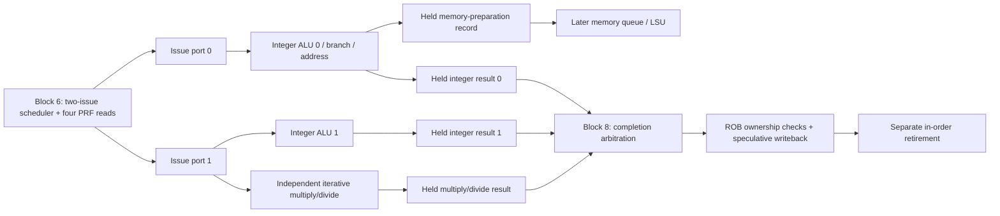

# Block 7: independent integer execution and iterative multiply/divide

This is the execution hardware inside the EX section. The issue queue from block 6 now sends
selected instructions to real arithmetic circuits. Two integer paths can accept a pair, while
an independent iterative multiply/divide unit keeps working on an earlier instruction.

The connected demonstration uses real execution results. It feeds legitimate decoded
instructions directly into rename because instruction fetch is a later block. Completion
selection in that testbench is a temporary test driver; the production arbiter is block 8.

## 1. Your example: ADD finishes while an older DIV keeps running

```asm
# Earlier ADDI instructions establish x1=100, x2=4, x3=7, x4=9.
div x5, x1, x2       # Older: 100 / 4 = 25, iterative execution.
add x6, x3, x4       # Independent: 7 + 9 = 16, integer execution.
add x7, x5, x6       # Dependent: waits for both physical results, then produces 41.
```

DIV uses issue port 1 to enter the multiply/divide unit. ADD uses issue port 0 to enter the
first integer ALU on the same edge. Once DIV is inside its unit, that unit's busy state does
not reserve either integer ALU. A later independent integer pair can use both ALUs while
DIV continues its iterations.

On acceptance, DIV leaves its IQ slot but keeps its ROB entry. Its execution unit retains the
full identity until completion, while the freed IQ capacity can admit more work.

The divider's intermediate state is private to that instruction. ADD's completed result has
its own output register and its own ROB/physical destination identity. Neither result can
accidentally replace the other when completion timing differs.

The connected test prints this measured sequence:

| Test cycle | Actual hardware event | Architectural consequence |
|---:|---|---|
| 6 | DIV enters iterative unit; independent ADD enters integer ALU | Both remain speculative |
| 7 | ADD completion is accepted, value 16 | Its physical register is ready; older DIV still blocks retirement |
| 39 | DIV completion is accepted, value 25 | Dependent ADD wakes and issues using completion bypass |
| 40 | Dependent ADD completion is accepted, value 41 | DIV and independent ADD retire together, in order |
| 41 | Dependent ADD's registered completion is eligible | Dependent ADD retires with value 41 |

These are testbench cycle numbers measured at acceptance boundaries. A unit's registered
result can become valid just after an edge and be accepted on the next edge. The divider
accepts at E0, performs iterations at E1 through E32, then offers its result for acceptance.
Do not count the acceptance edge as the first iteration.

## 2. Where this block connects



Port 0's completion and memory-preparation outputs share one occupied slot; only one is valid
at a time. Port 1 selects either ALU 1 or multiply/divide for its newly issued instruction.
The resources have independent retained state, so an already-running DIV and later ALU 1
instructions can overlap. Issue remains limited to two new instructions per edge.

There can be three completed arithmetic results at once: an older DIV can finish on the same
edge as a younger integer pair. Three completion channels therefore feed the future two-wide
arbiter. Each producer retains an unaccepted result. Three available results do not imply
three write ports or three issues per cycle.

## 3. Modules and signal ownership

rv32_integer_execute is instantiated twice. CONTROL_ENABLE=1 enables integer, branch, jump,
and address work on port 0. CONTROL_ENABLE=0 supports integer work on port 1. An accidentally
misrouted class becomes an illegal-instruction completion and a diagnostic; it is not silently
consumed without an owner/result.

rv32_muldiv_execute has its own arithmetic registers and state machine. rv32_execution_cluster
connects these resources to the two scheduler ports and combines cancellation acknowledgments.
There is no CSR/system engine in this block; the scheduler's system sink remains a later connection.

| Unit signal | Width | Source → destination | Meaning |
|---|---:|---|---|
| clk_i, rst_ni | 1 each | Common clock/reset → unit | Rising-edge state; active-low asynchronous reset |
| request_i | 364 | IQ/PRF → unit | Renamed instruction plus two raw 32-bit source values |
| request_valid_i | 1 | Selected issue port → unit | Capture pulse on an advertised-ready edge |
| request_ready_o | 1 | Unit → scheduler | Capacity available before instruction selection |
| completion_o | 222 | Unit → completion arbiter | Full owner, destination intent, value, exception, actual next PC |
| completion_valid_o, completion_ready_i | 1 each | Unit ↔ arbiter | Retained result and consumer acceptance |
| memory_o | 190 | Port-0 unit → later memory queue | Prepared byte address, store value, access/fault/control metadata |
| memory_valid_o, memory_ready_i | 1 each | Port-0 unit ↔ memory queue | Retained preparation record and acceptance |
| cancel_i | 1 | Recovery controller → unit | Stop publication/admission; clear executing and buffered work at edge |
| cancel_done_o | 1 | Unit → recovery controller | Registered acknowledgment of the cancellation edge |
| busy_o | 1 | Unit → status | Arithmetic in progress or an output still held |
| quiescent_o | 1 | Unit → recovery controller | No executing owner and no held output remains |
| protocol_error_o | 1 | Unit → integration diagnostics | Issue without capacity, or a misrouted operation |

The cluster presents issue_fire_i[1:0] and issue_packet_i to these units. Its alu0_ready_o,
alu1_ready_o, and muldiv_ready_o connect directly to the matching block-6 inputs.
memory_ready_o advertises the shared port-0 slot's capacity; it differs from memory_ready_i,
which acknowledges a previously prepared output. An empty slot may capture one address while
the downstream memory queue is temporarily unable to accept it.

The cluster exports a pair of ALU completions and a separate multiply/divide completion,
with independent readiness inputs. busy_o[0], [1], [2] describe ALU 0, ALU 1, and multiply/divide.
Cluster quiescence and cancellation acknowledgment require all three units to agree.

The shared memory_entry_t record gains control_flow in this block. The memory engine must
preserve the verified next PC and possible stale-prediction mismatch until it completes the
load/store. A prepared address must not mark the ROB instruction complete before the memory
response arrives.

## 4. Integer execution at circuit level

The block-2 ALU and branch comparator are reused rather than reimplemented. Each integer
instance has operand-selection multiplexers ahead of its ALU:

- Operand A selects raw rs1, zero for LUI, or the instruction PC for AUIPC.
- Operand B selects raw rs2 or the decoder's sign-extended immediate.
- The ALU control selects addition/subtraction, shift, comparison, or Boolean logic.

The combinational result enters a registered output slot on the accepted issue edge. That
slot includes all completion metadata, so changing the next request cannot change the held
result. No architectural register storage is written in this module.

When an old result is accepted, the integer slot can capture a new instruction on the same
edge. This supports one result per integer path per cycle after filling, subject to issue and
writeback capacity. A busy integer slot can therefore still be request-ready if its old output
will be accepted. The iterative unit uses a simpler contract and does not refill on its result-pop edge.

The long combinational path can include accepted-result wakeup, IQ selection, PRF bypass/read,
operand muxes, and the ALU before the execution-result register. Its actual timing must be
checked in Vivado; simulation alone does not prove the 50 MHz target.

## 5. Branches, jumps, and next-PC verification

Branches compare the two raw register values, independently of the integer operand muxes.
A taken branch selects PC + immediate; a not-taken branch selects PC + 4. JAL selects its
PC-relative target and returns PC + 4 as the link value. JALR adds rs1 + immediate, clears target
bit 0, and returns the link value. With this core's four-byte instruction alignment, a taken
branch/jump whose final target has nonzero low two bits produces an instruction-address fault.
A not-taken branch does not fault because its unused target is misaligned.
These rules follow the [RV32I specification](https://docs.riscv.org/reference/isa/v20260120/unpriv/rv32.html).

The completion contains actual next PC, control-flow type, direction, and whether next PC
matched the carried prediction. Ordinary integer operations also compare PC + 4 against the
prediction: a stale BTB entry on an instruction that is no longer a branch must be recoverable.
The multiply/divide and memory-preparation paths preserve this check too.

This block reports the resolution; it does not directly flush fetch or restore rename maps.
The ROB records it, and the later recovery controller applies the retirement-based policy.
Faults take priority: a fault completion does not simultaneously request prediction recovery.
A faulting JAL/JALR retains its decoded destination intent for ROB ownership checks, while
exception.valid prevents the later PRF write.

## 6. Address generation is separate from a memory transaction

Loads and stores calculate the original byte address as rs1 + immediate. Store data remains
the raw, unshifted rs2 value. A byte address can use any byte lane; halfwords require bit 0=0,
and words require bits [1:0]=00. Misalignment records load/store cause 4/6 and the original
address in exception.tval. Byte-lane selection, write strobes, load extension, bus faults, and
exactly-once transactions belong to the later LSU.

The retained memory record contains prepared=1 and its complete ROB tag. It carries the
size, signed/unsigned-load flag, physical destination intent, store value, address, exception,
and actual-next-PC information. No AXI signal is generated here. Even a prepared wrong-path
store has no external effect. Actual transactions remain restricted to the live incomplete
ROB head by the agreed memory-engine design.

An existing fetch exception is retained ahead of newly discovered target/alignment faults.
Unsupported routed classes become illegal-instruction faults. Fault values are unusable;
accepted completion gating, not a convenient numeric result, controls physical writes and wakeup.

## 7. Iterative multiplication: reuse an adder over 32 cycles

The multiply datapath has a 64-bit product accumulator, a 64-bit shifted multiplicand, a
32-bit multiplier, a five-bit iteration counter, and a final sign-correction path. Counts 0
through 31 represent the 32 iterations; the counter does not need to hold the value 32.

```text
 multiplier bit 0 ----> select add / retain accumulator
                            |
 product register ------> 64-bit adder <------ shifted multiplicand register
                            |
                     next product register
 multiplier shifts right             multiplicand shifts left
```

For each iteration, add the multiplicand when the current multiplier bit is one, then move
to the next bit. After 32 iterations, every multiplier bit has contributed. Signed variants
first convert the required operands to unsigned magnitudes, then conditionally negate the
complete 64-bit product before selecting its architectural half. MUL needs only the low half;
its low bits are identical under signed and unsigned interpretation.

| Operation | Interpretation and selected result |
|---|---|
| MUL | Low 32 product bits |
| MULH | High 32 bits, signed × signed |
| MULHSU | High 32 bits, signed rs1 × unsigned rs2 |
| MULHU | High 32 bits, unsigned × unsigned |

These result definitions come from the
[RISC-V M specification](https://docs.riscv.org/reference/isa/v20260120/unpriv/m-st-ext.html).
The iterative algorithm is this project's implementation choice. The synthesizable module
uses no multiply, divide, remainder, or exponent operator. It describes shifts, additions,
subtractions, comparisons, registers, and control. No DSP inference or resource count is
claimed without synthesis.

## 8. Iterative division: shift, compare, subtract

Division uses a 33-bit partial remainder, 32-bit quotient register, divisor magnitude, sign
flags, and the same iteration count/control machinery. Initially the quotient register contains
the dividend magnitude. On each iteration:

1. Shift the partial remainder left and bring in the next unprocessed dividend bit.
2. Compare that trial value with the zero-extended divisor.
3. If subtraction fits, retain the difference and shift a one into the quotient; otherwise
   retain the trial remainder and shift in zero.
4. After 32 iterations, apply the quotient and remainder sign rules and select the result.

The extra remainder bit retains the carry produced by the shift before comparison. Once a
nonzero divisor has been subtracted as needed, the next retained remainder again fits in 32 bits.

For an easily followed four-bit illustration of 13 / 3, the same algorithm consumes 1101:

| Input bit | Trial remainder | Subtract 3? | Next remainder | Quotient bit |
|---:|---:|---|---:|---:|
| 1 | 1 | No | 1 | 0 |
| 1 | 3 | Yes | 0 | 1 |
| 0 | 0 | No | 0 | 0 |
| 1 | 1 | No | 1 | 0 |

The quotient bits are 0100 = 4 and the remainder is 1. The actual module applies this recurrence
to all 32 bits; this small example is an explanation, not another configurable hardware variant.

Signed DIV rounds toward zero; REM follows the dividend's sign. DIVU and REMU use unsigned
operands. Division by zero returns all-one quotient bits or the original dividend as remainder.
The signed overflow pair 0x80000000 / 0xffffffff returns 0x80000000 with remainder zero. These
conditions produce defined values without an arithmetic trap, as required by the
[M specification](https://docs.riscv.org/reference/isa/v20260120/unpriv/m-st-ext.html).

This module uses 32 iterations even for these edge cases. A divide-by-zero flag selects the
required final value. The magnitude/sign datapath naturally produces the signed-overflow result.
There is no early-out, quotient/remainder fusion, or multiply/divide pipelining in this version.

## 9. State machines, output holding, and cancellation

The iterative control states are IDLE → MULTIPLY or DIVIDE → RESPONSE → IDLE. A valid request
captures one owner in IDLE; RESPONSE retains its completion until accepted. It cannot accept
a new owner on the response-pop edge. An unexpected inherited fault or misrouted class responds
without arithmetic iterations, retaining the original owner and precise fault metadata.

The integer path uses valid and is_memory state rather than a multicycle arithmetic state
machine. Its one slot retains either a completion or address record. The selected consumer's
ready signal permits removal or same-edge replacement; the other consumer cannot pop it.

The request interface is the scheduler's capture pulse, not a producer holding valid through
backpressure. Capacity must be advertised first; issue only pulses for an accepting resource.
An issue pulse without capacity is diagnosed and cannot overwrite a held owner. Completion
outputs use ordinary retained valid/ready semantics: all payload bits stay stable while valid
and not accepted, except when cancellation withdraws the speculative work.

Cancellation masks request-ready and publication-valid immediately. At the edge, it clears
arithmetic progress and output slots, and registers cancel_done. Quiescent reports the actual
empty state, so it does not become true merely because cancel is asserted before that edge.
The cluster acknowledges only after all three units have cleared. A simultaneous new issue or
completion-ready cannot defeat cancellation.

The later recovery controller must also stop IQ issue, deal with completion arbitration and
memory ownership, and only then apply ROB/rename/IQ restoration and permit resource reuse.
This block's local cancellation is one part of that barrier, not the full recovery controller.

## 10. Tests and waveform guidance

The standalone testbench compares multiply/divide against behavioral wide multiplication,
division, and remainder. Those operators appear only in the test oracle. It also verifies
integer operand muxes, ALU operations, branch conditions, jump alignment, address records,
inherited-fault priority, backpressure, replacement, reset, and cancellation boundaries.

The connected test uses rename, ROB, physical registers, IQ, these execution units, and trace.
Real ADDI instructions initialize the source values; results are not injected into the PRF.
It checks the opening DIV/ADD example, dependent wakeup, in-order retirement, three simultaneous
held results, cancellation-before-reuse, and ROB generation changes. Its temporary completion
selector is explicitly test-only and is not the block-8 implementation.

```sh
python3 scripts/run_checks.py --block 7
python3 scripts/run_checks.py --block 7 --waves
```

Current Icarus evidence is **121,060 standalone checks + 658 connected checks = 121,718 checks,
zero failures**. Reports contain separate case counts and exact source hashes. Optional waveforms are under
build/block07. The standalone waveform records the lead example and selected boundary cases,
pausing recording during the large arithmetic sweep to keep file size manageable. The connected
waveform records the complete demonstration.

Start with issue_fire, issued packets, unit ready/busy, all three completion-valids, accepted
ROB completions, physical write enables, retire_fire, and trace.order. In the iterative module,
inspect state_q, iteration_q, quotient_q, remainder_q, and product_q. Watch the ADD result while
state_q remains DIVIDE, then observe that completion acceptance and retirement occur separately.

For Vivado XSim on Linux, source your Vivado settings first, then run the standalone case:

```sh
xvlog --sv rtl/rv32_ooo_pkg.sv rtl/rv32_alu.sv rtl/rv32_branch_compare.sv \
  rtl/rv32_integer_execute.sv rtl/rv32_muldiv_execute.sv tb/tb_block07.sv
xelab tb_block07 -s block07_sim
xsim block07_sim --runall
```

The connected test additionally needs rv32_rename.sv, rv32_physical_regfile.sv,
rv32_reorder_buffer.sv, rv32_trace_recorder.sv, rv32_issue_queue.sv, and
rv32_execution_cluster.sv before tb_block07_integration.sv. No decoder is instantiated in
that case: the test directly supplies the documented decoded controls.

Vivado/XSim, synthesis, timing, DRC, and bitstream generation remain unverified here. These
execution tests do not establish whole-core ISA compliance, fetch correctness, memory-bus
behavior, CSR/interrupt delivery, or complete recovery coordination.

## 11. Interview questions

**How can two-issue hardware have three execution units?** The issue width limits new work per
edge. An older multicycle operation can remain active while later issues use other resources.

**Why keep three completion channels with only two write ports?** Different-latency operations
can finish together. Arbitration selects at most two; every other producer retains its result.

**Does ADD completing first violate program order?** No. Its physical write is speculative;
the ROB still retires older DIV first and preserves precise exceptions.

**Why use an iterative multiplier on an FPGA?** It demonstrates arithmetic-state reuse and
limits parallel arithmetic hardware. Throughput is lower than a pipelined multiplier; actual
FPGA area/timing tradeoffs require synthesis measurements.

**How is MULHSU different from MULH?** Only rs1 is signed for MULHSU. Treating rs2 as signed
would corrupt high-half results when rs2 has its top bit set.

**Why is the partial remainder 33 bits?** Shifting a 32-bit remainder and inserting a dividend
bit can temporarily require one additional bit before compare/subtract.

**Why is divide by zero not a trap here?** RV32M defines its quotient/remainder values.
The execution unit returns them normally; software may add a branch if its language needs a check.

**Why preserve destination intent on a fault?** The ROB checks it against the allocated owner.
The separate exception flag suppresses the physical write and wakeup.

**Why can't cancellation simply reset the iteration counter?** A result may already be held
in RESPONSE. Cancellation must remove both arithmetic state and every buffered owner/result.

**What prevents a prepared wrong-path store from writing a peripheral?** Address preparation
has no bus interface. Only the later memory engine can issue a transaction at the ROB head.

**Is the 50 MHz target proved now?** No. Cycle-accurate functional simulation and FPGA timing
analysis answer different questions. Vivado implementation must measure the actual path delays.

## 12. Source ownership

These modules are custom RTL, with ISA behavior checked against the primary RISC-V references
linked above. No third-party RTL was copied. Naming, procedural blocks, and intent-focused
comments follow the project's established lowRISC-inspired style.
