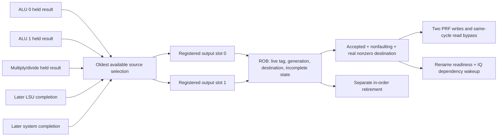

# Block 8: completion arbitration and accepted speculative writeback

This block occupies the completion part of WB. It replaces block 7's test-only selector with
real RTL: five producer channels share two registered result buffers, followed by ROB ownership
checks and accepted-value broadcast. Architectural retirement remains the separate ROB-head
operation from block 5.

rv32_completion_arbiter owns the two buffers and source selection. rv32_writeback instantiates
it and generates the physical write ports and dependency-wakeup broadcasts. The register file,
rename unit, issue queue, and ROB remain separate modules connected by these signals.

## 1. Your example: three results finish, but only two ports exist

Assume an older DIV finishes on the same edge as two younger integer operations. The execution
cluster now has three valid completions, each in its own retained output register:

| Source | ROB age | Result | What arbitration chooses |
|---|---:|---:|---|
| Multiply/divide, source 2 | 0 | 25 | First available arbiter slot |
| ALU 0, source 0 | 1 | 16 | Second available arbiter slot |
| ALU 1, source 1 | 2 | 104 | Remains in ALU 1 until capacity opens |

The source-ready mask is 00101: sources 2 and 0 transfer, while source 1 holds its full packet.
The arbiter does not replace a result just because it has the same instruction class, and no
physical register changes merely because a source was selected.

There are two different acceptance boundaries:

1. **Source capture:** source_valid and source_ready transfer a packet into an arbiter register.
   Its execution unit can then reuse its output slot.
2. **ROB consumption:** completion_valid and completion_ready transfer that buffered packet to
   ownership checking. A consumed packet may be accepted or rejected. Only accepted, nonfaulting
   register results can write physical registers and wake dependent instructions.

A simple stalled sequence is:

| Edge | Source transfers | ROB transfers | State after the edge |
|---|---|---|---|
| E0 | DIV and ALU 0 enter arbiter buffers | None for these newly captured packets | Two buffered packets; ALU 1 still holds its result |
| E1, while ROB-ready is low | None | None | Both arbiter packets and ALU 1's packet remain unchanged |
| E2, when both consumers are ready | ALU 1 enters a newly freed slot | DIV and ALU 0 are consumed | Only ALU 1 remains buffered |
| E3 | Other waiting sources may fill free slots | ALU 1 is consumed | No result is lost or counted twice |

The connected test synchronizes three actual execution-unit completions and checks this
selection, holding, and dual-pop/refill behavior. Its stalled ROB connection is a test-controlled
backpressure case; normal live ROB entries already have allocated completion storage.

## 2. Connections in the WB section



The memory source accepts an eventual **completion_t from the LSU**, after its response or
fault has been resolved. It must not be connected to the integer unit's memory_entry_t address
preparation output. A prepared address is not a completed load/store.

The system source is reserved for the serialized CSR/system engine. Memory and system engines
remain later blocks; their producer-valid bits are zero in the connected arithmetic demonstration.
The arbiter itself implements all five channels, which are exercised by the standalone tests.

## 3. Signal table and record layout

completion_sources_t is a new packed record in the shared package. From least to most
significant bits, its five 222-bit fields are alu0_result, alu1_result, muldiv_result,
memory_result, and system_result. The matching valid/ready index uses exactly that order.
These are five producer positions, not five issue lanes.

| Signal | Width | Source → destination | Meaning |
|---|---:|---|---|
| clk_i, rst_ni | 1 each | Common clock/reset → WB | Rising-edge state; active-low asynchronous reset |
| sources_i | 1,110 | Five producer output registers → arbiter | Full completion packets |
| source_valid_i | 5 | Producers → arbiter | Independent available packets; any mask is legal |
| source_ready_o | 5 | Arbiter → producers | Selected packets transfer into buffers on this edge |
| rob_head_index_i | 4 | ROB → arbiter | Reference for modular program-age priority |
| completion_o / rob_completion_o | 444 | Arbiter buffers → ROB | Two stationary completion packets |
| completion_valid_o / rob_completion_valid_o | 2 | Arbiter → ROB | Independent occupied output lanes |
| completion_ready_i / rob_completion_ready_i | 2 | ROB → arbiter | Each lane's consumption permission |
| rob_completion_accepted_i | 2 | ROB → writeback gate | Consumed packets that passed actual owner checks |
| broadcast_o | 444 | Writeback gate → rename/IQ | Enabled accepted register-result packets; disabled lanes are zero |
| broadcast_valid_o | 2 | Writeback gate → rename/IQ | Accepted, nonfaulting, nonzero-register writes only |
| write_enable_o | 2 | Writeback gate → PRF | Same enabled-result mask as broadcast_valid_o |
| write0_addr_o, write1_addr_o | 6 each | Writeback gate → PRF | Physical destination identities |
| write0_data_o, write1_data_o | 32 each | Writeback gate → PRF | Corresponding accepted values |
| occupancy_o | 2 | Arbiter → status/recovery | Number of occupied buffers, 0 through 2 |
| quiescent_o | 1 | Arbiter → recovery controller | Both local buffers are actually empty |
| cancel_i, cancel_done_o | 1 each | Recovery control ↔ arbiter | Dominant speculative clear and registered acknowledgment |
| protocol_error_o | 1 | Arbiter/writeback → diagnostics | Duplicate owners or inconsistent accepted feedback |

The standalone arbiter uses completion_* names; the wrapper's ROB-facing equivalents use
rob_completion_*. Their payload and handshake meaning is the same. The wrapper does not
instantiate the ROB or PRF: their explicit connections are shown in the connected testbench.

## 4. Priority selection and the inferred circuit

For a candidate, age is `(ROB index - current ROB head index) modulo 16`. With head index 14,
indices 14, 15, 0 have ages 0, 1, 2. Among available source packets, the smallest age wins;
equal ages use the lower source index. Legitimate distinct live instructions have distinct
positions in the current ROB window. Generation remains in the packet for ownership checks;
it is not used as a numerical age.

The circuit forms five ages, compares eligible candidates, selects one packet through a
five-input payload multiplexer, removes that source from the temporary candidate mask, and
selects the next winner if another buffer can accept it. A source cannot transfer twice on
one edge. The first winner fills the lowest-numbered available output slot.

Each output buffer retains 222 payload bits and one validity bit: 446 state bits total before
implementation optimization. Occupancy is calculated from the two valid bits. The RTL also
describes age comparators, selection/mux logic, and duplicate-owner diagnostics. These are RTL
storage/logic descriptions; Vivado must determine actual FPGA resource use and timing.

A source is eligible for capture only when valid. Producers must therefore assert and hold
valid independently of ready; waiting for ready before presenting valid would deadlock this
interface. The existing execution units already follow this retained-result contract.

A source with a stale generation is not trusted merely because its index appears old. The
arbiter carries it onward; the ROB rejects it. Candidate age is scheduling information, not
proof of ownership. Rejected packets must drain even when the ROB has no live instructions.

## 5. Registered slots, stable lanes, and throughput

A packet captured at E0 first appears as a registered ROB-facing output after E0 and can be
consumed at E1. There is no transparent source-to-ROB bypass. This adds one completion-stage
cycle relative to block 7's direct test selector, while permitting up to two source captures
and two ROB consumptions per cycle once the buffers are flowing.

Each buffer is independent. Its old packet can be consumed and replaced by a new source on
the same edge. If lane 0 is consumed while lane 1 stalls, lane 1 stays exactly where it is.
No compaction or later age update can move a stalled payload to another lane.

Consequently a valid mask of 10 is legal here: only completion lane 1 can remain occupied.
This differs from dispatch and retirement, which use a program-order prefix. A newly filled
lane 0 can also hold a younger packet than the retained lane 1; completion lane numbering does
not determine architectural order.

An older result that arrives later cannot preempt an already-buffered younger packet. It wins
priority when a buffer next opens. The ROB must accept live younger completions even when its
head has not completed; tying completion readiness to head retirement could block the younger
buffers and prevent an older producer from ever entering. The implemented ROB provides separate
completion storage/handshakes and does not impose that head-only restriction.

This is still a five-logical-section OoO design. Internal queues and retained completion
registers mean instruction latency is not fixed at five clocks. Two-wide peak throughput is
also not a promise of two retired instructions every cycle.

## 6. Accepted-result gating and physical-register effects

For each output lane, the wrapper first computes:

```text
consumed = buffered_valid AND ROB_ready
accepted = consumed AND ROB_accepted
register_result = accepted AND writes_rd AND (pdst != 0) AND NOT exception.valid
```

Only register_result enables both the PRF write and the readiness/wakeup broadcast. The same
accepted value reaches PRF bypass and IQ wakeup on the same edge, so a dependent instruction
cannot observe readiness while reading an older stored value.

A consumed but rejected stale/wrong-destination packet frees its arbiter slot without writing,
waking, or retiring anything. An accepted fault completion makes the ROB entry complete-for-trap,
but does not make its destination usable. An accepted branch, store, or x0-destination result
can complete its ROB owner without a register broadcast.

ROB checks from block 5 still validate full tag/generation, incomplete live ownership, pdst,
and decoded write intent. The wrapper does not replace those checks. It diagnoses accepted
feedback outside an actual valid/ready handshake and ignores such feedback for register effects.

A conforming ROB already rejects a second conflicting completion. As a defensive wiring check,
this wrapper also detects two accepted packets claiming the same owner, or two accepted
nonfaulting writers claiming the same nonzero physical destination. Lane 0 retains priority;
lane 1's physical write and wakeup are suppressed. This diagnostic is not a substitute for
correct allocation or a recovery mechanism for arbitrary broken external feedback.

The arbiter also diagnoses duplicate full owners among pending sources/buffers. It forwards
them through the normal path for ROB rejection, rather than silently losing a producer packet.

## 7. Completion, writeback, and retirement remain separate

The connected arithmetic demonstration now uses this production writeback path. Its real
ADDI seed instructions establish operands; the divider and ALUs calculate their own values.
The extra registered completion stage changes the measured timing from block 7:

| Test cycle | Event | What remains speculative |
|---:|---|---|
| 7 | DIV100/4 and ADD7+9 issue together | Both instructions |
| 9 | Independent ADD completion accepted, value 16 | Its physical value is ready; DIV still blocks retirement |
| 41 | DIV completion accepted, value 25; dependent ADD issues through bypass | Dependent ADD's result |
| 42 | DIV and independent ADD retire in order | Dependent ADD waits in its completion path |
| 43 | Dependent completion accepted, value 41 | It waits for registered ROB completion state |
| 44 | Dependent ADD retires | All three demonstrated results are committed |

The values are identical to block 7; the interface latency differs. Earlier guides retain
their measured timing and clearly identify their direct test selector. This guide describes
the added production WB hardware.

Physical writeback does not update the committed rename map or release an old committed
physical register. Those events still occur only when the ROB retires an instruction in
program order. A younger result can therefore be written speculatively without making a
later older exception imprecise.

## 8. Cancellation and recovery boundaries

cancel_i immediately masks source-ready, ROB-facing valid, broadcasts, and physical writes.
At its clock edge, it clears both payload/valid registers and registers cancel_done. A
simultaneous source or ROB handshake cannot win over cancellation. Quiescent becomes true
when those local buffers are actually empty, not merely when cancel is asserted.

Arbiter emptiness alone does not mean the processor is quiescent. A divider may still be
iterating or another producer may hold a result. Recovery must cancel/drain the execution
cluster, this writeback block, memory ownership, and later system paths before restoring
maps/queues and reusing tags or physical destinations. The connected test waits for both
execution and writeback acknowledgment/quiescence before safe apply.

Admission hold for a pending redirect or interrupt must still allow older results to complete
and retire. Cancellation is the later ownership-clear barrier; it must not be used to freeze
older work needed to reach the precise boundary. The complete controller remains block 11.

## 9. Verification and waveform reading

The standalone testbench independently tracks both buffer slots, source consumption, candidate
priority, accepted masks, and expected register effects. It covers all source-valid and sink-ready
masks, ROB wraparound, tied ages, partial output stalls, simultaneous pop/refill, faults,
nonwriters, x0, malformed accepted feedback, duplicate owners/destinations, cancellation, and reset.

The connected test uses the real rename, ROB, PRF, IQ, execution cluster, writeback, and trace.
It checks actual out-of-order arithmetic, three synchronized completions, retained packets,
accepted-value wiring, and cancellation-before-reuse. The reserved memory/system source interfaces
also carry explicitly synthetic stale-generation and wrong-destination packets through the real
ROB. Both are consumed/rejected without physical writes, wakeup, readiness/free-list changes,
or retirement; the legitimate owner then executes normally. These packet-injection tests do
not implement memory/system engines.

```sh
python3 scripts/run_checks.py --block 8
python3 scripts/run_checks.py --block 8 --waves
```

Current Icarus evidence is **52,221 standalone checks + 890 connected checks = 53,111 checks,
zero failures**. The report records separate case counts and exact compiled-source hashes. Optional VCD files
are under build/block08. Start with source_valid/source_ready, arbiter occupancy, buffered
completion-valid/ready, ROB accepted/rejected, broadcast-valid, PRF write enables, retire_fire,
and trace.order. Distinguish a producer leaving its buffer from its destination actually becoming
ready. During a stall, watch each valid output lane's entire payload remain unchanged.

To simulate the standalone case with Vivado XSim on Linux:

```sh
xvlog --sv rtl/rv32_ooo_pkg.sv rtl/rv32_completion_arbiter.sv \
  rtl/rv32_writeback.sv tb/tb_block08.sv
xelab tb_block08 -s block08_sim
xsim block08_sim --runall
```

The connected case also needs the block-7 integration source modules listed in the runner,
with tb_block08_integration.sv as top. The input remains a controlled decoded stream; instruction
fetch and the complete processor top are later blocks. Vivado/XSim, timing, DRC, and bitstream
results remain unverified here. Directed/generated block tests are not ISA certification.

## 10. Interview questions

**Why can three results finish in a two-issue processor?** A long operation issued earlier
can finish alongside a later integer pair. Issue width and completion arrival count differ.

**Where does the third result wait?** In its producer's retained output register until a
source-ready edge transfers it into an available arbiter buffer.

**Does source-ready mean the destination register is ready?** No. It means the arbiter captured
the packet. Destination readiness requires a subsequent accepted, nonfaulting ROB completion.

**Why do the output slots stay stationary?** A valid packet under backpressure must remain
stable on its interface. Moving it to another lane would change which transfer the consumer sees.

**Can completion mask 10 be valid?** Yes. Completion ports are independent. Dispatch and
retirement instead use an ordered prefix, so their validity contracts are different.

**Does a generation field choose the oldest instruction?** No. Current live-window index
distance supplies age; full tag/generation supplies ownership for rejection of recycled uses.

**Why must IQ wakeup and PRF bypass share a mask/value?** If readiness comes from an unaccepted
or different result, a dependent can execute with stale data even though the tag appears ready.

**Why can a fault complete without broadcasting?** Its ROB entry needs the fault information
for a precise trap. Its destination value must not become usable by dependent instructions.

**What protects against a delayed wrong-path result?** Producer/buffer cancellation and
quiescence prevent unsafe reuse; ROB tag/generation/destination checks reject stale packets.
Both mechanisms are required.

**Why doesn't physical writeback free the previous architectural mapping?** Completion order
can differ from program order. Retirement updates committed mappings and frees replaced versions.

## 11. Source ownership

The two modules are custom RTL. Their contracts build on this project's already tested ROB,
rename, register file, scheduler, and execution modules. No third-party RTL is copied here.

## Complete five-source completion arbiter

Source: `rtl/rv32_completion_arbiter.sv`.

```systemverilog
// WB section: five retained producer channels share two registered result slots.
// Capturing a source frees its producer, but does not yet write any physical register.
`timescale 1ns / 1ps

module rv32_completion_arbiter
  import rv32_ooo_pkg::*;
(
  input  logic                 clk_i,
  input  logic                 rst_ni,
  input  logic [COMPLETION_SOURCE_COUNT-1:0] source_valid_i,
  output logic [COMPLETION_SOURCE_COUNT-1:0] source_ready_o,
  input  completion_sources_t  sources_i,
  input  rob_index_t           rob_head_index_i,
  output logic [1:0]           completion_valid_o,
  input  logic [1:0]           completion_ready_i,
  output completion_pair_t     completion_o,
  input  logic                 cancel_i,
  output logic                 cancel_done_o,
  output logic                 quiescent_o,
  output logic [1:0]           occupancy_o,
  output logic                 protocol_error_o
);
  completion_t slots_q [2];
  completion_t slots_d [2];
  logic [1:0] valid_q, valid_d;

  function automatic int program_age(input rob_index_t index, input rob_index_t head);
    rob_index_t distance;
    begin
      distance = index - head;
      program_age = int'(distance);
    end
  endfunction

  // Registered slots own the output payload. A stalled lane never moves lanes,
  // even if an older result appears or the other lane is consumed/refilled.
  always_comb begin
    completion_valid_o = '0;
    completion_o = '0;
    if (rst_ni && !cancel_i) begin
      completion_valid_o = valid_q;
      if (valid_q[0]) completion_o.lane0 = slots_q[0];
      if (valid_q[1]) completion_o.lane1 = slots_q[1];
    end
    occupancy_o = {1'b0, valid_q[0]} + {1'b0, valid_q[1]};
    quiescent_o = valid_q == 0;
  end

  always_comb begin : select_sources
    completion_t packets [COMPLETION_SOURCE_COUNT];
    completion_t packet, other_packet, buffered;
    logic [COMPLETION_SOURCE_COUNT-1:0] selected;
    int ages [COMPLETION_SOURCE_COUNT];
    int best;

    packets[0] = sources_i.alu0_result;
    packets[1] = sources_i.alu1_result;
    packets[2] = sources_i.muldiv_result;
    packets[3] = sources_i.memory_result;
    packets[4] = sources_i.system_result;
    for (int i = 0; i < COMPLETION_SOURCE_COUNT; i++) begin
      packet = packets[i];
      ages[i] = program_age(packet.rob_tag.index, rob_head_index_i);
    end
    selected = '0;
    source_ready_o = '0;
    valid_d = valid_q;
    for (int lane = 0; lane < 2; lane++) slots_d[lane] = slots_q[lane];
    best = -1;
    protocol_error_o = 1'b0;
    packet = '0;
    other_packet = '0;
    buffered = '0;

    if (rst_ni && !cancel_i) begin
      for (int lane = 0; lane < 2; lane++) begin
        // Only this lane's consumer can free its slot. Pop and refill can coincide.
        if (!valid_q[lane] || completion_ready_i[lane]) begin
          valid_d[lane] = 1'b0;
          best = -1;
          for (int i = 0; i < COMPLETION_SOURCE_COUNT; i++) begin
            if (source_valid_i[i] && !selected[i]
                && (best < 0 || ages[i] < ages[best])) best = i;
          end
          if (best >= 0) begin
            slots_d[lane] = packets[best];
            valid_d[lane] = 1'b1;
            selected[best] = 1'b1;
            source_ready_o[best] = 1'b1;
          end
        end
      end

      // Each live instruction has one completion owner. Duplicate packets still
      // flow to ROB rejection; this diagnostic never substitutes for its checks.
      for (int i = 0; i < COMPLETION_SOURCE_COUNT; i++) begin
        packet = packets[i];
        for (int j = 0; j < COMPLETION_SOURCE_COUNT; j++) begin
          other_packet = packets[j];
          if (j > i && source_valid_i[i] && source_valid_i[j]
              && packet.rob_tag == other_packet.rob_tag) protocol_error_o = 1'b1;
        end
        for (int lane = 0; lane < 2; lane++) begin
          buffered = slots_q[lane];
          if (source_valid_i[i] && valid_q[lane]
              && packet.rob_tag == buffered.rob_tag) protocol_error_o = 1'b1;
        end
      end
      packet = slots_q[0];
      other_packet = slots_q[1];
      if (&valid_q && packet.rob_tag == other_packet.rob_tag) protocol_error_o = 1'b1;
    end
  end

  always_ff @(posedge clk_i or negedge rst_ni) begin
    if (!rst_ni) begin
      valid_q <= '0;
      slots_q[0] <= '0;
      slots_q[1] <= '0;
      cancel_done_o <= 1'b0;
    end else begin
      cancel_done_o <= cancel_i;
      if (cancel_i) begin
        valid_q <= '0;
        slots_q[0] <= '0;
        slots_q[1] <= '0;
      end else begin
        valid_q <= valid_d;
        slots_q[0] <= slots_d[0];
        slots_q[1] <= slots_d[1];
      end
    end
  end
endmodule
```

## Complete accepted-value writeback wrapper

Source: `rtl/rv32_writeback.sv`.

```systemverilog
// Speculative writeback boundary: source buffering, ROB checks, and accepted-value broadcast.
// Architectural commitment remains a separate, program-ordered ROB operation.
`timescale 1ns / 1ps

module rv32_writeback
  import rv32_ooo_pkg::*;
(
  input  logic                 clk_i,
  input  logic                 rst_ni,
  input  logic [COMPLETION_SOURCE_COUNT-1:0] source_valid_i,
  output logic [COMPLETION_SOURCE_COUNT-1:0] source_ready_o,
  input  completion_sources_t  sources_i,
  input  rob_index_t           rob_head_index_i,
  output logic [1:0]           rob_completion_valid_o,
  input  logic [1:0]           rob_completion_ready_i,
  output completion_pair_t     rob_completion_o,
  input  logic [1:0]           rob_completion_accepted_i,
  output logic [1:0]           broadcast_valid_o,
  output completion_pair_t     broadcast_o,
  output logic [1:0]           write_enable_o,
  output phys_reg_t            write0_addr_o,
  output phys_reg_t            write1_addr_o,
  output word_t                write0_data_o,
  output word_t                write1_data_o,
  input  logic                 cancel_i,
  output logic                 cancel_done_o,
  output logic                 quiescent_o,
  output logic [1:0]           occupancy_o,
  output logic                 protocol_error_o
);
  logic arbiter_error;

  rv32_completion_arbiter arbiter (
    .clk_i(clk_i), .rst_ni(rst_ni),
    .source_valid_i(source_valid_i), .source_ready_o(source_ready_o), .sources_i(sources_i),
    .rob_head_index_i(rob_head_index_i), .completion_valid_o(rob_completion_valid_o),
    .completion_ready_i(rob_completion_ready_i), .completion_o(rob_completion_o),
    .cancel_i(cancel_i), .cancel_done_o(cancel_done_o), .quiescent_o(quiescent_o),
    .occupancy_o(occupancy_o), .protocol_error_o(arbiter_error)
  );

  always_comb begin : accepted_writeback
    logic [1:0] consumed, accepted, register_result;
    logic owner_conflict, destination_conflict;
    completion_t first, second;

    first = rob_completion_o.lane0;
    second = rob_completion_o.lane1;
    consumed = rob_completion_valid_o & rob_completion_ready_i;
    accepted = rob_completion_accepted_i & consumed;
    register_result[0] = accepted[0] && first.writes_rd && first.pdst != 0
                         && !first.exception.valid;
    register_result[1] = accepted[1] && second.writes_rd && second.pdst != 0
                         && !second.exception.valid;
    owner_conflict = (&accepted) && first.rob_tag == second.rob_tag;
    destination_conflict = (&register_result) && first.pdst == second.pdst;
    // A conforming ROB already rejects the second conflicting owner. This
    // defensive gate also protects the PRF if accepted feedback is miswired.
    if (owner_conflict || destination_conflict) register_result[1] = 1'b0;

    broadcast_valid_o = '0;
    broadcast_o = '0;
    protocol_error_o = 1'b0;
    if (rst_ni && !cancel_i) begin
      broadcast_valid_o = register_result;
      if (register_result[0]) broadcast_o.lane0 = first;
      if (register_result[1]) broadcast_o.lane1 = second;
      protocol_error_o = arbiter_error || owner_conflict || destination_conflict
                         || |(rob_completion_accepted_i & ~consumed);
    end
    write_enable_o = broadcast_valid_o;
    write0_addr_o = broadcast_o.lane0.pdst;
    write1_addr_o = broadcast_o.lane1.pdst;
    write0_data_o = broadcast_o.lane0.value;
    write1_data_o = broadcast_o.lane1.value;
  end
endmodule
```

## Complete arbitration/writeback testbench

Source: `tb/tb_block08.sv`.

```systemverilog
// Five held result sources -> two retained completion lanes -> guarded register broadcasts.
`timescale 1ns / 1ps

module tb_block08;
  import rv32_ooo_pkg::*;

  logic clk = 0, rst_n = 1, cancel;
  logic [4:0] source_valid, arb_source_ready, wb_source_ready;
  completion_sources_t sources;
  completion_t source_data [0:4];
  rob_index_t head_index;
  logic [1:0] sink_ready, arb_valid, wb_valid, accepted, accept_allow, accepted_override;
  logic override_feedback;
  completion_pair_t arb_packet, wb_packet, broadcast;
  logic arb_done, wb_done, arb_quiet, wb_quiet, arb_error, wb_error;
  logic [1:0] arb_occupancy, wb_occupancy, broadcast_valid, write_enable;
  phys_reg_t write0_addr, write1_addr;
  word_t write0_data, write1_data;

  logic [1:0] ref_valid;
  completion_t ref_packet [0:1];
  logic ref_ack;
  logic [4:0] selected_sources;
  integer selected_for_slot [0:1];
  logic [1:0] expected_visible;
  completion_pair_t expected_packets;
  logic expected_arb_error;
  integer checks = 0, failures = 0, serial_number = 1;
  integer source_accept_count = 0, sink_consume_count = 0;
  integer a, b, c, d, e, mask, allow_mask, case0, case1, n, i, mode;
  integer permutation [0:4];
  integer source_before, sink_before;
  completion_t packet, other_packet, retained;
  word_t rng = 32'h8c4e19ab;

  assign sources.alu0_result = source_data[0];
  assign sources.alu1_result = source_data[1];
  assign sources.muldiv_result = source_data[2];
  assign sources.memory_result = source_data[3];
  assign sources.system_result = source_data[4];
  assign accepted = override_feedback ? accepted_override : arb_valid & sink_ready & accept_allow;

  rv32_completion_arbiter arbiter (
    .clk_i(clk), .rst_ni(rst_n), .source_valid_i(source_valid),
    .source_ready_o(arb_source_ready), .sources_i(sources), .rob_head_index_i(head_index),
    .completion_valid_o(arb_valid), .completion_ready_i(sink_ready), .completion_o(arb_packet),
    .cancel_i(cancel), .cancel_done_o(arb_done), .quiescent_o(arb_quiet),
    .occupancy_o(arb_occupancy), .protocol_error_o(arb_error)
  );
  rv32_writeback writeback (
    .clk_i(clk), .rst_ni(rst_n), .source_valid_i(source_valid),
    .source_ready_o(wb_source_ready), .sources_i(sources), .rob_head_index_i(head_index),
    .rob_completion_valid_o(wb_valid), .rob_completion_ready_i(sink_ready),
    .rob_completion_o(wb_packet), .rob_completion_accepted_i(accepted),
    .broadcast_valid_o(broadcast_valid), .broadcast_o(broadcast), .write_enable_o(write_enable),
    .write0_addr_o(write0_addr), .write1_addr_o(write1_addr),
    .write0_data_o(write0_data), .write1_data_o(write1_data),
    .cancel_i(cancel), .cancel_done_o(wb_done), .quiescent_o(wb_quiet),
    .occupancy_o(wb_occupancy), .protocol_error_o(wb_error)
  );

  function automatic word_t next_random(input word_t value);
    next_random = {value[30:0], value[31] ^ value[21] ^ value[1] ^ value[0]};
  endfunction

  function automatic completion_t result_packet(input integer id, index_value);
    completion_t result;
    begin
      result = '0;
      result.rob_tag.index = index_value;
      result.rob_tag.generation = 17 + id / ROB_DEPTH;
      result.pdst = 1 + id % 63;
      result.writes_rd = id % 3 != 0;
      result.value = 32'hac510000 ^ (id * 32'h10201);
      result.exception.valid = id % 7 == 0;
      result.exception.cause = CAUSE_LOAD_ACCESS;
      result.exception.tval = 32'h20f00000 + id * 4;
      result.control_flow.is_control = id % 2;
      result.control_flow.is_conditional = id % 3 == 0;
      result.control_flow.taken = id % 4 == 0;
      result.control_flow.mispredicted = id % 5 == 0;
      result.control_flow.next_pc = 32'h400 + id * 4;
      result.memory_access.valid = id % 2;
      result.memory_access.write = id % 3 == 0;
      result.memory_access.address = 32'h1000 + id * 4;
      result.memory_access.wdata = 32'h81828384 ^ id;
      result.memory_access.wstrb = id % 16;
      result_packet = result;
    end
  endfunction

  task automatic check(input logic condition, input string label_text);
    begin
      checks = checks + 1;
      if (condition !== 1'b1) begin
        failures = failures + 1;
        if (failures <= 35) $display("FAIL: %s time=%0t", label_text, $time);
      end
    end
  endtask

  // Queue state and tag-bucket selection are independent of the RTL's comparator selection.
  // Walk ages 0..15, then source indices 0..4, and place into available slots in lane order.
  task automatic evaluate;
    integer age, source_id, source_age, slot, next_slot, count;
    completion_t first, second, left, right;
    completion_pair_t expected_broadcast;
    logic [1:0] effective_accept, candidates, expected_enables;
    logic free0, free1, duplicate_owner, duplicate_destination, feedback_error;
    logic valid_left, valid_right;
    begin
      expected_visible = rst_n && !cancel ? ref_valid : 2'b00;
      expected_packets = '0;
      if (expected_visible[0]) expected_packets.lane0 = ref_packet[0];
      if (expected_visible[1]) expected_packets.lane1 = ref_packet[1];
      check(arb_valid == expected_visible && wb_valid == expected_visible,
            "registered lane validity equals independent retained-slot model");
      check(arb_packet == expected_packets && wb_packet == expected_packets,
            "each valid lane retains its complete payload; invalid lanes are zero");
      count = (ref_valid[0] ? 1 : 0) + (ref_valid[1] ? 1 : 0);
      check(arb_occupancy == count && wb_occupancy == count,
            "occupancy counts physical retained output slots");
      check(arb_quiet == (ref_valid == 0) && wb_quiet == (ref_valid == 0),
            "quiescence describes actual empty state, including during cancel");
      check(arb_done == ref_ack && wb_done == ref_ack,
            "cancel acknowledgement follows the sampled cancellation edge");

      selected_sources = 0; selected_for_slot[0] = -1; selected_for_slot[1] = -1;
      free0 = !ref_valid[0] || sink_ready[0];
      free1 = !ref_valid[1] || sink_ready[1];
      next_slot = free0 ? 0 : (free1 ? 1 : 2);
      if (rst_n && !cancel) begin
        for (age = 0; age < ROB_DEPTH; age = age + 1) begin
          for (source_id = 0; source_id < 5; source_id = source_id + 1) begin
            first = source_data[source_id];
            source_age = (int'(first.rob_tag.index) - int'(head_index) + ROB_DEPTH) % ROB_DEPTH;
            if (source_valid[source_id] && source_age == age && next_slot < 2) begin
              selected_sources[source_id] = 1;
              selected_for_slot[next_slot] = source_id;
              if (next_slot == 0 && free1) next_slot = 1;
              else next_slot = 2;
            end
          end
        end
      end
      check(arb_source_ready == selected_sources && wb_source_ready == selected_sources,
            "source acceptance follows age buckets, source tie order, and available slot count");
      check((arb_source_ready & ~source_valid) == 0,
            "only a selected valid source observes ready");

      expected_arb_error = 0;
      if (rst_n && !cancel) begin
        for (integer item0 = 0; item0 < 7; item0 = item0 + 1) begin
          if (item0 < 5) begin left = source_data[item0]; valid_left = source_valid[item0]; end
          else begin left = ref_packet[item0-5]; valid_left = ref_valid[item0-5]; end
          for (integer item1 = item0 + 1; item1 < 7; item1 = item1 + 1) begin
            if (item1 < 5) begin right = source_data[item1]; valid_right = source_valid[item1]; end
            else begin right = ref_packet[item1-5]; valid_right = ref_valid[item1-5]; end
            if (valid_left && valid_right && left.rob_tag == right.rob_tag)
              expected_arb_error = 1;
          end
        end
      end
      check(arb_error == expected_arb_error,
            "duplicate full owners are diagnosed without filtering");

      first = ref_packet[0]; second = ref_packet[1];
      effective_accept = accepted & expected_visible & sink_ready;
      candidates[0] = effective_accept[0] && first.writes_rd && !first.exception.valid &&
                      first.pdst != 0;
      candidates[1] = effective_accept[1] && second.writes_rd && !second.exception.valid &&
                      second.pdst != 0;
      duplicate_owner = effective_accept == 3 && first.rob_tag == second.rob_tag;
      duplicate_destination = candidates == 3 && first.pdst == second.pdst;
      expected_enables = candidates;
      if (duplicate_owner || duplicate_destination) expected_enables[1] = 0;
      expected_broadcast = '0;
      if (expected_enables[0]) expected_broadcast.lane0 = first;
      if (expected_enables[1]) expected_broadcast.lane1 = second;
      check(write_enable == expected_enables && broadcast_valid == expected_enables,
            "only accepted nonfaulting nonzero physical writes broadcast");
      check(broadcast == expected_broadcast, "disabled broadcast lanes carry zero payload");
      check(write0_addr == (expected_enables[0] ? first.pdst : phys_reg_t'(0)) &&
            write1_addr == (expected_enables[1] ? second.pdst : phys_reg_t'(0)),
            "PRF write selectors follow guarded accepted results");
      check(write0_data == (expected_enables[0] ? first.value : word_t'(0)) &&
            write1_data == (expected_enables[1] ? second.value : word_t'(0)),
            "PRF write values follow guarded accepted results");
      feedback_error = rst_n && !cancel && (accepted & ~(expected_visible & sink_ready)) != 0;
      check(wb_error == (expected_arb_error || feedback_error || duplicate_owner ||
                         duplicate_destination),
            "writeback combines ownership, acceptance-feedback, and destination diagnostics");
    end
  endtask

  task automatic cycle;
    logic [1:0] next_valid;
    logic [4:0] consumed;
    completion_t next0, next1;
    begin
      #1; evaluate;
      next_valid = ref_valid; next0 = ref_packet[0]; next1 = ref_packet[1];
      consumed = selected_sources & source_valid;
      if (!rst_n || cancel) begin next_valid = 0; next0 = '0; next1 = '0; end
      else begin
        for (integer slot = 0; slot < 2; slot = slot + 1) begin
          if (ref_valid[slot] && sink_ready[slot]) begin
            next_valid[slot] = 0;
            sink_consume_count = sink_consume_count + 1;
          end
          if (selected_for_slot[slot] >= 0) begin
            next_valid[slot] = 1;
            if (slot == 0) next0 = source_data[selected_for_slot[slot]];
            else next1 = source_data[selected_for_slot[slot]];
          end
        end
        for (integer source_id = 0; source_id < 5; source_id = source_id + 1)
          if (consumed[source_id]) source_accept_count = source_accept_count + 1;
      end
      #1; clk = 1; #1; clk = 0;
      ref_valid = next_valid; ref_packet[0] = next0; ref_packet[1] = next1;
      ref_ack = rst_n && cancel;
      source_valid = source_valid & ~consumed;
      #1; evaluate;
    end
  endtask

  task automatic neutral;
    begin
      source_valid = 0; sink_ready = 0; accept_allow = 3;
      head_index = 0; cancel = 0; override_feedback = 0; accepted_override = 0;
      for (integer source_id = 0; source_id < 5; source_id = source_id + 1)
        source_data[source_id] = '0;
    end
  endtask

  task automatic reset_dut;
    begin
      neutral; rst_n = 0; ref_valid = 0; ref_packet[0] = '0; ref_packet[1] = '0;
      ref_ack = 0; #2; evaluate;
      check(!arb_valid && !wb_valid && !arb_source_ready && !wb_source_ready,
            "reset masks input/output handshakes");
      rst_n = 1; #1; evaluate;
    end
  endtask

  task automatic clear_queues;
    begin
      cancel = 1; cycle;
      source_valid = 0; cancel = 0; sink_ready = 0; accept_allow = 3;
      override_feedback = 0; accepted_override = 0;
      cycle;
    end
  endtask

  task automatic offer(input integer source_id, index_value);
    begin
      check(!source_valid[source_id], "test producer replaces only an empty accepted source");
      source_data[source_id] = result_packet(serial_number, index_value);
      serial_number = serial_number + 1;
      source_valid[source_id] = 1;
    end
  endtask

  task automatic drain;
    integer limit;
    begin
      sink_ready = 3; override_feedback = 0; accept_allow = 3; limit = 0;
      while ((source_valid != 0 || ref_valid != 0) && limit < 12) begin
        cycle; limit = limit + 1;
      end
      check(source_valid == 0 && ref_valid == 0, "all buffered/source owners drain within timeout");
      sink_ready = 0;
    end
  endtask

  initial begin
    if ($test$plusargs("waves")) begin
      $dumpfile("build/block08/block08.vcd");
      $dumpvars(0, tb_block08);
    end
    #1000000; $fatal(1, "Block 8 testbench timed out");
  end

  initial begin
    reset_dut;
    check(COMPLETION_SOURCE_COUNT == 5 && $bits(completion_sources_t) == 1110,
          "five complete source payloads use the agreed packed interface");

    // Leading case: three results arrive, only two can enter retained output slots.
    offer(0, 1); offer(1, 2); offer(2, 0); #1; evaluate;
    check(arb_source_ready == 5'b00101 && wb_valid == 0 && write_enable == 0,
          "older DIV and first ADD capture first; no source-to-ROB transparent bypass");
    cycle;
    check(source_valid == 5'b00010 && arb_valid == 3,
          "third result stays with its producer after two captures");
    retained = arb_packet.lane1;
    for (n = 0; n < 5; n = n + 1) begin
      cycle; check(arb_source_ready == 0, "full retained slots backpressure the third producer");
    end
    sink_ready = 1; cycle;
    check(arb_valid == 3 && arb_packet.lane1 == retained && source_valid == 0,
          "one consumed lane refills without moving its blocked neighbor");
    drain;

    // Arbitrary independent output readiness can leave only lane 1 valid; it must not compact.
    offer(0, 4); offer(1, 5); cycle;
    retained = arb_packet.lane1; sink_ready = 1; cycle;
    check(arb_valid == 2 && arb_packet.lane0 == '0 && arb_packet.lane1 == retained,
          "partial consumption leaves the blocked lane stationary with valid mask 10");
    for (n = 0; n < 3; n = n + 1) begin cycle; check(arb_valid == 2, "lane 1 remains blocked"); end
    offer(4, 0); cycle;
    check(arb_valid == 3 && arb_packet.lane1 == retained,
          "free lane 0 accepts a new owner independently of blocked lane 1");
    drain;

    // All source-age permutations, wrapping around ROB slot 15, have an independent oracle.
    for (a = 0; a < 5; a = a + 1) begin
      for (b = 0; b < 5; b = b + 1) begin
        for (c = 0; c < 5; c = c + 1) begin
          for (d = 0; d < 5; d = d + 1) begin
            for (e = 0; e < 5; e = e + 1) begin
              if (a != b && a != c && a != d && a != e && b != c && b != d && b != e &&
                  c != d && c != e && d != e) begin
                permutation[0] = a; permutation[1] = b; permutation[2] = c;
                permutation[3] = d; permutation[4] = e;
                head_index = (a+b) % 2 == 0 ? 0 : 14;
                source_before = source_accept_count; sink_before = sink_consume_count;
                for (i = 0; i < 5; i = i + 1) offer(i, (head_index+permutation[i]) % 16);
                cycle;
                sink_ready = (a+c) % 4; cycle;
                drain;
                check(source_accept_count-source_before == 5 && sink_consume_count-sink_before == 5,
                      "every source is captured and consumed exactly once across contention");
              end
            end
          end
        end
      end
    end

    // Equal index age, distinct generations: lower source index breaks the tie.
    for (i = 0; i < 5; i = i + 1) begin
      offer(i, 15); packet = source_data[i]; packet.rob_tag.generation = 80+i;
      source_data[i] = packet;
    end
    head_index = 15; #1; evaluate;
    check(arb_source_ready == 5'b00011, "source index supplies deterministic age ties");
    cycle; head_index = 0; sink_ready = 3; cycle; drain;

    // Every independent ROB-ready/accepted mask combination gates broadcasts and PRF writes.
    for (mask = 0; mask < 4; mask = mask + 1) begin
      for (allow_mask = 0; allow_mask < 4; allow_mask = allow_mask + 1) begin
        clear_queues;
        offer(0, 0); offer(1, 1);
        for (i = 0; i < 2; i = i + 1) begin
          packet = source_data[i]; packet.writes_rd = 1; packet.exception.valid = 0;
          packet.pdst = 32+i; source_data[i] = packet;
        end
        cycle; sink_ready = mask; accept_allow = allow_mask; #1; evaluate;
        check(write_enable == (mask & allow_mask),
              "ROB consumption without ownership acceptance creates no register effect");
        cycle; clear_queues;
      end
    end

    // Fault, nonwriter, p0, and normal-write cases on both output lanes.
    for (case0 = 0; case0 < 4; case0 = case0 + 1) begin
      for (case1 = 0; case1 < 4; case1 = case1 + 1) begin
        offer(0, 0); offer(1, 1);
        for (i = 0; i < 2; i = i + 1) begin
          packet = source_data[i]; packet.writes_rd = 1; packet.exception.valid = 0;
          packet.pdst = 32+i;
          case (i == 0 ? case0 : case1)
            1: packet.exception.valid = 1;
            2: packet.writes_rd = 0;
            3: packet.pdst = 0;
            default: begin end
          endcase
          source_data[i] = packet;
        end
        cycle; sink_ready = 3; #1; evaluate;
        check(write_enable == {(case1 == 0), (case0 == 0)},
              "faults/nonwriters/p0 never publish usable physical values");
        cycle; sink_ready = 0;
      end
    end

    // Invalid acceptance feedback is diagnosed and cannot fabricate a transfer.
    override_feedback = 1; accepted_override = 3; sink_ready = 3; #1; evaluate;
    check(wb_error && broadcast_valid == 0 && write_enable == 0,
          "accept feedback on empty lanes is rejected");
    override_feedback = 0; offer(0, 0); offer(1, 1); cycle;
    override_feedback = 1; accepted_override = 3; sink_ready = 0; #1; evaluate;
    check(wb_error && write_enable == 0, "accept feedback without ready is ignored");
    sink_ready = 1; cycle;
    sink_ready = 2; accepted_override = 3; #1; evaluate;
    check(wb_error && wb_valid == 2, "spurious acceptance of empty lane 0 is diagnosed");
    cycle; override_feedback = 0; sink_ready = 0;

    // Duplicates are forwarded to the ROB; lane-1 suppression also applies behind a fault.
    for (mode = 0; mode < 3; mode = mode + 1) begin
      offer(0, 0); offer(1, 1);
      packet = source_data[0]; other_packet = source_data[1];
      packet.writes_rd = mode != 2; packet.exception.valid = mode == 1; packet.pdst = 32;
      other_packet.writes_rd = mode != 2; other_packet.exception.valid = 0; other_packet.pdst = 33;
      other_packet.rob_tag = packet.rob_tag;
      source_data[0] = packet; source_data[1] = other_packet; #1; evaluate;
      check(arb_error && arb_source_ready == 3, "duplicate source owners diagnose but still drain");
      cycle; sink_ready = 3; #1; evaluate;
      check(arb_valid == 3 && wb_error && write_enable == (mode == 0 ? 1 : 0) &&
            broadcast_valid == (mode == 0 ? 1 : 0),
            "fake dual acceptance of duplicate owner always suppresses lane-1 register effects");
      cycle; sink_ready = 0;
    end

    offer(0, 0); cycle;
    packet = source_data[0]; source_data[4] = packet; source_valid[4] = 1; #1; evaluate;
    check(arb_error, "a source repeating a still-buffered owner is diagnosed");
    drain;

    // Distinct accepted owners cannot both write one physical destination.
    for (mode = 0; mode < 3; mode = mode + 1) begin
      offer(0, 0); offer(1, 1);
      packet = source_data[0]; other_packet = source_data[1];
      packet.writes_rd = 1; packet.exception.valid = mode == 1; packet.pdst = 41;
      other_packet.writes_rd = mode != 2; other_packet.exception.valid = 0; other_packet.pdst = 41;
      source_data[0] = packet; source_data[1] = other_packet; cycle;
      sink_ready = 3; #1; evaluate;
      if (mode == 0) check(!arb_error && wb_error && write_enable == 1,
                          "physical-destination conflict keeps lane 0 and diagnoses lane 1");
      else check(!wb_error, "fault/nonwriter cannot create a false physical-write conflict");
      cycle; sink_ready = 0;
    end

    // Cancellation kills retained state and masks otherwise-ready transfers before the edge.
    for (i = 0; i < 5; i = i + 1) offer(i, i);
    cycle; packet = arb_packet.lane0; cancel = 1; sink_ready = 3;
    override_feedback = 1; accepted_override = 3; #1; evaluate;
    check(!arb_quiet && arb_valid == 0 && arb_source_ready == 0 && write_enable == 0,
          "cancel masks transfer immediately while quiescence waits for state clearance");
    cycle; check(arb_quiet && wb_quiet && arb_done && wb_done,
                 "cancel acknowledgement follows clearing both retained slots");
    source_valid = 0; cancel = 0; override_feedback = 0; sink_ready = 0;
    packet.value = 32'h12345678; source_data[2] = packet; source_valid = 4;
    cycle; sink_ready = 3; #1; evaluate;
    check(arb_valid == 1 && arb_packet.lane0.value == 32'h12345678,
          "same owner identity can be reused after cancellation acknowledgement");
    cycle; sink_ready = 0;

    // Held producers inject only into their empty source slots during randomized traffic.
    for (n = 0; n < 1200; n = n + 1) begin
      rng = next_random(rng); head_index = rng % ROB_DEPTH;
      sink_ready = rng[1:0]; accept_allow = rng[3:2];
      for (i = 0; i < 5; i = i + 1) begin
        rng = next_random(rng);
        if (!source_valid[i] && rng[0]) offer(i, rng % ROB_DEPTH);
      end
      override_feedback = n % 47 == 0;
      accepted_override = rng[9:8];
      if (n % 79 == 78) begin
        clear_queues;
      end else cycle;
    end
    override_feedback = 0; drain;

    // Asynchronous reset removes occupied state while traffic and false feedback are present.
    offer(0, 1); offer(1, 2); offer(2, 3); cycle;
    override_feedback = 1; accepted_override = 3;
    rst_n = 0; ref_valid = 0; ref_packet[0] = '0; ref_packet[1] = '0; ref_ack = 0;
    #2; evaluate;
    check(arb_quiet && wb_quiet && !arb_done && !wb_done && write_enable == 0,
          "global reset clears retained owners and cancellation acknowledgements");
    source_valid = 0; override_feedback = 0; sink_ready = 3; rst_n = 1;
    for (n = 0; n < 4; n = n + 1) cycle;

    $display("BLOCK08 SUMMARY: %0d checks, %0d failures", checks, failures);
    if (failures) $fatal(1, "Block 8 completion/writeback tests failed");
    $finish;
  end
endmodule
```

## Complete connected production-writeback test

Source: `tb/tb_block08_integration.sv`.

```systemverilog
// Connected OoO execution test with the production completion/writeback path.
// Every arithmetic value comes from real ALU or iterative multiply/divide RTL.
`timescale 1ns / 1ps
module tb_block08_integration;
  import rv32_ooo_pkg::*;

  logic clk = 0, rst_n = 1;
  logic [1:0] front_valid, rename_ready, rename_fire, rob_ready, rob_fire;
  logic [1:0] iq_ready, iq_fire, src1_ready, src2_ready, wb_valid;
  logic [1:0] wb_ready, wb_accepted, wb_rejected, head_valid, head_complete;
  logic [1:0] head_ready, retire_fire, trap_fire, write_enable, issue_fire;
  logic [1:0] alu_valid, alu_ready;
  decoded_pair_t decoded;
  renamed_pair_t renamed, retiring, demo_pair, demo_consumer, saved_pair, replay_pair;
  renamed_pair_t conflict_pair, cancellation_pair;
  renamed_pair_t rejection_owner;
  completion_sources_t sources;
  logic [4:0] source_valid, source_ready;
  logic [1:0] synthetic_valid;
  completion_t synthetic_memory, synthetic_system;
  logic expected_rejection;
  phys_mask_t ready_before_rejection, free_before_rejection;
  integer accepted_before_rejection, retired_before_rejection;
  logic [1:0] wb_raw_valid, broadcast_valid, writeback_occupancy;
  logic writeback_done, writeback_quiescent, writeback_error;
  completion_pair_t wb_raw, broadcast, held_writeback;
  phys_reg_t write0_addr, write1_addr;
  word_t write0_data, write1_data;
  rob_tag_pair_t tags;
  completion_pair_t wb, alu_completion;
  completion_t md_completion, held0, held1, held_md;
  rob_entry_pair_t heads;
  retire_trace_pair_t events, trace;
  execute_packet_pair_t issued;
  memory_entry_t memory;
  phys_reg_t r00, r01, r10, r11, committed_phys;
  arch_reg_t committed_arch;
  word_t v00, v01, v10, v11, mispredict_pc;
  phys_mask_t free_mask, ready_mask;
  phys_count_t free_count;
  rob_index_t head_index, query_age;
  rob_count_t rob_occupancy;
  issue_count_t iq_occupancy;
  logic [ISSUE_DEPTH-1:0] occupied;
  rob_tag_t mispredict_tag, cancelled_div_tag, cancelled_add_tag, cancelled_add1_tag;
  logic alu0_available, alu1_available, md_available, memory_available;
  logic md_valid, md_ready, memory_valid, apply, cancel, cancel_done;
  logic [2:0] cluster_busy;
  logic cluster_quiescent, cluster_error, wb_allow, issue_enable, admission_hold;
  logic rename_done, rob_done, iq_done, rename_error, rob_error, iq_error;
  logic trace_error, write_error, recovery, mispredict, serial_pending, fault_pending;
  logic query_live, full, empty, guard_cancelled;
  renamed_uop_t expected_uop [0:63];
  word_t expected_pc [0:63];
  word_t expected_value [0:63];
  arch_reg_t expected_rd [0:63];
  integer expected_count = 0, retired_count = 0;
  integer checks = 0, failures = 0, cycle_number = 0, watchdog;
  integer div_issue_cycle = -1, add_issue_cycle = -1, consumer_issue_cycle = -1;
  integer div_complete_cycle = -1, add_complete_cycle = -1;
  integer completion_count = 0, cancelled_completion_count = 0;

  rv32_rename rename (
    .clk_i(clk), .rst_ni(rst_n), .dispatch_valid_i(front_valid),
    .dispatch_resources_ready_i(rob_ready & iq_ready), .decoded_i(decoded),
    .dispatch_rob_tag_i(tags), .dispatch_ready_o(rename_ready), .dispatch_fire_o(rename_fire),
    .renamed_o(renamed), .src1_ready_o(src1_ready), .src2_ready_o(src2_ready),
    .completion_valid_i(broadcast_valid), .completion_i(broadcast),
    .retire_valid_i(retire_fire), .retire_uop_i(retiring),
    .recover_i(apply), .recover_done_o(rename_done),
    .committed_query_arch_i(committed_arch), .committed_query_phys_o(committed_phys),
    .free_mask_o(free_mask), .ready_mask_o(ready_mask), .free_count_o(free_count),
    .protocol_error_o(rename_error)
  );
  assign retiring.lane0 = heads.lane0.uop;
  assign retiring.lane1 = heads.lane1.uop;
  rv32_reorder_buffer rob (
    .clk_i(clk), .rst_ni(rst_n), .dispatch_hold_i(admission_hold),
    .dispatch_valid_i(rename_fire), .dispatch_uop_i(renamed),
    .dispatch_ready_o(rob_ready), .dispatch_fire_o(rob_fire), .dispatch_tag_o(tags),
    .completion_valid_i(wb_valid), .completion_i(wb), .completion_ready_o(wb_ready),
    .completion_accepted_o(wb_accepted), .completion_rejected_o(wb_rejected),
    .head_valid_o(head_valid), .head_complete_o(head_complete), .head_entry_o(heads),
    .head_ready_i(head_ready), .head_trap_target_i(32'h100),
    .retire_fire_o(retire_fire), .trap_fire_o(trap_fire), .retirement_event_o(events),
    .recovery_required_o(recovery), .mispredict_pending_o(mispredict),
    .mispredict_tag_o(mispredict_tag), .mispredict_next_pc_o(mispredict_pc),
    .serial_pending_o(serial_pending), .fault_pending_o(fault_pending),
    .flush_i(apply), .flush_done_o(rob_done), .query_tag_i(wb.lane0.rob_tag),
    .query_live_o(query_live), .query_age_o(query_age), .head_index_o(head_index),
    .occupancy_o(rob_occupancy), .full_o(full), .empty_o(empty), .protocol_error_o(rob_error)
  );
  rv32_physical_regfile prf (
    .clk_i(clk), .rst_ni(rst_n),
    .read0_rs1_i(r00), .read0_rs2_i(r01), .read1_rs1_i(r10), .read1_rs2_i(r11),
    .read0_data1_o(v00), .read0_data2_o(v01),
    .read1_data1_o(v10), .read1_data2_o(v11),
    .write_enable_i(write_enable), .write0_addr_i(write0_addr),
    .write1_addr_i(write1_addr), .write0_data_i(write0_data),
    .write1_data_i(write1_data), .write_conflict_o(write_error)
  );
  rv32_issue_queue iq (
    .clk_i(clk), .rst_ni(rst_n), .dispatch_hold_i(admission_hold),
    .issue_hold_i(recovery || cancel || !issue_enable),
    .dispatch_valid_i(rename_fire), .dispatch_uop_i(renamed),
    .dispatch_src1_ready_i(src1_ready), .dispatch_src2_ready_i(src2_ready),
    .dispatch_ready_o(iq_ready), .dispatch_fire_o(iq_fire),
    .completion_valid_i(broadcast_valid), .completion_i(broadcast),
    .rob_head_valid_i(head_valid[0]), .rob_head_index_i(head_index),
    .rob_head_tag_i(heads.lane0.uop.rob_tag),
    .mispredict_pending_i(mispredict), .mispredict_tag_i(mispredict_tag),
    .alu0_ready_i(alu0_available), .alu1_ready_i(alu1_available),
    .muldiv_ready_i(md_available), .memory_ready_i(1'b0), .system_ready_i(1'b0),
    .issue_fire_o(issue_fire), .issue_packet_o(issued),
    .read0_rs1_o(r00), .read0_rs2_o(r01), .read1_rs1_o(r10), .read1_rs2_o(r11),
    .read0_data1_i(v00), .read0_data2_i(v01),
    .read1_data1_i(v10), .read1_data2_i(v11),
    .flush_i(apply), .flush_done_o(iq_done), .occupancy_o(iq_occupancy),
    .occupied_mask_o(occupied), .protocol_error_o(iq_error)
  );
  rv32_execution_cluster execute (
    .clk_i(clk), .rst_ni(rst_n), .issue_fire_i(issue_fire), .issue_packet_i(issued),
    .alu0_ready_o(alu0_available), .alu1_ready_o(alu1_available),
    .muldiv_ready_o(md_available), .memory_ready_o(memory_available),
    .alu_completion_valid_o(alu_valid), .alu_completion_ready_i(alu_ready),
    .alu_completion_o(alu_completion), .muldiv_completion_valid_o(md_valid),
    .muldiv_completion_ready_i(md_ready), .muldiv_completion_o(md_completion),
    .memory_valid_o(memory_valid), .memory_ready_i(1'b0), .memory_o(memory),
    .cancel_i(cancel), .cancel_done_o(cancel_done), .busy_o(cluster_busy),
    .quiescent_o(cluster_quiescent), .protocol_error_o(cluster_error)
  );
  rv32_trace_recorder recorder (
    .clk_i(clk), .rst_ni(rst_n), .event_i(events), .trace_o(trace),
    .protocol_error_o(trace_error)
  );

  // Stall both sides of the real ROB interface together. The DUT retains results;
  // the ROB must not consume a packet on an edge that writeback sees as blocked.
  assign wb = wb_raw;
  assign wb_valid = wb_raw_valid & {2{wb_allow}};
  assign source_valid = {synthetic_valid, md_valid, alu_valid};
  assign alu_ready = source_ready[1:0];
  assign md_ready = source_ready[2];
  always_comb begin
    sources = '0;
    sources.alu0_result = alu_completion.lane0;
    sources.alu1_result = alu_completion.lane1;
    sources.muldiv_result = md_completion;
    // These two test-driven packets exercise ROB rejection, not memory/system engines.
    sources.memory_result = synthetic_memory;
    sources.system_result = synthetic_system;
  end
  rv32_writeback writeback (
    .clk_i(clk), .rst_ni(rst_n), .source_valid_i(source_valid),
    .source_ready_o(source_ready), .sources_i(sources), .rob_head_index_i(head_index),
    .rob_completion_valid_o(wb_raw_valid),
    .rob_completion_ready_i(wb_ready & {2{wb_allow}}), .rob_completion_o(wb_raw),
    .rob_completion_accepted_i(wb_accepted),
    .broadcast_valid_o(broadcast_valid), .broadcast_o(broadcast),
    .write_enable_o(write_enable), .write0_addr_o(write0_addr), .write1_addr_o(write1_addr),
    .write0_data_o(write0_data), .write1_data_o(write1_data),
    .cancel_i(cancel), .cancel_done_o(writeback_done), .quiescent_o(writeback_quiescent),
    .occupancy_o(writeback_occupancy), .protocol_error_o(writeback_error)
  );

  task automatic check(input logic condition, input string label_text);
    begin
      checks = checks + 1;
      if (condition !== 1'b1) begin
        failures = failures + 1;
        $display("FAIL: %s cycle=%0d time=%0t", label_text, cycle_number, $time);
      end
    end
  endtask

  function automatic decoded_uop_t operation(
    input integer pc, kind, rd, rs1, rs2, immediate
  );
    decoded_uop_t result;
    begin
      result = '0;
      result.fetch.pc = pc;
      result.fetch.prediction.next_pc = pc + 4;
      result.op_class = UOP_INTEGER; result.alu_op = ALU_ADD;
      result.src_a = SRC_A_REGISTER; result.src_b = SRC_B_REGISTER;
      result.rd = rd; result.rs1 = rs1; result.rs2 = rs2;
      result.uses_rs1 = 1; result.uses_rs2 = kind != 0; result.writes_rd = rd != 0;
      if (kind == 0) begin
        result.src_b = SRC_B_IMMEDIATE;
        result.immediate = immediate;
        result.fetch.instruction = ((immediate & 4095) << 20) | (rs1 << 15)
                                   | (rd << 7) | 7'h13;
      end else begin
        result.fetch.instruction = (rs2 << 20) | (rs1 << 15) | (rd << 7) | 7'h33;
        if (kind == 2) begin
          result.op_class = UOP_MULDIV; result.muldiv_op = MD_DIV;
          result.fetch.instruction = result.fetch.instruction | 32'h02004000;
        end
      end
      operation = result;
    end
  endfunction

  task automatic observe_issue(input execute_packet_t packet);
    begin
      if (packet.uop.decoded.fetch.pc == 16) begin
        div_issue_cycle = cycle_number;
        check(packet.rs1_value == 100 && packet.rs2_value == 4,
              "DIV receives committed ADDI seed operands");
      end
      if (packet.uop.decoded.fetch.pc == 20) begin
        add_issue_cycle = cycle_number;
        check(packet.rs1_value == 7 && packet.rs2_value == 9,
              "independent ADD receives real physical-register values");
      end
      if (packet.uop.decoded.fetch.pc == 24) begin
        consumer_issue_cycle = cycle_number;
        check(div_complete_cycle == cycle_number,
              "dependent issues on the accepted DIV completion edge");
        check(packet.rs1_value == 25 && packet.rs2_value == 16,
              "dependent ADD captures DIV bypass and earlier ADD value");
      end
    end
  endtask

  task automatic observe_completion(input completion_t packet);
    integer index;
    logic found;
    renamed_uop_t owner;
    begin
      found = 0;
      completion_count = completion_count + 1;
      for (index = retired_count; index < expected_count; index = index + 1) begin
        owner = expected_uop[index];
        if (packet.rob_tag == owner.rob_tag) begin
          found = 1;
          check(packet.pdst == owner.pdst && packet.value == expected_value[index],
                "real execution result matches its allocated owner and expected arithmetic");
          check(!packet.exception.valid && packet.control_flow.next_pc == expected_pc[index] + 4,
                "real completion carries sequential next PC without a spurious fault");
        end
      end
      check(found, "accepted completion belongs to an expected live instruction");
      if (packet.rob_tag == demo_pair.lane0.rob_tag && expected_count >= 7) begin
        div_complete_cycle = cycle_number;
        check(packet.value == 25, "iterative DIV produces 100 / 4 = 25");
      end
      if (packet.rob_tag == demo_pair.lane1.rob_tag && expected_count >= 7) begin
        add_complete_cycle = cycle_number;
        check(packet.value == 16 && div_complete_cycle < 0,
              "independent ADD completes while older DIV remains unfinished");
      end
      if (guard_cancelled && (packet.rob_tag == cancelled_div_tag
                            || packet.rob_tag == cancelled_add_tag
                            || packet.rob_tag == cancelled_add1_tag)) begin
        cancelled_completion_count = cancelled_completion_count + 1;
        check(0, "cancelled execution owner must never publish a delayed result");
      end
    end
  endtask

  task automatic observe_retirement(input retire_trace_t event_record);
    begin
      check(retired_count < expected_count, "retirement has an expected architectural instruction");
      if (retired_count < expected_count) begin
        check(event_record.pc == expected_pc[retired_count]
              && event_record.rd == expected_rd[retired_count]
              && event_record.rd_value == expected_value[retired_count],
              "retirement follows program order and expected architectural values");
      end
      check(!event_record.trap && !event_record.interrupt && !event_record.memory_write,
            "arithmetic demonstration retires without trap or memory side effects");
      if (event_record.pc == 16 || event_record.pc == 20 || event_record.pc == 24)
        $display("BLOCK08 RETIRE: cycle=%0d pc=%0d rd=x%0d value=%0d",
                 cycle_number, event_record.pc, event_record.rd, event_record.rd_value);
      retired_count = retired_count + 1;
    end
  endtask

  task automatic edge_step;
    retire_trace_pair_t expected_trace;
    integer order_base;
    begin
      #1;
      check(rename_fire == rob_fire && rename_fire == iq_fire,
            "atomic dispatch agrees across rename, ROB, and IQ");
      check(!rename_error && !rob_error && !iq_error && !trace_error
            && !write_error && !cluster_error && !writeback_error,
            "connected execution has no protocol violations");
      check(wb_rejected == (expected_rejection ? 2'b11 : 2'b00)
            && trap_fire == 0 && !memory_valid && !mispredict,
            "only explicitly injected invalid packets reject; no trap, MMIO, or redirect occurs");
      if (expected_rejection)
        check(wb_valid == 3 && wb_ready == 3 && wb_accepted == 0
              && wb.lane0 == synthetic_memory && wb.lane1 == synthetic_system,
              "real ROB consumes and rejects the stale-generation and wrong-destination packets");
      check(broadcast_valid == wb_accepted && write_enable == wb_accepted,
            "production writeback publishes only the accepted nonfaulting register results");
      if (wb_accepted[0])
        check(broadcast.lane0 == wb.lane0 && write0_addr == wb.lane0.pdst
              && write0_data == wb.lane0.value,
              "lane-0 broadcast and PRF write carry the exact accepted owner and value");
      if (wb_accepted[1])
        check(broadcast.lane1 == wb.lane1 && write1_addr == wb.lane1.pdst
              && write1_data == wb.lane1.value,
              "lane-1 broadcast and PRF write carry the exact accepted owner and value");
      if (wb_accepted[0]) observe_completion(wb.lane0);
      if (wb_accepted[1]) observe_completion(wb.lane1);
      if (issue_fire[0]) observe_issue(issued.lane0);
      if (issue_fire[1]) observe_issue(issued.lane1);
      order_base = retired_count;
      expected_trace = '0;
      if (events.lane0.valid) begin
        expected_trace.lane0 = events.lane0;
        expected_trace.lane0.order = order_base;
        observe_retirement(events.lane0);
      end
      if (events.lane1.valid) begin
        expected_trace.lane1 = events.lane1;
        expected_trace.lane1.order = order_base + 1;
        observe_retirement(events.lane1);
      end
      #1; clk = 1; #1;
      check(trace == expected_trace, "registered trace preserves full ordered event records");
      clk = 0; cycle_number = cycle_number + 1; #1;
    end
  endtask

  task automatic send_instructions(
    input decoded_uop_t older, younger,
    input logic [1:0] valid_mask,
    input word_t result0, result1,
    output renamed_pair_t captured
  );
    begin
      decoded.lane0 = older; decoded.lane1 = younger; front_valid = valid_mask; #1;
      check(rename_fire == valid_mask, "available resources accept the offered instruction prefix");
      captured = renamed;
      if (rename_fire[0]) begin
        expected_uop[expected_count] = renamed.lane0;
        expected_pc[expected_count] = older.fetch.pc;
        expected_rd[expected_count] = older.rd;
        expected_value[expected_count] = result0;
        expected_count = expected_count + 1;
      end
      if (rename_fire[1]) begin
        expected_uop[expected_count] = renamed.lane1;
        expected_pc[expected_count] = younger.fetch.pc;
        expected_rd[expected_count] = younger.rd;
        expected_value[expected_count] = result1;
        expected_count = expected_count + 1;
      end
      edge_step; front_valid = 0; #1;
    end
  endtask

  task automatic drain;
    begin
      watchdog = 0;
      while ((!empty || iq_occupancy != 0 || !cluster_quiescent || !writeback_quiescent)
             && watchdog < 100) begin
        edge_step; watchdog = watchdog + 1;
      end
      check(watchdog < 100 && empty && iq_occupancy == 0 && cluster_quiescent
            && writeback_quiescent,
            "all dispatched work drains with no lost owner or completion");
      check(retired_count == expected_count && free_count == 32,
            "ordered retirement returns replaced physical identities to the free list");
    end
  endtask

  initial begin #100000; $fatal(1, "Connected execution test timed out"); end
  initial begin
    if ($test$plusargs("waves")) begin
      $dumpfile("build/block08/block08_integration.vcd");
      $dumpvars(0, tb_block08_integration);
    end
    front_valid = 0; decoded = '0; apply = 0; cancel = 0; guard_cancelled = 0;
    synthetic_valid = 0; synthetic_memory = '0; synthetic_system = '0;
    expected_rejection = 0;
    cancelled_div_tag = '0; cancelled_add_tag = '0; cancelled_add1_tag = '0;
    demo_pair = '0; demo_consumer = '0; saved_pair = '0;
    head_ready = 3; wb_allow = 1; issue_enable = 1; admission_hold = 0; committed_arch = 5;
    #1; rst_n = 0; #2; rst_n = 1; #1;
    check(empty && iq_occupancy == 0 && free_count == 32 && cluster_quiescent,
          "reset initializes the connected architectural and execution structures");

    // Real ADDI instructions establish x1..x4 through rename, issue, execution, and retirement.
    send_instructions(operation(0, 0, 1, 0, 0, 100), operation(4, 0, 2, 0, 0, 4),
                      3, 100, 4, saved_pair);
    send_instructions(operation(8, 0, 3, 0, 0, 7), operation(12, 0, 4, 0, 0, 9),
                      3, 7, 9, saved_pair);
    drain;
    check(retired_count == 4, "four seed instructions retire without direct storage injection");

    // The ADD executes independently; the final ADD remains dependent on both physical values.
    send_instructions(operation(16, 2, 5, 1, 2, 0), operation(20, 1, 6, 3, 4, 0),
                      3, 25, 16, demo_pair);
    send_instructions(operation(24, 1, 7, 5, 6, 0), '0, 1, 41, 0, demo_consumer);
    check(consumer_issue_cycle < 0 && div_complete_cycle < 0,
          "dependent ADD waits while iterative DIV runs");
    drain;
    check(add_issue_cycle >= 0 && div_issue_cycle >= 0
          && add_complete_cycle < div_complete_cycle
          && consumer_issue_cycle == div_complete_cycle,
          "trace proves out-of-order execution/completion and same-cycle RAW wakeup");
    check(retired_count == 7 && committed_phys == demo_pair.lane0.pdst,
          "DIV, independent ADD, and dependent ADD commit in their original order");
    $display("BLOCK08 OOO: DIV issue=%0d, ADD issue=%0d, ADD complete=%0d,",
             div_issue_cycle, add_issue_cycle, add_complete_cycle);
    $display("             DIV complete=%0d, dependent issue=%0d; results 25, 16, 41",
             div_complete_cycle, consumer_issue_cycle);

    // Arrange three actual completions on the same edge. The older DIV must win
    // over younger ALUs even though it occupies source 2 rather than source 0.
    wb_allow = 0; head_ready = 0;
    send_instructions(operation(28, 2, 8, 1, 2, 0), '0, 1, 25, 0, saved_pair);
    send_instructions(operation(32, 1, 9, 3, 4, 0), operation(36, 1, 10, 1, 2, 0),
                      3, 16, 104, conflict_pair);
    issue_enable = 0;
    check(!md_available && !md_valid && iq_occupancy == 2,
          "DIV has started while both younger ALU instructions remain queued");
    repeat (31) edge_step;
    check(!md_valid && alu_valid == 0 && writeback_quiescent,
          "no completion appears before the final DIV iteration");
    issue_enable = 1; #1;
    check(issue_fire == 3, "two younger ALUs issue for the divider's final iteration edge");
    edge_step;
    check(alu_valid == 3 && md_valid && wb_raw_valid == 0,
          "three real results become valid together before the registered writeback buffer");
    check(source_ready == 5'b00101,
          "age arbitration accepts older DIV and older ALU, retaining the younger ALU");
    held0 = alu_completion.lane0; held1 = alu_completion.lane1; held_md = md_completion;
    edge_step;
    check(wb_raw_valid == 3 && writeback_occupancy == 2
          && wb_raw.lane0 == held_md && wb_raw.lane1 == held0,
          "two registered writeback slots retain the two oldest selected completions");
    check(alu_valid == 2 && alu_completion.lane1 == held1 && !md_valid,
          "the third completion remains in its producing execution buffer");
    held_writeback = wb_raw;
    repeat (4) begin
      edge_step;
      check(wb_raw_valid == 3 && wb_raw == held_writeback
            && alu_valid == 2 && alu_completion.lane1 == held1 && source_ready == 0,
            "downstream backpressure keeps both arbiter slots and the third producer stable");
      check(broadcast_valid == 0 && write_enable == 0,
            "buffered unaccepted values cannot wake dependents or write physical registers");
    end
    wb_allow = 1; #1;
    check(wb_valid == 3 && wb_accepted == 3 && source_ready == 5'b00010,
          "two accepted writebacks release capacity for same-edge third-result refill");
    edge_step;
    check(wb_raw_valid == 1 && wb_raw.lane0 == held1 && alu_valid == 0
          && writeback_occupancy == 1 && cluster_quiescent,
          "third result replaces a popped slot without being duplicated or dropped");
    edge_step;
    check(writeback_quiescent && cluster_quiescent && head_complete == 3,
          "all three real results reach the ROB through the production writeback path");
    head_ready = 3; drain;

    // Reset speculative queue pointers only after execution AND writeback are empty.
    issue_enable = 0; admission_hold = 1; apply = 1; edge_step; apply = 0; #1;
    check(rename_done && rob_done && iq_done && head_index == 0
          && cluster_quiescent && writeback_quiescent,
          "safe clear starts a reusable ROB boundary after all result owners are quiescent");
    issue_enable = 1; admission_hold = 0; wb_allow = 0; head_ready = 0;
    send_instructions(operation(40, 2, 11, 1, 2, 0), '0, 1, 25, 0, saved_pair);
    cancelled_div_tag = saved_pair.lane0.rob_tag;
    send_instructions(operation(44, 1, 12, 3, 4, 0), operation(48, 1, 13, 1, 2, 0),
                      3, 16, 104, cancellation_pair);
    cancelled_add_tag = cancellation_pair.lane0.rob_tag;
    cancelled_add1_tag = cancellation_pair.lane1.rob_tag;
    repeat (3) edge_step;
    check(wb_raw_valid == 3 && writeback_occupancy == 2 && !md_valid && !md_available,
          "cancellation fixture has a running DIV and two held writeback owners");
    issue_enable = 0; admission_hold = 1; cancel = 1; #1;
    check(alu_valid == 0 && !md_valid && wb_raw_valid == 0 && wb_valid == 0
          && issue_fire == 0 && broadcast_valid == 0 && write_enable == 0,
          "cancel masks unit results, buffered writeback, issue, wakeup, and PRF writes");
    edge_step;
    check(cancel_done && writeback_done && cluster_quiescent && writeback_quiescent
          && cluster_busy == 0 && writeback_occupancy == 0,
          "both execution and writeback acknowledge cancellation before resource reuse");
    guard_cancelled = 1; cancel = 0;
    expected_count = retired_count;
    apply = 1; edge_step; apply = 0; #1;
    check(rename_done && rob_done && iq_done && empty && iq_occupancy == 0 && free_count == 32,
          "safe recovery restores committed rename state after both cancellation barriers");
    committed_arch = 12; #1;
    check(committed_phys == 12,
          "cancelled younger ADD cannot change its architectural destination mapping");
    committed_arch = 13; #1;
    check(committed_phys == 13,
          "second cancelled writeback owner also leaves the committed map unchanged");

    // A new generation occupies the cancelled divider's ROB slot and retires value 77.
    issue_enable = 1; admission_hold = 0; wb_allow = 1; head_ready = 3; committed_arch = 11;
    send_instructions(operation(52, 0, 11, 0, 0, 77), '0, 1, 77, 0, replay_pair);
    check(replay_pair.lane0.rob_tag.index == cancelled_div_tag.index
          && replay_pair.lane0.rob_tag.generation != cancelled_div_tag.generation,
          "post-cancel allocation reuses a ROB index with a different owner generation");
    drain;
    check(committed_phys == replay_pair.lane0.pdst,
          "replayed instruction establishes the correct committed physical mapping");
    repeat (40) edge_step;
    check(cancelled_completion_count == 0 && empty && cluster_quiescent
          && writeback_quiescent && retired_count == 11 && expected_count == 11
          && completion_count == 11,
          "no cancelled owner publishes or retires after its original divider latency");

    // Compose production WB with actual ROB rejection while a real owner waits in IQ.
    // Reserved channels carry explicit synthetic metadata errors; no memory or CSR work executes.
    committed_arch = 14;
    send_instructions(operation(56, 0, 14, 0, 0, 88), '0, 1, 88, 0, rejection_owner);
    issue_enable = 0;
    check(iq_occupancy == 1 && head_complete == 0
          && !ready_mask[rejection_owner.lane0.pdst] && committed_phys == 14,
          "rejection fixture owns an incomplete, unissued instruction with an unready destination");
    ready_before_rejection = ready_mask;
    free_before_rejection = free_mask;
    accepted_before_rejection = completion_count;
    retired_before_rejection = retired_count;
    synthetic_memory = '0;
    synthetic_memory.rob_tag = rejection_owner.lane0.rob_tag;
    synthetic_memory.rob_tag.generation = rejection_owner.lane0.rob_tag.generation + 1'b1;
    synthetic_memory.pdst = rejection_owner.lane0.pdst;
    synthetic_memory.writes_rd = 1;
    synthetic_memory.value = 32'hdead_beef;
    synthetic_memory.control_flow.next_pc = 60;
    synthetic_system = synthetic_memory;
    synthetic_system.rob_tag = rejection_owner.lane0.rob_tag;
    synthetic_system.pdst = rejection_owner.lane0.pdst == 63 ? 62 : 63;
    synthetic_system.value = 32'hbad0_cafe;
    synthetic_valid = 3; #1;
    check(source_ready == 5'b11000 && wb_raw_valid == 0,
          "both reserved test packets enter empty production arbiter buffers");
    edge_step; synthetic_valid = 0; expected_rejection = 1; #1;
    check(wb_raw_valid == 3 && wb_rejected == 3 && wb_accepted == 0
          && broadcast_valid == 0 && write_enable == 0,
          "stale-generation and wrong-pdst packets cannot broadcast or write the PRF");
    edge_step; expected_rejection = 0; #1;
    check(writeback_quiescent && wb_raw_valid == 0 && completion_count == accepted_before_rejection
          && retired_count == retired_before_rejection && iq_occupancy == 1
          && rob_occupancy == 1 && head_complete == 0,
          "rejected packets drain without completing or removing the actual instruction owner");
    check(ready_mask == ready_before_rejection && free_mask == free_before_rejection
          && !ready_mask[rejection_owner.lane0.pdst] && committed_phys == 14,
          "rejection leaves physical readiness, allocation, and committed mapping unchanged");
    issue_enable = 1;
    drain;
    check(completion_count == accepted_before_rejection + 1
          && retired_count == retired_before_rejection + 1
          && committed_phys == rejection_owner.lane0.pdst,
          "real instruction executes 88 and retires after both invalid packets drain");

    $display("BLOCK08_INTEGRATION SUMMARY: %0d checks, %0d failures", checks, failures);
    if (failures) $fatal(1, "Connected execution test failed");
    $finish;
  end
endmodule
```
