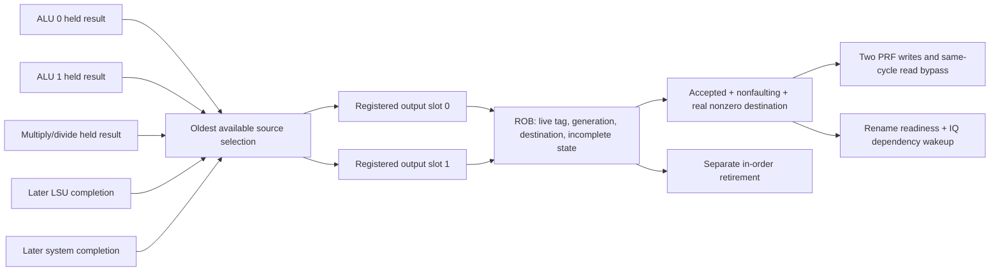

# Block 8: completion arbitration and accepted speculative writeback

This block occupies the completion part of WB. It replaces block 7's test-only selector with
real RTL: five producer channels share two registered result buffers, followed by ROB ownership
checks and accepted-value broadcast. Architectural retirement remains the separate ROB-head
operation from block 5.

rv32_completion_arbiter owns the two buffers and source selection. rv32_writeback instantiates
it and generates the physical write ports and dependency-wakeup broadcasts. The register file,
rename unit, issue queue, and ROB remain separate modules connected by these signals.

## 1. Your example: three results finish, but only two ports exist

Assume an older DIV finishes on the same edge as two younger integer operations. The execution
cluster now has three valid completions, each in its own retained output register:

| Source | ROB age | Result | What arbitration chooses |
|---|---:|---:|---|
| Multiply/divide, source 2 | 0 | 25 | First available arbiter slot |
| ALU 0, source 0 | 1 | 16 | Second available arbiter slot |
| ALU 1, source 1 | 2 | 104 | Remains in ALU 1 until capacity opens |

The source-ready mask is 00101: sources 2 and 0 transfer, while source 1 holds its full packet.
The arbiter does not replace a result just because it has the same instruction class, and no
physical register changes merely because a source was selected.

There are two different acceptance boundaries:

1. **Source capture:** source_valid and source_ready transfer a packet into an arbiter register.
   Its execution unit can then reuse its output slot.
2. **ROB consumption:** completion_valid and completion_ready transfer that buffered packet to
   ownership checking. A consumed packet may be accepted or rejected. Only accepted, nonfaulting
   register results can write physical registers and wake dependent instructions.

A simple stalled sequence is:

| Edge | Source transfers | ROB transfers | State after the edge |
|---|---|---|---|
| E0 | DIV and ALU 0 enter arbiter buffers | None for these newly captured packets | Two buffered packets; ALU 1 still holds its result |
| E1, while ROB-ready is low | None | None | Both arbiter packets and ALU 1's packet remain unchanged |
| E2, when both consumers are ready | ALU 1 enters a newly freed slot | DIV and ALU 0 are consumed | Only ALU 1 remains buffered |
| E3 | Other waiting sources may fill free slots | ALU 1 is consumed | No result is lost or counted twice |

The connected test synchronizes three actual execution-unit completions and checks this
selection, holding, and dual-pop/refill behavior. Its stalled ROB connection is a test-controlled
backpressure case; normal live ROB entries already have allocated completion storage.

## 2. Connections in the WB section



The memory source accepts an eventual **completion_t from the LSU**, after its response or
fault has been resolved. It must not be connected to the integer unit's memory_entry_t address
preparation output. A prepared address is not a completed load/store.

The system source is reserved for the serialized CSR/system engine. Memory and system engines
remain later blocks; their producer-valid bits are zero in the connected arithmetic demonstration.
The arbiter itself implements all five channels, which are exercised by the standalone tests.

## 3. Signal table and record layout

completion_sources_t is a new packed record in the shared package. From least to most
significant bits, its five 222-bit fields are alu0_result, alu1_result, muldiv_result,
memory_result, and system_result. The matching valid/ready index uses exactly that order.
These are five producer positions, not five issue lanes.

| Signal | Width | Source → destination | Meaning |
|---|---:|---|---|
| clk_i, rst_ni | 1 each | Common clock/reset → WB | Rising-edge state; active-low asynchronous reset |
| sources_i | 1,110 | Five producer output registers → arbiter | Full completion packets |
| source_valid_i | 5 | Producers → arbiter | Independent available packets; any mask is legal |
| source_ready_o | 5 | Arbiter → producers | Selected packets transfer into buffers on this edge |
| rob_head_index_i | 4 | ROB → arbiter | Reference for modular program-age priority |
| completion_o / rob_completion_o | 444 | Arbiter buffers → ROB | Two stationary completion packets |
| completion_valid_o / rob_completion_valid_o | 2 | Arbiter → ROB | Independent occupied output lanes |
| completion_ready_i / rob_completion_ready_i | 2 | ROB → arbiter | Each lane's consumption permission |
| rob_completion_accepted_i | 2 | ROB → writeback gate | Consumed packets that passed actual owner checks |
| broadcast_o | 444 | Writeback gate → rename/IQ | Enabled accepted register-result packets; disabled lanes are zero |
| broadcast_valid_o | 2 | Writeback gate → rename/IQ | Accepted, nonfaulting, nonzero-register writes only |
| write_enable_o | 2 | Writeback gate → PRF | Same enabled-result mask as broadcast_valid_o |
| write0_addr_o, write1_addr_o | 6 each | Writeback gate → PRF | Physical destination identities |
| write0_data_o, write1_data_o | 32 each | Writeback gate → PRF | Corresponding accepted values |
| occupancy_o | 2 | Arbiter → status/recovery | Number of occupied buffers, 0 through 2 |
| quiescent_o | 1 | Arbiter → recovery controller | Both local buffers are actually empty |
| cancel_i, cancel_done_o | 1 each | Recovery control ↔ arbiter | Dominant speculative clear and registered acknowledgment |
| protocol_error_o | 1 | Arbiter/writeback → diagnostics | Duplicate owners or inconsistent accepted feedback |

The standalone arbiter uses completion_* names; the wrapper's ROB-facing equivalents use
rob_completion_*. Their payload and handshake meaning is the same. The wrapper does not
instantiate the ROB or PRF: their explicit connections are shown in the connected testbench.

## 4. Priority selection and the inferred circuit

For a candidate, age is `(ROB index - current ROB head index) modulo 16`. With head index 14,
indices 14, 15, 0 have ages 0, 1, 2. Among available source packets, the smallest age wins;
equal ages use the lower source index. Legitimate distinct live instructions have distinct
positions in the current ROB window. Generation remains in the packet for ownership checks;
it is not used as a numerical age.

The circuit forms five ages, compares eligible candidates, selects one packet through a
five-input payload multiplexer, removes that source from the temporary candidate mask, and
selects the next winner if another buffer can accept it. A source cannot transfer twice on
one edge. The first winner fills the lowest-numbered available output slot.

Each output buffer retains 222 payload bits and one validity bit: 446 state bits total before
implementation optimization. Occupancy is calculated from the two valid bits. The RTL also
describes age comparators, selection/mux logic, and duplicate-owner diagnostics. These are RTL
storage/logic descriptions; Vivado must determine actual FPGA resource use and timing.

A source is eligible for capture only when valid. Producers must therefore assert and hold
valid independently of ready; waiting for ready before presenting valid would deadlock this
interface. The existing execution units already follow this retained-result contract.

A source with a stale generation is not trusted merely because its index appears old. The
arbiter carries it onward; the ROB rejects it. Candidate age is scheduling information, not
proof of ownership. Rejected packets must drain even when the ROB has no live instructions.

## 5. Registered slots, stable lanes, and throughput

A packet captured at E0 first appears as a registered ROB-facing output after E0 and can be
consumed at E1. There is no transparent source-to-ROB bypass. This adds one completion-stage
cycle relative to block 7's direct test selector, while permitting up to two source captures
and two ROB consumptions per cycle once the buffers are flowing.

Each buffer is independent. Its old packet can be consumed and replaced by a new source on
the same edge. If lane 0 is consumed while lane 1 stalls, lane 1 stays exactly where it is.
No compaction or later age update can move a stalled payload to another lane.

Consequently a valid mask of 10 is legal here: only completion lane 1 can remain occupied.
This differs from dispatch and retirement, which use a program-order prefix. A newly filled
lane 0 can also hold a younger packet than the retained lane 1; completion lane numbering does
not determine architectural order.

An older result that arrives later cannot preempt an already-buffered younger packet. It wins
priority when a buffer next opens. The ROB must accept live younger completions even when its
head has not completed; tying completion readiness to head retirement could block the younger
buffers and prevent an older producer from ever entering. The implemented ROB provides separate
completion storage/handshakes and does not impose that head-only restriction.

This is still a five-logical-section OoO design. Internal queues and retained completion
registers mean instruction latency is not fixed at five clocks. Two-wide peak throughput is
also not a promise of two retired instructions every cycle.

## 6. Accepted-result gating and physical-register effects

For each output lane, the wrapper first computes:

```text
consumed = buffered_valid AND ROB_ready
accepted = consumed AND ROB_accepted
register_result = accepted AND writes_rd AND (pdst != 0) AND NOT exception.valid
```

Only register_result enables both the PRF write and the readiness/wakeup broadcast. The same
accepted value reaches PRF bypass and IQ wakeup on the same edge, so a dependent instruction
cannot observe readiness while reading an older stored value.

A consumed but rejected stale/wrong-destination packet frees its arbiter slot without writing,
waking, or retiring anything. An accepted fault completion makes the ROB entry complete-for-trap,
but does not make its destination usable. An accepted branch, store, or x0-destination result
can complete its ROB owner without a register broadcast.

ROB checks from block 5 still validate full tag/generation, incomplete live ownership, pdst,
and decoded write intent. The wrapper does not replace those checks. It diagnoses accepted
feedback outside an actual valid/ready handshake and ignores such feedback for register effects.

A conforming ROB already rejects a second conflicting completion. As a defensive wiring check,
this wrapper also detects two accepted packets claiming the same owner, or two accepted
nonfaulting writers claiming the same nonzero physical destination. Lane 0 retains priority;
lane 1's physical write and wakeup are suppressed. This diagnostic is not a substitute for
correct allocation or a recovery mechanism for arbitrary broken external feedback.

The arbiter also diagnoses duplicate full owners among pending sources/buffers. It forwards
them through the normal path for ROB rejection, rather than silently losing a producer packet.

## 7. Completion, writeback, and retirement remain separate

The connected arithmetic demonstration now uses this production writeback path. Its real
ADDI seed instructions establish operands; the divider and ALUs calculate their own values.
The extra registered completion stage changes the measured timing from block 7:

| Test cycle | Event | What remains speculative |
|---:|---|---|
| 7 | DIV100/4 and ADD7+9 issue together | Both instructions |
| 9 | Independent ADD completion accepted, value 16 | Its physical value is ready; DIV still blocks retirement |
| 41 | DIV completion accepted, value 25; dependent ADD issues through bypass | Dependent ADD's result |
| 42 | DIV and independent ADD retire in order | Dependent ADD waits in its completion path |
| 43 | Dependent completion accepted, value 41 | It waits for registered ROB completion state |
| 44 | Dependent ADD retires | All three demonstrated results are committed |

The values are identical to block 7; the interface latency differs. Earlier guides retain
their measured timing and clearly identify their direct test selector. This guide describes
the added production WB hardware.

Physical writeback does not update the committed rename map or release an old committed
physical register. Those events still occur only when the ROB retires an instruction in
program order. A younger result can therefore be written speculatively without making a
later older exception imprecise.

## 8. Cancellation and recovery boundaries

cancel_i immediately masks source-ready, ROB-facing valid, broadcasts, and physical writes.
At its clock edge, it clears both payload/valid registers and registers cancel_done. A
simultaneous source or ROB handshake cannot win over cancellation. Quiescent becomes true
when those local buffers are actually empty, not merely when cancel is asserted.

Arbiter emptiness alone does not mean the processor is quiescent. A divider may still be
iterating or another producer may hold a result. Recovery must cancel/drain the execution
cluster, this writeback block, memory ownership, and later system paths before restoring
maps/queues and reusing tags or physical destinations. The connected test waits for both
execution and writeback acknowledgment/quiescence before safe apply.

Admission hold for a pending redirect or interrupt must still allow older results to complete
and retire. Cancellation is the later ownership-clear barrier; it must not be used to freeze
older work needed to reach the precise boundary. The complete controller remains block 11.

## 9. Verification and waveform reading

The standalone testbench independently tracks both buffer slots, source consumption, candidate
priority, accepted masks, and expected register effects. It covers all source-valid and sink-ready
masks, ROB wraparound, tied ages, partial output stalls, simultaneous pop/refill, faults,
nonwriters, x0, malformed accepted feedback, duplicate owners/destinations, cancellation, and reset.

The connected test uses the real rename, ROB, PRF, IQ, execution cluster, writeback, and trace.
It checks actual out-of-order arithmetic, three synchronized completions, retained packets,
accepted-value wiring, and cancellation-before-reuse. The reserved memory/system source interfaces
also carry explicitly synthetic stale-generation and wrong-destination packets through the real
ROB. Both are consumed/rejected without physical writes, wakeup, readiness/free-list changes,
or retirement; the legitimate owner then executes normally. These packet-injection tests do
not implement memory/system engines.

```sh
python3 scripts/run_checks.py --block 8
python3 scripts/run_checks.py --block 8 --waves
```

Current Icarus evidence is **52,221 standalone checks + 890 connected checks = 53,111 checks,
zero failures**. The report records separate case counts and exact compiled-source hashes. Optional VCD files
are under build/block08. Start with source_valid/source_ready, arbiter occupancy, buffered
completion-valid/ready, ROB accepted/rejected, broadcast-valid, PRF write enables, retire_fire,
and trace.order. Distinguish a producer leaving its buffer from its destination actually becoming
ready. During a stall, watch each valid output lane's entire payload remain unchanged.

To simulate the standalone case with Vivado XSim on Linux:

```sh
xvlog --sv rtl/rv32_ooo_pkg.sv rtl/rv32_completion_arbiter.sv \
  rtl/rv32_writeback.sv tb/tb_block08.sv
xelab tb_block08 -s block08_sim
xsim block08_sim --runall
```

The connected case also needs the block-7 integration source modules listed in the runner,
with tb_block08_integration.sv as top. The input remains a controlled decoded stream; instruction
fetch and the complete processor top are later blocks. Vivado/XSim, timing, DRC, and bitstream
results remain unverified here. Directed/generated block tests are not ISA certification.

## 10. Interview questions

**Why can three results finish in a two-issue processor?** A long operation issued earlier
can finish alongside a later integer pair. Issue width and completion arrival count differ.

**Where does the third result wait?** In its producer's retained output register until a
source-ready edge transfers it into an available arbiter buffer.

**Does source-ready mean the destination register is ready?** No. It means the arbiter captured
the packet. Destination readiness requires a subsequent accepted, nonfaulting ROB completion.

**Why do the output slots stay stationary?** A valid packet under backpressure must remain
stable on its interface. Moving it to another lane would change which transfer the consumer sees.

**Can completion mask 10 be valid?** Yes. Completion ports are independent. Dispatch and
retirement instead use an ordered prefix, so their validity contracts are different.

**Does a generation field choose the oldest instruction?** No. Current live-window index
distance supplies age; full tag/generation supplies ownership for rejection of recycled uses.

**Why must IQ wakeup and PRF bypass share a mask/value?** If readiness comes from an unaccepted
or different result, a dependent can execute with stale data even though the tag appears ready.

**Why can a fault complete without broadcasting?** Its ROB entry needs the fault information
for a precise trap. Its destination value must not become usable by dependent instructions.

**What protects against a delayed wrong-path result?** Producer/buffer cancellation and
quiescence prevent unsafe reuse; ROB tag/generation/destination checks reject stale packets.
Both mechanisms are required.

**Why doesn't physical writeback free the previous architectural mapping?** Completion order
can differ from program order. Retirement updates committed mappings and frees replaced versions.

## 11. Source ownership

The two modules are custom RTL. Their contracts build on this project's already tested ROB,
rename, register file, scheduler, and execution modules. No third-party RTL is copied here.
