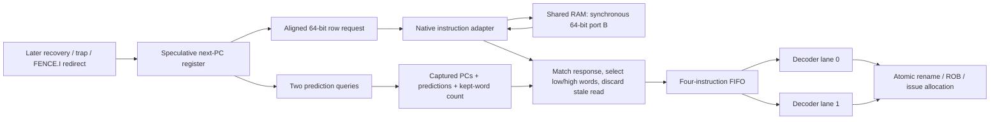

# Block 9: two-instruction fetch and synchronous BRAM adaptation

This block implements IF. It selects speculative instruction PCs, requests an aligned 64-bit
memory row, retains the matching PC/prediction metadata, and buffers up to four instructions
for decode. One row can supply two 32-bit instructions, matching the approved two-wide front end.

rv32_fetch owns the PC, instruction FIFO, credits, redirects, and fetch-fault records.
rv32_instruction_adapter connects its request/response interface to a synchronous native BRAM
port. No AXI instruction transaction is used. The later data path uses the shared RAM's other port.

## 1. Your example: one 64-bit read supplies two instructions

Suppose RAM contains:

```asm
# Byte addresses 0 and 4 occupy the same 64-bit row.
addi x1, x0, 100     # PC 0, low 32 bits of row 0
addi x2, x0, 4       # PC 4, high 32 bits of row 0
```

The core requests byte address 0. The adapter converts it to native row index 0 and enables
the BRAM read. After the enabled rising edge, the synchronous memory output contains both
instruction words. The fetch unit captures them with their own PCs and prediction records,
then presents a valid pair to the two decoder instances.

| Before edge | Memory action at edge | Fetch-buffer action at edge |
|---|---|---|
| E0: request row 0 | Accept/read row 0; its response becomes available after E0 | Record ownership of PCs 0 and 4 |
| E1: response row 0 and request row 8 | Consume row 0 response and accept/read row 8 | Enqueue PCs 0 and 4 |
| E2: decode accepts the pair; response row 8; request row 16 | Consume row 8 and accept/read row 16 | Remove PCs 0/4; enqueue PCs 8/12 |
| E3 onward, with continuous readiness | One row accepted and returned per cycle | Up to two instructions consumed/enqueued per cycle |

These are clock-edge relationships, not a measured FPGA frequency. The ideal fetch path can
sustain two instructions per cycle after filling; downstream dependencies and stalls still
control actual processor throughput. The standalone test explicitly checks this steady-state rate.

A request starting at PC 4 still reads aligned row 0, but keeps only its upper word. PC 0 is
not delivered accidentally. The next row can then continue from PC 8.

## 2. Connections and architectural position



The PC here is speculative fetch state. It is not the architectural next-unexecuted PC saved
by interrupt entry; that state belongs to the later retirement/machine-control integration.

The predictor itself is not implemented in this block. A tested two-query interface can use
external prediction records; prediction-disabled operation constructs PC + 4 records locally.
BTB/PHT storage and retirement training remain block 10. Redirect generation and the complete
recovery barrier remain block 11.

## 3. Signals and their sources/destinations

The package adds a 64-bit fetch_row_t, a three-bit fetch_count_t for counts 0 through 4,
and prediction_pair_t for the two lookup results. The selected 64 KiB RAM has 8,192 fetch rows,
so its native instruction address is 13 bits.

| Fetch signal | Width | Source → destination | Meaning |
|---|---:|---|---|
| clk_i, rst_ni | 1 each | Common clock/reset → IF | Rising-edge state; active-low asynchronous reset |
| enable_i | 1 | Front-end control → fetch | Permit fresh read offers/local-fault creation |
| redirect_i, redirect_pc_i | 1, 32 | Recovery/trap/fence control → fetch | Discard queued path and save new target |
| redirect_done_o | 1 | Fetch → recovery control | Registered local redirect acknowledgment |
| predict_enable_i | 1 | Configuration → fetch | Use external records or local sequential defaults |
| prediction_pc0_o, prediction_pc1_o | 32 each | Fetch → future predictor | Proposed first PC and first PC + 4 |
| prediction_i | 82 | Future predictor → fetch | Two 41-bit prediction records, captured per offer |
| request_valid_o, request_ready_i | 1 each | Fetch ↔ instruction adapter | Transfer a row-read request |
| request_address_o | 32 | Fetch → adapter | Eight-byte-aligned byte address |
| response_valid_i, response_ready_o | 1 each | Adapter ↔ fetch | Transfer the one matching outstanding response |
| response_data_i, response_error_i | 64, 1 | Adapter → fetch | Row data or instruction-access failure |
| fetch_valid_o, fetch_ready_i, fetch_fire_o | 2 each | Fetch ↔ decode/dispatch | Ordered instruction-prefix availability/capacity/transfer |
| fetch_o | 340 | Fetch FIFO → dual decode | Two complete PC/instruction/prediction/exception records |
| occupancy_o | 3 | Fetch → status/tests | Actual queued instruction count |
| transaction_pending_o | 1 | Fetch → status | Registered held offer or accepted outstanding read |
| stale_pending_o | 1 | Fetch → status | That held/outstanding descriptor must be discarded |
| fault_pending_o | 1 | Fetch → control/status | A fetch-fault token has stopped fresh fetching until redirect |
| protocol_error_o | 1 | Fetch → diagnostics | Invalid ready prefix or response without an accepted owner |

| Adapter signal | Width | Source → destination | Meaning |
|---|---:|---|---|
| request_valid_i, request_ready_o, request_address_i | 1, 1, 32 | Fetch ↔ adapter | Same row-read request interface |
| response_valid_o, response_ready_i | 1 each | Adapter ↔ fetch | Retained response and consumption |
| response_data_o, response_error_o | 64, 1 | Adapter → fetch | Matching native data or error |
| bram_enable_o | 1 | Adapter → native RAM port B | Authorize one synchronous row read |
| bram_address_o | 13 | Adapter → native RAM port B/wrapper | Proposed RAM-relative row index, visible before enable |
| bram_data_i | 64 | Native RAM port B → adapter | Synchronous enabled-read output, held when disabled |
| bram_block_i | 1 | External shared-memory control → adapter | Temporarily prevent a new read, for example on a write collision |
| transaction_pending_o | 1 | Adapter → status | An unconsumed response is retained |
| protocol_error_o | 1 | Adapter → diagnostics | An accepted row request was not eight-byte aligned |

The data-store collision detector is not in these modules. External shared-memory control drives
bram_block_i from actual data-port writes and the proposed instruction address. The native address
is intentionally visible independently of enable; deriving a collision hold from an enable-
gated address could create combinational feedback.

## 4. What circuits the RTL describes

The fetch unit contains a 32-bit next-PC register, four instruction records, an occupancy
register, request/response ownership descriptors, sticky stale bits, and a fetch-fault stop bit.
It describes adders for PC progression, alignment masks, word-selection muxes, FIFO shifting,
credit comparisons, and control multiplexers.

Each fetch_packet_t is 170 bits in this configuration. Four queued packets describe 680 payload
bits before synthesis optimization; ownership descriptors and control add further state. The
FIFO is deliberately small and shifts after a consumed prefix rather than using a deep RAM.
The program memory itself remains BRAM, separate from this small instruction queue.

The adapter contains response-valid/error state. It does not create an asynchronous memory
array. The native BRAM output supplies the stored payload: a new read is disabled whenever
its old response cannot be consumed, so that native output retains the correct data.

The memory contract is one native synchronous read stage, with both optional additional output
registers disabled. Enabling more memory-output stages would require a corresponding adapter
change. AMD describes these register/latency choices in the
[Block Memory Generator guide](https://docs.amd.com/api/khub/documents/V70n09duEdKgzrX2d1W97g/content).
The behavioral RAM in the tests implements exactly the documented one-stage contract.

## 5. Credits: why a response cannot overfill the queue

A request promises future storage even before its data returns. The fetch unit reserves the
number of instructions it will keep from that row: one or two. Before a fresh offer it checks:

```text
instructions remaining after this edge's accepted prefix
+ reserved words of the current nonstale outstanding read
+ words promised by the fresh offer
<= four FIFO slots
```

The outstanding reservation remains counted even when that response is being enqueued now.
This allows old response consumption and new request acceptance on the same edge without
borrowing space that does not exist. If a fresh offer stalls, its descriptor and reservation
are retained until acceptance; existing queued instructions can only free further capacity.

For example, with two queued instructions and a two-word response pending, the queue's four
slots are fully promised. If decode accepts both queued instructions at this edge, the two
freed slots permit the next two-word read. If decode accepts none, the old response still
fits, fills the queue, and fresh reads stop. The memory response never waits for speculative
space that was not reserved.

Only one accepted transaction is outstanding. A held unaccepted offer and an accepted pending
read are mutually exclusive in this implementation: a new offer is presented only when the
port is idle or the prior response is being consumed. On an ideal synchronous port, that
response-pop/request-refill overlap sustains a row per cycle.

## 6. Prediction records and choosing one or two words

With prediction disabled, each record's next_pc is PC + 4, flags are clear, and its PHT index
is PC[8:2]. With prediction enabled, both external records are captured when a fresh row is
first offered, even if memory is not ready yet. A later predictor update cannot mutate the
metadata of a held request.

If the starting PC is the lower word and its predicted next PC equals PC + 4, both words are
kept. The following fetch PC comes from the second word's prediction. Otherwise only the first
instruction on that predicted path is kept, and its prediction selects the next fetch PC.
An upper-word start also keeps just one instruction because the next instruction is in another row.

Predicted direction flags do not override next_pc: the predicted instruction path follows the
actual next_pc field. The existing execution units later compare that field with their resolved
next PC, including stale BTB predictions on ordinary instructions.

## 7. Ordered output pairs and partial acceptance

The FIFO presents an ordered prefix: 00, 01, or 11. Downstream ready may advertise no capacity,
one older instruction, or both instructions. Ready 10 is diagnosed and cannot skip the oldest.

This is a **prefix interface**, not two independent stalled completion lanes. When only lane 0
transfers, the unaccepted lane 1 moves to lane 0 next cycle. The next FIFO instruction can fill
lane 1, even when it came from another BRAM row. With a fully stalled pair, its existing records
remain unchanged; returning data only appends behind them.

The connected test deliberately accepts PC 0 alone, then observes PC 4 paired with PC 8. Both
PCs, instruction bits, prediction fields, and exceptions remain attached to the correct record.
Atomic rename/ROB/IQ acceptance still determines which prefix actually advances.

## 8. Redirects, held requests, and stale responses

On redirect, IF immediately masks its output validity/transfer. At the edge it clears the FIFO,
saves the redirect target, and marks any held or accepted read stale. redirect_done acknowledges
this local state update; it does not claim that the old memory response has already returned.

A request previously stalled on request_ready must keep its original address and metadata.
It remains offered through pause or redirect, then its eventual response is drained/discarded.
A request accepted on the redirect edge is also stale. No cancellation is sent to the native
memory interface, so request/response ownership remains unambiguous.

Staleness is sticky for that descriptor. Two or three redirects while one old response waits
cannot toggle it back to current. The latest target remains saved, and fresh requests resume
when the old response is consumed. An old response returning on the redirect edge never appears
briefly as a valid instruction. Even if the target PC equals the old address, the old descriptor
is discarded, which is useful for later FENCE.I integration.

An already accepted stale response can overlap acceptance of the first new-path request. Its
data/error is ignored while the new descriptor becomes the sole live owner.

## 9. Fetch faults, pause, and reset

A misaligned PC produces one local instruction-address fault record with cause 0, tval equal
to that PC, and instruction bits zero. It issues no memory request. A nonstale response error
produces one instruction-access fault record with cause 1 and the first requested instruction's
PC in tval, even when the request started in a row's upper word. The second word is discarded.

Fetch stops creating fresh work until redirect. The fault token can still move to decode/ROB,
where later precise-trap control handles it. Merely consuming the token or toggling enable does
not restart the faulting path. An error in a stale response creates no fault token.

Older response ordering matters. A delayed successful row must enter the FIFO before a local
fault at its predicted successor. If that row instead returns an access fault, that older fault
wins and no younger alignment token is added. Directed tests check both cases.

Adapter out-of-range or misaligned row requests return error with zero data and no native read
enable. Misalignment also diagnoses the row-interface violation. IF itself aligns valid row
requests; architectural PC alignment is checked separately before reaching the adapter. Addresses
outside the executable RAM become instruction-access faults, not peripheral reads.

enable_i stops only fresh offers/local-fault generation. Previously offered requests, accepted
responses, and queued output remain active. A later interrupt-drain controller must also stop
new decode admission; pausing fetch requests alone does not hide already buffered instructions.
Global reset clears fetch and adapter ownership together; both must share the system reset.

## 10. Shared-memory interface contract

Instruction port B reads 64 bits; data port A uses 32-bit words on the same 64 KiB RAM. Both
ports must see the same little-endian bytes: a row at byte address A contains the instruction
at A in bits 31:0 and the instruction at A+4 in bits 63:32. The instruction output has one
synchronous read stage, holds when disabled, and has no additional output-register latency.
External shared-memory control must hold a proposed same-row read during a conflicting write.

This block tests that interface with synchronous memory models. Block 15 also tests the
portable AXI wrapper with a shared executable-RAM model, including a write followed by FENCE.I.
Vendor IP generation, FPGA memory wiring, clock/reset generation, and physical collision
behavior are outside the revised project scope. The fixed part and clock specifications are
retained in [vivado_target.md](vivado_target.md); no synthesized BRAM inference or bitstream is
claimed. AMD's memory-port documentation remains useful background for a later implementation:
[AMD PG058](https://docs.amd.com/api/khub/documents/V70n09duEdKgzrX2d1W97g/content).

## 11. Connected program and measured behavior

The integration test now starts from RAM instruction bits, not directly supplied decoded controls:

```asm
addi x1, x0, 100
addi x2, x0, 4
addi x3, x0, 7
addi x4, x0, 9
div  x5, x1, x2
add  x6, x3, x4
add  x7, x5, x6
addi x8, x7, 1
```

Two actual decoder instances feed the production rename/ROB/IQ/execution/writeback/trace path.
The test injects native-read holds and a partial decode handoff, then stops admission after eight
instructions. Extra speculative fetch data may remain buffered; it is not admitted as program work.

| Measured test cycle | Event |
|---:|---|
| 12 | DIV issues; seed x1 retires with 100 |
| 13 | Independent ADD issues; seed x2/x3 retire with 4/7 |
| 14 | Seed x4 retires with 9 |
| 15 | Independent ADD completion accepted, value 16 |
| 46 | DIV completion accepted, value 25; dependent ADD issues through bypass |
| 47 | DIV and independent ADD retire in program order |
| 49 | Dependent ADD retires with 41 |
| 51 | Final ADDI retires x8=42 |

This demonstrates the composed RAM-to-retirement arithmetic path within block 9's test scope.
Blocks 10–15 add prediction, production recovery, LSU/data AXI, machine control, and the complete
portable core. A board wrapper and boot firmware are outside the revised project scope.

## 12. Verification and waveform reading

Three reproducible testbenches accompany the block:

- tb_block09.sv uses an independent expected instruction queue and abstract delayed single-read
  memory. It checks throughput, credits, upper-word selection, PC wrap, partial pairs, captured
  predictions, pause, repeated redirects, response/redirect races, faults, and mixed traffic.
- tb_block09_adapter.sv checks the native adapter independently, including continuous refill,
  held payloads, last/unmapped/misaligned rows, block-with-response-drain, and reset.
- tb_block09_integration.sv connects synchronous RAM through dual decode to real retirement and
  separately probes native adapter edge cases.

```sh
python3 scripts/run_checks.py --block 9
python3 scripts/run_checks.py --block 9 --waves
```

Current Icarus evidence is **37,319 fetch checks + 28,785 adapter checks + 505 integration
checks = 66,609 checks, zero failures**. Reports list separate case counts and compiled-source
hashes. Optional waveforms are in build/block09. Begin with request-valid/ready/address, native enable/address/data, response
valid/ready, FIFO occupancy, fetch-valid/fire/packets, stale/fault status, and redirect. For the
program path also inspect rename/ROB/IQ fires, accepted completions, PRF write enable, and trace.

Remember that native row address 1 means byte addresses 8 through 15. A redirect can mask valid
before occupancy clears at the edge. A stalled request can remain valid while stale_pending is
true; its response must return before the port can be reused safely.

For Vivado XSim on Linux, the standalone fetch source list is:

```sh
xvlog --sv rtl/rv32_ooo_pkg.sv rtl/rv32_fetch.sv tb/tb_block09.sv
xelab tb_block09 -s block09_sim
xsim block09_sim --runall
```

The adapter test needs the package, rv32_instruction_adapter.sv, and tb_block09_adapter.sv.
The connected case uses all active source modules named in scripts/run_checks.py for block 9;
the shared package must compile first. Vivado/XSim, synthesis, timing, DRC, and bitstream remain
unverified here. Simulation counts do not establish ISA certification or timing closure.

## 13. Interview questions

**Why read 64 bits when the ISA has 32-bit instructions?** Two independent instruction words
per row supply the approved two-wide front end; instruction encoding remains 32 bits.

**Why is PC 4 not a new native row?** Native address 0 contains byte addresses 0 through 7.
Starting at PC 4 selects its upper instruction, while a request at PC 8 selects row 1.

**Why reserve response credits before data returns?** Memory can complete while decode stalls.
Promising FIFO space early prevents a legal response from overflowing the instruction buffer.

**Can one-outstanding operation sustain a read every cycle?** Yes for this one-cycle memory:
the old response can transfer on the same edge as the next request, retaining only one owner.

**Why does a stalled instruction pair compact after a partial transfer?** It is an ordered
prefix interface. Keeping the younger instruction permanently in lane 1 would prevent it from
becoming the next oldest instruction. Completion ports use a different independent-lane contract.

**Why retain prediction metadata during a request stall?** Predictor training may change lookup
results. The fetched instruction must keep the prediction that selected its speculative path.

**Why not cancel a native memory request on a branch redirect?** Retaining the old transaction
preserves handshake ownership. Marking its response stale makes cancellation unnecessary here.

**Why use a sticky stale bit instead of only a toggling epoch bit?** Repeated redirects during
one delayed read could toggle an epoch back to its original value. Sticky state cannot revive it.

**Does redirect_done mean all memory traffic stopped?** No. It acknowledges local FIFO/PC
recovery. An older read can still be draining, protected by its stale ownership state.

**Why does the adapter need the native output to hold when disabled?** It uses that output as
the retained response payload. A stalled response prevents any new enabled read from replacing it.

**Does this block implement branch prediction?** It implements the fetch-side prediction
interface and metadata flow. BTB/PHT storage and training are the next architectural block.

## 14. Source ownership

The fetch unit and adapter are custom RTL. Vendor documentation informs the memory-port contract;
no third-party processor RTL is copied.

## Complete two-instruction fetch unit

Source: `rtl/rv32_fetch.sv`.

```systemverilog
// IF section: two instructions per 64-bit row, with reserved response capacity.
// Accepted reads are never cancelled on the memory interface; stale data is drained.
`timescale 1ns / 1ps

module rv32_fetch
  import rv32_ooo_pkg::*;
(
  input  logic             clk_i,
  input  logic             rst_ni,
  input  logic             enable_i,
  input  logic             redirect_i,
  input  word_t            redirect_pc_i,
  output logic             redirect_done_o,
  input  logic             predict_enable_i,
  output word_t            prediction_pc0_o,
  output word_t            prediction_pc1_o,
  input  prediction_pair_t prediction_i,

  output logic             request_valid_o,
  input  logic             request_ready_i,
  output word_t            request_address_o,
  input  logic             response_valid_i,
  output logic             response_ready_o,
  input  fetch_row_t       response_data_i,
  input  logic             response_error_i,

  output logic [1:0]       fetch_valid_o,
  input  logic [1:0]       fetch_ready_i,
  output fetch_pair_t      fetch_o,
  output logic [1:0]       fetch_fire_o,
  output fetch_count_t     occupancy_o,
  output logic             transaction_pending_o,
  output logic             stale_pending_o,
  output logic             fault_pending_o,
  output logic             protocol_error_o
);

  typedef struct packed {
    fetch_pair_t packets;
    word_t address;
    logic [1:0] count;
    logic upper_word;
  } descriptor_t;

  fetch_packet_t fifo_q [FETCH_DEPTH];
  fetch_packet_t fifo_d [FETCH_DEPTH];
  fetch_count_t count_q, count_d;
  word_t next_pc_q, next_pc_d;
  descriptor_t held_q, held_d, inflight_q, inflight_d, candidate;
  logic held_valid_q, held_valid_d, inflight_valid_q, inflight_valid_d;
  logic held_stale_q, held_stale_d, inflight_stale_q, inflight_stale_d;
  logic fault_wait_q, fault_wait_d;
  word_t candidate_next_pc;

  assign prediction_pc0_o = next_pc_q;
  assign prediction_pc1_o = next_pc_q + 32'd4;
  assign occupancy_o = count_q;
  assign transaction_pending_o = held_valid_q || inflight_valid_q;
  assign stale_pending_o = (held_valid_q && held_stale_q)
                            || (inflight_valid_q && inflight_stale_q);
  assign fault_pending_o = fault_wait_q;

  // Snapshot prediction when first offering a row, including a stalled request.
  // A prediction in word 0 can exclude word 1 before that word enters the FIFO.
  always_comb begin : make_candidate
    prediction_t first, second;
    first = '0;
    second = '0;
    first.next_pc = prediction_pc0_o + 32'd4;
    second.next_pc = prediction_pc1_o + 32'd4;
    first.pht_index = prediction_pc0_o[8:2];
    second.pht_index = prediction_pc1_o[8:2];
    if (predict_enable_i) begin
      first = prediction_i.lane0;
      second = prediction_i.lane1;
    end
    candidate = '0;
    candidate.address = {next_pc_q[31:3], 3'b000};
    candidate.upper_word = next_pc_q[2];
    candidate.packets.lane0.pc = next_pc_q;
    candidate.packets.lane0.prediction = first;
    candidate.packets.lane1.pc = next_pc_q + 32'd4;
    candidate.packets.lane1.prediction = second;
    candidate.count = 2'd1;
    candidate_next_pc = first.next_pc;
    if (!next_pc_q[2] && first.next_pc == next_pc_q + 32'd4) begin
      candidate.count = 2'd2;
      candidate_next_pc = second.next_pc;
    end
  end

  always_comb begin : movement
    int pop_count, used, reserved, tail;
    logic response_fire, request_fire, fresh_offer, local_fault, port_available;
    descriptor_t offered;
    fetch_packet_t first_packet, second_packet, fault_packet;

    count_d = count_q;
    next_pc_d = next_pc_q;
    held_d = held_q;
    inflight_d = inflight_q;
    held_valid_d = held_valid_q;
    inflight_valid_d = inflight_valid_q;
    held_stale_d = held_stale_q;
    inflight_stale_d = inflight_stale_q;
    fault_wait_d = fault_wait_q;
    fetch_valid_o = '0;
    fetch_fire_o = '0;
    fetch_o = '0;
    request_valid_o = 1'b0;
    request_address_o = '0;
    response_ready_o = rst_ni && inflight_valid_q;
    response_fire = response_ready_o && response_valid_i;
    request_fire = 1'b0;
    fresh_offer = 1'b0;
    local_fault = 1'b0;
    offered = '0;
    first_packet = '0;
    second_packet = '0;
    fault_packet = '0;
    protocol_error_o = rst_ni && (fetch_ready_i == 2'b10
                                  || (response_valid_i && !inflight_valid_q));

    if (rst_ni && !redirect_i) begin
      if (count_q != 0) begin
        fetch_valid_o[0] = 1'b1;
        fetch_o.lane0 = fifo_q[0];
      end
      if (count_q > 1) begin
        fetch_valid_o[1] = 1'b1;
        fetch_o.lane1 = fifo_q[1];
      end
      if (fetch_ready_i != 2'b10) begin
        fetch_fire_o[0] = fetch_valid_o[0] && fetch_ready_i[0];
        fetch_fire_o[1] = fetch_fire_o[0] && fetch_valid_o[1] && fetch_ready_i[1];
      end
    end
    pop_count = int'(fetch_fire_o[0]) + int'(fetch_fire_o[1]);
    tail = int'(count_q) - pop_count;
    for (int i = 0; i < FETCH_DEPTH; i++) begin
      fifo_d[i] = '0;
      if (i + pop_count < FETCH_DEPTH) fifo_d[i] = fifo_q[i + pop_count];
    end

    // Include the accepted read's full reserved capacity even before it returns.
    // Same-edge FIFO consumption makes fresh space usable without a refill bubble.
    reserved = 0;
    if (inflight_valid_q && !inflight_stale_q) reserved = int'(inflight_q.count);
    used = tail + reserved;
    port_available = !inflight_valid_q || response_fire;
    if (rst_ni && !redirect_i && enable_i && !fault_wait_q && !held_valid_q
        && port_available
        && !(response_fire && !inflight_stale_q && response_error_i)) begin
      if (|next_pc_q[1:0]) begin
        local_fault = used < FETCH_DEPTH;
      end else if (used + int'(candidate.count) <= FETCH_DEPTH) begin
        fresh_offer = 1'b1;
      end
    end

    // Held unaccepted requests retain their payload across pause and redirect.
    if (rst_ni && held_valid_q) begin
      offered = held_q;
      request_valid_o = 1'b1;
    end else if (fresh_offer) begin
      offered = candidate;
      request_valid_o = 1'b1;
    end
    if (request_valid_o) request_address_o = offered.address;
    request_fire = request_valid_o && request_ready_i;

    if (response_fire) begin
      inflight_valid_d = 1'b0;
      inflight_stale_d = 1'b0;
      if (!inflight_stale_q && !redirect_i) begin
        first_packet = inflight_q.packets.lane0;
        second_packet = inflight_q.packets.lane1;
        first_packet.instruction = inflight_q.upper_word
                                   ? response_data_i[63:32] : response_data_i[31:0];
        second_packet.instruction = response_data_i[63:32];
        if (response_error_i) begin
          first_packet.instruction = '0;
          first_packet.exception.valid = 1'b1;
          first_packet.exception.cause = CAUSE_INSTR_ACCESS;
          first_packet.exception.tval = first_packet.pc;
          fault_wait_d = 1'b1;
          fifo_d[tail] = first_packet;
          tail = tail + 1;
        end else begin
          fifo_d[tail] = first_packet;
          tail = tail + 1;
          if (inflight_q.count == 2) begin
            fifo_d[tail] = second_packet;
            tail = tail + 1;
          end
        end
      end
    end
    if (local_fault) begin
      fault_packet = candidate.packets.lane0;
      fault_packet.exception.valid = 1'b1;
      fault_packet.exception.cause = CAUSE_INSTR_MISALIGNED;
      fault_packet.exception.tval = next_pc_q;
      fifo_d[tail] = fault_packet;
      tail = tail + 1;
      fault_wait_d = 1'b1;
    end
    if (fresh_offer) begin
      next_pc_d = candidate_next_pc;
      if (!request_fire) begin
        held_d = offered;
        held_valid_d = 1'b1;
        held_stale_d = 1'b0;
      end
    end
    if (request_fire) begin
      inflight_d = offered;
      inflight_valid_d = 1'b1;
      inflight_stale_d = (held_valid_q && held_stale_q) || redirect_i;
      held_valid_d = 1'b0;
      held_stale_d = 1'b0;
    end
    count_d = fetch_count_t'(tail);

    if (redirect_i) begin
      for (int i = 0; i < FETCH_DEPTH; i++) fifo_d[i] = '0;
      count_d = '0;
      next_pc_d = redirect_pc_i;
      fault_wait_d = 1'b0;
      // Sticky state cannot alias after two or more redirects during one old read.
      if (held_valid_d) held_stale_d = 1'b1;
      if (inflight_valid_d) inflight_stale_d = 1'b1;
    end
  end

  always_ff @(posedge clk_i or negedge rst_ni) begin
    if (!rst_ni) begin
      for (int i = 0; i < FETCH_DEPTH; i++) fifo_q[i] <= '0;
      count_q <= '0;
      next_pc_q <= RESET_PC;
      held_q <= '0;
      inflight_q <= '0;
      held_valid_q <= 1'b0;
      inflight_valid_q <= 1'b0;
      held_stale_q <= 1'b0;
      inflight_stale_q <= 1'b0;
      fault_wait_q <= 1'b0;
      redirect_done_o <= 1'b0;
    end else begin
      for (int i = 0; i < FETCH_DEPTH; i++) fifo_q[i] <= fifo_d[i];
      count_q <= count_d;
      next_pc_q <= next_pc_d;
      held_q <= held_d;
      inflight_q <= inflight_d;
      held_valid_q <= held_valid_d;
      inflight_valid_q <= inflight_valid_d;
      held_stale_q <= held_stale_d;
      inflight_stale_q <= inflight_stale_d;
      fault_wait_q <= fault_wait_d;
      redirect_done_o <= redirect_i;
    end
  end
endmodule
```

## Complete synchronous native instruction adapter

Source: `rtl/rv32_instruction_adapter.sv`.

```systemverilog
// IF memory boundary: one retained response over a synchronous 64-bit BRAM port.
// The native BRAM output updates on an enabled clock edge and holds while disabled.
`timescale 1ns / 1ps

module rv32_instruction_adapter
  import rv32_ooo_pkg::*;
(
  input  logic                 clk_i,
  input  logic                 rst_ni,
  input  logic                 request_valid_i,
  output logic                 request_ready_o,
  input  word_t                request_address_i,
  output logic                 response_valid_o,
  input  logic                 response_ready_i,
  output fetch_row_t           response_data_o,
  output logic                 response_error_o,
  input  logic                 bram_block_i,
  output logic                 bram_enable_o,
  output logic [BRAM_FETCH_ADDR_W-1:0] bram_address_o,
  input  fetch_row_t           bram_data_i,
  output logic                 transaction_pending_o,
  output logic                 protocol_error_o
);

  localparam int ROW_OFFSET_W = $clog2(FETCH_ROW_BYTES);
  logic response_valid_q, response_error_q;
  logic request_fire, misaligned, address_valid;
  word_t relative_address;

  assign relative_address = request_address_i - RAM_BASE;
  assign misaligned = |request_address_i[ROW_OFFSET_W-1:0];
  assign address_valid = request_address_i >= RAM_BASE
                         && relative_address < RAM_BYTES && !misaligned;

  // A consumed response can be replaced on the same edge. A shared-memory
  // collision hold blocks only NEW reads, never consumption of the old response.
  assign request_ready_o = rst_ni && !bram_block_i
                           && (!response_valid_q || response_ready_i);
  assign request_fire = request_valid_i && request_ready_o;
  assign bram_enable_o = request_fire && address_valid;
  // Keep the proposed row visible before enable, so collision hold can compare
  // addresses without feeding back through the enable that it is suppressing.
  assign bram_address_o = relative_address[BRAM_FETCH_ADDR_W+ROW_OFFSET_W-1:ROW_OFFSET_W];

  // BRAM must have one-cycle native read latency, with additional output
  // registers disabled. No new read is enabled while its response is stalled,
  // so the native output register itself retains the matching 64-bit payload.
  assign response_valid_o = rst_ni && response_valid_q;
  assign response_error_o = response_valid_o && response_error_q;
  assign response_data_o = response_valid_o && !response_error_q ? bram_data_i : '0;
  assign transaction_pending_o = response_valid_q;
  assign protocol_error_o = request_fire && misaligned;

  always_ff @(posedge clk_i or negedge rst_ni) begin
    if (!rst_ni) begin
      response_valid_q <= 1'b0;
      response_error_q <= 1'b0;
    end else begin
      if (response_valid_o && response_ready_i) response_valid_q <= 1'b0;
      if (request_fire) begin
        response_valid_q <= 1'b1;
        response_error_q <= !address_valid;
      end
    end
  end
endmodule
```

## Complete fetch reference-model test

Source: `tb/tb_block09.sv`.

```systemverilog
// Fetch verification with an independent single-response memory and expected packet queue.
`timescale 1ns / 1ps

module tb_block09;
  import rv32_ooo_pkg::*;

  logic clk = 0, rst_n = 1, enable, redirect, redirect_done, predict_enable;
  word_t redirect_pc, prediction_pc0, prediction_pc1, request_address;
  prediction_pair_t prediction;
  logic request_valid, request_ready, response_valid, response_ready, response_error;
  fetch_row_t response_data;
  logic [1:0] fetch_valid, fetch_ready, fetch_fire;
  fetch_pair_t fetched;
  fetch_count_t occupancy;
  logic transaction_pending, stale_pending, fault_pending, protocol_error;

  typedef struct packed {
    fetch_pair_t packets;
    word_t address;
    logic [1:0] count;
    logic stale;
  } expected_read_t;
  expected_read_t offered_read, memory_read;
  logic offered_valid, memory_pending, memory_error;
  integer memory_delay, next_delay;
  logic allow_request, release_response, next_error, force_spurious;
  integer prediction_mode;
  word_t prediction_anchor, prediction_target, prediction_salt;
  word_t reference_pc, rng = 32'h91c0ffee;
  fetch_packet_t expected_queue [0:7];
  integer queue_count;
  logic reference_halt, reference_ack;
  logic [1:0] last_fire;
  fetch_pair_t last_delivered;
  integer checks = 0, failures = 0, cycle_number = 0;
  integer accepted_reads = 0, delivered_packets = 0, stale_returns = 0, fault_tokens = 0;
  integer held_cycles = 0, paused_pending = 0, redirect_events = 0, delayed_cycles = 0;
  integer request_before, delivered_before, n, mode, limit;
  fetch_pair_t held_pair;
  prediction_t retained_prediction;

  rv32_fetch dut (
    .clk_i(clk), .rst_ni(rst_n), .enable_i(enable),
    .redirect_i(redirect), .redirect_pc_i(redirect_pc), .redirect_done_o(redirect_done),
    .predict_enable_i(predict_enable), .prediction_pc0_o(prediction_pc0),
    .prediction_pc1_o(prediction_pc1), .prediction_i(prediction),
    .request_valid_o(request_valid), .request_ready_i(request_ready),
    .request_address_o(request_address), .response_valid_i(response_valid),
    .response_ready_o(response_ready), .response_data_i(response_data),
    .response_error_i(response_error), .fetch_valid_o(fetch_valid), .fetch_ready_i(fetch_ready),
    .fetch_o(fetched), .fetch_fire_o(fetch_fire), .occupancy_o(occupancy),
    .transaction_pending_o(transaction_pending), .stale_pending_o(stale_pending),
    .fault_pending_o(fault_pending), .protocol_error_o(protocol_error)
  );

  function automatic word_t next_random(input word_t value);
    next_random = {value[30:0], value[31] ^ value[21] ^ value[1] ^ value[0]};
  endfunction

  function automatic word_t memory_word(input word_t address);
    memory_word = 32'ha5000013 ^ (address * 32'h00010101);
  endfunction

  function automatic prediction_t predicted(
    input word_t pc, input logic enabled, input integer kind,
    input word_t anchor, target, salt
  );
    prediction_t result;
    begin
      result = '0;
      result.next_pc = pc + 32'd4;
      result.pht_index = pc[8:2];
      if (enabled) begin
        result.pht_index = pc[8:2] ^ salt[6:0];
        result.taken = (pc[2] ^ salt[0]);
        result.btb_hit = pc[3] ^ salt[1];
        if (kind != 0 && pc == anchor) begin
          result.next_pc = target; result.taken = 1; result.btb_hit = 1;
        end
      end
      predicted = result;
    end
  endfunction

  always_comb begin
    prediction.lane0 = predicted(prediction_pc0, 1'b1, prediction_mode,
                                 prediction_anchor, prediction_target, prediction_salt);
    prediction.lane1 = predicted(prediction_pc1, 1'b1, prediction_mode,
                                 prediction_anchor, prediction_target, prediction_salt);
    response_valid = force_spurious
                     || (memory_pending && memory_delay == 0 && release_response);
    response_data = '0;
    response_error = 0;
    if (memory_pending) begin
      response_data = {memory_word(memory_read.address + 32'd4), memory_word(memory_read.address)};
      response_error = memory_error;
    end
    request_ready = allow_request && (!memory_pending || (response_valid && response_ready));
  end

  function automatic expected_read_t describe_read(input word_t first_pc);
    expected_read_t result;
    begin
      result = '0;
      result.address = {first_pc[31:3], 3'b0};
      result.packets.lane0.pc = first_pc;
      result.packets.lane1.pc = first_pc + 32'd4;
      result.packets.lane0.prediction = predicted(first_pc, predict_enable, prediction_mode,
                                                prediction_anchor, prediction_target,
                                                prediction_salt);
      result.packets.lane1.prediction = predicted(first_pc + 32'd4, predict_enable,
                                                prediction_mode, prediction_anchor,
                                                prediction_target, prediction_salt);
      result.count = 1;
      if (!first_pc[2]
          && result.packets.lane0.prediction.next_pc == first_pc + 32'd4) result.count = 2;
      describe_read = result;
    end
  endfunction

  task automatic check(input logic condition, input string label_text);
    begin
      checks = checks + 1;
      if (condition !== 1'b1) begin
        failures = failures + 1;
        if (failures <= 40)
          $display("FAIL: %s cycle=%0d time=%0t", label_text, cycle_number, $time);
      end
    end
  endtask

  task automatic push_expected(input fetch_packet_t packet);
    begin
      check(queue_count < FETCH_DEPTH, "response/local fault has reserved buffer capacity");
      if (queue_count < 8) expected_queue[queue_count] = packet;
      queue_count = queue_count + 1;
    end
  endtask

  // This memory model owns one accepted read. Delays and request backpressure are independent.
  // Expected packets are constructed from accepted descriptors, not DUT internal state.
  task automatic cycle;
    logic request_transfer, response_transfer, was_error, was_pending, stale_old;
    logic local_fault_observed;
    logic [1:0] expected_valid, expected_fire;
    fetch_pair_t expected_output;
    expected_read_t accepted_read, old_read;
    fetch_packet_t first, second, local_packet;
    word_t old_reference_pc;
    prediction_t local_prediction;
    integer consumed, index;
    begin
      #1;
      expected_valid = 0; expected_output = '0; expected_fire = 0;
      if (!redirect) begin
        if (queue_count > 0) begin
          expected_valid[0] = 1; expected_output.lane0 = expected_queue[0];
        end
        if (queue_count > 1) begin
          expected_valid[1] = 1; expected_output.lane1 = expected_queue[1];
        end
        if (fetch_ready != 2'b10) begin
          expected_fire[0] = expected_valid[0] && fetch_ready[0];
          expected_fire[1] = expected_fire[0] && expected_valid[1] && fetch_ready[1];
        end
      end
      check(fetch_valid == expected_valid && fetched == expected_output,
            "visible instruction records match independent response/redirect queue");
      check(fetch_fire == expected_fire, "downstream consumes only a legal ordered prefix");
      check(occupancy == queue_count && queue_count <= FETCH_DEPTH,
            "FIFO count matches expected queue");
      check(prediction_pc0 == reference_pc && prediction_pc1 == reference_pc + 32'd4,
            "prediction lookup follows the saved future PC");
      check(response_ready == memory_pending,
            "reserved response capacity drains pending reads even during downstream stalls");
      check(queue_count + ((memory_pending && !memory_read.stale) ? memory_read.count : 0)
            + ((offered_valid && !offered_read.stale) ? offered_read.count : 0) <= FETCH_DEPTH,
            "buffer contents and every live promised response fit the four-entry credit budget");
      check(transaction_pending == (offered_valid || memory_pending),
            "pending status distinguishes held offers/accepted transactions from fresh wires");
      check(stale_pending == ((offered_valid && offered_read.stale)
                             || (memory_pending && memory_read.stale)),
            "stale ownership is sticky until the matching response drains");
      check(fault_pending == reference_halt, "fetch-fault stop state persists until redirect");
      check(redirect_done == reference_ack,
            "redirect acknowledgement follows its application edge");
      check(protocol_error == (fetch_ready == 2'b10 || (force_spurious && !memory_pending)),
            "only illegal prefix/unowned-response traffic diagnoses protocol errors");
      if (offered_valid) begin
        check(request_valid && request_address == offered_read.address,
              "unaccepted request remains stable across pause, metadata changes, and redirects");
        held_cycles = held_cycles + 1;
      end
      if (!enable && (offered_valid || memory_pending)) paused_pending = paused_pending + 1;
      if (memory_pending && memory_delay != 0) delayed_cycles = delayed_cycles + 1;
      old_reference_pc = reference_pc;
      local_prediction = predicted(reference_pc, predict_enable, prediction_mode,
                                   prediction_anchor, prediction_target, prediction_salt);
      local_fault_observed = 0;
      last_fire = expected_fire;
      last_delivered = expected_output;
      consumed = int'(expected_fire[0]) + int'(expected_fire[1]);
      delivered_packets = delivered_packets + consumed;
      for (index = 0; index < 8; index = index + 1) begin
        if (index + consumed < queue_count) expected_queue[index] = expected_queue[index+consumed];
        else expected_queue[index] = '0;
      end
      queue_count = queue_count - consumed;
      request_transfer = request_valid && request_ready;
      response_transfer = response_valid && response_ready;
      was_pending = memory_pending;
      was_error = memory_error;
      old_read = memory_read;
      stale_old = memory_read.stale || redirect;
      if (redirect) begin
        if (offered_valid) offered_read.stale = 1;
        if (memory_pending) memory_read.stale = 1;
      end
      if (request_valid && !offered_valid) begin
        accepted_read = describe_read(reference_pc);
        check(!reference_halt && enable && !redirect && reference_pc[1:0] == 0,
              "fresh request uses an enabled, aligned, nonfaulted PC");
        check(!memory_pending || response_transfer,
              "one outstanding accepted transaction allows only pop/refill overlap");
        check(request_address == accepted_read.address && request_address[2:0] == 0,
              "request is the expected aligned 64-bit row");
        offered_read = accepted_read;
        offered_valid = 1;
        reference_pc = accepted_read.count == 2
                       ? accepted_read.packets.lane1.prediction.next_pc
                       : accepted_read.packets.lane0.prediction.next_pc;
      end
      accepted_read = offered_read;
      if (request_transfer) begin
        check(offered_valid, "every accepted request has captured PC/prediction ownership");
        offered_valid = 0;
        accepted_reads = accepted_reads + 1;
      end
      if (redirect) begin
        reference_pc = redirect_pc;
        reference_halt = 0;
        queue_count = 0;
        for (index = 0; index < 8; index = index + 1) expected_queue[index] = '0;
        accepted_read.stale = 1;
        redirect_events = redirect_events + 1;
      end else if (response_transfer) begin
        check(was_pending, "response consumption has an accepted descriptor");
        if (stale_old) stale_returns = stale_returns + 1;
        else begin
          first = old_read.packets.lane0;
          second = old_read.packets.lane1;
          first.instruction = memory_word(first.pc);
          second.instruction = memory_word(second.pc);
          if (was_error) begin
            first.instruction = 0;
            first.exception.valid = 1;
            first.exception.cause = CAUSE_INSTR_ACCESS;
            first.exception.tval = first.pc;
            reference_halt = 1; fault_tokens = fault_tokens + 1;
            push_expected(first);
          end else begin
            push_expected(first);
            if (old_read.count == 2) push_expected(second);
          end
        end
      end
      if (redirect && response_transfer && was_pending) stale_returns = stale_returns + 1;

      #1; clk = 1; #1; clk = 0;
      if (response_transfer) memory_pending = 0;
      else if (memory_pending && memory_delay > 0) memory_delay = memory_delay - 1;
      if (request_transfer) begin
        memory_pending = 1;
        memory_read = accepted_read;
        memory_delay = next_delay;
        memory_error = next_error;
      end
      reference_ack = redirect;
      #1;
      if (!reference_halt && fault_pending && !redirect) begin
        // Local bad-PC faults have no memory transaction to enqueue a descriptor.
        // Observe their stop transition, then require the exact architectural token.
        check(old_reference_pc[1:0] != 0 && enable && !request_transfer,
              "new local fault corresponds to a misaligned saved PC, not a memory request");
        local_packet = '0;
        local_packet.pc = old_reference_pc;
        local_packet.prediction = local_prediction;
        local_packet.exception.valid = 1;
        local_packet.exception.cause = CAUSE_INSTR_MISALIGNED;
        local_packet.exception.tval = old_reference_pc;
        push_expected(local_packet);
        reference_halt = 1;
        fault_tokens = fault_tokens + 1;
        local_fault_observed = 1;
      end
      check(occupancy == queue_count && fault_pending == reference_halt,
            "post-edge instruction count and fault-stop state match expected effects");
      if (local_fault_observed)
        check(!request_valid, "local instruction-alignment fault issues no read");
      cycle_number = cycle_number + 1;
    end
  endtask

  task automatic neutral_controls;
    begin
      enable = 1; redirect = 0; redirect_pc = 0; predict_enable = 0;
      fetch_ready = 3; allow_request = 1; release_response = 1;
      next_delay = 0; next_error = 0; force_spurious = 0;
      prediction_mode = 0; prediction_anchor = 0; prediction_target = 0; prediction_salt = 0;
    end
  endtask

  task automatic reset_dut;
    begin
      neutral_controls; rst_n = 0; clk = 0;
      offered_read = '0; memory_read = '0; offered_valid = 0; memory_pending = 0;
      memory_error = 0; memory_delay = 0; reference_pc = RESET_PC;
      queue_count = 0; reference_halt = 0; reference_ack = 0;
      for (integer index = 0; index < 8; index = index + 1) expected_queue[index] = '0;
      #2;
      check(fetch_valid == 0 && fetch_fire == 0 && !request_valid && !response_ready,
            "global reset masks all instruction/memory handshakes");
      check(occupancy == 0 && !transaction_pending && !stale_pending && !fault_pending,
            "global reset clears buffered instruction and transaction ownership");
      rst_n = 1; #1;
    end
  endtask

  task automatic redirect_to(input word_t pc);
    begin redirect = 1; redirect_pc = pc; cycle; redirect = 0; end
  endtask

  task automatic wait_output(input word_t pc);
    begin
      fetch_ready = 0; limit = 0;
      while (!fetch_valid[0] && limit < 30) begin cycle; limit = limit + 1; end
      check(limit < 30 && fetch_valid[0] && fetched.lane0.pc == pc,
            "new path eventually presents the requested first instruction");
    end
  endtask

  initial begin
    if ($test$plusargs("waves")) begin
      $dumpfile("build/block09/block09.vcd");
      $dumpvars(0, tb_block09);
    end
    #3000000; $fatal(1, "Block 9 fetch test timed out");
  end

  initial begin
    reset_dut;
    check($bits(fetch_row_t) == 64 && $bits(fetch_count_t) == 3,
          "one read supplies two instructions and occupancy includes four entries");
    cycle; cycle; #1;
    check(fetch_valid == 3 && fetched.lane0.pc == 0 && fetched.lane1.pc == 4
          && fetched.lane0.instruction == memory_word(0)
          && fetched.lane1.instruction == memory_word(4),
          "one 64-bit row becomes two correctly ordered 32-bit instructions");
    request_before = accepted_reads;
    delivered_before = delivered_packets;
    for (n = 0; n < 16; n = n + 1) begin
      cycle;
      check(last_fire == 3, "one-cycle memory sustains two consumed instructions every cycle");
    end
    check(accepted_reads-request_before == 16 && delivered_packets-delivered_before == 32,
          "steady state fetches one row and supplies two instructions per edge");

    fetch_ready = 0;
    for (n = 0; n < 6; n = n + 1) cycle;
    check(occupancy == 4 && !transaction_pending && !request_valid,
          "four-entry buffer stops new reads after all reserved capacity is used");
    held_pair = fetched;
    for (n = 0; n < 4; n = n + 1) begin
      cycle;
      check(fetched == held_pair, "whole-prefix backpressure preserves both visible records");
    end
    fetch_ready = 1; cycle;
    check(fetched.lane0 == held_pair.lane1, "partial acceptance compacts the unconsumed suffix");
    for (n = 0; n < 9; n = n + 1) cycle;
    fetch_ready = 3;
    for (n = 0; n < 8; n = n + 1) cycle;

    // Upper-half entry and wraparound exercise row extraction independently of request alignment.
    for (mode = 0; mode < 2; mode = mode + 1) begin
      reset_dut; enable = 0; cycle;
      if (mode == 0) redirect_to(32'h104);
      else redirect_to(32'hfffffffc);
      enable = 1;
      if (mode == 0) wait_output(32'h104);
      else wait_output(32'hfffffffc);
      check(fetch_valid[0] && fetched.lane0.instruction == memory_word(fetched.lane0.pc),
            "PC at row word 1 selects high instruction bits without inventing a preceding word");
      fetch_ready = 3;
      for (n = 0; n < 10; n = n + 1) cycle;
    end

    // Prediction on word 0 excludes word 1; prediction on word 1 selects the following row.
    for (mode = 0; mode < 2; mode = mode + 1) begin
      reset_dut; predict_enable = 1; prediction_mode = 1; prediction_salt = 32'h35;
      prediction_anchor = mode == 0 ? 0 : 4;
      prediction_target = mode == 0 ? 32'h80 : 32'h100;
      fetch_ready = 0; cycle; cycle;
      check(fetch_valid[0] && fetched.lane0.pc == 0,
            "prediction retains its matching instruction PC");
      if (mode == 0)
        check(occupancy == 1 && fetched.lane0.prediction.next_pc == 32'h80,
              "nonsequential word-0 prediction suppresses the unused second word");
      else check(occupancy == 2 && fetched.lane1.pc == 4
                 && fetched.lane1.prediction.next_pc == 32'h100,
                 "word-1 prediction preserves both row instructions before redirecting next fetch");
      fetch_ready = 3;
      for (n = 0; n < 14; n = n + 1) cycle;
    end

    // Prediction metadata is captured when an unaccepted request first appears.
    reset_dut; predict_enable = 1; prediction_mode = 1;
    prediction_anchor = 0; prediction_target = 32'h200; prediction_salt = 32'h5b;
    allow_request = 0; fetch_ready = 0; cycle;
    retained_prediction = offered_read.packets.lane0.prediction;
    prediction_mode = 0; prediction_salt = 32'h12;
    for (n = 0; n < 4; n = n + 1) cycle;
    allow_request = 1; cycle; enable = 0; cycle;
    check(fetch_valid[0] && occupancy == 1 && fetched.lane0.prediction == retained_prediction,
          "stalled request returns its captured prediction rather than newer table contents");

    // Three redirects cannot make the original delayed response look current again.
    reset_dut; fetch_ready = 0; next_delay = 5; release_response = 0; cycle;
    redirect_to(32'h80); redirect_to(32'h100); redirect_to(32'h180);
    check(stale_pending && transaction_pending, "multiple redirects retain stale ownership");
    next_delay = 0; release_response = 1; wait_output(32'h180);
    check(!fault_pending, "discarded old response does not stop the new path");

    // An unaccepted request survives redirects and pause; only the latest restart PC is used.
    reset_dut; allow_request = 0; fetch_ready = 0; cycle;
    enable = 0; redirect_to(32'h400); redirect_to(32'h600); redirect_to(32'h800);
    check(request_valid && request_address == 0 && stale_pending,
          "held request keeps old address while latest redirect PC is saved separately");
    for (n = 0; n < 3; n = n + 1) cycle;
    allow_request = 1; cycle;
    for (n = 0; n < 4; n = n + 1) cycle;
    check(occupancy == 0 && !transaction_pending && !request_valid,
          "paused fetch drains a stale accepted read without admitting fresh work");
    enable = 1; wait_output(32'h800);

    // A response accepted on the redirect edge must be discarded, not briefly exposed.
    reset_dut; fetch_ready = 0; cycle;
    check(response_valid && response_ready, "old response is ready before the redirect edge");
    redirect_to(32'h240);
    check(occupancy == 0, "redirect wins over simultaneous old response enqueue");
    wait_output(32'h240);

    // Bus error creates one first-PC fault token, including upper-half and stale-error cases.
    for (mode = 0; mode < 2; mode = mode + 1) begin
      reset_dut; enable = 0; cycle;
      if (mode == 1) redirect_to(32'h304);
      next_error = 1; enable = 1; fetch_ready = 0; cycle;
      next_error = 0; enable = 0; cycle;
      check(occupancy == 1 && fault_pending && fetched.lane0.exception.valid
            && fetched.lane0.exception.cause == CAUSE_INSTR_ACCESS
            && fetched.lane0.exception.tval == (mode == 0 ? 0 : 32'h304)
            && fetched.lane0.instruction == 0,
            "memory error produces exactly one precise first-PC access-fault record");
      fetch_ready = 3; enable = 1;
      for (n = 0; n < 5; n = n + 1) cycle;
      check(fault_pending && !request_valid && occupancy == 0,
            "consuming the fault token does not restart fetching before a redirect");
      redirect_to(32'h380); wait_output(32'h380);
    end
    reset_dut; next_error = 1; release_response = 0; cycle;
    next_error = 0; redirect_to(32'h480); release_response = 1;
    wait_output(32'h480);
    check(!fault_pending && !fetched.lane0.exception.valid,
          "stale error responses cannot create traps");

    // Misaligned PCs create local tokens without issuing a memory request.
    for (mode = 0; mode < 3; mode = mode + 1) begin
      reset_dut; enable = 0; cycle; redirect_to(32'h500 + mode + 1);
      request_before = accepted_reads; enable = 1; fetch_ready = 0; cycle;
      check(fault_pending && occupancy == 1 && !request_valid
            && fetched.lane0.exception.cause == CAUSE_INSTR_MISALIGNED
            && fetched.lane0.exception.tval == 32'h500 + mode + 1
            && accepted_reads == request_before,
            "misaligned instruction PC becomes one local fault rather than a BRAM read");
      fetch_ready = 3;
      for (n = 0; n < 4; n = n + 1) cycle;
      check(fault_pending && occupancy == 0,
            "local fault waits for a controller redirect after delivery");
    end
    reset_dut; predict_enable = 1; prediction_mode = 1; prediction_anchor = 4;
    prediction_target = 2; fetch_ready = 0; cycle; cycle;
    check(occupancy == 3 && fault_pending,
          "a misaligned predicted successor queues its fault behind both preceding instructions");

    // A younger predicted-PC fault must not pass an older delayed instruction response.
    reset_dut; predict_enable = 1; prediction_mode = 1; prediction_anchor = 4;
    prediction_target = 2; fetch_ready = 0; release_response = 0; cycle;
    for (n = 0; n < 5; n = n + 1) begin
      cycle;
      check(!fault_pending && occupancy == 0 && memory_pending && !request_valid,
            "delayed older read keeps its younger local fault out of the visible queue");
    end
    release_response = 1; cycle;
    check(occupancy == 3 && fetched.lane0.pc == 0 && fetched.lane1.pc == 4
          && !fetched.lane0.exception.valid && !fetched.lane1.exception.valid,
          "delayed successful pair precedes the predicted-successor fault");
    fetch_ready = 3; cycle;
    check(fetch_valid == 1 && fetched.lane0.pc == 2
          && fetched.lane0.exception.cause == CAUSE_INSTR_MISALIGNED,
          "the younger alignment fault becomes oldest only after the successful pair leaves");
    cycle;

    // An older access fault suppresses a younger local fault at the predicted next PC.
    reset_dut; predict_enable = 1; prediction_mode = 1; prediction_anchor = 4;
    prediction_target = 2; fetch_ready = 0; release_response = 0; next_error = 1; cycle;
    next_error = 0;
    for (n = 0; n < 3; n = n + 1) begin
      cycle;
      check(!fault_pending && occupancy == 0, "no younger fault bypasses the delayed access");
    end
    release_response = 1; cycle;
    check(occupancy == 1 && fetch_valid == 1 && fetched.lane0.pc == 0
          && fetched.lane0.exception.cause == CAUSE_INSTR_ACCESS
          && fetched.lane0.exception.tval == 0,
          "returning access fault wins over the misaligned predicted successor");
    fetch_ready = 3;
    for (n = 0; n < 4; n = n + 1) cycle;
    check(fault_pending && occupancy == 0 && !request_valid,
          "one older access-fault token halts fetch without adding a second local fault");

    // Illegal ready prefix and unowned response are diagnostic-only protocol violations.
    reset_dut; fetch_ready = 0;
    for (n = 0; n < 5; n = n + 1) cycle;
    held_pair = fetched; fetch_ready = 2;
    for (n = 0; n < 3; n = n + 1) begin
      cycle;
      check(last_fire == 0 && fetched == held_pair, "ready mask 10 cannot skip the oldest word");
    end
    reset_dut; enable = 0; force_spurious = 1;
    for (n = 0; n < 2; n = n + 1) cycle;
    check(!response_ready && occupancy == 0 && !fault_pending,
          "unowned response is not mistaken for an instruction or fault");
    force_spurious = 0;

    // Mixed legal stalls, changing predictions, redirects, pause, and response errors.
    reset_dut;
    for (n = 0; n < 2400; n = n + 1) begin
      rng = next_random(rng); allow_request = rng[0] || rng[1];
      release_response = rng[2] || rng[3]; enable = rng[4] || rng[5];
      case (rng[7:6])
        0: fetch_ready = 0;
        1: fetch_ready = 1;
        default: fetch_ready = 3;
      endcase
      predict_enable = rng[8]; prediction_salt = rng;
      prediction_mode = rng[9]; prediction_anchor = prediction_pc0;
      prediction_target = {22'b0, rng[11:2]};
      prediction_target[1:0] = 0;
      next_delay = rng[13:12]; next_error = n % 113 == 0;
      redirect = n % 37 == 0 || (fault_pending && n % 3 == 0);
      redirect_pc = {20'b0, rng[11:2], 2'b0};
      if (n % 211 == 0) begin redirect = 1; redirect_pc[1:0] = 2; end
      cycle;
    end
    redirect = 0; enable = 1; allow_request = 1; release_response = 1; fetch_ready = 3;
    next_delay = 0; next_error = 0; predict_enable = 0;
    redirect_to(32'h1000);
    for (n = 0; n < 15; n = n + 1) cycle;
    check(held_cycles > 10 && stale_returns > 10 && fault_tokens > 5
          && paused_pending > 5 && delayed_cycles > 10 && redirect_events > 10,
          "directed/random traffic exercises every major wait, stale, and fault mechanism");

    // Reset with an accepted delayed response, and again with an unaccepted held offer.
    reset_dut; release_response = 0; next_delay = 7; cycle; reset_dut;
    allow_request = 0; cycle; reset_dut;
    for (n = 0; n < 8; n = n + 1) cycle;
    $display("BLOCK09 SUMMARY: %0d checks, %0d failures", checks, failures);
    if (failures) $fatal(1, "Block 9 fetch tests failed");
    $finish;
  end
endmodule
```

## Complete RAM-to-retirement integration test

Source: `tb/tb_block09_integration.sv`.

```systemverilog
// Synchronous native instruction memory through fetch/decode to real OoO retirement.
// The eight-instruction program is stored in RAM; no decoded controls or values are injected.
`timescale 1ns / 1ps
module tb_block09_integration;
  import rv32_ooo_pkg::*;

  logic clk = 0, rst_n = 1, probe_rst_n = 1;
  logic [1:0] front_valid, rename_ready, rename_fire, rob_ready, rob_fire;
  logic [1:0] iq_ready, iq_fire, src1_ready, src2_ready, wb_valid;
  logic [1:0] wb_ready, wb_accepted, wb_rejected, head_valid, head_complete;
  logic [1:0] head_ready, retire_fire, trap_fire, write_enable, issue_fire;
  logic [1:0] alu_valid, alu_ready, wb_raw_valid, broadcast_valid, writeback_occupancy;
  decoded_pair_t decoded;
  renamed_pair_t renamed, retiring;
  renamed_uop_t final_owner;
  completion_sources_t sources;
  logic [4:0] source_valid, source_ready;
  logic [1:0] synthetic_valid;
  completion_t synthetic_memory, synthetic_system;
  logic writeback_done, writeback_quiescent, writeback_error;
  completion_pair_t wb_raw, broadcast, wb, alu_completion;
  completion_t md_completion;
  phys_reg_t write0_addr, write1_addr;
  word_t write0_data, write1_data;
  rob_tag_pair_t tags;
  rob_entry_pair_t heads;
  retire_trace_pair_t events, trace;
  execute_packet_pair_t issued;
  memory_entry_t memory;
  phys_reg_t r00, r01, r10, r11, committed_phys;
  arch_reg_t committed_arch;
  word_t v00, v01, v10, v11, mispredict_pc;
  phys_mask_t free_mask, ready_mask;
  phys_count_t free_count;
  rob_index_t head_index, query_age;
  rob_count_t rob_occupancy;
  issue_count_t iq_occupancy;
  logic [ISSUE_DEPTH-1:0] occupied;
  rob_tag_t mispredict_tag;
  logic alu0_available, alu1_available, md_available, memory_available;
  logic md_valid, md_ready, memory_valid, apply, cancel, cancel_done;
  logic [2:0] cluster_busy;
  logic cluster_quiescent, cluster_error, wb_allow, issue_enable, admission_hold;
  logic rename_done, rob_done, iq_done, rename_error, rob_error, iq_error;
  logic trace_error, write_error, recovery, mispredict, serial_pending, fault_pending;
  logic query_live, full, empty;

  logic fetch_run, admission_enable, single_dispatch;
  logic [1:0] fetched_valid, fetched_fire;
  fetch_pair_t fetched, held_fetch;
  fetch_count_t fetch_occupancy;
  logic fetch_transaction, fetch_stale, fetch_fault, fetch_error, redirect_done;
  word_t prediction_pc0, prediction_pc1;
  logic request_valid, request_ready, response_valid, response_ready, response_error;
  word_t request_address;
  fetch_row_t response_data, bram_data;
  logic bram_block, bram_enable, adapter_pending, adapter_error;
  logic [BRAM_FETCH_ADDR_W-1:0] bram_address;
  fetch_row_t rows [0:RAM_FETCH_ROWS-1];
  word_t program_words [0:7];
  word_t expected_value [0:7];
  renamed_uop_t expected_owner [0:7];
  integer dispatched_count = 0, retired_count = 0, completion_count = 0;
  integer memory_inflight = 0, reads_requested = 0, responses_consumed = 0;
  word_t pending_address, stalled_address;
  logic request_was_stalled = 0;
  integer checks = 0, failures = 0, cycle_number = 0, watchdog, row;
  integer div_issue_cycle = -1, add_issue_cycle = -1, consumer_issue_cycle = -1;
  integer div_complete_cycle = -1, add_complete_cycle = -1;

  logic probe_request_valid, probe_request_ready, probe_response_valid, probe_response_ready;
  word_t probe_address;
  fetch_row_t probe_response_data, probe_bram_data, saved_probe_data;
  logic probe_response_error, probe_block, probe_enable, probe_pending, probe_error;
  logic [BRAM_FETCH_ADDR_W-1:0] probe_bram_address;

  rv32_fetch fetch (
    .clk_i(clk), .rst_ni(rst_n), .enable_i(fetch_run && dispatched_count < 8),
    .redirect_i(1'b0), .redirect_pc_i(32'd0), .redirect_done_o(redirect_done),
    .predict_enable_i(1'b0), .prediction_pc0_o(prediction_pc0),
    .prediction_pc1_o(prediction_pc1), .prediction_i(prediction_pair_t'('0)),
    .request_valid_o(request_valid), .request_ready_i(request_ready),
    .request_address_o(request_address), .response_valid_i(response_valid),
    .response_ready_o(response_ready), .response_data_i(response_data),
    .response_error_i(response_error), .fetch_valid_o(fetched_valid),
    .fetch_ready_i(rename_fire), .fetch_o(fetched), .fetch_fire_o(fetched_fire),
    .occupancy_o(fetch_occupancy), .transaction_pending_o(fetch_transaction),
    .stale_pending_o(fetch_stale), .fault_pending_o(fetch_fault), .protocol_error_o(fetch_error)
  );
  rv32_instruction_adapter instruction_memory (
    .clk_i(clk), .rst_ni(rst_n), .request_valid_i(request_valid),
    .request_ready_o(request_ready), .request_address_i(request_address),
    .response_valid_o(response_valid), .response_ready_i(response_ready),
    .response_data_o(response_data), .response_error_o(response_error),
    .bram_block_i(bram_block), .bram_enable_o(bram_enable), .bram_address_o(bram_address),
    .bram_data_i(bram_data), .transaction_pending_o(adapter_pending),
    .protocol_error_o(adapter_error)
  );
  always_ff @(posedge clk) begin
    if (bram_enable) bram_data <= rows[bram_address];
  end
  rv32_decoder decoder0 (.fetch_i(fetched.lane0), .decoded_o(decoded.lane0));
  rv32_decoder decoder1 (.fetch_i(fetched.lane1), .decoded_o(decoded.lane1));
  always_comb begin
    front_valid = '0;
    if (rst_n && admission_enable && dispatched_count < 8) begin
      front_valid[0] = fetched_valid[0];
      if (!single_dispatch && dispatched_count < 7) front_valid[1] = fetched_valid[1];
    end
  end

  // A separate adapter instance tests defensive address/error and native-port contracts.
  rv32_instruction_adapter adapter_probe (
    .clk_i(clk), .rst_ni(probe_rst_n), .request_valid_i(probe_request_valid),
    .request_ready_o(probe_request_ready), .request_address_i(probe_address),
    .response_valid_o(probe_response_valid), .response_ready_i(probe_response_ready),
    .response_data_o(probe_response_data), .response_error_o(probe_response_error),
    .bram_block_i(probe_block), .bram_enable_o(probe_enable),
    .bram_address_o(probe_bram_address), .bram_data_i(probe_bram_data),
    .transaction_pending_o(probe_pending), .protocol_error_o(probe_error)
  );
  function automatic fetch_row_t probe_pattern(input integer line_address);
    word_t low_word, high_word;
    begin
      low_word = 32'ha0000000 | (line_address * 2);
      high_word = low_word + 1;
      probe_pattern = {high_word, low_word};
    end
  endfunction
  always_ff @(posedge clk) begin
    if (probe_enable) probe_bram_data <= probe_pattern(probe_bram_address);
  end

  rv32_rename rename (
    .clk_i(clk), .rst_ni(rst_n), .dispatch_valid_i(front_valid),
    .dispatch_resources_ready_i(rob_ready & iq_ready), .decoded_i(decoded),
    .dispatch_rob_tag_i(tags), .dispatch_ready_o(rename_ready), .dispatch_fire_o(rename_fire),
    .renamed_o(renamed), .src1_ready_o(src1_ready), .src2_ready_o(src2_ready),
    .completion_valid_i(broadcast_valid), .completion_i(broadcast),
    .retire_valid_i(retire_fire), .retire_uop_i(retiring),
    .recover_i(apply), .recover_done_o(rename_done),
    .committed_query_arch_i(committed_arch), .committed_query_phys_o(committed_phys),
    .free_mask_o(free_mask), .ready_mask_o(ready_mask), .free_count_o(free_count),
    .protocol_error_o(rename_error)
  );
  assign retiring.lane0 = heads.lane0.uop;
  assign retiring.lane1 = heads.lane1.uop;
  rv32_reorder_buffer rob (
    .clk_i(clk), .rst_ni(rst_n), .dispatch_hold_i(admission_hold),
    .dispatch_valid_i(rename_fire), .dispatch_uop_i(renamed),
    .dispatch_ready_o(rob_ready), .dispatch_fire_o(rob_fire), .dispatch_tag_o(tags),
    .completion_valid_i(wb_valid), .completion_i(wb), .completion_ready_o(wb_ready),
    .completion_accepted_o(wb_accepted), .completion_rejected_o(wb_rejected),
    .head_valid_o(head_valid), .head_complete_o(head_complete), .head_entry_o(heads),
    .head_ready_i(head_ready), .head_trap_target_i(32'h100),
    .retire_fire_o(retire_fire), .trap_fire_o(trap_fire), .retirement_event_o(events),
    .recovery_required_o(recovery), .mispredict_pending_o(mispredict),
    .mispredict_tag_o(mispredict_tag), .mispredict_next_pc_o(mispredict_pc),
    .serial_pending_o(serial_pending), .fault_pending_o(fault_pending),
    .flush_i(apply), .flush_done_o(rob_done), .query_tag_i(wb.lane0.rob_tag),
    .query_live_o(query_live), .query_age_o(query_age), .head_index_o(head_index),
    .occupancy_o(rob_occupancy), .full_o(full), .empty_o(empty), .protocol_error_o(rob_error)
  );
  rv32_physical_regfile prf (
    .clk_i(clk), .rst_ni(rst_n),
    .read0_rs1_i(r00), .read0_rs2_i(r01), .read1_rs1_i(r10), .read1_rs2_i(r11),
    .read0_data1_o(v00), .read0_data2_o(v01),
    .read1_data1_o(v10), .read1_data2_o(v11),
    .write_enable_i(write_enable), .write0_addr_i(write0_addr),
    .write1_addr_i(write1_addr), .write0_data_i(write0_data),
    .write1_data_i(write1_data), .write_conflict_o(write_error)
  );
  rv32_issue_queue iq (
    .clk_i(clk), .rst_ni(rst_n), .dispatch_hold_i(admission_hold),
    .issue_hold_i(recovery || cancel || !issue_enable),
    .dispatch_valid_i(rename_fire), .dispatch_uop_i(renamed),
    .dispatch_src1_ready_i(src1_ready), .dispatch_src2_ready_i(src2_ready),
    .dispatch_ready_o(iq_ready), .dispatch_fire_o(iq_fire),
    .completion_valid_i(broadcast_valid), .completion_i(broadcast),
    .rob_head_valid_i(head_valid[0]), .rob_head_index_i(head_index),
    .rob_head_tag_i(heads.lane0.uop.rob_tag),
    .mispredict_pending_i(mispredict), .mispredict_tag_i(mispredict_tag),
    .alu0_ready_i(alu0_available), .alu1_ready_i(alu1_available),
    .muldiv_ready_i(md_available), .memory_ready_i(1'b0), .system_ready_i(1'b0),
    .issue_fire_o(issue_fire), .issue_packet_o(issued),
    .read0_rs1_o(r00), .read0_rs2_o(r01), .read1_rs1_o(r10), .read1_rs2_o(r11),
    .read0_data1_i(v00), .read0_data2_i(v01),
    .read1_data1_i(v10), .read1_data2_i(v11),
    .flush_i(apply), .flush_done_o(iq_done), .occupancy_o(iq_occupancy),
    .occupied_mask_o(occupied), .protocol_error_o(iq_error)
  );
  rv32_execution_cluster execute (
    .clk_i(clk), .rst_ni(rst_n), .issue_fire_i(issue_fire), .issue_packet_i(issued),
    .alu0_ready_o(alu0_available), .alu1_ready_o(alu1_available),
    .muldiv_ready_o(md_available), .memory_ready_o(memory_available),
    .alu_completion_valid_o(alu_valid), .alu_completion_ready_i(alu_ready),
    .alu_completion_o(alu_completion), .muldiv_completion_valid_o(md_valid),
    .muldiv_completion_ready_i(md_ready), .muldiv_completion_o(md_completion),
    .memory_valid_o(memory_valid), .memory_ready_i(1'b0), .memory_o(memory),
    .cancel_i(cancel), .cancel_done_o(cancel_done), .busy_o(cluster_busy),
    .quiescent_o(cluster_quiescent), .protocol_error_o(cluster_error)
  );
  rv32_trace_recorder recorder (
    .clk_i(clk), .rst_ni(rst_n), .event_i(events), .trace_o(trace),
    .protocol_error_o(trace_error)
  );

  // Stall both sides of the real ROB interface together. The DUT retains results;
  // the ROB must not consume a packet on an edge that writeback sees as blocked.
  assign wb = wb_raw;
  assign wb_valid = wb_raw_valid & {2{wb_allow}};
  assign source_valid = {synthetic_valid, md_valid, alu_valid};
  assign alu_ready = source_ready[1:0];
  assign md_ready = source_ready[2];
  always_comb begin
    sources = '0;
    sources.alu0_result = alu_completion.lane0;
    sources.alu1_result = alu_completion.lane1;
    sources.muldiv_result = md_completion;
    // Memory/system completion producers are inactive in this arithmetic program.
    sources.memory_result = synthetic_memory;
    sources.system_result = synthetic_system;
  end
  rv32_writeback writeback (
    .clk_i(clk), .rst_ni(rst_n), .source_valid_i(source_valid),
    .source_ready_o(source_ready), .sources_i(sources), .rob_head_index_i(head_index),
    .rob_completion_valid_o(wb_raw_valid),
    .rob_completion_ready_i(wb_ready & {2{wb_allow}}), .rob_completion_o(wb_raw),
    .rob_completion_accepted_i(wb_accepted),
    .broadcast_valid_o(broadcast_valid), .broadcast_o(broadcast),
    .write_enable_o(write_enable), .write0_addr_o(write0_addr), .write1_addr_o(write1_addr),
    .write0_data_o(write0_data), .write1_data_o(write1_data),
    .cancel_i(cancel), .cancel_done_o(writeback_done), .quiescent_o(writeback_quiescent),
    .occupancy_o(writeback_occupancy), .protocol_error_o(writeback_error)
  );

  task automatic check(input logic condition, input string label_text);
    begin
      checks = checks + 1;
      if (condition !== 1'b1) begin
        failures = failures + 1;
        $display("FAIL: %s cycle=%0d time=%0t", label_text, cycle_number, $time);
      end
    end
  endtask

  task automatic raw_edge;
    begin #1; clk = 1; #1; clk = 0; #1; end
  endtask

  task automatic observe_dispatch(input renamed_uop_t owner, input integer position);
    begin
      check(position < 8, "only the eight RAM-program instructions are admitted");
      if (position < 8) begin
        check(owner.decoded.fetch.pc == position * 4
              && owner.decoded.fetch.instruction == program_words[position],
              "RAM instruction bits and matching PC survive fetch, decode, and rename");
        check(!owner.decoded.fetch.exception.valid && owner.decoded.rd == position + 1
              && owner.decoded.writes_rd,
              "real decoder recognizes the expected nonfaulting program destination");
        check(owner.decoded.fetch.prediction.next_pc == position * 4 + 4,
              "prediction-disabled fetch retains sequential next-PC metadata");
        expected_owner[position] = owner;
      end
    end
  endtask

  task automatic observe_issue(input execute_packet_t packet);
    begin
      case (packet.uop.decoded.fetch.pc)
        16: begin
          div_issue_cycle = cycle_number;
          check(packet.rs1_value == 100 && packet.rs2_value == 4,
                "DIV reads the actual ADDI-produced source values from the PRF");
        end
        20: begin
          add_issue_cycle = cycle_number;
          check(packet.rs1_value == 7 && packet.rs2_value == 9,
                "independent ADD reads real seeded register values");
        end
        24: begin
          consumer_issue_cycle = cycle_number;
          check(div_complete_cycle == cycle_number,
                "dependent ADD issues on the accepted DIV completion/bypass edge");
          check(packet.rs1_value == 25 && packet.rs2_value == 16,
                "dependent ADD receives both physical producer results");
        end
        28: check(packet.rs1_value == 41 && packet.uop.decoded.immediate == 1,
                  "final ADDI consumes the real dependent ADD result");
        default: begin end
      endcase
    end
  endtask

  task automatic observe_completion(input completion_t packet);
    integer index;
    logic found;
    renamed_uop_t owner;
    begin
      found = 0;
      completion_count = completion_count + 1;
      for (index = retired_count; index < dispatched_count; index = index + 1) begin
        owner = expected_owner[index];
        if (packet.rob_tag == owner.rob_tag) begin
          found = 1;
          check(packet.pdst == owner.pdst && packet.value == expected_value[index],
                "actual execution result matches its allocated program instruction");
          check(!packet.exception.valid && packet.control_flow.next_pc == index * 4 + 4,
                "actual completion has a sequential next PC and no spurious exception");
          if (index == 4) div_complete_cycle = cycle_number;
          if (index == 5) begin
            add_complete_cycle = cycle_number;
            check(div_complete_cycle < 0,
                  "independent ADD completes before the older DIV finishes");
          end
        end
      end
      check(found, "accepted completion belongs to a still-live RAM-program owner");
    end
  endtask

  task automatic observe_retirement(input retire_trace_t event_record);
    begin
      check(retired_count < 8, "retirement count stays within the program budget");
      if (retired_count < 8)
        check(event_record.pc == retired_count * 4
              && event_record.instruction == program_words[retired_count]
              && event_record.rd == retired_count + 1
              && event_record.rd_value == expected_value[retired_count],
              "RAM instruction retires in program order with the expected architectural value");
      check(!event_record.trap && !event_record.interrupt && !event_record.memory_write,
            "arithmetic program retires without trap or external side effects");
      $display("BLOCK09 RETIRE: cycle=%0d pc=%0d rd=x%0d value=%0d", cycle_number,
               event_record.pc, event_record.rd, event_record.rd_value);
      retired_count = retired_count + 1;
    end
  endtask

  task automatic edge_step;
    retire_trace_pair_t expected_trace;
    integer accepted_this_cycle, base_count, order_base;
    begin
      #1;
      check(rename_fire == rob_fire && rename_fire == iq_fire && rename_fire == fetched_fire,
            "fetch consumption agrees with atomic rename, ROB, and IQ admission");
      check(!rename_error && !rob_error && !iq_error && !trace_error && !write_error
            && !cluster_error && !writeback_error && !fetch_error && !adapter_error,
            "all connected production modules see legal protocol traffic");
      check(wb_rejected == 0 && trap_fire == 0 && !memory_valid && !mispredict
            && !fetch_stale && !fetch_fault,
            "straight-line executable RAM produces no fault, rejection, or redirect");
      check(fetch_occupancy <= FETCH_DEPTH, "fetch buffering never exceeds four instructions");
      check(broadcast_valid == wb_accepted && write_enable == wb_accepted,
            "every accepted program register result reaches both PRF and dependency wakeup");
      if (request_was_stalled)
        check(request_valid && request_address == stalled_address,
              "instruction request remains stable while the native port blocks acceptance");
      request_was_stalled = request_valid && !request_ready;
      stalled_address = request_address;
      if (response_valid && response_ready) begin
        check(memory_inflight == 1 && !response_error,
              "native response belongs to the one accepted outstanding request");
        check(response_data == rows[pending_address[15:3]],
              "synchronous native BRAM returns the accepted aligned row contents");
        memory_inflight = memory_inflight - 1;
        responses_consumed = responses_consumed + 1;
      end
      if (request_valid && request_ready) begin
        check(bram_enable && request_address[2:0] == 0
              && bram_address == request_address[15:3],
              "native read enable/address correspond to the accepted eight-byte row");
        memory_inflight = memory_inflight + 1;
        pending_address = request_address;
        reads_requested = reads_requested + 1;
      end
      check(memory_inflight >= 0 && memory_inflight <= 1,
            "instruction port keeps at most one accepted request outstanding");
      accepted_this_cycle = 0;
      base_count = dispatched_count;
      if (rename_fire[0]) begin
        observe_dispatch(renamed.lane0, base_count);
        accepted_this_cycle = accepted_this_cycle + 1;
      end
      if (rename_fire[1]) begin
        observe_dispatch(renamed.lane1, base_count + 1);
        accepted_this_cycle = accepted_this_cycle + 1;
      end
      if (wb_accepted[0]) observe_completion(wb.lane0);
      if (wb_accepted[1]) observe_completion(wb.lane1);
      if (issue_fire[0]) observe_issue(issued.lane0);
      if (issue_fire[1]) observe_issue(issued.lane1);
      order_base = retired_count;
      expected_trace = '0;
      if (events.lane0.valid) begin
        expected_trace.lane0 = events.lane0;
        expected_trace.lane0.order = order_base;
        observe_retirement(events.lane0);
      end
      if (events.lane1.valid) begin
        expected_trace.lane1 = events.lane1;
        expected_trace.lane1.order = order_base + 1;
        observe_retirement(events.lane1);
      end
      #1; clk = 1; #1;
      // This counter controls the program admission budget, so change it only after capture.
      dispatched_count = dispatched_count + accepted_this_cycle;
      check(trace == expected_trace,
            "registered retirement trace preserves the full ordered events");
      clk = 0; cycle_number = cycle_number + 1; #1;
    end
  endtask

  initial begin #100000; $fatal(1, "Block 9 integration timed out"); end
  initial begin
    if ($test$plusargs("waves")) begin
      $dumpfile("build/block09/block09_integration.vcd");
      $dumpvars(0, tb_block09_integration);
    end
    program_words[0] = 32'h06400093; // addi x1,x0,100
    program_words[1] = 32'h00400113; // addi x2,x0,4
    program_words[2] = 32'h00700193; // addi x3,x0,7
    program_words[3] = 32'h00900213; // addi x4,x0,9
    program_words[4] = 32'h0220c2b3; // div  x5,x1,x2
    program_words[5] = 32'h00418333; // add  x6,x3,x4
    program_words[6] = 32'h006283b3; // add  x7,x5,x6
    program_words[7] = 32'h00138413; // addi x8,x7,1
    expected_value[0] = 100; expected_value[1] = 4;
    expected_value[2] = 7; expected_value[3] = 9;
    expected_value[4] = 25; expected_value[5] = 16;
    expected_value[6] = 41; expected_value[7] = 42;
    for (row = 0; row < RAM_FETCH_ROWS; row = row + 1)
      rows[row] = {NOP_INSTRUCTION, NOP_INSTRUCTION};
    for (row = 0; row < 4; row = row + 1)
      rows[row] = {program_words[row*2+1], program_words[row*2]};
    bram_data = 0; probe_bram_data = 0;
    fetch_run = 0; admission_enable = 0; single_dispatch = 0; bram_block = 0;
    head_ready = 3; wb_allow = 1; issue_enable = 1; admission_hold = 0;
    apply = 0; cancel = 0; synthetic_valid = 0;
    synthetic_memory = '0; synthetic_system = '0; committed_arch = 8;
    probe_request_valid = 0; probe_response_ready = 0; probe_address = 0; probe_block = 0;
    #1; rst_n = 0; probe_rst_n = 0; #2;
    check(!probe_request_ready && !probe_response_valid && !probe_enable,
          "adapter asynchronous reset masks request, response, and native read enable");
    probe_rst_n = 1; #1;

    // Native read result appears after its enabled edge and is held while the consumer stalls.
    probe_address = 8; probe_request_valid = 1; #1;
    check(probe_request_ready && probe_enable && probe_bram_address == 1,
          "valid byte address selects its native 64-bit row");
    raw_edge; probe_request_valid = 0; #1;
    check(probe_response_valid && !probe_response_error && probe_pending
          && probe_response_data == probe_pattern(1),
          "one synchronous native read becomes one matching successful response");
    saved_probe_data = probe_response_data;
    probe_address = 24; probe_request_valid = 1;
    for (row = 0; row < 3; row = row + 1) begin
      #1; check(!probe_request_ready && !probe_enable
                && probe_response_data == saved_probe_data && probe_response_valid,
                "unconsumed response blocks a new read and holds all returned data");
      raw_edge;
    end
    probe_block = 1; probe_response_ready = 1; #1;
    check(!probe_request_ready && !probe_enable && probe_response_valid,
          "native collision block prevents a new read but not an old response pop");
    raw_edge;
    check(!probe_response_valid && !probe_pending && !probe_request_ready,
          "old response drains while bram_block remains asserted");
    probe_block = 0; probe_response_ready = 0; #1;
    check(probe_request_ready && probe_enable && probe_bram_address == 3,
          "blocked request becomes eligible once the native port is released");
    raw_edge;
    check(probe_response_valid && probe_response_data == probe_pattern(3),
          "released native read retains the correct row identity");
    probe_address = 40; probe_response_ready = 1; #1;
    check(probe_request_ready && probe_enable,
          "response pop and next native read can share an edge");
    raw_edge;
    check(probe_response_valid && probe_response_data == probe_pattern(5),
          "same-edge refill publishes the new row without duplicating the old response");
    probe_request_valid = 0; raw_edge;
    check(!probe_response_valid && !probe_pending, "last native response is consumed once");

    probe_address = 32'h00010000; probe_request_valid = 1; probe_response_ready = 0; #1;
    check(probe_request_ready && !probe_enable && !probe_error,
          "out-of-RAM fetch accepts an access error without enabling native memory");
    raw_edge; probe_request_valid = 0; #1;
    check(probe_response_valid && probe_response_error && probe_response_data == 0,
          "out-of-RAM response reports error with no stale RAM data");
    raw_edge;
    check(probe_response_valid && probe_response_error && probe_response_data == 0,
          "error response also remains stable under backpressure");
    probe_response_ready = 1; raw_edge; probe_response_ready = 0;
    probe_address = 4; probe_request_valid = 1; #1;
    check(probe_request_ready && !probe_enable && probe_error,
          "misaligned adapter request is diagnosed and never reaches BRAM");
    raw_edge; probe_request_valid = 0; #1;
    check(probe_response_valid && probe_response_error && probe_response_data == 0,
          "defensive unaligned request produces a retained error response");
    probe_response_ready = 1; raw_edge;
    probe_rst_n = 0; probe_response_ready = 0; #1;

    // The executable program now traverses every implemented section from IF to retirement.
    rst_n = 1; fetch_run = 1; #1;
    check(empty && iq_occupancy == 0 && free_count == 32,
          "reset initializes the backend before instruction fetching starts");
    edge_step;
    bram_block = 1; edge_step;
    check(fetched_valid == 3 && fetched.lane0.pc == 0 && fetched.lane1.pc == 4
          && fetched.lane0.instruction == program_words[0]
          && fetched.lane1.instruction == program_words[1],
          "one native 64-bit read supplies two distinct 32-bit instructions and PCs");
    check(!adapter_pending && fetch_transaction && request_valid && !request_ready
          && request_address == 8 && fetch_occupancy == 2,
          "old response drains while the next offered row waits on native blocking");
    held_fetch = fetched;
    for (row = 0; row < 3; row = row + 1) begin
      edge_step;
      check(fetched == held_fetch && fetch_occupancy == 2,
            "stalled decode retains the original instruction pair while a request waits");
    end
    bram_block = 0; edge_step; edge_step;
    check(fetch_occupancy == 4 && fetched == held_fetch,
          "the four-entry fetch buffer fills without changing its blocked oldest pair");
    edge_step;
    check(!request_valid && fetch_occupancy == 4,
          "full fetch buffering stops fresh memory requests");
    admission_enable = 1; single_dispatch = 1; #1;
    check(rename_fire == 1 && fetched_fire == 1,
          "decode can accept just the older instruction of a fetched pair");
    edge_step; single_dispatch = 0; #1;
    check(fetched.lane0.pc == 4 && fetched.lane1.pc == 8
          && fetched.lane0.instruction == program_words[1]
          && fetched.lane1.instruction == program_words[2],
          "unaccepted suffix compacts and pairs with an instruction from the next RAM row");
    watchdog = 0;
    while ((retired_count < 8 || !empty || iq_occupancy != 0 || !cluster_quiescent
            || !writeback_quiescent) && watchdog < 160) begin
      edge_step; watchdog = watchdog + 1;
    end
    check(watchdog < 160 && dispatched_count == 8 && retired_count == 8 && completion_count == 8,
          "the complete eight-instruction RAM program executes and retires exactly once");
    final_owner = expected_owner[7];
    check(empty && iq_occupancy == 0 && cluster_quiescent && writeback_quiescent
          && free_count == 32 && committed_phys == final_owner.pdst,
          "drained backend preserves final committed mapping and returns old physical identities");
    check(add_issue_cycle >= 0 && div_issue_cycle >= 0
          && add_complete_cycle < div_complete_cycle
          && consumer_issue_cycle == div_complete_cycle,
          "RAM-fed program demonstrates out-of-order completion and accepted-result RAW bypass");
    check(reads_requested >= 4 && responses_consumed == reads_requested && memory_inflight == 0,
          "native instruction requests and responses finish without loss or duplication");
    check(!fetch_run || dispatched_count == 8,
          "admission budget stops fresh fetch requests after the complete program enters");
    $display("BLOCK09 PROGRAM: DIV issue=%0d, ADD issue=%0d, ADD complete=%0d,",
             div_issue_cycle, add_issue_cycle, add_complete_cycle);
    $display("                 DIV complete=%0d, dependent issue=%0d; x8=42",
             div_complete_cycle, consumer_issue_cycle);
    $display("BLOCK09_INTEGRATION SUMMARY: %0d checks, %0d failures", checks, failures);
    if (failures) $fatal(1, "Block 9 fetch-to-retirement integration failed");
    $finish;
  end
endmodule
```

## Complete independent native-adapter test

Source: `tb/tb_block09_adapter.sv`.

```systemverilog
// Native instruction adapter verification with a synchronous enable-held RAM model.
`timescale 1ns / 1ps

module tb_block09_adapter;
  import rv32_ooo_pkg::*;

  logic clk = 0, rst_n = 1;
  logic request_valid, request_ready, response_valid, response_ready, response_error;
  logic block_read, bram_enable, pending, protocol_error;
  word_t address;
  fetch_row_t response_data, bram_data = 0;
  logic [BRAM_FETCH_ADDR_W-1:0] bram_address;
  logic reference_valid = 0, reference_error = 0;
  fetch_row_t reference_data = 0;
  word_t rng = 32'h31415927;
  integer checks = 0, failures = 0, accepts = 0, responses = 0;
  logic expected_ready, fire, valid_address;

  rv32_instruction_adapter dut (
    .clk_i(clk), .rst_ni(rst_n), .request_valid_i(request_valid),
    .request_ready_o(request_ready), .request_address_i(address),
    .response_valid_o(response_valid), .response_ready_i(response_ready),
    .response_data_o(response_data), .response_error_o(response_error),
    .bram_block_i(block_read), .bram_enable_o(bram_enable), .bram_address_o(bram_address),
    .bram_data_i(bram_data), .transaction_pending_o(pending), .protocol_error_o(protocol_error)
  );

  function automatic fetch_row_t pattern(input integer row_index);
    word_t low_word, high_word;
    begin
      low_word = 32'h10000000 + row_index * 2;
      high_word = low_word + 1;
      pattern = {high_word, low_word};
    end
  endfunction

  // Only an enabled rising edge changes the native memory's output latch.
  always_ff @(posedge clk) begin
    if (bram_enable) bram_data <= pattern(bram_address);
  end

  task automatic check(input logic condition, input string label_text);
    begin
      checks = checks + 1;
      if (condition !== 1'b1) begin
        failures = failures + 1;
        $display("FAIL: %s", label_text);
      end
    end
  endtask

  task automatic observe;
    begin
      expected_ready = rst_n && !block_read && (!reference_valid || response_ready);
      valid_address = address < 65536 && address % 8 == 0;
      fire = request_valid && expected_ready;
      check(request_ready == expected_ready, "request capacity matches response ownership");
      check(response_valid == (rst_n && reference_valid) && pending == reference_valid,
            "response valid and pending describe the retained owner");
      check(response_error == (rst_n && reference_valid && reference_error),
            "error flag stays with its matching response");
      check(response_data == ((rst_n && reference_valid && !reference_error)
                             ? reference_data : 64'b0), "matching payload remains stable");
      check(bram_enable == (fire && valid_address),
            "native reads require a valid accepted address");
      check(bram_address == ((address / 8) % 8192), "byte-to-row address is visible before enable");
      check(protocol_error == (fire && address % 8 != 0), "misaligned captures are diagnosed");
    end
  endtask

  task automatic step;
    begin
      #1; observe;
      if (reference_valid && response_ready) begin
        reference_valid = 0;
        responses = responses + 1;
      end
      if (fire) begin
        reference_valid = 1;
        reference_error = !valid_address;
        reference_data = pattern(address / 8);
        accepts = accepts + 1;
      end
      #1; clk = 1; #1; clk = 0; #1; observe;
    end
  endtask

  initial begin
    if ($test$plusargs("waves")) begin
      $dumpfile("build/block09/block09_adapter.vcd");
      $dumpvars(0, tb_block09_adapter);
    end
    #100000; $fatal(1, "Native instruction adapter timed out");
  end

  initial begin
    request_valid = 0; response_ready = 0; block_read = 0; address = 0;
    #1; rst_n = 0; #2; observe; rst_n = 1;
    request_valid = 1; address = 0; step; request_valid = 0;
    repeat (3) step;

    // A collision hold prevents refill but never traps an already completed response.
    block_read = 1; response_ready = 1; request_valid = 1; address = 8; step;
    check(!response_valid && !pending && !request_ready,
          "blocked refill does not block old-response consumption");
    block_read = 0; step;
    for (integer i = 0; i < 40; i++) begin address = (i + 2) * 8; step; end
    request_valid = 0; step;

    address = 32'h0000fff8; request_valid = 1; step; // Last complete row.
    address = 32'h00010000; step; // First unmapped row.
    address = 32'h0000fffc; step; // Misaligned row request.
    address = 32'hffffffff; step;
    request_valid = 0; step;

    // Keep an unaccepted producer request stable; vary the two sides' stalls independently.
    for (integer i = 0; i < 2000; i++) begin
      rng = {rng[30:0], rng[31] ^ rng[21] ^ rng[1] ^ rng[0]};
      if (!(request_valid && !request_ready)) begin
        request_valid = rng[0];
        case (rng[4:2])
          0: address = rng & 32'h0000fff8;
          1: address = 32'h0000fff8;
          2: address = 32'h00010000;
          3: address = 32'hffffffff;
          4: address = 32'h00000004;
          default: address = rng & 32'h0000fff8;
        endcase
      end
      block_read = rng[5] && rng[6];
      response_ready = rng[7];
      step;
    end
    request_valid = 0; response_ready = 1; block_read = 0; step;
    request_valid = 1; address = 32; response_ready = 0; step;

    // One final occupied response is intentionally removed by global reset.
    rst_n = 0; reference_valid = 0; reference_error = 0; #2; observe;
    rst_n = 1; request_valid = 0; step;
    $display("BLOCK09_ADAPTER TRAFFIC: %0d accepts, %0d responses (one cleared by reset)",
             accepts, responses);
    $display("BLOCK09_ADAPTER SUMMARY: %0d checks, %0d failures", checks, failures);
    if (failures) $fatal(1, "Native instruction adapter failed");
    $finish;
  end
endmodule
```
