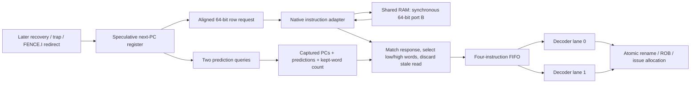

# Block 9: two-instruction fetch and synchronous BRAM adaptation

This block implements IF. It selects speculative instruction PCs, requests an aligned 64-bit
memory row, retains the matching PC/prediction metadata, and buffers up to four instructions
for decode. One row can supply two 32-bit instructions, matching the approved two-wide front end.

rv32_fetch owns the PC, instruction FIFO, credits, redirects, and fetch-fault records.
rv32_instruction_adapter connects its request/response interface to a synchronous native BRAM
port. No AXI instruction transaction is used. The later data path uses the shared RAM's other port.

## 1. Your example: one 64-bit read supplies two instructions

Suppose RAM contains:

```asm
# Byte addresses 0 and 4 occupy the same 64-bit row.
addi x1, x0, 100     # PC 0, low 32 bits of row 0
addi x2, x0, 4       # PC 4, high 32 bits of row 0
```

The core requests byte address 0. The adapter converts it to native row index 0 and enables
the BRAM read. After the enabled rising edge, the synchronous memory output contains both
instruction words. The fetch unit captures them with their own PCs and prediction records,
then presents a valid pair to the two decoder instances.

| Before edge | Memory action at edge | Fetch-buffer action at edge |
|---|---|---|
| E0: request row 0 | Accept/read row 0; its response becomes available after E0 | Record ownership of PCs 0 and 4 |
| E1: response row 0 and request row 8 | Consume row 0 response and accept/read row 8 | Enqueue PCs 0 and 4 |
| E2: decode accepts the pair; response row 8; request row 16 | Consume row 8 and accept/read row 16 | Remove PCs 0/4; enqueue PCs 8/12 |
| E3 onward, with continuous readiness | One row accepted and returned per cycle | Up to two instructions consumed/enqueued per cycle |

These are clock-edge relationships, not a measured FPGA frequency. The ideal fetch path can
sustain two instructions per cycle after filling; downstream dependencies and stalls still
control actual processor throughput. The standalone test explicitly checks this steady-state rate.

A request starting at PC 4 still reads aligned row 0, but keeps only its upper word. PC 0 is
not delivered accidentally. The next row can then continue from PC 8.

## 2. Connections and architectural position



The PC here is speculative fetch state. It is not the architectural next-unexecuted PC saved
by interrupt entry; that state belongs to the later retirement/machine-control integration.

The predictor itself is not implemented in this block. A tested two-query interface can use
external prediction records; prediction-disabled operation constructs PC + 4 records locally.
BTB/PHT storage and retirement training remain block 10. Redirect generation and the complete
recovery barrier remain block 11.

## 3. Signals and their sources/destinations

The package adds a 64-bit fetch_row_t, a three-bit fetch_count_t for counts 0 through 4,
and prediction_pair_t for the two lookup results. The selected 64 KiB RAM has 8,192 fetch rows,
so its native instruction address is 13 bits.

| Fetch signal | Width | Source → destination | Meaning |
|---|---:|---|---|
| clk_i, rst_ni | 1 each | Common clock/reset → IF | Rising-edge state; active-low asynchronous reset |
| enable_i | 1 | Front-end control → fetch | Permit fresh read offers/local-fault creation |
| redirect_i, redirect_pc_i | 1, 32 | Recovery/trap/fence control → fetch | Discard queued path and save new target |
| redirect_done_o | 1 | Fetch → recovery control | Registered local redirect acknowledgment |
| predict_enable_i | 1 | Configuration → fetch | Use external records or local sequential defaults |
| prediction_pc0_o, prediction_pc1_o | 32 each | Fetch → future predictor | Proposed first PC and first PC + 4 |
| prediction_i | 82 | Future predictor → fetch | Two 41-bit prediction records, captured per offer |
| request_valid_o, request_ready_i | 1 each | Fetch ↔ instruction adapter | Transfer a row-read request |
| request_address_o | 32 | Fetch → adapter | Eight-byte-aligned byte address |
| response_valid_i, response_ready_o | 1 each | Adapter ↔ fetch | Transfer the one matching outstanding response |
| response_data_i, response_error_i | 64, 1 | Adapter → fetch | Row data or instruction-access failure |
| fetch_valid_o, fetch_ready_i, fetch_fire_o | 2 each | Fetch ↔ decode/dispatch | Ordered instruction-prefix availability/capacity/transfer |
| fetch_o | 340 | Fetch FIFO → dual decode | Two complete PC/instruction/prediction/exception records |
| occupancy_o | 3 | Fetch → status/tests | Actual queued instruction count |
| transaction_pending_o | 1 | Fetch → status | Registered held offer or accepted outstanding read |
| stale_pending_o | 1 | Fetch → status | That held/outstanding descriptor must be discarded |
| fault_pending_o | 1 | Fetch → control/status | A fetch-fault token has stopped fresh fetching until redirect |
| protocol_error_o | 1 | Fetch → diagnostics | Invalid ready prefix or response without an accepted owner |

| Adapter signal | Width | Source → destination | Meaning |
|---|---:|---|---|
| request_valid_i, request_ready_o, request_address_i | 1, 1, 32 | Fetch ↔ adapter | Same row-read request interface |
| response_valid_o, response_ready_i | 1 each | Adapter ↔ fetch | Retained response and consumption |
| response_data_o, response_error_o | 64, 1 | Adapter → fetch | Matching native data or error |
| bram_enable_o | 1 | Adapter → native RAM port B | Authorize one synchronous row read |
| bram_address_o | 13 | Adapter → native RAM port B/wrapper | Proposed RAM-relative row index, visible before enable |
| bram_data_i | 64 | Native RAM port B → adapter | Synchronous enabled-read output, held when disabled |
| bram_block_i | 1 | External shared-memory control → adapter | Temporarily prevent a new read, for example on a write collision |
| transaction_pending_o | 1 | Adapter → status | An unconsumed response is retained |
| protocol_error_o | 1 | Adapter → diagnostics | An accepted row request was not eight-byte aligned |

The data-store collision detector is not in these modules. External shared-memory control drives
bram_block_i from actual data-port writes and the proposed instruction address. The native address
is intentionally visible independently of enable; deriving a collision hold from an enable-
gated address could create combinational feedback.

## 4. What circuits the RTL describes

The fetch unit contains a 32-bit next-PC register, four instruction records, an occupancy
register, request/response ownership descriptors, sticky stale bits, and a fetch-fault stop bit.
It describes adders for PC progression, alignment masks, word-selection muxes, FIFO shifting,
credit comparisons, and control multiplexers.

Each fetch_packet_t is 170 bits in this configuration. Four queued packets describe 680 payload
bits before synthesis optimization; ownership descriptors and control add further state. The
FIFO is deliberately small and shifts after a consumed prefix rather than using a deep RAM.
The program memory itself remains BRAM, separate from this small instruction queue.

The adapter contains response-valid/error state. It does not create an asynchronous memory
array. The native BRAM output supplies the stored payload: a new read is disabled whenever
its old response cannot be consumed, so that native output retains the correct data.

The memory contract is one native synchronous read stage, with both optional additional output
registers disabled. Enabling more memory-output stages would require a corresponding adapter
change. AMD describes these register/latency choices in the
[Block Memory Generator guide](https://docs.amd.com/api/khub/documents/V70n09duEdKgzrX2d1W97g/content).
The behavioral RAM in the tests implements exactly the documented one-stage contract.

## 5. Credits: why a response cannot overfill the queue

A request promises future storage even before its data returns. The fetch unit reserves the
number of instructions it will keep from that row: one or two. Before a fresh offer it checks:

```text
instructions remaining after this edge's accepted prefix
+ reserved words of the current nonstale outstanding read
+ words promised by the fresh offer
<= four FIFO slots
```

The outstanding reservation remains counted even when that response is being enqueued now.
This allows old response consumption and new request acceptance on the same edge without
borrowing space that does not exist. If a fresh offer stalls, its descriptor and reservation
are retained until acceptance; existing queued instructions can only free further capacity.

For example, with two queued instructions and a two-word response pending, the queue's four
slots are fully promised. If decode accepts both queued instructions at this edge, the two
freed slots permit the next two-word read. If decode accepts none, the old response still
fits, fills the queue, and fresh reads stop. The memory response never waits for speculative
space that was not reserved.

Only one accepted transaction is outstanding. A held unaccepted offer and an accepted pending
read are mutually exclusive in this implementation: a new offer is presented only when the
port is idle or the prior response is being consumed. On an ideal synchronous port, that
response-pop/request-refill overlap sustains a row per cycle.

## 6. Prediction records and choosing one or two words

With prediction disabled, each record's next_pc is PC + 4, flags are clear, and its PHT index
is PC[8:2]. With prediction enabled, both external records are captured when a fresh row is
first offered, even if memory is not ready yet. A later predictor update cannot mutate the
metadata of a held request.

If the starting PC is the lower word and its predicted next PC equals PC + 4, both words are
kept. The following fetch PC comes from the second word's prediction. Otherwise only the first
instruction on that predicted path is kept, and its prediction selects the next fetch PC.
An upper-word start also keeps just one instruction because the next instruction is in another row.

Predicted direction flags do not override next_pc: the predicted instruction path follows the
actual next_pc field. The existing execution units later compare that field with their resolved
next PC, including stale BTB predictions on ordinary instructions.

## 7. Ordered output pairs and partial acceptance

The FIFO presents an ordered prefix: 00, 01, or 11. Downstream ready may advertise no capacity,
one older instruction, or both instructions. Ready 10 is diagnosed and cannot skip the oldest.

This is a **prefix interface**, not two independent stalled completion lanes. When only lane 0
transfers, the unaccepted lane 1 moves to lane 0 next cycle. The next FIFO instruction can fill
lane 1, even when it came from another BRAM row. With a fully stalled pair, its existing records
remain unchanged; returning data only appends behind them.

The connected test deliberately accepts PC 0 alone, then observes PC 4 paired with PC 8. Both
PCs, instruction bits, prediction fields, and exceptions remain attached to the correct record.
Atomic rename/ROB/IQ acceptance still determines which prefix actually advances.

## 8. Redirects, held requests, and stale responses

On redirect, IF immediately masks its output validity/transfer. At the edge it clears the FIFO,
saves the redirect target, and marks any held or accepted read stale. redirect_done acknowledges
this local state update; it does not claim that the old memory response has already returned.

A request previously stalled on request_ready must keep its original address and metadata.
It remains offered through pause or redirect, then its eventual response is drained/discarded.
A request accepted on the redirect edge is also stale. No cancellation is sent to the native
memory interface, so request/response ownership remains unambiguous.

Staleness is sticky for that descriptor. Two or three redirects while one old response waits
cannot toggle it back to current. The latest target remains saved, and fresh requests resume
when the old response is consumed. An old response returning on the redirect edge never appears
briefly as a valid instruction. Even if the target PC equals the old address, the old descriptor
is discarded, which is useful for later FENCE.I integration.

An already accepted stale response can overlap acceptance of the first new-path request. Its
data/error is ignored while the new descriptor becomes the sole live owner.

## 9. Fetch faults, pause, and reset

A misaligned PC produces one local instruction-address fault record with cause 0, tval equal
to that PC, and instruction bits zero. It issues no memory request. A nonstale response error
produces one instruction-access fault record with cause 1 and the first requested instruction's
PC in tval, even when the request started in a row's upper word. The second word is discarded.

Fetch stops creating fresh work until redirect. The fault token can still move to decode/ROB,
where later precise-trap control handles it. Merely consuming the token or toggling enable does
not restart the faulting path. An error in a stale response creates no fault token.

Older response ordering matters. A delayed successful row must enter the FIFO before a local
fault at its predicted successor. If that row instead returns an access fault, that older fault
wins and no younger alignment token is added. Directed tests check both cases.

Adapter out-of-range or misaligned row requests return error with zero data and no native read
enable. Misalignment also diagnoses the row-interface violation. IF itself aligns valid row
requests; architectural PC alignment is checked separately before reaching the adapter. Addresses
outside the executable RAM become instruction-access faults, not peripheral reads.

enable_i stops only fresh offers/local-fault generation. Previously offered requests, accepted
responses, and queued output remain active. A later interrupt-drain controller must also stop
new decode admission; pausing fetch requests alone does not hide already buffered instructions.
Global reset clears fetch and adapter ownership together; both must share the system reset.

## 10. Shared-memory interface contract

Instruction port B reads 64 bits; data port A uses 32-bit words on the same 64 KiB RAM. Both
ports must see the same little-endian bytes: a row at byte address A contains the instruction
at A in bits 31:0 and the instruction at A+4 in bits 63:32. The instruction output has one
synchronous read stage, holds when disabled, and has no additional output-register latency.
External shared-memory control must hold a proposed same-row read during a conflicting write.

This block tests that interface with synchronous memory models. Block 15 also tests the
portable AXI wrapper with a shared executable-RAM model, including a write followed by FENCE.I.
Vendor IP generation, FPGA memory wiring, clock/reset generation, and physical collision
behavior are outside the revised project scope. The fixed part and clock specifications are
retained in [vivado_target.md](vivado_target.md); no synthesized BRAM inference or bitstream is
claimed. AMD's memory-port documentation remains useful background for a later implementation:
[AMD PG058](https://docs.amd.com/api/khub/documents/V70n09duEdKgzrX2d1W97g/content).

## 11. Connected program and measured behavior

The integration test now starts from RAM instruction bits, not directly supplied decoded controls:

```asm
addi x1, x0, 100
addi x2, x0, 4
addi x3, x0, 7
addi x4, x0, 9
div  x5, x1, x2
add  x6, x3, x4
add  x7, x5, x6
addi x8, x7, 1
```

Two actual decoder instances feed the production rename/ROB/IQ/execution/writeback/trace path.
The test injects native-read holds and a partial decode handoff, then stops admission after eight
instructions. Extra speculative fetch data may remain buffered; it is not admitted as program work.

| Measured test cycle | Event |
|---:|---|
| 12 | DIV issues; seed x1 retires with 100 |
| 13 | Independent ADD issues; seed x2/x3 retire with 4/7 |
| 14 | Seed x4 retires with 9 |
| 15 | Independent ADD completion accepted, value 16 |
| 46 | DIV completion accepted, value 25; dependent ADD issues through bypass |
| 47 | DIV and independent ADD retire in program order |
| 49 | Dependent ADD retires with 41 |
| 51 | Final ADDI retires x8=42 |

This demonstrates the composed RAM-to-retirement arithmetic path within block 9's test scope.
Blocks 10–15 add prediction, production recovery, LSU/data AXI, machine control, and the complete
portable core. A board wrapper and boot firmware are outside the revised project scope.

## 12. Verification and waveform reading

Three reproducible testbenches accompany the block:

- tb_block09.sv uses an independent expected instruction queue and abstract delayed single-read
  memory. It checks throughput, credits, upper-word selection, PC wrap, partial pairs, captured
  predictions, pause, repeated redirects, response/redirect races, faults, and mixed traffic.
- tb_block09_adapter.sv checks the native adapter independently, including continuous refill,
  held payloads, last/unmapped/misaligned rows, block-with-response-drain, and reset.
- tb_block09_integration.sv connects synchronous RAM through dual decode to real retirement and
  separately probes native adapter edge cases.

```sh
python3 scripts/run_checks.py --block 9
python3 scripts/run_checks.py --block 9 --waves
```

Current Icarus evidence is **37,319 fetch checks + 28,785 adapter checks + 505 integration
checks = 66,609 checks, zero failures**. Reports list separate case counts and compiled-source
hashes. Optional waveforms are in build/block09. Begin with request-valid/ready/address, native enable/address/data, response
valid/ready, FIFO occupancy, fetch-valid/fire/packets, stale/fault status, and redirect. For the
program path also inspect rename/ROB/IQ fires, accepted completions, PRF write enable, and trace.

Remember that native row address 1 means byte addresses 8 through 15. A redirect can mask valid
before occupancy clears at the edge. A stalled request can remain valid while stale_pending is
true; its response must return before the port can be reused safely.

For Vivado XSim on Linux, the standalone fetch source list is:

```sh
xvlog --sv rtl/rv32_ooo_pkg.sv rtl/rv32_fetch.sv tb/tb_block09.sv
xelab tb_block09 -s block09_sim
xsim block09_sim --runall
```

The adapter test needs the package, rv32_instruction_adapter.sv, and tb_block09_adapter.sv.
The connected case uses all active source modules named in scripts/run_checks.py for block 9;
the shared package must compile first. Vivado/XSim, synthesis, timing, DRC, and bitstream remain
unverified here. Simulation counts do not establish ISA certification or timing closure.

## 13. Interview questions

**Why read 64 bits when the ISA has 32-bit instructions?** Two independent instruction words
per row supply the approved two-wide front end; instruction encoding remains 32 bits.

**Why is PC 4 not a new native row?** Native address 0 contains byte addresses 0 through 7.
Starting at PC 4 selects its upper instruction, while a request at PC 8 selects row 1.

**Why reserve response credits before data returns?** Memory can complete while decode stalls.
Promising FIFO space early prevents a legal response from overflowing the instruction buffer.

**Can one-outstanding operation sustain a read every cycle?** Yes for this one-cycle memory:
the old response can transfer on the same edge as the next request, retaining only one owner.

**Why does a stalled instruction pair compact after a partial transfer?** It is an ordered
prefix interface. Keeping the younger instruction permanently in lane 1 would prevent it from
becoming the next oldest instruction. Completion ports use a different independent-lane contract.

**Why retain prediction metadata during a request stall?** Predictor training may change lookup
results. The fetched instruction must keep the prediction that selected its speculative path.

**Why not cancel a native memory request on a branch redirect?** Retaining the old transaction
preserves handshake ownership. Marking its response stale makes cancellation unnecessary here.

**Why use a sticky stale bit instead of only a toggling epoch bit?** Repeated redirects during
one delayed read could toggle an epoch back to its original value. Sticky state cannot revive it.

**Does redirect_done mean all memory traffic stopped?** No. It acknowledges local FIFO/PC
recovery. An older read can still be draining, protected by its stale ownership state.

**Why does the adapter need the native output to hold when disabled?** It uses that output as
the retained response payload. A stalled response prevents any new enabled read from replacing it.

**Does this block implement branch prediction?** It implements the fetch-side prediction
interface and metadata flow. BTB/PHT storage and training are the next architectural block.

## 14. Source ownership

The fetch unit and adapter are custom RTL. Vendor documentation informs the memory-port contract;
no third-party processor RTL is copied.
