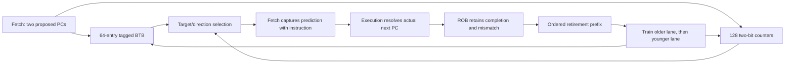

# Block 10: tagged BTB and two-bit branch prediction

The predictor supplies a proposed next PC before decode knows whether the fetched word is a
branch. It has two combinational lookup ports in IF and two ordered training inputs from WB
retirement. The fetch unit from block 9 captures these predictions with each instruction.
Execution later checks them; prediction never determines which result is allowed to commit.

This implementation contains a 64-entry tagged branch target buffer (BTB) and a 128-entry
bimodal pattern history table (PHT). It predicts from each branch PC's recent outcomes. It has
no global-history register, return-address stack, or dedicated loop-count predictor.

## 1. Your example: learn a loop, then leave it

Consider a backward branch at PC 16 whose target is PC 8. Its outcomes are taken, taken,
taken, then not taken. Every PHT entry starts weakly not taken, encoded as 01.

| Counter | Meaning | Direction when the BTB hits |
|---|---|---|
| 00 | Strongly not taken | Next sequential instruction |
| 01 | Weakly not taken | Next sequential instruction |
| 10 | Weakly taken | Stored branch target |
| 11 | Strongly taken | Stored branch target |

A taken outcome increments the counter unless it is already 11. A not-taken outcome
decrements it unless it is already 00. Saturation prevents wraparound: another taken result
at 11 must not turn into a strongly not-taken prediction.

| Retirement event | Counter before | Counter after | What a following lookup predicts |
|---|---|---|---|
| First taken branch | 01 | 10 | Taken after the BTB target has been installed |
| Second taken branch | 10 | 11 | Taken |
| Third taken branch | 11 | 11 | Taken |
| Loop exit, not taken | 11 | 10 | Still taken if this branch is queried again |

One exit does not erase the loop's taken bias. The predictor can miss on an exit and still
improve repeated execution. Two consecutive not-taken outcomes from 11 reach 01 and reverse
the direction prediction. The two bits provide this resistance to a single unusual outcome.

The conditional BTB target remains PC + immediate, here 8, even when the last retired outcome
was not taken and its actual next PC was 20. Caching the fall-through address as the branch
target would corrupt the next taken prediction.

## 2. Connections across IF, EX, and WB



A cold BTB miss returns PC + 4. A conditional hit uses the PHT high bit to choose target or
fall-through. A JAL/JALR hit predicts its cached target unconditionally; it does not use the
direction counter. JALR caches its last resolved target and does not implement a return stack.

The execution units already compare predicted and actual next PCs, including ordinary
instructions that accidentally encounter a stale BTB entry. Block 11 performs the safe
recovery sequence when that mismatch reaches the retirement boundary.

## 3. Signals and ownership

| Signal | Width | Source → destination | Meaning |
|---|---:|---|---|
| clk_i, rst_ni | 1 each | Common clock/reset → predictor | Rising-edge training; active-low asynchronous reset |
| enable_i | 1 | Configuration → lookup | Use table prediction or sequential PC + 4 |
| query_pc0_i, query_pc1_i | 32 each | Fetch → predictor | Proposed first and second instruction PCs |
| prediction_o | 82 | Predictor → fetch | Two 41-bit next-PC/taken/hit/PHT-index records |
| retire_valid_i | 2 | ROB retirement → training | Ordered accepted prefix: 00, 01, or 11 |
| retire_entry_i | 1,010 | ROB head records → training | Original PC/immediate/type plus actual completion metadata |
| invalidate_i | 1 | FENCE.I retirement control → predictor | Bypass stale predictions and clear both tables |
| invalidate_done_o | 1 | Predictor → control/status | Registered acknowledgment of the invalidation edge |
| query0_counter_o, query1_counter_o | 2 each | PHT → debug/tests | Actual stored counters at the queried indices |
| protocol_error_o | 1 | Predictor → integration checks | Malformed prefix or invalid retirement training record |

There is no execution-completion training input. The caller must connect actual retirement
fires, rather than raw execution results. A mispredicted branch can train when it commits;
a squashed younger branch cannot.

## 4. Inferred lookup and update circuits

The BTB index is PC[7:2], selecting one of 64 entries. Its stored PC[31:8] tag distinguishes
other word-aligned PCs sharing that index. Each entry stores valid, conditional, 24 tag bits,
and a 32-bit target: 58 bits per entry. The PHT index is PC[8:2], selecting one of 128 counters.

The two lookups infer independent reads, tag comparators, direction tests, and next-PC
multiplexers. The tables describe 3,968 state bits before implementation optimization; this
is not a claim that Vivado maps them into a particular RAM or achieves a particular frequency.
Training computes next-state updates and writes registers at the clock edge.

If enable_i is zero, lookup returns sequential next PCs with taken/hit clear. Retirement
training still occurs, so disabling prediction changes lookup behavior without disabling the
training logic. Debug counters continue to expose stored state. A misaligned query returns
sequential metadata and cannot use a BTB hit; architectural alignment faults are handled elsewhere.

## 5. Training two instructions without losing an update

Both retiring lanes update next state in program order: lane 0 first, lane 1 second. This is
important when two conditional branches map to one PHT entry. Starting at 11, older taken
followed by younger not taken gives 11 then 10. Updating each lane independently from the old
11 would lose one operation in other outcome/state combinations.

BTB collisions follow the same ordering. Two control instructions sharing an index leave the
younger retired control instruction's tag/target installed. A retired noncontrol instruction
invalidates only its own matching stale BTB tag; an unrelated ordinary PC sharing the index
does not evict the cached branch.

Training checks entry validity, completion, fault absence, aligned PC, decoded class, and
relevant control metadata. Conditional branches also check that the captured PHT index agrees
with the PC index. An invalid older record prevents younger training past it; an invalid younger
record does not erase a valid older update. Valid mask 10 is not a valid retirement prefix.

A not-taken branch may have a misaligned unused target without faulting. Its not-taken outcome
can train the PHT, but that unusable target is not installed in the BTB. A taken misaligned
branch cannot provide a valid nonfaulting training record.

## 6. Invalidation and timing

invalidate_i immediately makes lookup sequential. At the edge it clears BTB entries and
restores PHT counters to 01; invalidate_done_o then acknowledges that edge. Invalidation has
priority over retirement training on the same edge. The complete core asserts it when FENCE.I
retires and separately flushes/restarts fetch through the recovery controller.

Lookup sees registered table state before a training edge and updated state after it. There
is no special same-cycle training bypass. A stalled instruction-memory request keeps the
prediction captured when it was first offered; a later table update cannot rewrite that
instruction's history.

## 7. Tests and waveform reading

Block 10 has 75,009 standalone checks and 971 connected checks, 75,980 total, with zero
failures in the recorded Icarus run. The standalone reference uses separate full-PC BTB state
and integer saturation counters. Tests cover all counter states/outcomes, both lookup ports,
all table indices, collisions, malformed records, disabled lookup, reset, and invalidation.

The block-10 loop test compares 15 full architectural events. Prediction enabled takes 36
test cycles and two recoveries; disabled takes 44 cycles and three recoveries. That harness
uses an explicitly test-only recovery sequencer. Block 15 separately verifies the production
controller/core; its WFI-terminated loop has a different cycle count and one extra final event.

```sh
python3 scripts/run_checks.py --block 10
python3 scripts/run_checks.py --block 10 --waves
```

The exact tested source hashes and case scopes are in reports/block10_results.json. Waveforms
are under build/block10. Start with query PCs, prediction_o, both query counters, retire_valid,
retired branch outcome, and invalidate. Observe a BTB miss becoming a tagged hit only after
retirement, and then see the PHT counter progress 01→10→11. Separate the resolved branch
completion from the later retirement edge that trains it.

No official ACT4 certification, exhaustive formal proof, or Vivado timing/implementation run
is claimed by these results. Prediction accuracy depends on the program and table aliasing;
the example's cycle reduction is a test result, not a general speed guarantee.

## 8. Interview questions

**Why have both a BTB and a PHT?** The BTB supplies a target and whether the cached control
instruction is conditional. The PHT estimates direction for conditional branches.

**Why does a two-bit counter help loops?** One exit weakens a taken prediction without
immediately reversing a strongly learned bias.

**Why store a tag?** Index bits alone cannot distinguish two PCs mapped to the same BTB slot.

**Why is a not-taken branch's target not its actual next PC?** Actual next PC is fall-through
on that execution. The cached taken target still comes from PC + immediate.

**Why train at retirement?** The instruction is then known to belong to committed execution;
wrong-path completions cannot train the tables.

**What happens if both retiring branches share a counter?** Their updates fold sequentially
in architectural order, including saturation at either boundary.

**Does this predictor know the exact loop count?** No. It learns a direction bias from the
PC-indexed counter. Dedicated loop prediction and global history are outside this version.

**What does prediction disable prove?** In a comparison test, architectural events should
remain equivalent even though speculation and execution time differ.

## Complete predictor

Source: `rtl/rv32_branch_predictor.sv`.

```systemverilog
// IF lookup / WB retirement training: tagged BTB and two-bit bimodal direction table.
// Speculative execution has no training port. Only a committed retirement prefix trains state.
`timescale 1ns / 1ps

module rv32_branch_predictor
  import rv32_ooo_pkg::*;
(
  input  logic             clk_i,
  input  logic             rst_ni,
  input  logic             enable_i,
  input  word_t            query_pc0_i,
  input  word_t            query_pc1_i,
  output prediction_pair_t prediction_o,
  input  logic [1:0]       retire_valid_i,
  input  rob_entry_pair_t  retire_entry_i,
  input  logic             invalidate_i,
  output logic             invalidate_done_o,
  output logic [1:0]       query0_counter_o,
  output logic [1:0]       query1_counter_o,
  output logic             protocol_error_o
);
  localparam int BTB_INDEX_W = $clog2(BTB_ENTRIES);

  typedef struct packed {
    logic valid;
    logic conditional;
    logic [XLEN-1:BTB_INDEX_W+2] tag;
    word_t target;
  } btb_entry_t;

  btb_entry_t btb_q [BTB_ENTRIES];
  btb_entry_t btb_d [BTB_ENTRIES];
  logic [1:0] pht_q [PHT_ENTRIES];
  logic [1:0] pht_d [PHT_ENTRIES];

  function automatic logic [1:0] train_counter(
    input logic [1:0] counter, input logic taken
  );
    begin
      train_counter = counter;
      if (taken && counter != 2'b11) train_counter = counter + 2'd1;
      else if (!taken && counter != 2'b00) train_counter = counter - 2'd1;
    end
  endfunction

  function automatic prediction_t lookup(
    input word_t pc, input btb_entry_t entry,
    input logic [1:0] counter, input logic allowed
  );
    prediction_t result;
    begin
      result = '0;
      result.next_pc = pc + 32'd4;
      result.pht_index = pc[PHT_INDEX_W+1:2];
      if (allowed && pc[1:0] == 0 && entry.valid
          && entry.tag == pc[XLEN-1:BTB_INDEX_W+2]) begin
        result.btb_hit = 1'b1;
        result.taken = !entry.conditional || counter[1];
        if (result.taken) result.next_pc = entry.target;
      end
      lookup = result;
    end
  endfunction

  function automatic logic retirement_well_formed(input rob_entry_t entry);
    decoded_uop_t decoded;
    word_t target, actual_next;
    logic good;
    begin
      decoded = entry.uop.decoded;
      target = decoded.fetch.pc + decoded.immediate;
      actual_next = entry.control_flow.next_pc;
      good = entry.valid && entry.complete && !entry.exception.valid
             && decoded.fetch.pc[1:0] == 0 && decoded.op_class != UOP_NONE;
      if (decoded.op_class == UOP_BRANCH) begin
        good = good && entry.control_flow.is_control && entry.control_flow.is_conditional
               && decoded.fetch.prediction.pht_index == decoded.fetch.pc[PHT_INDEX_W+1:2]
               && actual_next == (entry.control_flow.taken ? target : decoded.fetch.pc + 32'd4)
               && (!entry.control_flow.taken || target[1:0] == 0);
      end else if (decoded.op_class == UOP_JUMP) begin
        good = good && entry.control_flow.is_control && !entry.control_flow.is_conditional
               && entry.control_flow.taken && actual_next[1:0] == 0
               && (decoded.jump_indirect || actual_next == target);
      end
      // Nonbranch SYSTEM instructions may later redirect via MRET. Their next-PC
      // metadata must not be constrained to the ordinary sequential value here.
      retirement_well_formed = good;
    end
  endfunction

  always_comb begin : query_tables
    btb_entry_t first, second;
    logic allowed;
    first = btb_q[query_pc0_i[BTB_INDEX_W+1:2]];
    second = btb_q[query_pc1_i[BTB_INDEX_W+1:2]];
    query0_counter_o = rst_ni ? pht_q[query_pc0_i[PHT_INDEX_W+1:2]] : 2'b01;
    query1_counter_o = rst_ni ? pht_q[query_pc1_i[PHT_INDEX_W+1:2]] : 2'b01;
    allowed = rst_ni && enable_i && !invalidate_i;
    prediction_o.lane0 = lookup(query_pc0_i, first, query0_counter_o, allowed);
    prediction_o.lane1 = lookup(query_pc1_i, second, query1_counter_o, allowed);
  end

  always_comb begin : retirement_training
    rob_entry_t retired;
    decoded_uop_t decoded;
    btb_entry_t updated;
    word_t target;
    int index;
    pht_index_t counter_index;
    logic older_good, good;

    for (int i = 0; i < BTB_ENTRIES; i++) btb_d[i] = btb_q[i];
    for (int i = 0; i < PHT_ENTRIES; i++) pht_d[i] = pht_q[i];
    protocol_error_o = 1'b0;
    retired = '0;
    decoded = '0;
    updated = '0;
    target = '0;
    index = 0;
    counter_index = '0;
    older_good = 1'b1;
    good = 1'b0;

    if (invalidate_i) begin
      for (int i = 0; i < BTB_ENTRIES; i++) btb_d[i] = '0;
      for (int i = 0; i < PHT_ENTRIES; i++) pht_d[i] = 2'b01;
    end else if (rst_ni) begin
      if (retire_valid_i == 2'b10) begin
        protocol_error_o = 1'b1;
      end else begin
        // Fold into NEXT state in architectural order. Two same-index outcomes
        // must both affect saturation; the younger BTB replacement wins an alias.
        for (int lane = 0; lane < RETIRE_WIDTH; lane++) begin
          retired = lane == 0 ? retire_entry_i.lane0 : retire_entry_i.lane1;
          if (retire_valid_i[lane]) begin
            good = older_good && retirement_well_formed(retired);
            if (!good) begin
              protocol_error_o = 1'b1;
              if (lane == 0) older_good = 1'b0;
            end else begin
              decoded = retired.uop.decoded;
              index = int'(decoded.fetch.pc[BTB_INDEX_W+1:2]);
              updated = btb_d[index];
              if (decoded.op_class == UOP_BRANCH || decoded.op_class == UOP_JUMP) begin
                target = decoded.op_class == UOP_BRANCH
                         ? decoded.fetch.pc + decoded.immediate : retired.control_flow.next_pc;
                if (decoded.op_class == UOP_BRANCH) begin
                  counter_index = decoded.fetch.prediction.pht_index;
                  pht_d[counter_index] = train_counter(pht_d[counter_index],
                                                       retired.control_flow.taken);
                end
                if (target[1:0] == 0) begin
                  updated.valid = 1'b1;
                  updated.conditional = decoded.op_class == UOP_BRANCH;
                  updated.tag = decoded.fetch.pc[XLEN-1:BTB_INDEX_W+2];
                  updated.target = target;
                end else if (updated.valid
                             && updated.tag == decoded.fetch.pc[XLEN-1:BTB_INDEX_W+2]) begin
                  // A legal not-taken branch may encode a misaligned unused target.
                  // Learn its N outcome, but do not install an unusable target.
                  updated.valid = 1'b0;
                end
              end else if (updated.valid
                           && updated.tag == decoded.fetch.pc[XLEN-1:BTB_INDEX_W+2]) begin
                // Retired noncontrol code removes only its own stale BTB prediction.
                // An unrelated PC sharing this index must not evict the cached branch.
                updated.valid = 1'b0;
              end
              btb_d[index] = updated;
            end
          end
        end
      end
    end
  end

  always_ff @(posedge clk_i or negedge rst_ni) begin
    if (!rst_ni) begin
      for (int i = 0; i < BTB_ENTRIES; i++) btb_q[i] <= '0;
      for (int i = 0; i < PHT_ENTRIES; i++) pht_q[i] <= 2'b01;
      invalidate_done_o <= 1'b0;
    end else begin
      for (int i = 0; i < BTB_ENTRIES; i++) btb_q[i] <= btb_d[i];
      for (int i = 0; i < PHT_ENTRIES; i++) pht_q[i] <= pht_d[i];
      invalidate_done_o <= invalidate_i;
    end
  end
endmodule
```

## Predictor tests

Source: `tb/tb_block10.sv`.

```systemverilog
// BTB/PHT verification using full-PC reference tags and integer saturating counters.
`timescale 1ns / 1ps

module tb_block10;
  import rv32_ooo_pkg::*;

  logic clk = 0, rst_n = 1, enable, invalidate, invalidate_done, protocol_error;
  word_t query_pc0, query_pc1;
  prediction_pair_t prediction;
  logic [1:0] retire_valid, counter0, counter1;
  rob_entry_pair_t retirement;
  logic ref_valid [0:63];
  logic ref_conditional [0:63];
  word_t ref_pc [0:63], ref_target [0:63];
  integer ref_counter [0:127];
  logic ref_ack;
  word_t rng = 32'h10c0ffee;
  integer checks = 0, failures = 0, sequence_id = 0;
  integer i, n, state_value, outcomes, kind, bad, retire_mask;
  rob_entry_t first, second, malformed;
  word_t pc, other_pc, target;
  logic waves;

  rv32_branch_predictor dut (
    .clk_i(clk), .rst_ni(rst_n), .enable_i(enable),
    .query_pc0_i(query_pc0), .query_pc1_i(query_pc1), .prediction_o(prediction),
    .retire_valid_i(retire_valid), .retire_entry_i(retirement),
    .invalidate_i(invalidate), .invalidate_done_o(invalidate_done),
    .query0_counter_o(counter0), .query1_counter_o(counter1), .protocol_error_o(protocol_error)
  );

  function automatic word_t next_random(input word_t value);
    next_random = {value[30:0], value[31] ^ value[21] ^ value[1] ^ value[0]};
  endfunction

  function automatic integer btb_slot(input word_t address);
    btb_slot = (address / 4) % 64;
  endfunction

  function automatic integer pht_slot(input word_t address);
    pht_slot = (address / 4) % 128;
  endfunction

  function automatic rob_entry_t branch_record(
    input word_t address, destination, input logic taken
  );
    rob_entry_t value;
    begin
      value = '0;
      value.valid = 1;
      value.complete = 1;
      value.uop.decoded.op_class = UOP_BRANCH;
      value.uop.decoded.branch_op = BRANCH_NE;
      value.uop.decoded.fetch.pc = address;
      value.uop.decoded.fetch.instruction = 32'hfe009ce3;
      value.uop.decoded.fetch.prediction.next_pc = address + 4;
      value.uop.decoded.fetch.prediction.pht_index = pht_slot(address);
      value.uop.decoded.immediate = destination - address;
      value.control_flow.is_control = 1;
      value.control_flow.is_conditional = 1;
      value.control_flow.taken = taken;
      value.control_flow.mispredicted = taken;
      value.control_flow.next_pc = taken ? destination : address + 4;
      branch_record = value;
    end
  endfunction

  function automatic rob_entry_t jump_record(
    input word_t address, destination, input logic indirect
  );
    rob_entry_t value;
    begin
      value = branch_record(address, destination, 1'b1);
      value.uop.decoded.op_class = UOP_JUMP;
      value.uop.decoded.jump_indirect = indirect;
      value.uop.decoded.writes_rd = 1;
      value.uop.decoded.rd = 1;
      value.uop.pdst = 32;
      value.control_flow.is_conditional = 0;
      jump_record = value;
    end
  endfunction

  function automatic rob_entry_t ordinary_record(input word_t address);
    rob_entry_t value;
    begin
      value = '0;
      value.valid = 1;
      value.complete = 1;
      value.uop.decoded.op_class = UOP_INTEGER;
      value.uop.decoded.alu_op = ALU_ADD;
      value.uop.decoded.fetch.pc = address;
      value.uop.decoded.fetch.instruction = NOP_INSTRUCTION;
      value.uop.decoded.fetch.prediction.pht_index = pht_slot(address);
      value.control_flow.next_pc = address + 4;
      ordinary_record = value;
    end
  endfunction

  // This is the retirement interface contract, not a second instruction decoder.
  function automatic logic record_ok(input rob_entry_t value);
    word_t address, branch_target, expected_pc;
    logic usable;
    begin
      address = value.uop.decoded.fetch.pc;
      branch_target = address + value.uop.decoded.immediate;
      usable = value.valid && value.complete && !value.exception.valid && address % 4 == 0
               && value.uop.decoded.op_class != UOP_NONE;
      if (value.uop.decoded.op_class == UOP_BRANCH) begin
        expected_pc = value.control_flow.taken ? branch_target : address + 4;
        usable = usable && value.control_flow.is_control && value.control_flow.is_conditional
                 && value.uop.decoded.fetch.prediction.pht_index == pht_slot(address)
                 && value.control_flow.next_pc == expected_pc
                 && (!value.control_flow.taken || branch_target % 4 == 0);
      end else if (value.uop.decoded.op_class == UOP_JUMP) begin
        usable = usable && value.control_flow.is_control && !value.control_flow.is_conditional
                 && value.control_flow.taken && value.control_flow.next_pc % 4 == 0;
        if (!value.uop.decoded.jump_indirect)
          usable = usable && value.control_flow.next_pc == branch_target;
      end
      record_ok = usable;
    end
  endfunction

  function automatic logic expected_error;
    begin
      expected_error = 0;
      if (rst_n && !invalidate) begin
        if (retire_valid == 2'b10) expected_error = 1;
        if (retire_valid[0] && !record_ok(retirement.lane0)) expected_error = 1;
        if (retire_valid[1] && !record_ok(retirement.lane1)) expected_error = 1;
      end
    end
  endfunction

  function automatic prediction_t predicted(input word_t address);
    prediction_t result;
    integer slot, counter_index;
    begin
      result = '0;
      result.next_pc = address + 4;
      counter_index = pht_slot(address);
      result.pht_index = counter_index;
      slot = btb_slot(address);
      if (rst_n && enable && !invalidate && address % 4 == 0
          && ref_valid[slot] && ref_pc[slot] == address) begin
        result.btb_hit = 1;
        result.taken = !ref_conditional[slot] || ref_counter[counter_index] >= 2;
        if (result.taken) result.next_pc = ref_target[slot];
      end
      predicted = result;
    end
  endfunction

  task automatic check(input logic condition, input string label_text);
    begin
      checks = checks + 1;
      if (condition !== 1'b1) begin
        failures = failures + 1;
        if (failures <= 35) $display("FAIL: %s time=%0t", label_text, $time);
      end
    end
  endtask

  task automatic evaluate;
    prediction_pair_t expected;
    begin
      expected.lane0 = predicted(query_pc0);
      expected.lane1 = predicted(query_pc1);
      check(prediction == expected, "both asynchronous lookups match independent full-PC model");
      check(counter0 == (rst_n ? ref_counter[pht_slot(query_pc0)] : 1)
            && counter1 == (rst_n ? ref_counter[pht_slot(query_pc1)] : 1),
            "debug counter values show actual registered state even with lookup disabled");
      check(invalidate_done == ref_ack, "invalidation acknowledgement follows its clock edge");
      check(protocol_error == expected_error(), "retirement validity diagnostics match contract");
    end
  endtask

  task automatic clear_reference;
    begin
      for (integer index = 0; index < 64; index++) begin
        ref_valid[index] = 0;
        ref_conditional[index] = 0;
        ref_pc[index] = 0;
        ref_target[index] = 0;
      end
      for (integer index = 0; index < 128; index++) ref_counter[index] = 1;
    end
  endtask

  // Full PC equality and bounded integer arithmetic differ from the RTL's tag slices/counter logic.
  task automatic train_reference(input rob_entry_t value);
    integer slot, counter_index, adjusted;
    word_t address, destination;
    begin
      address = value.uop.decoded.fetch.pc;
      slot = btb_slot(address);
      if (value.uop.decoded.op_class == UOP_BRANCH) begin
        counter_index = value.uop.decoded.fetch.prediction.pht_index;
        adjusted = ref_counter[counter_index] + (value.control_flow.taken ? 1 : -1);
        if (adjusted < 0) adjusted = 0;
        if (adjusted > 3) adjusted = 3;
        ref_counter[counter_index] = adjusted;
        destination = address + value.uop.decoded.immediate;
        if (destination % 4 == 0) begin
          ref_valid[slot] = 1;
          ref_pc[slot] = address;
          ref_target[slot] = destination;
          ref_conditional[slot] = 1;
        end else if (ref_valid[slot] && ref_pc[slot] == address) ref_valid[slot] = 0;
      end else if (value.uop.decoded.op_class == UOP_JUMP) begin
        ref_valid[slot] = 1;
        ref_pc[slot] = address;
        ref_target[slot] = value.control_flow.next_pc;
        ref_conditional[slot] = 0;
      end else if (ref_valid[slot] && ref_pc[slot] == address) ref_valid[slot] = 0;
    end
  endtask

  task automatic cycle;
    begin
      #1; evaluate;
      #1; clk = 1;
      ref_ack = invalidate;
      if (invalidate) clear_reference;
      else if (retire_valid != 2'b10 && retire_valid[0] && record_ok(retirement.lane0)) begin
        train_reference(retirement.lane0);
        if (retire_valid[1] && record_ok(retirement.lane1)) train_reference(retirement.lane1);
      end
      #1; clk = 0; #1; evaluate;
    end
  endtask

  task automatic query(input word_t address0, address1);
    begin query_pc0 = address0; query_pc1 = address1; #1; evaluate; end
  endtask

  task automatic retire_pair(
    input rob_entry_t older, younger, input logic [1:0] mask
  );
    begin
      retirement.lane0 = older; retirement.lane1 = younger; retire_valid = mask;
      cycle;
      retire_valid = 0; retirement = '0; #1; evaluate;
    end
  endtask

  task automatic retire_one(input rob_entry_t value);
    begin retire_pair(value, '0, 2'b01); end
  endtask

  task automatic invalidate_tables;
    begin
      invalidate = 1; cycle;
      invalidate = 0; retire_valid = 0; retirement = '0; #1; evaluate;
    end
  endtask

  task automatic reset_dut;
    begin
      clk = 0; enable = 1; invalidate = 0; retire_valid = 0; retirement = '0;
      query_pc0 = 0; query_pc1 = 4; ref_ack = 0;
      rst_n = 0; clear_reference; #2; evaluate;
      rst_n = 1; #1; evaluate;
    end
  endtask

  task automatic sweep_tables;
    begin
      for (integer index = 0; index < 64; index++)
        query(ref_pc[index], ref_pc[index] ^ 32'h100);
      for (integer index = 0; index < 128; index++)
        query(32'h8000 + index * 4, 32'h10000 + ((index + 47) % 128) * 4);
    end
  endtask

  initial begin #3000000; $fatal(1, "Branch predictor test timed out"); end
  initial begin
    waves = $test$plusargs("waves");
    if (waves) begin
      $dumpfile("build/block10/block10.vcd");
      $dumpvars(0, tb_block10);
    end
    reset_dut;
    check(BTB_ENTRIES == 64 && PHT_ENTRIES == 128,
          "approved BTB and PHT dimensions remain fixed");

    // Leading example: the loop target must remain static even after its not-taken exit.
    pc = 32'h40; target = 32'h20; query(pc, pc + 4);
    check(counter0 == 1 && !prediction.lane0.btb_hit && !prediction.lane0.taken,
          "cold loop branch has weak not-taken state and no cached target");
    retire_one(branch_record(pc, target, 1));
    check(counter0 == 2 && prediction.lane0.taken && prediction.lane0.next_pc == target,
          "first retired taken outcome installs target and weak taken state");
    retire_one(branch_record(pc, target, 1));
    check(counter0 == 3, "second taken outcome strengthens the loop prediction");
    retire_one(branch_record(pc, target, 1));
    check(counter0 == 3, "taken saturation cannot wrap back to not-taken");
    retire_one(branch_record(pc, target, 0));
    check(counter0 == 2 && prediction.lane0.taken && prediction.lane0.next_pc == target,
          "loop exit weakens direction but BTB retains the loop target instead of fall-through");
    retire_one(branch_record(pc, target, 0));
    check(counter0 == 1 && prediction.lane0.btb_hit && !prediction.lane0.taken
          && prediction.lane0.next_pc == pc + 4,
          "second not-taken outcome crosses the direction threshold but retains a BTB hit");
    retire_one(branch_record(pc, target, 0)); retire_one(branch_record(pc, target, 0));
    check(counter0 == 0, "not-taken saturation cannot wrap to taken");

    // Both training records may touch one counter. Saturation makes ordering observable.
    for (state_value = 0; state_value < 4; state_value++) begin
      for (outcomes = 0; outcomes < 4; outcomes++) begin
        invalidate_tables; pc = 32'h80; other_pc = pc + 32'h200; query(pc, other_pc);
        if (state_value == 0) retire_one(branch_record(pc, 32'h60, 0));
        if (state_value >= 2) retire_one(branch_record(pc, 32'h60, 1));
        if (state_value == 3) retire_one(branch_record(pc, 32'h60, 1));
        check(counter0 == state_value, "collision test starts from each counter state");
        first = branch_record(pc, 32'h60, outcomes[1]);
        second = branch_record(other_pc, 32'h300, outcomes[0]);
        retire_pair(first, second, 3);
        check(!prediction.lane0.btb_hit && prediction.lane1.btb_hit,
              "younger control owns an aliased BTB slot after ordered pair training");
      end
    end

    // Exercise every PHT location and both lookup ports, including each BTB replacement index.
    if (waves) $dumpoff;
    invalidate_tables;
    for (i = 0; i < 128; i++) begin
      pc = 32'h1000 + i * 4; query(pc, pc);
      retire_one(branch_record(pc, pc + 32'h100, 1));
      retire_one(branch_record(pc, pc + 32'h100, 1));
      retire_one(branch_record(pc, pc + 32'h100, 0));
      retire_one(branch_record(pc, pc + 32'h100, 0));
      retire_one(branch_record(pc, pc + 32'h100, 0));
      check(counter0 == 0 && counter1 == 0, "each PHT counter reaches both saturation boundaries");
    end
    sweep_tables;

    // A BTB collision need not be a PHT collision: PC+256 changes the seventh PHT index bit.
    invalidate_tables; pc = 32'h44; other_pc = pc + 32'h100; query(pc, other_pc);
    retire_pair(branch_record(pc, 32'h100, 1), branch_record(other_pc, 32'h200, 1), 3);
    check(counter0 == 2 && counter1 == 2 && !prediction.lane0.btb_hit
          && prediction.lane1.next_pc == 32'h200,
          "independent PHT counters coexist while the younger BTB alias replaces the older tag");

    // Ordinary instructions evict only their own stale tag, never another PC's alias.
    retire_one(ordinary_record(pc));
    check(prediction.lane1.btb_hit, "ordinary alias does not evict a different cached branch PC");
    retire_one(ordinary_record(other_pc));
    check(!prediction.lane1.btb_hit && counter1 == 2,
          "ordinary instruction invalidates its own stale BTB entry without training PHT");
    retire_pair(branch_record(pc, 32'h100, 1), ordinary_record(other_pc), 3);
    check(prediction.lane0.btb_hit,
          "younger ordinary alias preserves an older branch installation");
    retire_pair(branch_record(pc, 32'h100, 0), ordinary_record(pc), 3);
    check(!prediction.lane0.btb_hit,
          "younger same-PC ordinary record clears the older branch entry");

    // Unconditional jumps use cached targets even when the direction counter predicts not-taken.
    pc = 32'h90; query(pc, pc + 4);
    retire_one(branch_record(pc, 32'h80, 0));
    retire_one(jump_record(pc, 32'h400, 0));
    check(counter0 == 0 && prediction.lane0.taken && prediction.lane0.next_pc == 32'h400,
          "JAL prediction is unconditional and does not train its PHT counter");
    retire_one(jump_record(pc, 32'hc00, 1));
    check(counter0 == 0 && prediction.lane0.next_pc == 32'hc00,
          "JALR learns its latest resolved target without changing direction state");
    first = ordinary_record(pc); first.uop.decoded.op_class = UOP_SYSTEM;
    first.uop.decoded.system_op = SYS_MRET; first.control_flow.is_control = 1;
    first.control_flow.next_pc = 32'h8000;
    retire_one(first);
    check(!prediction.lane0.btb_hit && counter0 == 0,
          "system return metadata does not turn SYSTEM into a BTB jump");

    // Lookup disable changes prediction only; accepted retirement still trains the tables.
    enable = 0; pc = 32'ha0; query(pc, pc + 4);
    retire_one(branch_record(pc, 32'h700, 1));
    check(counter0 == 2 && !prediction.lane0.btb_hit && prediction.lane0.next_pc == pc + 4,
          "disabled lookup stays sequential while retired outcomes continue to train");
    enable = 1; #1; evaluate;
    check(prediction.lane0.taken && prediction.lane0.next_pc == 32'h700,
          "reenabling lookup exposes retained trained state");

    // Misaligned query PCs never match a cached aligned instruction.
    for (i = 1; i < 4; i++) begin
      query(pc + i, pc);
      check(!prediction.lane0.btb_hit && !prediction.lane0.taken,
            "misaligned lookup forces sequential prediction with no BTB hit");
    end
    pc = 32'hfffffffc; query(pc, pc + 4);
    retire_one(branch_record(pc, 0, 1));
    check(prediction.lane0.next_pc == 0 && prediction.lane0.btb_hit,
          "PC-relative arithmetic wraps at the architectural 32-bit boundary");

    // A legal not-taken branch can have an unusable taken target.
    pc = 32'h200; query(pc, pc + 32'h100);
    retire_one(branch_record(pc, pc + 8, 1));
    retire_one(branch_record(pc, pc + 2, 0));
    check(counter0 == 1 && !prediction.lane0.btb_hit,
          "non-taken misaligned target trains direction but clears only its own unusable target");
    retire_one(jump_record(pc + 32'h100, 32'h800, 0));
    retire_one(branch_record(pc, pc + 2, 0));
    check(prediction.lane1.btb_hit && prediction.lane1.next_pc == 32'h800,
          "uninstallable branch target does not evict a different PC's valid alias");

    // Invalid retirement records cannot pollute either table; older valid training still applies.
    for (bad = 0; bad < 13; bad++) begin
      first = branch_record(32'h300, 32'h280, 1);
      malformed = branch_record(32'h500, 32'h480, 1);
      case (bad)
        0: malformed.valid = 0;
        1: malformed.complete = 0;
        2: malformed.exception.valid = 1;
        3: malformed.uop.decoded.fetch.pc = 32'h502;
        4: malformed.uop.decoded.op_class = UOP_NONE;
        5: malformed.control_flow.is_control = 0;
        6: malformed.control_flow.is_conditional = 0;
        7: malformed.uop.decoded.fetch.prediction.pht_index = 0;
        8: malformed.control_flow.next_pc = 32'h484;
        9: begin
          malformed.uop.decoded.immediate = 2;
          malformed.control_flow.next_pc = 32'h502;
        end
        10: begin malformed = jump_record(32'h500, 32'h480, 0);
                  malformed.control_flow.taken = 0; end
        11: begin malformed = jump_record(32'h500, 32'h482, 1); end
        12: begin malformed = jump_record(32'h500, 32'h480, 0);
                  malformed.control_flow.next_pc = 32'h484; end
      endcase
      query(32'h300, 32'h500);
      retire_pair(malformed, first, 3);
      retire_pair(first, malformed, 3);
      retire_pair('0, first, 2'b10);
      sweep_tables;
    end

    // Invalidation masks lookups immediately and overrides even malformed retirement sidebands.
    if (waves) $dumpon;
    invalidate_tables;
    for (i = 0; i < 64; i++)
      retire_one(jump_record(32'h4000 + i * 4, 32'h8000 + i * 8, 1));
    query(32'h4000, 32'h40fc);
    check(prediction.lane0.btb_hit && prediction.lane1.btb_hit,
          "invalidation fixture fills all cached targets");
    retirement.lane0 = '0; retirement.lane1 = '0; retire_valid = 2'b10; invalidate = 1;
    #1; evaluate;
    check(!prediction.lane0.btb_hit && !protocol_error,
          "invalidation bypass masks predictions before the edge and ignores bad retirement");
    cycle; invalidate = 0; retire_valid = 0; retirement = '0;
    for (i = 0; i < 64; i++) query(32'h4000 + i * 4, 32'h4000 + ((i+19) % 64) * 4);
    sweep_tables;
    check(invalidate_done, "invalidation acknowledgement remains registered until the next edge");
    cycle; check(!invalidate_done, "acknowledgement drops after invalidation deasserts");

    // Random retirement groups preserve program-order folding while both lookup PCs move freely.
    if (waves) $dumpoff;
    for (n = 0; n < 2500; n++) begin
      rng = next_random(rng); pc = {16'h1234, rng[15:2], 2'b0};
      rng = next_random(rng); other_pc = n % 3 == 0 ? pc + 32'h200 : (rng & 32'h0000fffc);
      rng = next_random(rng); target = rng & 32'hffff_fffc;
      kind = rng[2:0];
      if (kind < 4) first = branch_record(pc, target, rng[3]);
      else if (kind < 6) first = jump_record(pc, target, kind[0]);
      else first = ordinary_record(pc);
      rng = next_random(rng);
      if (rng[1:0] < 2) second = branch_record(other_pc, target ^ 32'h400, rng[3]);
      else if (rng[1:0] == 2) second = jump_record(other_pc, target, 1);
      else second = ordinary_record(other_pc);
      if (n % 17 == 0) second.exception.valid = 1;
      if (n % 23 == 0) first.complete = 0;
      enable = n % 13 != 0; invalidate = n % 101 == 100;
      query_pc0 = n % 4 == 0 ? pc + 1 : pc;
      query_pc1 = n % 5 == 0 ? other_pc ^ 32'h100 : other_pc;
      case (rng[5:4])
        0: retire_mask = 0;
        1: retire_mask = 1;
        2: retire_mask = 3;
        default: retire_mask = n % 7 == 0 ? 2 : 3;
      endcase
      retire_pair(first, second, retire_mask);
      if (n % 97 == 0) sweep_tables;
    end
    invalidate = 0; enable = 1; retire_valid = 0; retirement = '0; sweep_tables;

    // Reset must dominate occupied prediction state and outstanding training inputs.
    if (waves) $dumpon;
    retire_one(branch_record(32'hc0, 32'h80, 1));
    for (i = 0; i < 64; i++)
      retire_one(jump_record(32'h6000 + i * 4, 32'ha000 + i * 8, 1));
    query(32'h6000, 32'h60fc);
    retirement.lane0 = branch_record(32'hc0, 32'h40, 1); retire_valid = 1;
    rst_n = 0; ref_ack = 0; clear_reference; #2; evaluate;
    check(!prediction.lane0.btb_hit && counter0 == 1 && !invalidate_done,
          "asynchronous reset discards learned state and pending training");
    rst_n = 1; retire_valid = 0; retirement = '0; #1; evaluate;
    for (i = 0; i < 64; i++) query(32'h6000 + i * 4, 32'h6000 + ((i+13) % 64) * 4);
    sweep_tables;
    $display("BLOCK10 SUMMARY: %0d checks, %0d failures", checks, failures);
    if (failures) $fatal(1, "Branch predictor unit checks failed");
    $finish;
  end
endmodule
```

## Loop integration with test-only recovery

Source: `tb/tb_block10_integration.sv`.

```systemverilog
// Actual RAM loop with production fetch/prediction/OoO execution and ordered training.
// Recovery sequencing below is a TEST DRIVER; the production controller is block 11.
`timescale 1ns / 1ps
module tb_block10_integration;
  import rv32_ooo_pkg::*;

  typedef enum logic [1:0] {RUN, CANCEL, APPLY} recovery_phase_e;
  recovery_phase_e phase = RUN;
  logic clk = 0, rst_n = 1, predict_enabled = 0, finished = 0, inspect_mode = 0;
  logic [1:0] front_valid, rename_ready, rename_fire, rob_ready, rob_fire;
  logic [1:0] iq_ready, iq_fire, src1_ready, src2_ready, wb_valid;
  logic [1:0] wb_ready, wb_accepted, wb_rejected, head_valid, head_complete;
  logic [1:0] head_ready, retire_fire, trap_fire, write_enable, issue_fire;
  logic [1:0] alu_valid, alu_ready, wb_raw_valid, broadcast_valid, writeback_occupancy;
  decoded_pair_t decoded;
  renamed_pair_t renamed, retiring;
  completion_sources_t sources;
  logic [4:0] source_valid, source_ready;
  logic writeback_done, writeback_quiescent, writeback_error;
  completion_pair_t wb_raw, broadcast, wb, alu_completion;
  completion_t md_completion;
  phys_reg_t write0_addr, write1_addr;
  word_t write0_data, write1_data;
  rob_tag_pair_t tags;
  rob_entry_pair_t heads;
  retire_trace_pair_t events, trace;
  execute_packet_pair_t issued;
  memory_entry_t memory;
  phys_reg_t r00, r01, r10, r11, committed_phys;
  arch_reg_t committed_arch;
  word_t v00, v01, v10, v11, mispredict_pc;
  phys_mask_t free_mask, ready_mask;
  phys_count_t free_count;
  rob_index_t head_index, query_age;
  rob_count_t rob_occupancy;
  issue_count_t iq_occupancy;
  logic [ISSUE_DEPTH-1:0] occupied;
  rob_tag_t mispredict_tag;
  logic alu0_available, alu1_available, md_available, memory_available;
  logic md_valid, md_ready, memory_valid, apply, cancel, cancel_done;
  logic [2:0] cluster_busy;
  logic cluster_quiescent, cluster_error, wb_allow, issue_enable, admission_hold;
  logic rename_done, rob_done, iq_done, rename_error, rob_error, iq_error;
  logic trace_error, write_error, recovery, mispredict, serial_pending, fault_pending;
  logic query_live, full, empty;

  logic [1:0] fetched_valid, fetched_fire;
  fetch_pair_t fetched;
  fetch_count_t fetch_occupancy;
  logic fetch_transaction, fetch_stale, fetch_fault, fetch_error, redirect_done;
  word_t prediction_pc0, prediction_pc1, recovery_pc = 0;
  prediction_pair_t prediction;
  logic [1:0] counter0, counter1;
  logic invalidate = 0, invalidate_done, predictor_error;
  logic request_valid, request_ready, response_valid, response_ready, response_error;
  word_t request_address;
  fetch_row_t response_data, bram_data = 0;
  logic bram_enable, adapter_pending, adapter_error;
  logic [BRAM_FETCH_ADDR_W-1:0] bram_address;
  fetch_row_t rows [0:RAM_FETCH_ROWS-1];

  word_t reference_regs [0:31];
  word_t reference_pc;
  retire_trace_t enabled_trace [0:14];
  integer checks = 0, failures = 0, cycle_number = 0;
  integer retired_count = 0, branch_count = 0, recovery_count = 0;
  integer dispatched_count = 0, accepted_count = 0, predicted_taken_count = 0;
  integer enabled_cycles, disabled_cycles, enabled_recoveries, disabled_recoveries;
  integer expected_branch_number, watchdog, row, mode;

  assign wb_allow = 1'b1;
  assign cancel = phase != RUN;
  assign apply = phase == APPLY;
  assign admission_hold = phase != RUN || finished;
  assign issue_enable = phase == RUN && !finished;
  assign front_valid = rst_n && phase == RUN && !finished ? fetched_valid : 2'b00;
  // Single-expression readiness avoids procedural default/override toggles through
  // the ROB's combinational head-record output in event-driven simulation.
  assign head_ready = phase != RUN || finished ? 2'b00
                      : (head_valid[0] && heads.lane0.uop.decoded.fetch.pc == 20)
                        ? 2'b01 : 2'b11;

  rv32_fetch fetch (
    .clk_i(clk), .rst_ni(rst_n),
    .enable_i(phase == RUN && !finished && !mispredict),
    .redirect_i(apply), .redirect_pc_i(recovery_pc), .redirect_done_o(redirect_done),
    .predict_enable_i(predict_enabled), .prediction_pc0_o(prediction_pc0),
    .prediction_pc1_o(prediction_pc1), .prediction_i(prediction),
    .request_valid_o(request_valid), .request_ready_i(request_ready),
    .request_address_o(request_address), .response_valid_i(response_valid),
    .response_ready_o(response_ready), .response_data_i(response_data),
    .response_error_i(response_error), .fetch_valid_o(fetched_valid),
    .fetch_ready_i(rename_fire), .fetch_o(fetched), .fetch_fire_o(fetched_fire),
    .occupancy_o(fetch_occupancy), .transaction_pending_o(fetch_transaction),
    .stale_pending_o(fetch_stale), .fault_pending_o(fetch_fault), .protocol_error_o(fetch_error)
  );
  rv32_branch_predictor predictor (
    .clk_i(clk), .rst_ni(rst_n), .enable_i(predict_enabled),
    .query_pc0_i(prediction_pc0), .query_pc1_i(prediction_pc1), .prediction_o(prediction),
    .retire_valid_i(retire_fire), .retire_entry_i(heads),
    .invalidate_i(invalidate), .invalidate_done_o(invalidate_done),
    .query0_counter_o(counter0), .query1_counter_o(counter1), .protocol_error_o(predictor_error)
  );
  rv32_instruction_adapter instruction_memory (
    .clk_i(clk), .rst_ni(rst_n), .request_valid_i(request_valid),
    .request_ready_o(request_ready), .request_address_i(request_address),
    .response_valid_o(response_valid), .response_ready_i(response_ready),
    .response_data_o(response_data), .response_error_o(response_error),
    .bram_block_i(1'b0), .bram_enable_o(bram_enable), .bram_address_o(bram_address),
    .bram_data_i(bram_data), .transaction_pending_o(adapter_pending),
    .protocol_error_o(adapter_error)
  );
  always_ff @(posedge clk) begin
    if (bram_enable) bram_data <= rows[bram_address];
  end
  rv32_decoder decoder0 (.fetch_i(fetched.lane0), .decoded_o(decoded.lane0));
  rv32_decoder decoder1 (.fetch_i(fetched.lane1), .decoded_o(decoded.lane1));

  rv32_rename rename (
    .clk_i(clk), .rst_ni(rst_n), .dispatch_valid_i(front_valid),
    .dispatch_resources_ready_i(rob_ready & iq_ready), .decoded_i(decoded),
    .dispatch_rob_tag_i(tags), .dispatch_ready_o(rename_ready), .dispatch_fire_o(rename_fire),
    .renamed_o(renamed), .src1_ready_o(src1_ready), .src2_ready_o(src2_ready),
    .completion_valid_i(broadcast_valid), .completion_i(broadcast),
    .retire_valid_i(retire_fire), .retire_uop_i(retiring),
    .recover_i(apply), .recover_done_o(rename_done),
    .committed_query_arch_i(committed_arch), .committed_query_phys_o(committed_phys),
    .free_mask_o(free_mask), .ready_mask_o(ready_mask), .free_count_o(free_count),
    .protocol_error_o(rename_error)
  );
  assign retiring.lane0 = heads.lane0.uop;
  assign retiring.lane1 = heads.lane1.uop;
  rv32_reorder_buffer rob (
    .clk_i(clk), .rst_ni(rst_n), .dispatch_hold_i(admission_hold),
    .dispatch_valid_i(rename_fire), .dispatch_uop_i(renamed),
    .dispatch_ready_o(rob_ready), .dispatch_fire_o(rob_fire), .dispatch_tag_o(tags),
    .completion_valid_i(wb_valid), .completion_i(wb), .completion_ready_o(wb_ready),
    .completion_accepted_o(wb_accepted), .completion_rejected_o(wb_rejected),
    .head_valid_o(head_valid), .head_complete_o(head_complete), .head_entry_o(heads),
    .head_ready_i(head_ready), .head_trap_target_i(32'h100),
    .retire_fire_o(retire_fire), .trap_fire_o(trap_fire), .retirement_event_o(events),
    .recovery_required_o(recovery), .mispredict_pending_o(mispredict),
    .mispredict_tag_o(mispredict_tag), .mispredict_next_pc_o(mispredict_pc),
    .serial_pending_o(serial_pending), .fault_pending_o(fault_pending),
    .flush_i(apply), .flush_done_o(rob_done), .query_tag_i(wb.lane0.rob_tag),
    .query_live_o(query_live), .query_age_o(query_age), .head_index_o(head_index),
    .occupancy_o(rob_occupancy), .full_o(full), .empty_o(empty), .protocol_error_o(rob_error)
  );
  rv32_physical_regfile prf (
    .clk_i(clk), .rst_ni(rst_n),
    .read0_rs1_i(inspect_mode ? committed_phys : r00), .read0_rs2_i(r01),
    .read1_rs1_i(r10), .read1_rs2_i(r11),
    .read0_data1_o(v00), .read0_data2_o(v01),
    .read1_data1_o(v10), .read1_data2_o(v11),
    .write_enable_i(write_enable), .write0_addr_i(write0_addr),
    .write1_addr_i(write1_addr), .write0_data_i(write0_data),
    .write1_data_i(write1_data), .write_conflict_o(write_error)
  );
  rv32_issue_queue iq (
    .clk_i(clk), .rst_ni(rst_n), .dispatch_hold_i(admission_hold),
    .issue_hold_i(recovery || cancel || !issue_enable),
    .dispatch_valid_i(rename_fire), .dispatch_uop_i(renamed),
    .dispatch_src1_ready_i(src1_ready), .dispatch_src2_ready_i(src2_ready),
    .dispatch_ready_o(iq_ready), .dispatch_fire_o(iq_fire),
    .completion_valid_i(broadcast_valid), .completion_i(broadcast),
    .rob_head_valid_i(head_valid[0]), .rob_head_index_i(head_index),
    .rob_head_tag_i(heads.lane0.uop.rob_tag),
    .mispredict_pending_i(mispredict), .mispredict_tag_i(mispredict_tag),
    .alu0_ready_i(alu0_available), .alu1_ready_i(alu1_available),
    .muldiv_ready_i(md_available), .memory_ready_i(1'b0), .system_ready_i(1'b0),
    .issue_fire_o(issue_fire), .issue_packet_o(issued),
    .read0_rs1_o(r00), .read0_rs2_o(r01), .read1_rs1_o(r10), .read1_rs2_o(r11),
    .read0_data1_i(v00), .read0_data2_i(v01),
    .read1_data1_i(v10), .read1_data2_i(v11),
    .flush_i(apply), .flush_done_o(iq_done), .occupancy_o(iq_occupancy),
    .occupied_mask_o(occupied), .protocol_error_o(iq_error)
  );
  rv32_execution_cluster execute (
    .clk_i(clk), .rst_ni(rst_n), .issue_fire_i(issue_fire), .issue_packet_i(issued),
    .alu0_ready_o(alu0_available), .alu1_ready_o(alu1_available),
    .muldiv_ready_o(md_available), .memory_ready_o(memory_available),
    .alu_completion_valid_o(alu_valid), .alu_completion_ready_i(alu_ready),
    .alu_completion_o(alu_completion), .muldiv_completion_valid_o(md_valid),
    .muldiv_completion_ready_i(md_ready), .muldiv_completion_o(md_completion),
    .memory_valid_o(memory_valid), .memory_ready_i(1'b0), .memory_o(memory),
    .cancel_i(cancel), .cancel_done_o(cancel_done), .busy_o(cluster_busy),
    .quiescent_o(cluster_quiescent), .protocol_error_o(cluster_error)
  );
  rv32_trace_recorder recorder (
    .clk_i(clk), .rst_ni(rst_n), .event_i(events), .trace_o(trace),
    .protocol_error_o(trace_error)
  );

  // Stall both sides of the real ROB interface together. The DUT retains results;
  // the ROB must not consume a packet on an edge that writeback sees as blocked.
  assign wb = wb_raw;
  assign wb_valid = wb_raw_valid & {2{wb_allow}};
  assign source_valid = {2'b00, md_valid, alu_valid};
  assign alu_ready = source_ready[1:0];
  assign md_ready = source_ready[2];
  always_comb begin
    sources = '0;
    sources.alu0_result = alu_completion.lane0;
    sources.alu1_result = alu_completion.lane1;
    sources.muldiv_result = md_completion;
    // Memory/system completion producers are inactive in this arithmetic program.
    sources.memory_result = '0;
    sources.system_result = '0;
  end
  rv32_writeback writeback (
    .clk_i(clk), .rst_ni(rst_n), .source_valid_i(source_valid),
    .source_ready_o(source_ready), .sources_i(sources), .rob_head_index_i(head_index),
    .rob_completion_valid_o(wb_raw_valid),
    .rob_completion_ready_i(wb_ready & {2{wb_allow}}), .rob_completion_o(wb_raw),
    .rob_completion_accepted_i(wb_accepted),
    .broadcast_valid_o(broadcast_valid), .broadcast_o(broadcast),
    .write_enable_o(write_enable), .write0_addr_o(write0_addr), .write1_addr_o(write1_addr),
    .write0_data_o(write0_data), .write1_data_o(write1_data),
    .cancel_i(cancel), .cancel_done_o(writeback_done), .quiescent_o(writeback_quiescent),
    .occupancy_o(writeback_occupancy), .protocol_error_o(writeback_error)
  );

  task automatic check(input logic condition, input string label_text);
    begin
      checks = checks + 1;
      if (condition !== 1'b1) begin
        failures = failures + 1;
        if (failures <= 35)
          $display("FAIL: %s mode=%0d cycle=%0d time=%0t", label_text,
                   predict_enabled, cycle_number, $time);
      end
    end
  endtask

  function automatic word_t instruction_at(input word_t pc);
    case (pc)
      0: instruction_at = 32'h00400093;  // addi x1,x0,4
      4: instruction_at = 32'h00000113;  // addi x2,x0,0
      8: instruction_at = 32'h00310113;  // addi x2,x2,3
      12: instruction_at = 32'hfff08093; // addi x1,x1,-1
      16: instruction_at = 32'hfe009ce3; // bne x1,x0,-8
      20: instruction_at = 32'h00110193; // addi x3,x2,1
      default: instruction_at = NOP_INSTRUCTION;
    endcase
  endfunction

  // The independent architectural reference follows retired PCs, not speculative dispatch.
  task automatic observe_retirement(
    input retire_trace_t event_record, input rob_entry_t owner, output logic final_event
  );
    word_t value, next_pc;
    arch_reg_t destination;
    retire_trace_t stamped;
    logic taken;
    begin
      final_event = 0;
      destination = 0; value = 0; next_pc = reference_pc + 4; taken = 0;
      check(retired_count < 15 && event_record.pc == reference_pc
            && event_record.instruction == instruction_at(reference_pc),
            "only the next reference-path RAM instruction retires");
      case (reference_pc)
        0: begin destination = 1; value = 4; end
        4: begin destination = 2; value = 0; end
        8: begin destination = 2; value = reference_regs[2] + 3; end
        12: begin destination = 1; value = reference_regs[1] - 1; end
        16: begin
          taken = reference_regs[1] != 0;
          next_pc = taken ? 8 : 20;
          check(branch_count < 4 && taken == (branch_count < 3),
                "loop retirement outcomes are taken, taken, taken, then exit");
          check(owner.control_flow.is_control && owner.control_flow.is_conditional
                && owner.control_flow.taken == taken && owner.control_flow.next_pc == next_pc,
                "real comparator and target adder resolve the reference branch");
          check(owner.uop.decoded.fetch.prediction.pht_index == 4,
                "retired branch retains its actual PC-indexed PHT identity");
          if (owner.uop.decoded.fetch.prediction.next_pc == 8)
            predicted_taken_count = predicted_taken_count + 1;
          if (predict_enabled && branch_count != 0)
            check(owner.uop.decoded.fetch.prediction.next_pc == 8,
                  "after first training, the loop branch is fetched with its BTB target");
          else check(owner.uop.decoded.fetch.prediction.next_pc == 20,
                     "cold or disabled lookup predicts the branch fall-through");
          branch_count = branch_count + 1;
        end
        20: begin destination = 3; value = reference_regs[2] + 1; final_event = 1; end
        default: check(0, "no following NOP or wrong-path instruction may retire");
      endcase
      check(event_record.rd == destination && event_record.rd_value == value
            && event_record.next_pc == next_pc,
            "retirement value, destination, and next PC match the architectural reference");
      check(!event_record.trap && !event_record.interrupt && !event_record.memory_write,
            "loop has no trap, interrupt, or memory side effect");
      stamped = event_record;
      stamped.order = retired_count;
      if (retired_count < 15) begin
        if (predict_enabled) enabled_trace[retired_count] = stamped;
        else check(stamped == enabled_trace[retired_count],
                   "disabled and enabled prediction produce identical architectural events");
      end
      if (destination != 0) reference_regs[destination] = value;
      reference_regs[0] = 0;
      reference_pc = next_pc;
      retired_count = retired_count + 1;
      $display("BLOCK10 RETIRE: enabled=%0d cycle=%0d pc=%0d rd=x%0d value=%0d next=%0d",
               predict_enabled, cycle_number, event_record.pc, destination, value, next_pc);
    end
  endtask

  task automatic check_register_result(input integer lane, input completion_t packet);
    logic should_write;
    completion_t observed;
    begin
      should_write = wb_accepted[lane] && packet.writes_rd && packet.pdst != 0
                     && !packet.exception.valid;
      check(broadcast_valid[lane] == should_write && write_enable[lane] == should_write,
            "only an accepted real register result writes and wakes dependents");
      observed = lane == 0 ? broadcast.lane0 : broadcast.lane1;
      if (should_write)
        check(observed == packet, "accepted value and identity reach wakeup intact");
      else check(observed == '0, "nonwriting branches publish no register-wakeup packet");
    end
  endtask

  task automatic edge_step;
    retire_trace_pair_t expected_trace;
    integer order_base;
    recovery_phase_e sampled_phase;
    logic final0, final1, recover_now;
    word_t resolved_target;
    begin
      #1;
      sampled_phase = phase;
      recover_now = 0; resolved_target = recovery_pc;
      final0 = 0; final1 = 0;
      check(rename_fire == rob_fire && rename_fire == iq_fire && rename_fire == fetched_fire,
            "paired fetch consumption matches atomic backend allocation");
      check(!rename_error && !rob_error && !iq_error && !trace_error && !write_error
            && !cluster_error && !writeback_error && !fetch_error && !adapter_error
            && !predictor_error, "every production connection obeys its protocol");
      check(wb_rejected == 0 && trap_fire == 0 && !memory_valid && !fetch_fault,
            "legal loop execution has no rejected completion or architectural fault");
      check(fetch_occupancy <= FETCH_DEPTH, "front-end credits stay within the four-entry FIFO");
      if (sampled_phase != RUN)
        check(rename_fire == 0 && issue_fire == 0 && wb_valid == 0 && retire_fire == 0,
              "recovery barrier suppresses dispatch, issue, writeback, and retirement");
      dispatched_count = dispatched_count + int'(rename_fire[0]) + int'(rename_fire[1]);
      accepted_count = accepted_count + int'(wb_accepted[0]) + int'(wb_accepted[1]);
      check_register_result(0, wb.lane0);
      check_register_result(1, wb.lane1);
      order_base = retired_count;
      expected_trace = '0;
      if (events.lane0.valid) begin
        expected_trace.lane0 = events.lane0;
        expected_trace.lane0.order = order_base;
        observe_retirement(events.lane0, heads.lane0, final0);
      end
      if (events.lane1.valid) begin
        expected_trace.lane1 = events.lane1;
        expected_trace.lane1.order = order_base + 1;
        observe_retirement(events.lane1, heads.lane1, final1);
      end
      if (retire_fire[0] && heads.lane0.control_flow.mispredicted) begin
        recover_now = 1; resolved_target = heads.lane0.control_flow.next_pc;
      end else if (retire_fire[1] && heads.lane1.control_flow.mispredicted) begin
        recover_now = 1; resolved_target = heads.lane1.control_flow.next_pc;
      end
      if (recover_now)
        check(sampled_phase == RUN && !final0 && !final1,
              "test-only recovery begins only after a mispredicted branch actually retires");
      #1; clk = 1; #1;
      check(trace == expected_trace,
            "registered trace preserves complete ordered reference events");
      clk = 0;
      // Change driver control only AFTER the retirement/cancellation edge it describes.
      case (sampled_phase)
        RUN: begin
          if (recover_now) begin
            recovery_pc = resolved_target;
            recovery_count = recovery_count + 1;
            phase = CANCEL;
          end
          if (final0 || final1) finished = 1;
        end
        CANCEL: begin
          check(cancel_done && writeback_done && cluster_quiescent && writeback_quiescent,
                "execution and completion buffers acknowledge empty ownership before safe apply");
          if (cancel_done && writeback_done && cluster_quiescent && writeback_quiescent)
            phase = APPLY;
        end
        APPLY: begin
          check(rename_done && rob_done && iq_done && redirect_done
                && empty && iq_occupancy == 0,
                "safe apply restores maps/queues and redirects fetch after all producer clears");
          phase = RUN;
        end
        default: check(0, "test-only recovery driver has a defined phase");
      endcase
      cycle_number = cycle_number + 1;
      #1;
    end
  endtask

  task automatic reset_run(input logic enabled);
    begin
      clk = 0; rst_n = 0; phase = RUN; finished = 0; inspect_mode = 0;
      predict_enabled = enabled; recovery_pc = 0; invalidate = 0; committed_arch = 0;
      reference_pc = 0; retired_count = 0; branch_count = 0; recovery_count = 0;
      dispatched_count = 0; accepted_count = 0; predicted_taken_count = 0; cycle_number = 0;
      for (integer reg_id = 0; reg_id < 32; reg_id++) reference_regs[reg_id] = 0;
      #3;
      check(empty && free_count == 32 && cluster_quiescent && writeback_quiescent,
            "global reset starts the next architectural comparison with no old owners");
      rst_n = 1; #1;
    end
  endtask

  task automatic inspect_committed(input arch_reg_t architectural, input word_t expected_value);
    begin
      committed_arch = architectural; #1;
      check(ready_mask[committed_phys] && v00 == expected_value,
            "restored committed physical mapping contains the final reference value");
    end
  endtask

  initial begin #100000; $fatal(1, "Block 10 integration timed out"); end
  initial begin
    if ($test$plusargs("waves")) begin
      $dumpfile("build/block10/block10_integration.vcd");
      $dumpvars(0, tb_block10_integration);
    end
    for (row = 0; row < RAM_FETCH_ROWS; row++) rows[row] = {NOP_INSTRUCTION, NOP_INSTRUCTION};
    for (row = 0; row < 3; row++) rows[row] = {instruction_at(row*8+4), instruction_at(row*8)};

    for (mode = 0; mode < 2; mode++) begin
      reset_run(mode == 0);
      watchdog = 0;
      while (!finished && watchdog < 500) begin edge_step; watchdog = watchdog + 1; end
      check(watchdog < 500 && retired_count == 15 && branch_count == 4,
            "four loop iterations retire exactly fifteen architectural instructions");
      check(reference_pc == 24 && reference_regs[1] == 0 && reference_regs[2] == 12
            && reference_regs[3] == 13, "loop arithmetic and exit reach the expected final state");
      check(recovery_count == (predict_enabled ? 2 : 3)
            && predicted_taken_count == (predict_enabled ? 3 : 0),
            "retirement learning avoids repeated taken misses but still detects loop exit");
      if (predict_enabled) begin
        enabled_cycles = cycle_number; enabled_recoveries = recovery_count;
      end
      else begin disabled_cycles = cycle_number; disabled_recoveries = recovery_count; end
      $display("BLOCK10 LOOP: enabled=%0d cycles=%0d recoveries=%0d retired=%0d",
               predict_enabled, cycle_number, recovery_count, retired_count);

      // Test-only final cleanup removes younger speculative NOPs without retiring them.
      phase = CANCEL; recovery_pc = 16;
      watchdog = 0;
      while (phase != RUN && watchdog < 5) begin edge_step; watchdog = watchdog + 1; end
      check(empty && iq_occupancy == 0 && cluster_quiescent && writeback_quiescent
            && free_count == 32 && retired_count == 15,
            "post-program speculative cleanup preserves exactly the committed architectural state");
      inspect_mode = 1;
      inspect_committed(0, 0); inspect_committed(1, 0);
      inspect_committed(2, 12); inspect_committed(3, 13);
      check(prediction_pc0 == 16 && counter0 == 2'b10,
            "TTTN retirement training leaves the branch PHT counter weakly taken");
      if (predict_enabled)
        check(prediction.lane0.btb_hit && prediction.lane0.taken
              && prediction.lane0.next_pc == 8,
              "loop BTB retains its static target even after a not-taken exit");
      else check(!prediction.lane0.btb_hit && !prediction.lane0.taken
                 && prediction.lane0.next_pc == 20,
                 "disabled lookup stays sequential while retirement training remains active");
      invalidate = 1; #1;
      check(!prediction.lane0.btb_hit && prediction.lane0.next_pc == 20,
            "external invalidation immediately masks stale lookup results");
      edge_step; invalidate = 0; #1;
      check(invalidate_done && counter0 == 2'b01 && !prediction.lane0.btb_hit,
            "invalidation resets loop target/direction state without inventing a FENCE.I engine");
    end
    check(enabled_recoveries < disabled_recoveries && enabled_cycles < disabled_cycles,
          "this measured loop uses fewer recoveries and cycles with prediction enabled");
    $display("BLOCK10 COMPARISON: enabled=%0d cycles/%0d recoveries, disabled=%0d/%0d",
             enabled_cycles, enabled_recoveries, disabled_cycles, disabled_recoveries);
    $display("BLOCK10_INTEGRATION SUMMARY: %0d checks, %0d failures", checks, failures);
    if (failures) $fatal(1, "Block 10 predictor integration failed");
    $finish;
  end
endmodule
```
