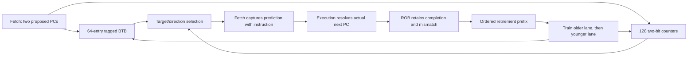

# Block 10: tagged BTB and two-bit branch prediction

The predictor supplies a proposed next PC before decode knows whether the fetched word is a
branch. It has two combinational lookup ports in IF and two ordered training inputs from WB
retirement. The fetch unit from block 9 captures these predictions with each instruction.
Execution later checks them; prediction never determines which result is allowed to commit.

This implementation contains a 64-entry tagged branch target buffer (BTB) and a 128-entry
bimodal pattern history table (PHT). It predicts from each branch PC's recent outcomes. It has
no global-history register, return-address stack, or dedicated loop-count predictor.

## 1. Your example: learn a loop, then leave it

Consider a backward branch at PC 16 whose target is PC 8. Its outcomes are taken, taken,
taken, then not taken. Every PHT entry starts weakly not taken, encoded as 01.

| Counter | Meaning | Direction when the BTB hits |
|---|---|---|
| 00 | Strongly not taken | Next sequential instruction |
| 01 | Weakly not taken | Next sequential instruction |
| 10 | Weakly taken | Stored branch target |
| 11 | Strongly taken | Stored branch target |

A taken outcome increments the counter unless it is already 11. A not-taken outcome
decrements it unless it is already 00. Saturation prevents wraparound: another taken result
at 11 must not turn into a strongly not-taken prediction.

| Retirement event | Counter before | Counter after | What a following lookup predicts |
|---|---|---|---|
| First taken branch | 01 | 10 | Taken after the BTB target has been installed |
| Second taken branch | 10 | 11 | Taken |
| Third taken branch | 11 | 11 | Taken |
| Loop exit, not taken | 11 | 10 | Still taken if this branch is queried again |

One exit does not erase the loop's taken bias. The predictor can miss on an exit and still
improve repeated execution. Two consecutive not-taken outcomes from 11 reach 01 and reverse
the direction prediction. The two bits provide this resistance to a single unusual outcome.

The conditional BTB target remains PC + immediate, here 8, even when the last retired outcome
was not taken and its actual next PC was 20. Caching the fall-through address as the branch
target would corrupt the next taken prediction.

## 2. Connections across IF, EX, and WB



A cold BTB miss returns PC + 4. A conditional hit uses the PHT high bit to choose target or
fall-through. A JAL/JALR hit predicts its cached target unconditionally; it does not use the
direction counter. JALR caches its last resolved target and does not implement a return stack.

The execution units already compare predicted and actual next PCs, including ordinary
instructions that accidentally encounter a stale BTB entry. Block 11 performs the safe
recovery sequence when that mismatch reaches the retirement boundary.

## 3. Signals and ownership

| Signal | Width | Source → destination | Meaning |
|---|---:|---|---|
| clk_i, rst_ni | 1 each | Common clock/reset → predictor | Rising-edge training; active-low asynchronous reset |
| enable_i | 1 | Configuration → lookup | Use table prediction or sequential PC + 4 |
| query_pc0_i, query_pc1_i | 32 each | Fetch → predictor | Proposed first and second instruction PCs |
| prediction_o | 82 | Predictor → fetch | Two 41-bit next-PC/taken/hit/PHT-index records |
| retire_valid_i | 2 | ROB retirement → training | Ordered accepted prefix: 00, 01, or 11 |
| retire_entry_i | 1,010 | ROB head records → training | Original PC/immediate/type plus actual completion metadata |
| invalidate_i | 1 | FENCE.I retirement control → predictor | Bypass stale predictions and clear both tables |
| invalidate_done_o | 1 | Predictor → control/status | Registered acknowledgment of the invalidation edge |
| query0_counter_o, query1_counter_o | 2 each | PHT → debug/tests | Actual stored counters at the queried indices |
| protocol_error_o | 1 | Predictor → integration checks | Malformed prefix or invalid retirement training record |

There is no execution-completion training input. The caller must connect actual retirement
fires, rather than raw execution results. A mispredicted branch can train when it commits;
a squashed younger branch cannot.

## 4. Inferred lookup and update circuits

The BTB index is PC[7:2], selecting one of 64 entries. Its stored PC[31:8] tag distinguishes
other word-aligned PCs sharing that index. Each entry stores valid, conditional, 24 tag bits,
and a 32-bit target: 58 bits per entry. The PHT index is PC[8:2], selecting one of 128 counters.

The two lookups infer independent reads, tag comparators, direction tests, and next-PC
multiplexers. The tables describe 3,968 state bits before implementation optimization; this
is not a claim that Vivado maps them into a particular RAM or achieves a particular frequency.
Training computes next-state updates and writes registers at the clock edge.

If enable_i is zero, lookup returns sequential next PCs with taken/hit clear. Retirement
training still occurs, so disabling prediction changes lookup behavior without disabling the
training logic. Debug counters continue to expose stored state. A misaligned query returns
sequential metadata and cannot use a BTB hit; architectural alignment faults are handled elsewhere.

## 5. Training two instructions without losing an update

Both retiring lanes update next state in program order: lane 0 first, lane 1 second. This is
important when two conditional branches map to one PHT entry. Starting at 11, older taken
followed by younger not taken gives 11 then 10. Updating each lane independently from the old
11 would lose one operation in other outcome/state combinations.

BTB collisions follow the same ordering. Two control instructions sharing an index leave the
younger retired control instruction's tag/target installed. A retired noncontrol instruction
invalidates only its own matching stale BTB tag; an unrelated ordinary PC sharing the index
does not evict the cached branch.

Training checks entry validity, completion, fault absence, aligned PC, decoded class, and
relevant control metadata. Conditional branches also check that the captured PHT index agrees
with the PC index. An invalid older record prevents younger training past it; an invalid younger
record does not erase a valid older update. Valid mask 10 is not a valid retirement prefix.

A not-taken branch may have a misaligned unused target without faulting. Its not-taken outcome
can train the PHT, but that unusable target is not installed in the BTB. A taken misaligned
branch cannot provide a valid nonfaulting training record.

## 6. Invalidation and timing

invalidate_i immediately makes lookup sequential. At the edge it clears BTB entries and
restores PHT counters to 01; invalidate_done_o then acknowledges that edge. Invalidation has
priority over retirement training on the same edge. The complete core asserts it when FENCE.I
retires and separately flushes/restarts fetch through the recovery controller.

Lookup sees registered table state before a training edge and updated state after it. There
is no special same-cycle training bypass. A stalled instruction-memory request keeps the
prediction captured when it was first offered; a later table update cannot rewrite that
instruction's history.

## 7. Tests and waveform reading

Block 10 has 75,009 standalone checks and 971 connected checks, 75,980 total, with zero
failures in the recorded Icarus run. The standalone reference uses separate full-PC BTB state
and integer saturation counters. Tests cover all counter states/outcomes, both lookup ports,
all table indices, collisions, malformed records, disabled lookup, reset, and invalidation.

The block-10 loop test compares 15 full architectural events. Prediction enabled takes 36
test cycles and two recoveries; disabled takes 44 cycles and three recoveries. That harness
uses an explicitly test-only recovery sequencer. Block 15 separately verifies the production
controller/core; its WFI-terminated loop has a different cycle count and one extra final event.

```sh
python3 scripts/run_checks.py --block 10
python3 scripts/run_checks.py --block 10 --waves
```

The exact tested source hashes and case scopes are in reports/block10_results.json. Waveforms
are under build/block10. Start with query PCs, prediction_o, both query counters, retire_valid,
retired branch outcome, and invalidate. Observe a BTB miss becoming a tagged hit only after
retirement, and then see the PHT counter progress 01→10→11. Separate the resolved branch
completion from the later retirement edge that trains it.

No official ACT4 certification, exhaustive formal proof, or Vivado timing/implementation run
is claimed by these results. Prediction accuracy depends on the program and table aliasing;
the example's cycle reduction is a test result, not a general speed guarantee.

## 8. Interview questions

**Why have both a BTB and a PHT?** The BTB supplies a target and whether the cached control
instruction is conditional. The PHT estimates direction for conditional branches.

**Why does a two-bit counter help loops?** One exit weakens a taken prediction without
immediately reversing a strongly learned bias.

**Why store a tag?** Index bits alone cannot distinguish two PCs mapped to the same BTB slot.

**Why is a not-taken branch's target not its actual next PC?** Actual next PC is fall-through
on that execution. The cached taken target still comes from PC + immediate.

**Why train at retirement?** The instruction is then known to belong to committed execution;
wrong-path completions cannot train the tables.

**What happens if both retiring branches share a counter?** Their updates fold sequentially
in architectural order, including saturation at either boundary.

**Does this predictor know the exact loop count?** No. It learns a direction bias from the
PC-indexed counter. Dedicated loop prediction and global history are outside this version.

**What does prediction disable prove?** In a comparison test, architectural events should
remain equivalent even though speculation and execution time differ.
