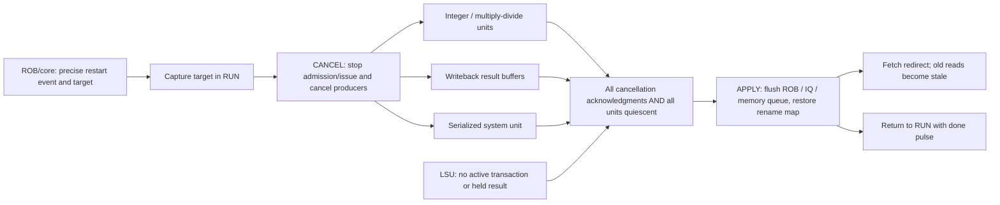

# Block 11: cancellation barrier and production recovery

The recovery controller converts a precise restart decision into safe resource reuse. It does
not decide which instruction is architecturally oldest; the ROB/core selects the fault,
retired misprediction, MRET, FENCE.I, or drained interrupt boundary and supplies its target.
The controller then cancels producers before applying queue/map restoration and fetch redirect.

The production controller is implemented and tested. Its standalone test passes 19,625 checks;
block 15 also exercises the same controller inside the actual processor.

## 1. Why flushing valid bits alone is insufficient

Suppose an older DIV is still running while younger instructions have already written physical
registers. A redirect makes that younger work invalid, but the divider or a held completion
could still produce a result later. If a flushed ROB slot or physical identity were reused too
early, the delayed result could corrupt a new instruction's state.

ROB generations reject stale ownership, but finite generations are not an unlimited substitute
for draining/cancellation. This design removes executing and buffered owners before making
recycled identities available again.

## 2. Connections to the core



The complete core blocks new admission while recovery is active and blocks new issue through
its recovery controls. Previously known misprediction handling still allows older work to
reach the retirement boundary before requesting this barrier.

## 3. Signals and contracts

| Signal | Width | Source → destination | Meaning |
|---|---:|---|---|
| clk_i, rst_ni | 1 each | Common clock/reset → controller | Rising-edge FSM; active-low asynchronous reset |
| request_i | 1 | Core/ROB boundary → controller | One restart pulse offered while busy_o is zero |
| target_i | 32 | Core → target register | Trap vector, resolved next PC, MRET target, or fence restart PC |
| units_quiescent_i | 1 | Combined producer/LSU state → barrier | No executing owner or retained result remains to corrupt reuse |
| cancel_ack_i | 1 | Combined producer acknowledgments → barrier | Cancellation was applied by every participating producer |
| cancel_o | 1 | Controller → producers/control | Remains asserted throughout CANCEL and APPLY |
| apply_o | 1 | Controller → queues/maps/fetch | One full clock interval authorizing safe restoration/redirect |
| redirect_pc_o | 32 | Saved target → fetch | Stable captured destination, retained after completion |
| busy_o | 1 | FSM → admission/control | Recovery owns the machine outside RUN |
| done_o | 1 | FSM → control/status | One-cycle pulse after the APPLY edge returns to RUN |

This is a pulse request interface, not an arbitrary request queue. Requests while busy cannot
replace the saved target. The core already ensures that only the selected precise boundary
starts recovery; the controller need not merge several speculative redirect candidates itself.

## 4. Circuit and state-machine behavior

The RTL infers a small RUN/CANCEL/APPLY state register, a 32-bit target register, and a done
flip-flop. Output decoding exposes cancellation/apply state. There is no combinational path
that turns a new request directly into a flush.

| State before edge | Condition at edge | State afterward | Visible consequence |
|---|---|---|---|
| RUN | No request | RUN | No cancellation or apply |
| RUN | Restart request | CANCEL | Target captured; cancellation asserted |
| CANCEL | Only acknowledgment, only quiescence, or neither | CANCEL | Target and cancellation remain held |
| CANCEL | Acknowledgment and quiescence together | APPLY | Apply asserted while cancellation stays active |
| APPLY | Following clock edge | RUN | Queues/maps/fetch apply recovery; done pulses |

The two barrier inputs must be true together at a sampled edge. An acknowledgment in one cycle
followed by quiescence in another is not enough. Even if all producers were initially idle,
a request first enters CANCEL rather than bypassing the cancellation phase.

A typical delayed sequence is:

| Edge | Inputs/state event | Result |
|---|---|---|
| E0 | Request target T in RUN | Capture T, enter CANCEL |
| E1 | Producers quiet but an acknowledgment missing | Keep cancellation; do not apply |
| E2 | Acknowledgments present but a producer not quiet | Keep cancellation; do not apply |
| E3 | Both combined barrier conditions true | Enter APPLY, target still T |
| E4 | Apply edge | Restore/flush/restart, enter RUN, done=1 |
| E5 | No next request | done clears; target remains retained |

The cancellation duration is variable. Only the apply interval is exactly one controller
cycle. A new request can start on the first available RUN edge after completion.

## 5. What is cancelled and what is preserved

Execution cancellation clears multicycle arithmetic progress and every unit's held completion.
Writeback cancellation clears both retained result slots. CSR-unit cancellation clears pending
uncommitted system ownership; it does not erase architectural CSRs or counters.

The LSU reports quiescence only when its request/response/completion engine is idle. Unissued
queue entries can still exist then and are safe to flush because they have made no bus request.
An accepted store or read is allowed to finish; it is not withdrawn from AXI. Restricting actual
data requests to the ROB head prevents younger wrong-path transactions from escaping.

After the barrier, rename restores speculative mappings from committed mappings and rebuilds
free identities. PRF values belonging to committed mappings are preserved. ROB generations
are also preserved across a microarchitectural flush.

Instruction reads need different handling: they are read-only transactions with PC metadata.
Fetch clears buffered instructions at apply and marks any old held/outstanding read stale.
The old response may drain after controller completion; it cannot enter decode as current work.
Thus fetch redirect acknowledgment is not an assertion that every old read has disappeared.

## 6. Precise selection and integration

The ROB/core establishes ordering before invoking this controller. A younger known
misprediction cannot outrank an older fault that reaches the head. A mispredicted JAL/JALR can
commit its valid link-register effect before younger mappings are restored. FENCE.I and MRET
retire as serialized system boundaries and request a restart even if no prediction mismatch
is otherwise present.

Interrupt entry first stops admission, drains admitted work, and rechecks eligibility. Only
then does it update machine trap state and request recovery to mtvec. The controller does not
save a speculative fetch PC as mepc.

## 7. Tests and waveforms

```sh
python3 scripts/run_checks.py --block 11
python3 scripts/run_checks.py --block 11 --waves
```

reports/block11_results.json records 19,625 passing checks and tested source hashes. Directed
and 400 randomized recovery sequences cover both missing-barrier conditions, alternating
individual acknowledgments/quiescence, stable targets, busy requests, a single apply edge,
done pulses, immediate next recovery, idle changes, and reset during CANCEL or APPLY.

In build/block11/block11.vcd, begin with request/target, cancel, both barrier inputs, apply,
busy, done, and redirect_pc. Confirm that cancellation precedes apply, that a stalled barrier
never changes the target, and that cancel remains high during the actual apply edge.

The block-15 trap and arithmetic tests additionally exercise production recovery with running
DIV, completed younger results, wrong-path memory entries, competing branch resolutions,
precise exceptions, interrupts, MRET, and FENCE.I. Their source-hashed reports distinguish those
composition checks from this standalone FSM test. No exhaustive formal proof or official ACT4
certification is claimed.

## 8. Interview questions

**Why is acknowledgment alone insufficient?** A module can acknowledge a command before all
owned work or buffered output is gone. Reuse also requires actual quiescence.

**Why keep cancellation high in APPLY?** Producers must remain unable to publish old work on
the same edge that identities and queues are restored.

**Why not reset the physical register file?** Recovery must preserve committed values. It
restores ownership/mappings and discards speculative identities instead.

**Why retain the target during a long wait?** Upstream PCs can change while cancellation
drains. The restart must use the destination selected at the precise boundary.

**Can an old instruction-memory response survive recovery?** Yes, provided fetch retains its
old ownership and discards it as stale before admitting it to decode.

**Who gives an older fault priority over a younger branch?** The ROB/core's ordered boundary
selection. This controller executes that selected decision safely.

## Complete production recovery controller

Source: `rtl/rv32_recovery_controller.sv`.

```systemverilog
// Retirement-boundary recovery: cancel producers before flushing reusable ownership.
`timescale 1ns / 1ps
module rv32_recovery_controller
  import rv32_ooo_pkg::*;
(
  input logic clk_i, rst_ni,
  input logic request_i,
  input word_t target_i,
  input logic units_quiescent_i,
  input logic cancel_ack_i,
  output logic cancel_o,
  output logic apply_o,
  output word_t redirect_pc_o,
  output logic busy_o,
  output logic done_o
);
  typedef enum logic [1:0] {RUN, CANCEL, APPLY} state_e;
  state_e state_q;
  word_t target_q;
  assign cancel_o = rst_ni && state_q != RUN;
  assign apply_o = rst_ni && state_q == APPLY;
  assign redirect_pc_o = target_q;
  assign busy_o = state_q != RUN;
  always_ff @(posedge clk_i or negedge rst_ni) begin
    if (!rst_ni) begin
      state_q <= RUN;
      target_q <= RESET_PC;
      done_o <= 1'b0;
    end else begin
      done_o <= 1'b0;
      case (state_q)
        RUN: if (request_i) begin target_q <= target_i; state_q <= CANCEL; end
        CANCEL: if (units_quiescent_i && cancel_ack_i) state_q <= APPLY;
        APPLY: begin state_q <= RUN; done_o <= 1'b1; end
        default: state_q <= CANCEL;
      endcase
    end
  end
endmodule
```

## Complete recovery protocol testbench

Source: `tb/tb_block11.sv`.

```systemverilog
// Recovery ownership-barrier tests. Requests are normally pulses offered only while idle.
// Busy requests are deliberately injected below to verify that they cannot replace the target.
`timescale 1ns / 1ps

module tb_block11;
  import rv32_ooo_pkg::*;

  logic clk = 0, rst_n = 1;
  logic request, quiescent, acknowledged, cancel, apply, busy, done;
  word_t target, redirect_pc, expected_target;
  word_t rng = 32'h7311cafe;
  integer checks = 0, failures = 0, cycle_number = 0;
  integer apply_edges = 0, completed_recoveries = 0;
  integer iteration, delay_cycles, position, choice, before_apply;

  rv32_recovery_controller dut (
    .clk_i(clk), .rst_ni(rst_n), .request_i(request), .target_i(target),
    .units_quiescent_i(quiescent), .cancel_ack_i(acknowledged),
    .cancel_o(cancel), .apply_o(apply), .redirect_pc_o(redirect_pc),
    .busy_o(busy), .done_o(done)
  );

  function automatic word_t next_random(input word_t value);
    next_random = {value[30:0], value[31] ^ value[21] ^ value[1] ^ value[0]};
  endfunction

  task automatic check(input logic condition, input string label_text);
    begin
      checks = checks + 1;
      if (condition !== 1'b1) begin
        failures = failures + 1;
        if (failures <= 30)
          $display("FAIL: %s cycle=%0d time=%0t", label_text, cycle_number, $time);
      end
    end
  endtask

  task automatic edge_step;
    begin
      #1;
      check(!apply || (cancel && busy), "safe apply retains cancellation throughout its edge");
      check(!done || (!busy && !cancel && !apply), "done is an idle-state completion pulse");
      if (apply) apply_edges = apply_edges + 1;
      #1; clk = 1; #1; clk = 0; #1;
      cycle_number = cycle_number + 1;
    end
  endtask

  task automatic check_idle(input logic completion_pulse);
    begin
      check(!busy && !cancel && !apply && done == completion_pulse,
            "idle exposes neither cancellation nor reusable-state flush");
      check(redirect_pc == expected_target, "target remains retained until another request/reset");
    end
  endtask

  task automatic reset_controller;
    begin
      rst_n = 0; request = 0; target = 32'hdeadbeef;
      quiescent = 0; acknowledged = 0; expected_target = RESET_PC;
      #2;
      check(!cancel && !apply && !busy && !done && redirect_pc == RESET_PC,
            "asynchronous reset clears both active recovery and its saved target");
      rst_n = 1; #1; check_idle(0);
    end
  endtask

  task automatic start_recovery(input word_t destination, input logic already_ready);
    begin
      check(!busy, "caller starts a new ownership recovery only while idle");
      request = 1; target = destination;
      quiescent = already_ready; acknowledged = already_ready;
      #1;
      check(!cancel && !apply && !busy, "new request does not bypass clocked target capture");
      expected_target = destination;
      edge_step;
      request = 0; target = ~destination; #1;
      check(cancel && busy && !apply && !done,
            "every request enters cancellation before apply, even when producers were idle");
      check(redirect_pc == destination, "request edge captures all target bits");
    end
  endtask

  task automatic hold_for_one_edge(input logic have_ack, input logic have_quiet);
    begin
      acknowledged = have_ack; quiescent = have_quiet;
      // A caller violating the idle-only request contract must not corrupt the active owner.
      request = 1; target = rng ^ 32'h55aa0011;
      #1;
      check(cancel && busy && !apply && !done && redirect_pc == expected_target,
            "cancellation holds the captured owner while incomplete barrier inputs wait");
      edge_step;
      check(cancel && busy && !apply && !done && redirect_pc == expected_target,
            "one barrier input alone never authorizes early resource reuse");
    end
  endtask

  task automatic release_and_finish;
    begin
      before_apply = apply_edges;
      request = 1; target = expected_target ^ 32'h11112222;
      quiescent = 1; acknowledged = 1;
      #1;
      check(cancel && !apply && redirect_pc == expected_target,
            "both barrier inputs still require their sampled clock edge");
      edge_step;
      check(cancel && apply && busy && !done && redirect_pc == expected_target,
            "simultaneous quiescence and acknowledgments authorize exactly the apply phase");
      // The barrier was sampled. Dropping it now cannot truncate the one-cycle apply pulse.
      quiescent = 0; acknowledged = 0; #1;
      check(apply && cancel, "apply is retained despite later changes to acknowledgment inputs");
      edge_step;
      request = 0;
      check_idle(1);
      check(apply_edges == before_apply + 1, "each completed recovery has exactly one apply edge");
      completed_recoveries = completed_recoveries + 1;
    end
  endtask

  initial begin
    if ($test$plusargs("waves")) begin
      $dumpfile("build/block11/block11.vcd");
      $dumpvars(0, tb_block11);
    end
    #1000000; $fatal(1, "Recovery-controller test timed out");
  end

  initial begin
    request = 0; target = 0; quiescent = 0; acknowledged = 0;
    expected_target = RESET_PC;
    reset_controller;

    // Neither a single acknowledgment nor historical alternating inputs satisfy the barrier.
    start_recovery(32'h00000100, 0);
    hold_for_one_edge(0, 0);
    hold_for_one_edge(1, 0);
    hold_for_one_edge(0, 1);
    hold_for_one_edge(1, 0);
    hold_for_one_edge(0, 1);
    release_and_finish;
    edge_step; check_idle(0);

    // Idle producers still pass through a full cancellation and apply sequence.
    start_recovery(32'hfffffffc, 1);
    release_and_finish;
    // Start the next request on the first available RUN edge, with no extra idle bubble.
    start_recovery(32'h00000004, 0);
    hold_for_one_edge(0, 1);
    release_and_finish;
    edge_step; check_idle(0);

    // Asynchronous reset may abort either outstanding cancellation or the apply phase.
    start_recovery(32'h10000000, 0);
    hold_for_one_edge(1, 0);
    reset_controller;
    start_recovery(32'h00000080, 1);
    request = 0; edge_step;
    check(apply && busy && cancel, "directed reset fixture reaches its apply interval");
    reset_controller;
    edge_step; check_idle(0);

    // Targets and barrier arrival order vary; the release schedule is independent of the DUT.
    for (iteration = 0; iteration < 400; iteration = iteration + 1) begin
      rng = next_random(rng);
      start_recovery(rng, rng[0]);
      delay_cycles = 1 + int'(rng[6:3]);
      for (position = 0; position < delay_cycles; position = position + 1) begin
        rng = next_random(rng);
        choice = int'(rng[1:0]) % 3;
        case (choice)
          0: hold_for_one_edge(0, 0);
          1: hold_for_one_edge(1, 0);
          default: hold_for_one_edge(0, 1);
        endcase
      end
      release_and_finish;
      if (iteration % 7 == 0) begin
        // Reset the done pulse without offering another request.
        edge_step; check_idle(0);
      end
    end
    edge_step; check_idle(0);

    // Changing idle inputs and targets cannot create a flush or capture a target by itself.
    for (iteration = 0; iteration < 32; iteration = iteration + 1) begin
      rng = next_random(rng); target = rng;
      request = 0; quiescent = rng[0]; acknowledged = rng[1];
      edge_step; check_idle(0);
    end
    check(completed_recoveries == 403, "all nonaborted directed/random recoveries completed");
    $display("BLOCK11 SUMMARY: %0d checks, %0d failures", checks, failures);
    if (failures) $fatal(1, "Recovery-controller ownership barrier failed");
    $finish;
  end
endmodule
```
