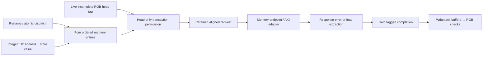

# Block 12: ordered memory queue and load/store engine

This block occupies the memory part of MEM. It connects in-order dispatch, speculative address
preparation, the ROB's retirement boundary, and the data-memory interface. Its central rule is:
**an address may be prepared early, but a data transaction starts only for the live incomplete
instruction at the ROB head.** This keeps wrong-path peripheral reads and writes off the bus.

The implementation has four memory entries and one active data transaction. Integer instructions
can continue through the independent execution paths while that transaction waits.

## 1. Connections and ownership



Dispatch copies each memory instruction's ROB identity, physical destination intent, size, and
signed/unsigned load flag. EX later supplies the effective byte address and raw store value.
Preparation must match that allocated identity and metadata, including the load extension flag;
it cannot change an allocated signed load into an unsigned load.

A nonmemory instruction still participates in the dispatch-prefix handshake, but occupies no
memory slot. This lets rename, ROB, IQ, and this queue agree on exactly the same accepted prefix.

## 2. Signals and their sources/destinations

The current package defines a 300-bit renamed instruction, a 190-bit memory entry, a 69-bit data
request, a 33-bit response, and a 222-bit completion. Payload validity is carried separately.

| Signal | Width | Source → destination | Meaning |
|---|---:|---|---|
| clk_i, rst_ni | 1 each | Common clock/reset → LSU | Rising-edge state; active-low asynchronous reset |
| dispatch_uop_i | 600 | Rename → queue | Two renamed records, lane 0 older |
| dispatch_valid_i / dispatch_ready_o / dispatch_fire_o | 2 each | Dispatcher ↔ queue | Offered, permitted, and accepted program-order prefix |
| prepare_i | 190 | Integer address path → queue | Prepared byte address, store data, fault, and next-PC metadata |
| prepare_valid_i / prepare_ready_o | 1 each | Address path ↔ queue | Preparation transfer; stale/unowned packets are diagnosed |
| head_valid_i / head_complete_i | 1 each | ROB → LSU | Whether the architectural head exists and still needs completion |
| head_tag_i | 12 | ROB → LSU | Full slot/generation identity permitted to access memory |
| data_request_o | 69 | LSU → memory/AXI adapter | Write bit, aligned byte address, data, four byte strobes |
| data_request_valid_o / data_request_ready_i | 1 each | LSU ↔ endpoint | Exactly one request transfer |
| data_response_i | 33 | Endpoint → LSU | Returned 32-bit data and error flag |
| data_response_valid_i / data_response_ready_o | 1 each | Endpoint ↔ LSU | Response transfer for the outstanding owner |
| completion_o | 222 | LSU → WB arbiter | Value/fault and original owner metadata |
| completion_valid_o / completion_ready_i | 1 each | LSU ↔ WB | Held result and acceptance into writeback |
| flush_i / flush_done_o | 1 each | Recovery control ↔ queue | Safe clear of unissued entries and registered acknowledgment |
| quiescent_o | 1 | LSU → recovery control | Transaction engine is IDLE; queued unissued work is cancellable |
| occupancy_o | 3 | Queue → status/tests | Number of allocated memory entries, 0 through 4 |
| protocol_error_o | 1 | LSU → diagnostics | Invalid prefix, bad preparation, unsafe flush, or unsolicited response |

quiescent_o and occupancy_o answer different questions. A queue can contain prepared younger
stores while the transaction engine is IDLE. Recovery can discard those entries because no bus
side effect has started. An active request, response, or held completion must finish first.

## 3. Circuit organization

The queue is a four-entry circular array with head/tail pointers and a count. Each entry stores
its own valid/prepared bits and full ROB identity. Two allocation paths can fill consecutive tail
positions; at most one oldest entry leaves after its completion transfers.

The transaction state machine is:

```text
IDLE → REQUEST → RESPONSE → COMPLETE → IDLE
          |          |           |
       request     response    completion
       holding     ownership   holding
```

IDLE checks the queue head against the ROB head. REQUEST holds one captured request until the
endpoint accepts it. RESPONSE accepts the matching data/error. COMPLETE holds the resulting
completion until writeback accepts it, then frees that memory entry.

A preparation accepted at one edge is observed from registered queue state on a later edge.
There is no preparation-to-bus combinational bypass. Current free slots determine dispatch
capacity; a slot released on this edge becomes allocation capacity next cycle.

## 4. Byte addresses, lanes, and sign extension

Instructions use byte addresses. The bus request clears address bits [1:0] and uses WSTRB to
identify the selected bytes. The little-endian lane position is the original address's low bits.

For a byte store of 0x80 at address 0x203, the bus receives:

| Field | Value | Reason |
|---|---|---|
| address | 0x200 | Word-aligned request address |
| wdata | 0x80000000 | Raw low byte shifted left by 24 bits |
| wstrb | 1000 | Only byte lane 3 changes |

For a returned word 0x80ff7f01, LB at 0x203 selects 0x80 and produces 0xffffff80; LBU produces
0x00000080. LH at 0x202 selects 0x80ff and produces 0xffff80ff; LHU produces 0x000080ff.
A word load uses the entire returned word.

Halfwords require address bit 0 clear; words require bits [1:0] clear. A misalignment completes
with cause 4 for a load or 6 for a store, using the original byte address in tval and issuing no
bus request. An inherited preparation fault keeps priority over a new alignment check.

## 5. Example transaction timing

Assume the queue has capacity, the preparation becomes available, and the owner is the ROB head:

| Edge | Event | State retained afterward |
|---|---|---|
| E0 | Dispatch allocates the memory instruction | Valid entry, not prepared |
| E1 | EX preparation transfers | Original address/store data and metadata saved |
| E2 | IDLE observes prepared matching head | Captured request, or local fault completion |
| E3, if ready | Request transfers once | RESPONSE owns the transaction |
| E4 or later | Endpoint response transfers | COMPLETE holds value/fault |
| E5 or later | WB accepts the completion | Queue head advances; engine returns to IDLE |
| Later edges | ROB accepts, then retires the result | Architectural state advances in order |

Any request or completion stall extends its row in the table without changing the retained
payload. A store's request acceptance is not its architectural completion; its response is
required. A full ROB does not stop already admitted memory work from completing.

## 6. Ordering, faults, and recovery

The queue performs no speculative load replay or store-to-load forwarding. Older stores receive
their responses and retire before a younger load can reach the ROB head. Register dependencies
for base/store operands were already enforced using physical tags in the scheduler.

An error response becomes cause 5 or 7 for a load/store access fault, with the original byte
address in tval. Fault completions preserve destination intent for ROB ownership validation but
publish no usable load value. Successful completions retain access metadata; store traces carry
the shifted data/strobes and original byte address.

An idle flush clears only unissued queue state. An unsafe flush while REQUEST, RESPONSE, or
COMPLETE is active is diagnosed and not acknowledged as safe. The active request/completion
remains owned, and a response can still drain. The production recovery controller therefore
waits for LSU quiescence before applying queue/map restoration.

## 7. Tests and waveforms

The current block-12 report records **1,067 checks, zero failures**. Its independent extraction
reference covers byte/halfword/word sizes, signed and unsigned extension, alignment offsets,
response faults, request/completion stalls, exactly-once transfer, queue exhaustion, prefix
allocation, ownership rejection, load-flag preservation, and safe/unsafe flush behavior.

```sh
python3 scripts/run_checks.py --block 12 --waves
```

Start with occupancy, head_tag_i, queue prepared state, state_q, request-valid/ready, response-
valid/ready, and completion-valid/ready. Check that a prepared younger entry does not produce a
request while another instruction owns the ROB head. For a byte access, compare the original
queued address with the aligned request and shifted strobe. During a stall, watch the complete
owner and payload remain unchanged.

These unit checks establish the LSU's local contracts. The separate core and AXI integration
benches exercise wrong-path MMIO suppression, data faults, and end-to-end memory behavior.
Their evidence is counted separately. Directed/generated simulation is not ISA certification,
formal proof, or FPGA timing analysis.

## 8. Interview questions

**Why can an address be prepared early while the request waits?** Address arithmetic has no
external side effect; the transaction can, especially for MMIO. ROB-head permission separates them.

**Why is a completion kept after the memory response?** Writeback may have no free slot. The
LSU must retain the result and owner instead of losing or repeating the transaction.

**Why check load_unsigned during preparation?** The allocated instruction determines extension
semantics. A matching tag with changed metadata must not reinterpret the returned value.

**Why does flush not simply clear a busy LSU?** A device may already own an accepted transaction.
Discarding its state would lose the response or permit duplicate side effects on replay.

**How are memory RAW dependencies handled here?** Strict head-only transactions serialize them;
register RAW dependencies use physical-tag readiness before address/store-data preparation.

## Complete ordered LSU

Source: `rtl/rv32_load_store_unit.sv`.

```systemverilog
// Ordered memory queue. Preparation may be speculative; bus requests require the ROB head.
`timescale 1ns / 1ps
module rv32_load_store_unit
  import rv32_ooo_pkg::*;
(
  input logic clk_i, rst_ni,
  input logic [1:0] dispatch_valid_i,
  input renamed_pair_t dispatch_uop_i,
  output logic [1:0] dispatch_ready_o, dispatch_fire_o,
  input logic prepare_valid_i,
  output logic prepare_ready_o,
  input memory_entry_t prepare_i,
  input logic head_valid_i, head_complete_i,
  input rob_tag_t head_tag_i,
  output logic data_request_valid_o,
  input logic data_request_ready_i,
  output data_request_t data_request_o,
  input logic data_response_valid_i,
  output logic data_response_ready_o,
  input memory_response_t data_response_i,
  output logic completion_valid_o,
  input logic completion_ready_i,
  output completion_t completion_o,
  input logic flush_i,
  output logic flush_done_o, quiescent_o,
  output logic [2:0] occupancy_o,
  output logic protocol_error_o
);
  typedef enum logic [1:0] {IDLE, REQUEST, RESPONSE, COMPLETE} state_e;
  state_e state_q, state_d;
  memory_entry_t queue_q [MEMORY_DEPTH], queue_d [MEMORY_DEPTH];
  logic [1:0] head_q, head_d, tail_q, tail_d;
  logic [2:0] count_q, count_d;
  data_request_t request_q, request_d;
  completion_t completion_q, completion_d;

  function automatic logic needs_memory(input renamed_uop_t uop);
    needs_memory = !uop.decoded.fetch.exception.valid
      && (uop.decoded.op_class == UOP_LOAD || uop.decoded.op_class == UOP_STORE);
  endfunction
  function automatic memory_entry_t allocate(input renamed_uop_t uop);
    memory_entry_t entry;
    begin
      entry = '0;
      entry.valid = 1'b1;
      entry.rob_tag = uop.rob_tag;
      entry.is_store = uop.decoded.op_class == UOP_STORE;
      entry.size = uop.decoded.mem_size;
      entry.load_unsigned = uop.decoded.load_unsigned;
      entry.pdst = uop.pdst;
      entry.writes_rd = uop.decoded.writes_rd;
      allocate = entry;
    end
  endfunction

  assign occupancy_o = count_q;
  // Unissued queue entries are cancellable; an accepted bus transaction is not.
  assign quiescent_o = state_q == IDLE;
  assign prepare_ready_o = rst_ni && !flush_i;
  assign data_request_valid_o = rst_ni && state_q == REQUEST;
  assign data_request_o = request_q;
  assign data_response_ready_o = rst_ni && state_q == RESPONSE;
  assign completion_valid_o = rst_ni && state_q == COMPLETE;
  assign completion_o = completion_valid_o ? completion_q : completion_t'('0);

  always_comb begin : queue_and_engine
    memory_entry_t entry, current;
    renamed_uop_t incoming0, incoming1;
    logic mem0, mem1, matched, bad_alignment;
    int pushed, popped, free_count;
    logic [1:0] allocation_index;
    logic [4:0] shift;
    word_t extracted;

    for (int i = 0; i < MEMORY_DEPTH; i++) queue_d[i] = queue_q[i];
    state_d = state_q;
    head_d = head_q;
    tail_d = tail_q;
    count_d = count_q;
    request_d = request_q;
    completion_d = completion_q;
    incoming0 = dispatch_uop_i.lane0;
    incoming1 = dispatch_uop_i.lane1;
    mem0 = needs_memory(incoming0);
    mem1 = needs_memory(incoming1);
    free_count = MEMORY_DEPTH - int'(count_q);
    pushed = 0;
    popped = 0;
    allocation_index = tail_q;
    matched = 1'b0;
    entry = '0;
    current = queue_q[head_q];
    shift = {current.address[1:0], 3'b000};
    extracted = data_response_i.rdata >> shift;
    bad_alignment = (current.size == MEM_HALF && current.address[0])
                    || (current.size == MEM_WORD && |current.address[1:0]);
    dispatch_ready_o = '0;
    dispatch_fire_o = '0;
    protocol_error_o = rst_ni && (dispatch_valid_i == 2'b10
      || (flush_i && state_q != IDLE)
      || (data_response_valid_i && state_q != RESPONSE));

    if (rst_ni && !flush_i) begin
      dispatch_ready_o[0] = !mem0 || free_count >= 1;
      dispatch_fire_o[0] = dispatch_valid_i[0] && dispatch_ready_o[0];
      dispatch_ready_o[1] = dispatch_fire_o[0] && !incoming0.decoded.fetch.exception.valid
        && incoming0.decoded.op_class != UOP_SYSTEM
        && free_count >= int'(mem0) + int'(mem1);
      dispatch_fire_o[1] = dispatch_valid_i[1] && dispatch_ready_o[1];
      if (dispatch_fire_o[0] && mem0) begin
        queue_d[allocation_index] = allocate(incoming0);
        allocation_index = allocation_index + 2'd1;
        pushed = pushed + 1;
      end
      if (dispatch_fire_o[1] && mem1) begin
        queue_d[allocation_index] = allocate(incoming1);
        allocation_index = allocation_index + 2'd1;
        pushed = pushed + 1;
      end
      if (prepare_valid_i) begin
        for (int i = 0; i < MEMORY_DEPTH; i++) begin
          entry = queue_q[i];
          if (entry.valid && !entry.prepared && entry.rob_tag == prepare_i.rob_tag
              && entry.pdst == prepare_i.pdst && entry.writes_rd == prepare_i.writes_rd
              && entry.is_store == prepare_i.is_store && entry.size == prepare_i.size
              && entry.load_unsigned == prepare_i.load_unsigned
              && prepare_i.valid && prepare_i.prepared) begin
            queue_d[i] = prepare_i;
            matched = 1'b1;
          end
        end
        if (!matched) protocol_error_o = 1'b1;
      end
    end

    case (state_q)
      IDLE: if (!flush_i && count_q != 0 && current.valid && current.prepared
                && head_valid_i && !head_complete_i && current.rob_tag == head_tag_i) begin
        completion_d = '0;
        completion_d.rob_tag = current.rob_tag;
        completion_d.pdst = current.pdst;
        completion_d.writes_rd = current.writes_rd;
        completion_d.control_flow = current.control_flow;
        completion_d.exception = current.exception;
        request_d = '0;
        request_d.write = current.is_store;
        request_d.address = {current.address[31:2], 2'b00};
        request_d.wdata = current.store_value << shift;
        case (current.size)
          MEM_BYTE: request_d.wstrb = 4'b0001 << current.address[1:0];
          MEM_HALF: request_d.wstrb = 4'b0011 << current.address[1:0];
          default: request_d.wstrb = 4'b1111;
        endcase
        if (!current.is_store) request_d.wstrb = '0;
        if (bad_alignment && !current.exception.valid) begin
          completion_d.exception.valid = 1'b1;
          completion_d.exception.cause = current.is_store
            ? CAUSE_STORE_MISALIGNED : CAUSE_LOAD_MISALIGNED;
          completion_d.exception.tval = current.address;
        end
        if (completion_d.exception.valid) state_d = COMPLETE;
        else state_d = REQUEST;
      end
      REQUEST: if (data_request_valid_o && data_request_ready_i) state_d = RESPONSE;
      RESPONSE: if (data_response_valid_i && data_response_ready_o) begin
        if (data_response_i.error) begin
          completion_d.exception.valid = 1'b1;
          completion_d.exception.cause = current.is_store ? CAUSE_STORE_ACCESS : CAUSE_LOAD_ACCESS;
          completion_d.exception.tval = current.address;
          completion_d.value = '0;
        end else begin
          if (!current.is_store) begin
            case (current.size)
              MEM_BYTE: completion_d.value = current.load_unsigned
                ? {24'b0, extracted[7:0]} : {{24{extracted[7]}}, extracted[7:0]};
              MEM_HALF: completion_d.value = current.load_unsigned
                ? {16'b0, extracted[15:0]} : {{16{extracted[15]}}, extracted[15:0]};
              default: completion_d.value = data_response_i.rdata;
            endcase
          end
          completion_d.memory_access.valid = 1'b1;
          completion_d.memory_access.write = current.is_store;
          completion_d.memory_access.address = current.address;
          if (current.is_store) begin
            completion_d.memory_access.wdata = request_q.wdata;
            completion_d.memory_access.wstrb = request_q.wstrb;
          end
        end
        state_d = COMPLETE;
      end
      COMPLETE: if (completion_valid_o && completion_ready_i) begin
        queue_d[head_q] = '0;
        head_d = head_q + 2'd1;
        popped = 1;
        state_d = IDLE;
      end
      default: state_d = IDLE;
    endcase
    tail_d = allocation_index;
    count_d = 3'(int'(count_q) + pushed - popped);
    if (flush_i && state_q == IDLE) begin
      for (int i = 0; i < MEMORY_DEPTH; i++) queue_d[i] = '0;
      head_d = '0;
      tail_d = '0;
      count_d = '0;
    end
  end

  always_ff @(posedge clk_i or negedge rst_ni) begin
    if (!rst_ni) begin
      for (int i = 0; i < MEMORY_DEPTH; i++) queue_q[i] <= '0;
      state_q <= IDLE;
      head_q <= '0;
      tail_q <= '0;
      count_q <= '0;
      request_q <= '0;
      completion_q <= '0;
      flush_done_o <= 1'b0;
    end else begin
      for (int i = 0; i < MEMORY_DEPTH; i++) queue_q[i] <= queue_d[i];
      state_q <= state_d;
      head_q <= head_d;
      tail_q <= tail_d;
      count_q <= count_d;
      request_q <= request_d;
      completion_q <= completion_d;
      flush_done_o <= flush_i && state_q == IDLE;
    end
  end
endmodule
```

## LSU tests

Source: `tb/tb_block12.sv`.

```systemverilog
// Ordered LSU tests: only the prepared ROB head may send a data transaction.
`timescale 1ns / 1ps
module tb_block12;
  import rv32_ooo_pkg::*;
  logic clk = 0, rst_n = 1;
  logic [1:0] dispatch_valid, dispatch_ready, dispatch_fire;
  renamed_pair_t dispatch_uop;
  logic prepare_valid, prepare_ready, head_valid, head_complete;
  memory_entry_t preparation, prepared;
  rob_tag_t head_tag;
  logic request_valid, request_ready, response_valid, response_ready;
  data_request_t request;
  memory_response_t response;
  logic completion_valid, completion_ready, flush, flush_done, quiet, protocol_error;
  completion_t completion, saved_completion;
  logic [2:0] occupancy;
  renamed_uop_t a, b, c, d, e, owner;
  integer checks = 0, failures = 0, serial_number = 0, accepted_requests = 0;
  integer size_index, lane, unsigned_load, n, limit, before_requests;

  rv32_load_store_unit dut (
    .clk_i(clk), .rst_ni(rst_n), .dispatch_valid_i(dispatch_valid),
    .dispatch_uop_i(dispatch_uop), .dispatch_ready_o(dispatch_ready),
    .dispatch_fire_o(dispatch_fire), .prepare_valid_i(prepare_valid),
    .prepare_ready_o(prepare_ready), .prepare_i(preparation),
    .head_valid_i(head_valid), .head_complete_i(head_complete), .head_tag_i(head_tag),
    .data_request_valid_o(request_valid), .data_request_ready_i(request_ready),
    .data_request_o(request), .data_response_valid_i(response_valid),
    .data_response_ready_o(response_ready), .data_response_i(response),
    .completion_valid_o(completion_valid), .completion_ready_i(completion_ready),
    .completion_o(completion), .flush_i(flush), .flush_done_o(flush_done),
    .quiescent_o(quiet), .occupancy_o(occupancy), .protocol_error_o(protocol_error)
  );
  task automatic check(input logic condition, input string label_text);
    begin
      checks = checks + 1;
      if (condition !== 1'b1) begin
        failures = failures + 1;
        if (failures <= 30) $display("FAIL: %s time=%0t", label_text, $time);
      end
    end
  endtask
  task automatic edge_step;
    begin
      #1;
      if (request_valid && request_ready) accepted_requests = accepted_requests + 1;
      #1; clk = 1; #1; clk = 0; #1;
    end
  endtask
  task automatic controls;
    begin
      dispatch_valid = 0; dispatch_uop = '0; prepare_valid = 0; preparation = '0;
      head_valid = 0; head_complete = 0; head_tag = '0;
      request_ready = 0; response_valid = 0; response = '0; completion_ready = 0; flush = 0;
    end
  endtask
  function automatic mem_size_e access_size(input integer selector);
    case (selector)
      0: access_size = MEM_BYTE;
      1: access_size = MEM_HALF;
      default: access_size = MEM_WORD;
    endcase
  endfunction
  function automatic renamed_uop_t instruction(
    input integer id, size_selector, input logic store_access, unsigned_access
  );
    renamed_uop_t result;
    begin
      result = '0;
      result.rob_tag.index = id % 16; result.rob_tag.generation = 20 + id / 16;
      result.decoded.fetch.pc = 32'h200 + id * 4;
      result.decoded.fetch.prediction.next_pc = result.decoded.fetch.pc + 4;
      if (store_access) result.decoded.op_class = UOP_STORE;
      else result.decoded.op_class = UOP_LOAD;
      result.decoded.mem_size = access_size(size_selector);
      result.decoded.load_unsigned = unsigned_access;
      result.decoded.writes_rd = !store_access;
      result.decoded.rd = store_access ? 0 : 5;
      result.pdst = store_access ? 0 : 32 + id % 32;
      instruction = result;
    end
  endfunction
  function automatic memory_entry_t address_record(
    input renamed_uop_t operation, input word_t address, value
  );
    memory_entry_t result;
    begin
      result = '0; result.valid = 1; result.prepared = 1;
      result.rob_tag = operation.rob_tag;
      result.is_store = operation.decoded.op_class == UOP_STORE;
      result.size = operation.decoded.mem_size;
      result.load_unsigned = operation.decoded.load_unsigned;
      result.pdst = operation.pdst; result.writes_rd = operation.decoded.writes_rd;
      result.address = address; result.store_value = value;
      result.control_flow.next_pc = operation.decoded.fetch.pc + 4;
      result.control_flow.mispredicted = operation.rob_tag.index[0];
      address_record = result;
    end
  endfunction
  function automatic word_t loaded_value(
    input word_t raw, input integer byte_offset, size_selector, input logic is_unsigned
  );
    word_t selected;
    begin
      selected = raw >> (byte_offset * 8);
      if (size_selector == 0) begin
        selected = selected & 255;
        if (!is_unsigned && selected >= 128) selected = selected | 32'hffffff00;
      end else if (size_selector == 1) begin
        selected = selected & 65535;
        if (!is_unsigned && selected >= 32768) selected = selected | 32'hffff0000;
      end else selected = raw;
      loaded_value = selected;
    end
  endfunction
  task automatic offer(input renamed_uop_t older, younger, input logic [1:0] mask);
    begin dispatch_uop.lane0 = older; dispatch_uop.lane1 = younger; dispatch_valid = mask; end
  endtask
  task automatic allocate_one(input renamed_uop_t operation);
    begin
      offer(operation, '0, 1); #1; check(dispatch_fire == 1, "memory owner allocates atomically");
      edge_step; dispatch_valid = 0;
    end
  endtask
  task automatic prepare_one(input memory_entry_t value);
    begin
      preparation = value; prepare_valid = 1; #1;
      check(prepare_ready && !protocol_error, "registered owner accepts one matching preparation");
      edge_step; prepare_valid = 0;
    end
  endtask
  task automatic idle_flush;
    begin
      head_valid = 0; flush = 1; #1;
      check(quiet && dispatch_fire == 0, "safe flush blocks admission of new queue owners");
      edge_step; flush = 0;
      check(flush_done && occupancy == 0 && quiet, "safe idle flush discards only unissued work");
      edge_step;
    end
  endtask

  task automatic access_case(
    input logic is_store, input integer size_selector, byte_offset,
    input logic is_unsigned, bus_error, inherited_fault, input word_t raw
  );
    logic misaligned;
    word_t original_address, store_data, expected_result;
    logic [3:0] expected_strobes;
    begin
      serial_number = serial_number + 1;
      owner = instruction(serial_number, size_selector, is_store, is_unsigned);
      original_address = 32'h1000 + byte_offset;
      store_data = 32'h89abcdef;
      misaligned = (size_selector == 1 && byte_offset % 2 != 0)
                   || (size_selector == 2 && byte_offset != 0);
      allocate_one(owner);
      prepared = address_record(owner, original_address, store_data);
      if (inherited_fault) begin
        prepared.exception.valid = 1; prepared.exception.cause = CAUSE_ILLEGAL_INSTR;
        prepared.exception.tval = 32'hbad0bad0;
      end
      prepare_one(prepared);
      before_requests = accepted_requests;
      head_valid = 1; head_tag = owner.rob_tag; head_complete = 1;
      repeat (2) begin edge_step; check(!request_valid && !completion_valid,
                                     "completed ROB head cannot reissue a memory access"); end
      head_complete = 0; head_tag.generation = head_tag.generation + 1'b1;
      repeat (2) begin edge_step; check(!request_valid && !completion_valid,
                                     "wrong-generation ROB head cannot authorize memory"); end
      head_tag = owner.rob_tag;
      limit = 0;
      while (!request_valid && !completion_valid && limit < 15) begin edge_step; limit++; end
      check(limit < 15, "prepared actual ROB head makes bounded progress");
      if (!misaligned && !inherited_fault) begin
        expected_strobes = size_selector == 0 ? (1 << byte_offset)
                           : size_selector == 1 ? (3 << byte_offset) : 15;
        check(request_valid && request.write == is_store && request.address == 32'h1000,
              "data bus sees the correct direction and aligned word address");
        if (is_store)
          check(request.wdata == (store_data << (byte_offset * 8))
                && request.wstrb == expected_strobes, "store byte lanes/data match byte address");
        else check(request.wstrb == 0, "loads never enable write strobes");
        for (integer hold = 0; hold < 3; hold++) begin
          edge_step;
          check(request_valid && request.address == 32'h1000 && !completion_valid,
                "request remains stable under data-port backpressure");
        end
        flush = 1; #1;
        check(protocol_error && request_valid && !flush_done,
              "unsafe flush cannot withdraw an offered memory transaction");
        edge_step; flush = 0; request_ready = 1; edge_step; request_ready = 0;
        check(response_ready && !request_valid, "one request transitions to response ownership");
        repeat (2) edge_step;
        flush = 1; #1;
        check(protocol_error && response_ready, "unsafe flush does not cancel response ownership");
        edge_step; flush = 0;
        response.rdata = raw; response.error = bus_error; response_valid = 1;
        edge_step; response_valid = 0;
        check(accepted_requests == before_requests + 1, "access sends exactly one bus request");
      end else begin
        check(!request_valid && completion_valid && accepted_requests == before_requests,
              "local fault completes at the head without any bus side effect");
      end
      #1;
      check(completion_valid && completion.rob_tag == owner.rob_tag
            && completion.pdst == owner.pdst && completion.writes_rd == owner.decoded.writes_rd
            && completion.control_flow == prepared.control_flow,
            "completion preserves full owner, destination intent, and next-PC metadata");
      if (misaligned || inherited_fault || bus_error) begin
        check(completion.exception.valid && !completion.memory_access.valid,
              "faulting memory operation publishes no successful-access trace");
        if (inherited_fault)
          check(completion.exception == prepared.exception, "inherited exception takes precedence");
        else if (misaligned)
          check(completion.exception.cause == (is_store ? CAUSE_STORE_MISALIGNED
                                                       : CAUSE_LOAD_MISALIGNED)
                && completion.exception.tval == original_address,
                "misalignment trap describes original byte address");
        else check(completion.exception.cause == (is_store ? CAUSE_STORE_ACCESS : CAUSE_LOAD_ACCESS)
                   && completion.exception.tval == original_address,
                   "bus error becomes load/store access fault at original address");
      end else begin
        expected_result = is_store ? 0 : loaded_value(raw, byte_offset, size_selector, is_unsigned);
        check(!completion.exception.valid && completion.value == expected_result,
              "load extraction/sign extension or store result matches independent value oracle");
        check(completion.memory_access.valid && completion.memory_access.write == is_store
              && completion.memory_access.address == original_address,
              "successful access trace retains original address and direction");
        if (is_store)
          check(completion.memory_access.wdata == (store_data << (byte_offset * 8))
                && completion.memory_access.wstrb == expected_strobes,
                "store trace reports exactly the bus lanes/data that completed");
        else check(completion.memory_access.wstrb == 0 && completion.memory_access.wdata == 0,
                   "load trace has no write-lane effects");
      end
      saved_completion = completion;
      flush = 1;
      for (integer hold = 0; hold < 3; hold++) begin
        #1; check(protocol_error && completion_valid && completion == saved_completion,
                  "held completion survives backpressure and rejected active flush");
        edge_step; check(!flush_done, "active flush never acknowledges safe cancellation");
      end
      flush = 0; completion_ready = 1; edge_step; completion_ready = 0; head_valid = 0;
      check(occupancy == 0 && quiet && !completion_valid,
            "accepted completion removes queue owner exactly once");
    end
  endtask

  initial begin #300000; $fatal(1, "Ordered LSU test timed out"); end
  initial begin
    if ($test$plusargs("waves")) begin
      $dumpfile("build/block12/block12.vcd"); $dumpvars(0, tb_block12);
    end
    controls; rst_n = 0; #2;
    check(occupancy == 0 && !request_valid && !completion_valid, "reset clears queue and engine");
    rst_n = 1; #1;

    a = instruction(1, 2, 0, 0); b = instruction(2, 2, 1, 0);
    c = instruction(3, 2, 0, 0); d = instruction(4, 0, 1, 0);
    offer(a, b, 3); #1; check(dispatch_fire == 3, "two memory operations allocate together");
    edge_step; offer(c, d, 3); edge_step; dispatch_valid = 0;
    check(occupancy == 4, "four-entry memory-order queue fills");
    offer(instruction(5, 0, 0, 0), instruction(6, 0, 1, 0), 3); #1;
    check(dispatch_fire == 0, "full queue stalls memory dispatch"); dispatch_valid = 0;
    owner = a; owner.decoded.op_class = UOP_INTEGER;
    offer(owner, owner, 3); #1; check(dispatch_fire == 3, "nonmemory pair consumes no queue slots");
    edge_step; dispatch_valid = 0;
    owner.decoded.op_class = UOP_SYSTEM; offer(owner, a, 3); #1;
    check(dispatch_fire == 1, "system boundary blocks younger dispatch"); edge_step;
    dispatch_valid = 0;
    prepared = address_record(d, UART_BASE, 32'h12345678); prepare_one(prepared);
    head_valid = 1; head_tag = d.rob_tag;
    repeat (4) begin edge_step; check(!request_valid,
      "prepared younger MMIO store cannot bypass older memory queue owners"); end
    idle_flush;

    // Ownership includes the decoded extension mode, not just destination and size.
    owner = instruction(9, 0, 0, 0);
    allocate_one(owner);
    preparation = address_record(owner, 32'h1000, 0);
    preparation.load_unsigned = 1;
    prepare_valid = 1; #1;
    check(prepare_ready && protocol_error, "mismatched load-extension metadata is rejected");
    edge_step; prepare_valid = 0;
    head_valid = 1; head_tag = owner.rob_tag;
    repeat (2) edge_step;
    check(!request_valid && !completion_valid,
          "invalid preparation cannot make its instruction executable");
    idle_flush;

    // Preparation requires a live unprepared owner, matching destination intent and access kind.
    allocate_one(a); prepared = address_record(a, 32'h1000, 0);
    for (n = 0; n < 6; n++) begin
      preparation = prepared;
      case (n)
        0: preparation.rob_tag.generation = preparation.rob_tag.generation + 1'b1;
        1: preparation.pdst = preparation.pdst + 1'b1;
        2: preparation.writes_rd = 0;
        3: preparation.is_store = 1;
        4: preparation.valid = 0;
        5: preparation.prepared = 0;
      endcase
      prepare_valid = 1; #1; check(prepare_ready && protocol_error,
                                 "malformed/stale preparation is consumed and diagnosed");
      edge_step; prepare_valid = 0;
    end
    prepare_one(prepared); prepare_valid = 1; preparation = prepared; #1;
    check(protocol_error, "duplicate preparation cannot overwrite prepared operands");
    edge_step; prepare_valid = 0; idle_flush;

    // Full-queue capacity does not borrow a same-edge completion release.
    offer(a, b, 3); edge_step; offer(c, d, 3); edge_step; dispatch_valid = 0;
    prepare_one(address_record(a, 32'h1000, 0)); head_valid = 1; head_tag = a.rob_tag;
    limit = 0; while (!request_valid && limit < 10) begin edge_step; limit++; end
    request_ready = 1; edge_step; request_ready = 0;
    response_valid = 1; response.rdata = 0; edge_step; response_valid = 0;
    e = instruction(7, 2, 0, 0); offer(e, '0, 1); completion_ready = 1; #1;
    check(completion_valid && dispatch_fire == 0,
          "full queue cannot borrow completion-edge capacity");
    edge_step; completion_ready = 0; head_valid = 0; #1;
    check(occupancy == 3 && dispatch_fire == 1, "released queue slot is usable next cycle");
    edge_step; dispatch_valid = 0;
    check(occupancy == 4, "retained producer allocates once space opens");
    idle_flush;

    for (size_index = 0; size_index < 3; size_index++)
      for (unsigned_load = 0; unsigned_load < 2; unsigned_load++)
        for (lane = 0; lane < 4; lane++)
          access_case(0, size_index, lane, unsigned_load, 0, 0,
                      lane[0] ? 32'h7fff0080 : 32'h807fff80);
    for (size_index = 0; size_index < 3; size_index++)
      for (lane = 0; lane < 4; lane++)
        access_case(1, size_index, lane, 0, 0, 0, 0);
    for (size_index = 0; size_index < 3; size_index++) begin
      access_case(0, size_index, 0, 0, 1, 0, 32'hffffffff);
      access_case(1, size_index, 0, 0, 1, 0, 0);
    end
    access_case(0, 2, 0, 0, 0, 1, 0);
    access_case(1, 2, 0, 0, 0, 1, 0);

    dispatch_valid = 2; #1; check(protocol_error && dispatch_fire == 0,
                                 "invalid dispatch prefix cannot allocate only lane one");
    dispatch_valid = 0; response_valid = 1; #1;
    check(protocol_error && !response_ready, "unsolicited bus response has no live owner");
    response_valid = 0;
    controls; rst_n = 0; #2;
    check(occupancy == 0 && quiet && !completion_valid && !request_valid,
          "global reset clears all speculative memory ownership");
    $display("BLOCK12 SUMMARY: %0d checks, %0d failures", checks, failures);
    if (failures) $fatal(1, "Ordered LSU checks failed");
    $finish;
  end
endmodule
```
