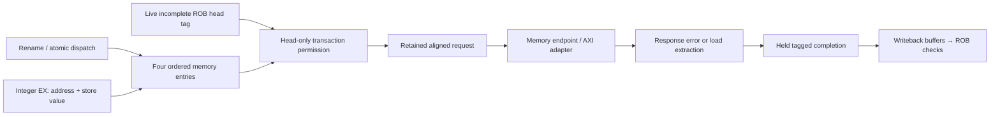

# Block 12: ordered memory queue and load/store engine

This block occupies the memory part of MEM. It connects in-order dispatch, speculative address
preparation, the ROB's retirement boundary, and the data-memory interface. Its central rule is:
**an address may be prepared early, but a data transaction starts only for the live incomplete
instruction at the ROB head.** This keeps wrong-path peripheral reads and writes off the bus.

The implementation has four memory entries and one active data transaction. Integer instructions
can continue through the independent execution paths while that transaction waits.

## 1. Connections and ownership



Dispatch copies each memory instruction's ROB identity, physical destination intent, size, and
signed/unsigned load flag. EX later supplies the effective byte address and raw store value.
Preparation must match that allocated identity and metadata, including the load extension flag;
it cannot change an allocated signed load into an unsigned load.

A nonmemory instruction still participates in the dispatch-prefix handshake, but occupies no
memory slot. This lets rename, ROB, IQ, and this queue agree on exactly the same accepted prefix.

## 2. Signals and their sources/destinations

The current package defines a 300-bit renamed instruction, a 190-bit memory entry, a 69-bit data
request, a 33-bit response, and a 222-bit completion. Payload validity is carried separately.

| Signal | Width | Source → destination | Meaning |
|---|---:|---|---|
| clk_i, rst_ni | 1 each | Common clock/reset → LSU | Rising-edge state; active-low asynchronous reset |
| dispatch_uop_i | 600 | Rename → queue | Two renamed records, lane 0 older |
| dispatch_valid_i / dispatch_ready_o / dispatch_fire_o | 2 each | Dispatcher ↔ queue | Offered, permitted, and accepted program-order prefix |
| prepare_i | 190 | Integer address path → queue | Prepared byte address, store data, fault, and next-PC metadata |
| prepare_valid_i / prepare_ready_o | 1 each | Address path ↔ queue | Preparation transfer; stale/unowned packets are diagnosed |
| head_valid_i / head_complete_i | 1 each | ROB → LSU | Whether the architectural head exists and still needs completion |
| head_tag_i | 12 | ROB → LSU | Full slot/generation identity permitted to access memory |
| data_request_o | 69 | LSU → memory/AXI adapter | Write bit, aligned byte address, data, four byte strobes |
| data_request_valid_o / data_request_ready_i | 1 each | LSU ↔ endpoint | Exactly one request transfer |
| data_response_i | 33 | Endpoint → LSU | Returned 32-bit data and error flag |
| data_response_valid_i / data_response_ready_o | 1 each | Endpoint ↔ LSU | Response transfer for the outstanding owner |
| completion_o | 222 | LSU → WB arbiter | Value/fault and original owner metadata |
| completion_valid_o / completion_ready_i | 1 each | LSU ↔ WB | Held result and acceptance into writeback |
| flush_i / flush_done_o | 1 each | Recovery control ↔ queue | Safe clear of unissued entries and registered acknowledgment |
| quiescent_o | 1 | LSU → recovery control | Transaction engine is IDLE; queued unissued work is cancellable |
| occupancy_o | 3 | Queue → status/tests | Number of allocated memory entries, 0 through 4 |
| protocol_error_o | 1 | LSU → diagnostics | Invalid prefix, bad preparation, unsafe flush, or unsolicited response |

quiescent_o and occupancy_o answer different questions. A queue can contain prepared younger
stores while the transaction engine is IDLE. Recovery can discard those entries because no bus
side effect has started. An active request, response, or held completion must finish first.

## 3. Circuit organization

The queue is a four-entry circular array with head/tail pointers and a count. Each entry stores
its own valid/prepared bits and full ROB identity. Two allocation paths can fill consecutive tail
positions; at most one oldest entry leaves after its completion transfers.

The transaction state machine is:

```text
IDLE → REQUEST → RESPONSE → COMPLETE → IDLE
          |          |           |
       request     response    completion
       holding     ownership   holding
```

IDLE checks the queue head against the ROB head. REQUEST holds one captured request until the
endpoint accepts it. RESPONSE accepts the matching data/error. COMPLETE holds the resulting
completion until writeback accepts it, then frees that memory entry.

A preparation accepted at one edge is observed from registered queue state on a later edge.
There is no preparation-to-bus combinational bypass. Current free slots determine dispatch
capacity; a slot released on this edge becomes allocation capacity next cycle.

## 4. Byte addresses, lanes, and sign extension

Instructions use byte addresses. The bus request clears address bits [1:0] and uses WSTRB to
identify the selected bytes. The little-endian lane position is the original address's low bits.

For a byte store of 0x80 at address 0x203, the bus receives:

| Field | Value | Reason |
|---|---|---|
| address | 0x200 | Word-aligned request address |
| wdata | 0x80000000 | Raw low byte shifted left by 24 bits |
| wstrb | 1000 | Only byte lane 3 changes |

For a returned word 0x80ff7f01, LB at 0x203 selects 0x80 and produces 0xffffff80; LBU produces
0x00000080. LH at 0x202 selects 0x80ff and produces 0xffff80ff; LHU produces 0x000080ff.
A word load uses the entire returned word.

Halfwords require address bit 0 clear; words require bits [1:0] clear. A misalignment completes
with cause 4 for a load or 6 for a store, using the original byte address in tval and issuing no
bus request. An inherited preparation fault keeps priority over a new alignment check.

## 5. Example transaction timing

Assume the queue has capacity, the preparation becomes available, and the owner is the ROB head:

| Edge | Event | State retained afterward |
|---|---|---|
| E0 | Dispatch allocates the memory instruction | Valid entry, not prepared |
| E1 | EX preparation transfers | Original address/store data and metadata saved |
| E2 | IDLE observes prepared matching head | Captured request, or local fault completion |
| E3, if ready | Request transfers once | RESPONSE owns the transaction |
| E4 or later | Endpoint response transfers | COMPLETE holds value/fault |
| E5 or later | WB accepts the completion | Queue head advances; engine returns to IDLE |
| Later edges | ROB accepts, then retires the result | Architectural state advances in order |

Any request or completion stall extends its row in the table without changing the retained
payload. A store's request acceptance is not its architectural completion; its response is
required. A full ROB does not stop already admitted memory work from completing.

## 6. Ordering, faults, and recovery

The queue performs no speculative load replay or store-to-load forwarding. Older stores receive
their responses and retire before a younger load can reach the ROB head. Register dependencies
for base/store operands were already enforced using physical tags in the scheduler.

An error response becomes cause 5 or 7 for a load/store access fault, with the original byte
address in tval. Fault completions preserve destination intent for ROB ownership validation but
publish no usable load value. Successful completions retain access metadata; store traces carry
the shifted data/strobes and original byte address.

An idle flush clears only unissued queue state. An unsafe flush while REQUEST, RESPONSE, or
COMPLETE is active is diagnosed and not acknowledged as safe. The active request/completion
remains owned, and a response can still drain. The production recovery controller therefore
waits for LSU quiescence before applying queue/map restoration.

## 7. Tests and waveforms

The current block-12 report records **1,067 checks, zero failures**. Its independent extraction
reference covers byte/halfword/word sizes, signed and unsigned extension, alignment offsets,
response faults, request/completion stalls, exactly-once transfer, queue exhaustion, prefix
allocation, ownership rejection, load-flag preservation, and safe/unsafe flush behavior.

```sh
python3 scripts/run_checks.py --block 12 --waves
```

Start with occupancy, head_tag_i, queue prepared state, state_q, request-valid/ready, response-
valid/ready, and completion-valid/ready. Check that a prepared younger entry does not produce a
request while another instruction owns the ROB head. For a byte access, compare the original
queued address with the aligned request and shifted strobe. During a stall, watch the complete
owner and payload remain unchanged.

These unit checks establish the LSU's local contracts. The separate core and AXI integration
benches exercise wrong-path MMIO suppression, data faults, and end-to-end memory behavior.
Their evidence is counted separately. Directed/generated simulation is not ISA certification,
formal proof, or FPGA timing analysis.

## 8. Interview questions

**Why can an address be prepared early while the request waits?** Address arithmetic has no
external side effect; the transaction can, especially for MMIO. ROB-head permission separates them.

**Why is a completion kept after the memory response?** Writeback may have no free slot. The
LSU must retain the result and owner instead of losing or repeating the transaction.

**Why check load_unsigned during preparation?** The allocated instruction determines extension
semantics. A matching tag with changed metadata must not reinterpret the returned value.

**Why does flush not simply clear a busy LSU?** A device may already own an accepted transaction.
Discarding its state would lose the response or permit duplicate side effects on replay.

**How are memory RAW dependencies handled here?** Strict head-only transactions serialize them;
register RAW dependencies use physical-tag readiness before address/store-data preparation.
