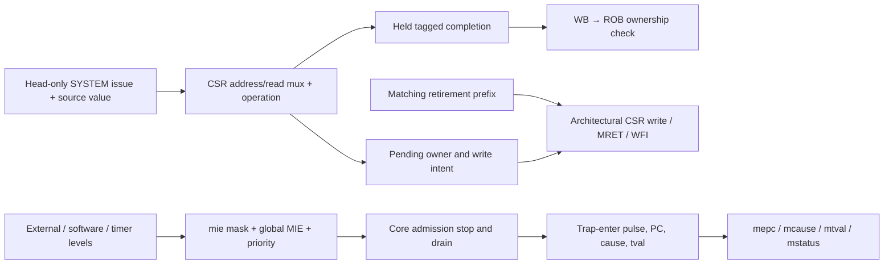

# Block 13: machine CSRs, precise trap state, and interrupt eligibility

This block is the serialized machine-mode system engine. It receives a SYSTEM instruction only
when the scheduler permits that instruction at the ROB head. It reads architectural CSR state,
returns a tagged completion, and retains any requested mutation until the same owner retires.

Completion and commitment are deliberately separate. A CSR result may reach its physical
register through WB while the CSR write intent is still pending. Recovery can then cancel the
uncommitted intent without rolling back an architectural CSR register.

## 1. Connections



The core coordinates draining and redirection. This module owns CSR contents, eligibility,
trap-target calculation, system completion, and committed MRET/WFI effects. Interrupt inputs
are synchronous level signals; their sources own how long pending conditions remain asserted.

## 2. Signal ownership

| Signal | Width | Source → destination | Meaning |
|---|---:|---|---|
| clk_i, rst_ni | 1 each | Common system clock/reset → unit | Rising-edge state; active-low asynchronous reset |
| request_i | 364 | Scheduler/PRF → system unit | Original renamed SYSTEM instruction and source values |
| request_valid_i / request_ready_o | 1 each | Scheduler ↔ unit | One head instruction accepted when no intent/wait is pending |
| completion_o | 222 | Unit → WB | Old CSR value or fault, original destination intent, actual next PC |
| completion_valid_o / completion_ready_i | 1 each | Unit ↔ WB | Retained result and consumer acceptance |
| retire_valid_i | 2 | ROB → unit | Actual normal-retirement prefix, excluding trap events |
| retire_entry_i | Two ROB records | ROB → unit | Valid/complete owner and operation metadata used for matching |
| irq_external_i / irq_software_i / irq_timer_i | 1 each | Synchronous interrupt sources → unit | Live machine pending levels |
| interrupt_pending_o | 1 | Unit → core control | At least one globally and locally enabled interrupt |
| interrupt_cause_o | 32 | Unit → core control | Highest-priority eligible machine interrupt cause |
| trap_enter_i | 1 | Precise core boundary → unit | Commit trap state at this edge |
| trap_pc_i / trap_cause_i / trap_tval_i | 32 each | Core → unit | Saved PC, cause, and fault-specific information |
| trap_target_o | 32 | Unit → ROB/recovery control | Direct or vectored mtvec target for the supplied cause |
| wfi_wait_o | 1 | Unit → front-end control | A committed WFI is waiting for a locally enabled pending level |
| cancel_i / cancel_done_o | 1 each | Recovery control ↔ unit | Remove uncommitted owner/result and acknowledge at the edge |
| quiescent_o | 1 | Unit → recovery control | No pending SYSTEM owner or completion remains |
| protocol_error_o | 1 | Unit → diagnostics | Misrouted/busy issue or inconsistent retirement ownership |

WFI waiting and quiescence are distinct. A committed WFI can leave the unit quiescent while the
front end waits. The clock and cycle counter continue operating.

## 3. Implemented CSR state and access rules

| CSR/group | Address | Implemented behavior |
|---|---|---|
| mstatus | 0x300 | MIE bit 3 and MPIE bit 7 stored; MPP reads machine mode 3; other unsupported bits fixed |
| misa | 0x301 | Fixed RV32 I/M value 0x40001100; Z-extension presence is documented separately |
| mie / mip | 0x304 / 0x344 | Enable mask supports MSIP/MTIP/MEIP bits 3/7/11; mip reads live input levels |
| mtvec | 0x305 | Four-byte base; mode 0 direct or 1 vectored, other mode writes become direct |
| mstatush | 0x310 | Fixed zero for this little-endian machine-only implementation |
| mcountinhibit | 0x320 | CY bit 0 and IR bit 2 supported |
| mscratch | 0x340 | 32-bit software scratch register |
| mepc / mcause / mtval | 0x341–0x343 | Stored trap state; mepc low two bits clear |
| mcycle / mcycleh | 0xb00 / 0xb80 | Low/high halves of a 64-bit cycle counter |
| minstret / minstreth | 0xb02 / 0xb82 | Low/high halves of a 64-bit normal-retirement counter |
| mvendorid, marchid, mimpid, mhartid, mconfigptr | 0xf11–0xf15 | Read-only identification values, currently zero |

Writes to fixed WARL/hardware-only fields such as misa, mstatush, and mip are accepted without
changing their fixed/live values. Writes to truly read-only identification CSRs fault. An
unsupported CSR address faults even for a read-only CSRRS operation.

All six Zicsr operations are decoded. CSRRW/CSRRWI always request a write. CSRRS/CSRRC suppress
the write only when their encoded source is x0; a nonzero register containing numeric zero still
requests a write and therefore faults on a read-only CSR. Immediate set/clear forms suppress
writing when zimm is zero. The returned value is the old CSR value sampled at issue.

## 4. Circuit and retirement timing

The hardware consists of CSR registers, address decode/read multiplexers, bitwise set/clear
logic, counter adders, and pending-owner/result registers. One owner remains reserved after its
completion is consumed, until matching retirement, cancellation, or trap entry removes it.

| Edge | Example CSRRW mscratch event | Architectural effect |
|---|---|---|
| E0 | Accept request; read old mscratch and capture new value/owner | No mscratch change |
| E1 or later | WB captures the held completion | Old value can proceed toward PRF/ROB acceptance |
| Later retirement edge | Full owner tag and operation metadata match | New mscratch commits; pending owner clears |
| Alternative cancellation edge | Recovery discards the uncommitted intent | Previous committed mscratch remains |

Retirement matching checks the full ROB identity, physical destination intent, SYSTEM operation,
CSR address, and CSR operation. Invalid prefixes/entries and mismatched ownership are diagnosed;
raw execution completion is never a CSR commit signal.

## 5. Counters and same-edge priority

mcycle increments on each active clock unless CY is inhibited. minstret adds the number of
valid completed nonfaulting records in the accepted retirement prefix, up to two. A trap or
interrupt event is not a retired instruction. Trace order counts architectural events, so its
number need not equal minstret.

A write to either half of mcycle or minstret replaces that counter's entire implicit update for
that edge. The selected half receives the software value; the other half keeps its **pre-edge**
value. This matters when the low half was 0xffffffff: an implicit carry must not accidentally
alter the preserved half during a simultaneous CSR write. Directed carry/write tests check it.

Counter inhibition changes take effect from the newly committed mask on subsequent edges.
Cancellation clears speculative intent, while architectural counters and previously committed
CSR values remain intact.

## 6. Traps, interrupt priority, MRET, and WFI

Eligible interrupts require mstatus.MIE and the matching mie bit. Priority is external, then
software, then timer. Pending bits can be observed through mip even when masked.

On trap_enter, the unit saves the aligned trap PC in mepc, stores mcause/mtval, copies MIE into
MPIE, and clears MIE. This trap update has priority over competing local state updates. The
core supplies the precise PC: the faulting instruction for a synchronous exception, or the next
unexecuted architectural PC after interrupt draining.

For mtvec=0x201, base=0x200 and mode=1. An external interrupt cause 11 selects 0x22c; a
synchronous illegal-instruction exception still selects 0x200. The target is calculated from
the supplied cause before trap state is captured.

MRET's completion carries mepc as its actual next PC. At retirement it restores MIE from MPIE
and sets MPIE. The production recovery path flushes younger work and restarts at the saved PC.
ECALL and EBREAK produce exception completions with causes 11 and 3; they cannot retire normally.

WFI sets waiting state only when it commits. A locally enabled pending interrupt clears that
wait even if global MIE is zero. In that case execution can resume without taking an interrupt;
if global eligibility is also true, core control drains and enters the trap.

A faulting SYSTEM owner can still be pending when its ROB entry takes a synchronous trap.
trap_enter/cancel removes it; waiting for that owner to become empty before issuing its trap
would deadlock. Interrupt entry instead waits for admitted normal work to drain first.

## 7. Tests and waveforms

The current block-13 report records **511 checks, zero failures**. It covers six CSR forms,
read-only/unsupported faults, encoded-x0 versus zero-value semantics, commit versus completion,
held responses, cancellation, fixed WARL values, counter halves/carry/write priority, dual
retirement, inhibition, interrupt masks/priority, direct/vectored traps, MRET, WFI, and system
exception generation.

```sh
python3 scripts/run_checks.py --block 13 --waves
```

Watch request-ready, pending_q, response_valid_q, matching retire_valid, and commit_owner for a
CSR write. For counters, distinguish issue-time read data from later retirement-time updates.
For interrupts, inspect mip, mie_q, mie_global_q, interrupt_pending_o, trap_enter, mepc_q,
mcause_q, and the two MIE/MPIE bits. WFI should stop admission while clk continues toggling.

These checks prove the local system-unit contracts. Core-level draining, recovery, bus ordering,
and actual peripheral interrupt paths are exercised by separate integration tests; consult the
block-15 evidence for their scope. No test count is a formal correctness or ISA-certification claim.

## 8. Interview questions

**Why retain write intent after the completion leaves?** The old CSR value can complete before
architectural retirement. The requested mutation must still wait for its precise commit boundary.

**Why is CSRRS with x1=0 different from CSRRS with rs1=x0?** The ISA suppresses writing based on
the encoded register name. The former still requests a write; the latter is a pure CSR read.

**Why is mip separate from mie?** mip describes pending source levels; mie selects local enables.
Global MIE is the final mask used for trap eligibility.

**Why does WFI wake while global MIE is clear?** Waiting and trap-taking have different enable
conditions. A locally enabled pending source can wake execution without globally enabling a trap.

**Why preserve the other pre-edge counter half on a write?** A CSR write overrides the implicit
increment. Keeping an incremented carry would combine two effects into an unintended value.

**Does cancel restore committed CSRs?** They were never speculatively modified. Cancel removes
the pending owner/result while committed state stays available.

## Complete CSR/system unit

Source: `rtl/rv32_csr_file.sv`.

```systemverilog
// Serialized machine-mode system unit. CSR values change at retirement, never completion.
`timescale 1ns / 1ps
module rv32_csr_file
  import rv32_ooo_pkg::*;
(
  input logic clk_i, rst_ni,
  input logic request_valid_i,
  output logic request_ready_o,
  input execute_packet_t request_i,
  output logic completion_valid_o,
  input logic completion_ready_i,
  output completion_t completion_o,
  input logic [1:0] retire_valid_i,
  input rob_entry_pair_t retire_entry_i,
  input logic irq_external_i, irq_software_i, irq_timer_i,
  output logic interrupt_pending_o,
  output word_t interrupt_cause_o,
  input logic trap_enter_i,
  input word_t trap_pc_i, trap_cause_i, trap_tval_i,
  output word_t trap_target_o,
  output logic wfi_wait_o,
  input logic cancel_i,
  output logic cancel_done_o, quiescent_o, protocol_error_o
);
  localparam word_t IRQ_MASK = 32'h0000_0888;
  logic mie_global_q, mpie_q;
  word_t mie_q, mtvec_q, mscratch_q, mepc_q, mcause_q, mtval_q;
  logic [63:0] cycle_q, instret_q;
  word_t inhibit_q;
  logic waiting_q, pending_q, response_valid_q;
  renamed_uop_t owner_q;
  completion_t result_q, incoming_result;
  csr_addr_t address_q;
  word_t write_value_q, incoming_write_value;
  logic write_q, incoming_write;
  word_t mip, local_pending, csr_read, operand;
  logic csr_known, csr_readonly, illegal, commit_owner;
  logic [1:0] retired_count;

  assign mip = (irq_external_i ? 32'h800 : 0) | (irq_software_i ? 32'h8 : 0)
               | (irq_timer_i ? 32'h80 : 0);
  assign local_pending = mip & mie_q;
  assign interrupt_pending_o = mie_global_q && |local_pending;
  always_comb begin
    interrupt_cause_o = '0;
    if (interrupt_pending_o) begin
      if (local_pending[11]) interrupt_cause_o = CAUSE_IRQ_EXTERNAL;
      else if (local_pending[3]) interrupt_cause_o = CAUSE_IRQ_SOFTWARE;
      else interrupt_cause_o = CAUSE_IRQ_TIMER;
    end
    trap_target_o = {mtvec_q[31:2], 2'b00};
    if (trap_cause_i[31] && mtvec_q[1:0] == 2'b01)
      trap_target_o = trap_target_o + {trap_cause_i[29:0], 2'b00};
  end

  always_comb begin : read_and_prepare
    decoded_uop_t decoded;
    decoded = request_i.uop.decoded;
    csr_known = 1'b1;
    csr_readonly = 1'b0;
    csr_read = '0;
    case (decoded.csr_address)
      CSR_MSTATUS: csr_read = 32'h1800 | (mie_global_q ? 32'h8 : 0)
                             | (mpie_q ? 32'h80 : 0);
      CSR_MISA: csr_read = MISA_VALUE;
      CSR_MSTATUSH: csr_read = '0;
      CSR_MIE: csr_read = mie_q;
      CSR_MIP: csr_read = mip;
      CSR_MTVEC: csr_read = mtvec_q;
      CSR_MSCRATCH: csr_read = mscratch_q;
      CSR_MEPC: csr_read = mepc_q;
      CSR_MCAUSE: csr_read = mcause_q;
      CSR_MTVAL: csr_read = mtval_q;
      CSR_MCOUNTINHIBIT: csr_read = inhibit_q;
      CSR_MCYCLE: csr_read = cycle_q[31:0];
      CSR_MCYCLEH: csr_read = cycle_q[63:32];
      CSR_MINSTRET: csr_read = instret_q[31:0];
      CSR_MINSTRETH: csr_read = instret_q[63:32];
      CSR_MVENDORID, CSR_MARCHID, CSR_MIMPID, CSR_MHARTID, CSR_MCONFIGPTR: begin
        csr_read = '0;
        csr_readonly = 1'b1;
      end
      default: csr_known = 1'b0;
    endcase
    operand = request_i.rs1_value;
    if (decoded.csr_op == CSR_RWI || decoded.csr_op == CSR_RSI || decoded.csr_op == CSR_RCI)
      operand = {27'b0, decoded.csr_immediate};
    incoming_write = 1'b0;
    incoming_write_value = csr_read;
    illegal = decoded.op_class != UOP_SYSTEM;
    incoming_result = '0;
    incoming_result.rob_tag = request_i.uop.rob_tag;
    incoming_result.pdst = request_i.uop.pdst;
    incoming_result.writes_rd = decoded.writes_rd;
    incoming_result.exception = decoded.fetch.exception;
    incoming_result.control_flow.next_pc = decoded.fetch.pc + 32'd4;
    case (decoded.system_op)
      SYS_CSR: begin
        incoming_result.value = csr_read;
        case (decoded.csr_op)
          CSR_RW, CSR_RWI: begin
            incoming_write = 1'b1;
            incoming_write_value = operand;
          end
          CSR_RS, CSR_RSI: begin
            // Register forms suppress by encoded x0, not by a zero register VALUE.
            incoming_write = decoded.csr_op == CSR_RS ? decoded.rs1 != 0 : operand != 0;
            incoming_write_value = csr_read | operand;
          end
          CSR_RC, CSR_RCI: begin
            incoming_write = decoded.csr_op == CSR_RC ? decoded.rs1 != 0 : operand != 0;
            incoming_write_value = csr_read & ~operand;
          end
          default: illegal = 1'b1;
        endcase
        illegal = illegal || !csr_known || (csr_readonly && incoming_write);
      end
      SYS_ECALL: begin
        if (!incoming_result.exception.valid) begin
          incoming_result.exception.valid = 1'b1;
          incoming_result.exception.cause = CAUSE_ECALL_M;
          incoming_result.exception.tval = '0;
        end
      end
      SYS_EBREAK: begin
        if (!incoming_result.exception.valid) begin
          incoming_result.exception.valid = 1'b1;
          incoming_result.exception.cause = CAUSE_BREAKPOINT;
          incoming_result.exception.tval = decoded.fetch.pc;
        end
      end
      SYS_MRET: incoming_result.control_flow.next_pc = mepc_q;
      SYS_WFI, SYS_FENCE, SYS_FENCE_I: begin end
      default: illegal = 1'b1;
    endcase
    if (illegal && !incoming_result.exception.valid) begin
      incoming_result.exception.valid = 1'b1;
      incoming_result.exception.cause = CAUSE_ILLEGAL_INSTR;
      incoming_result.exception.tval = decoded.fetch.instruction;
    end
    if (incoming_result.exception.valid) begin
      incoming_result.value = '0;
      incoming_write = 1'b0;
    end
    incoming_result.control_flow.mispredicted = !incoming_result.exception.valid
      && incoming_result.control_flow.next_pc != decoded.fetch.prediction.next_pc;
  end

  always_comb begin : retirement_match
    rob_entry_t entry;
    logic prefix_ok, older_good, entry_ok, owner_matches;
    retired_count = '0;
    commit_owner = 1'b0;
    protocol_error_o = rst_ni && request_valid_i && !cancel_i && !trap_enter_i
                       && (!request_ready_o || request_i.uop.decoded.op_class != UOP_SYSTEM
                           || request_i.uop.decoded.system_op == SYS_NONE);
    prefix_ok = retire_valid_i != 2'b10;
    older_good = 1'b1;
    if (rst_ni && !prefix_ok) protocol_error_o = 1'b1;
    for (int lane = 0; lane < 2; lane++) begin
      entry = lane == 0 ? retire_entry_i.lane0 : retire_entry_i.lane1;
      entry_ok = older_good && entry.valid && entry.complete && !entry.exception.valid;
      owner_matches = pending_q && entry.uop.rob_tag == owner_q.rob_tag;
      if (rst_ni && prefix_ok && retire_valid_i[lane]) begin
        if (!entry_ok) begin
          protocol_error_o = 1'b1;
          older_good = 1'b0;
        end else begin
          retired_count = retired_count + 2'd1;
          if (owner_matches) begin
            if (response_valid_q || result_q.exception.valid || entry.uop.pdst != owner_q.pdst
                || entry.uop.decoded.writes_rd != owner_q.decoded.writes_rd
                || entry.uop.decoded.system_op != owner_q.decoded.system_op
                || entry.uop.decoded.csr_address != owner_q.decoded.csr_address
                || entry.uop.decoded.csr_op != owner_q.decoded.csr_op) protocol_error_o = 1'b1;
            else commit_owner = 1'b1;
          end
        end
      end
    end
  end

  assign request_ready_o = rst_ni && !cancel_i && !trap_enter_i && !pending_q && !waiting_q;
  assign completion_valid_o = rst_ni && !cancel_i && !trap_enter_i && response_valid_q;
  assign completion_o = completion_valid_o ? result_q : completion_t'('0);
  assign quiescent_o = !pending_q && !response_valid_q;
  assign wfi_wait_o = waiting_q;

  always_ff @(posedge clk_i or negedge rst_ni) begin
    if (!rst_ni) begin
      mie_global_q <= 1'b0;
      mpie_q <= 1'b0;
      mie_q <= '0;
      mtvec_q <= '0;
      mscratch_q <= '0;
      mepc_q <= '0;
      mcause_q <= '0;
      mtval_q <= '0;
      inhibit_q <= '0;
      cycle_q <= '0;
      instret_q <= '0;
      waiting_q <= 1'b0;
      pending_q <= 1'b0;
      response_valid_q <= 1'b0;
      owner_q <= '0;
      result_q <= '0;
      address_q <= '0;
      write_value_q <= '0;
      write_q <= 1'b0;
      cancel_done_o <= 1'b0;
    end else begin
      cancel_done_o <= cancel_i;
      if (!inhibit_q[0]) cycle_q <= cycle_q + 64'd1;
      if (!inhibit_q[2]) instret_q <= instret_q + {62'b0, retired_count};
      if (completion_valid_o && completion_ready_i) response_valid_q <= 1'b0;
      if (commit_owner) begin
        pending_q <= 1'b0;
        if (owner_q.decoded.system_op == SYS_CSR && write_q) begin
          case (address_q)
            CSR_MSTATUS: begin mie_global_q <= write_value_q[3]; mpie_q <= write_value_q[7]; end
            CSR_MIE: mie_q <= write_value_q & IRQ_MASK;
            CSR_MTVEC: mtvec_q <= {write_value_q[31:2],
                                  (write_value_q[1:0] == 1 ? 2'b01 : 2'b00)};
            CSR_MSCRATCH: mscratch_q <= write_value_q;
            CSR_MEPC: mepc_q <= {write_value_q[31:2], 2'b00};
            CSR_MCAUSE: mcause_q <= write_value_q;
            CSR_MTVAL: mtval_q <= write_value_q;
            CSR_MCOUNTINHIBIT: inhibit_q <= write_value_q & 32'h5;
            // Either-half writes replace the counter's implicit update. Preserve
            // the other PRE-INCREMENT half, including on a low-half carry edge.
            CSR_MCYCLE: cycle_q <= {cycle_q[63:32], write_value_q};
            CSR_MCYCLEH: cycle_q <= {write_value_q, cycle_q[31:0]};
            CSR_MINSTRET: instret_q <= {instret_q[63:32], write_value_q};
            CSR_MINSTRETH: instret_q <= {write_value_q, instret_q[31:0]};
            // Fixed WARL values and hardware-only pending bits ignore writes.
            default: begin end
          endcase
        end
        if (owner_q.decoded.system_op == SYS_MRET) begin
          mie_global_q <= mpie_q;
          mpie_q <= 1'b1;
        end
        if (owner_q.decoded.system_op == SYS_WFI) waiting_q <= 1'b1;
      end
      if (|local_pending) waiting_q <= 1'b0;
      if (request_valid_i && request_ready_o) begin
        owner_q <= request_i.uop;
        result_q <= incoming_result;
        pending_q <= 1'b1;
        response_valid_q <= 1'b1;
        address_q <= request_i.uop.decoded.csr_address;
        write_value_q <= incoming_write_value;
        write_q <= incoming_write;
      end
      if (cancel_i || trap_enter_i) begin
        pending_q <= 1'b0;
        response_valid_q <= 1'b0;
        owner_q <= '0;
        result_q <= '0;
        write_q <= 1'b0;
      end
      if (trap_enter_i) begin
        mepc_q <= {trap_pc_i[31:2], 2'b00};
        mcause_q <= trap_cause_i;
        mtval_q <= trap_tval_i;
        mpie_q <= mie_global_q;
        mie_global_q <= 1'b0;
        waiting_q <= 1'b0;
      end
    end
  end
endmodule
```

## CSR tests

Source: `tb/tb_block13.sv`.

```systemverilog
// Machine CSR/system-unit checks: completion is speculative, retirement changes state.
`timescale 1ns / 1ps
module tb_block13;
  import rv32_ooo_pkg::*;
  logic clk = 0, rst_n = 1, request_valid, request_ready, completion_valid, completion_ready;
  execute_packet_t request_packet;
  completion_t completion_packet, saved_result;
  renamed_uop_t saved_owner;
  logic [1:0] retire_valid;
  rob_entry_pair_t retire_entry;
  logic external_irq, software_irq, timer_irq, interrupt_pending;
  word_t interrupt_cause, trap_pc, trap_cause, trap_tval, trap_target;
  logic trap_enter, waiting, cancel, cancel_done, quiet, error, force_nonzero_rs1;
  integer checks = 0, failures = 0, sequence_id = 1;
  word_t value, before_value, after_value;
  logic [63:0] counter_before;

  rv32_csr_file dut (
    .clk_i(clk), .rst_ni(rst_n), .request_valid_i(request_valid),
    .request_ready_o(request_ready), .request_i(request_packet),
    .completion_valid_o(completion_valid), .completion_ready_i(completion_ready),
    .completion_o(completion_packet), .retire_valid_i(retire_valid), .retire_entry_i(retire_entry),
    .irq_external_i(external_irq), .irq_software_i(software_irq), .irq_timer_i(timer_irq),
    .interrupt_pending_o(interrupt_pending), .interrupt_cause_o(interrupt_cause),
    .trap_enter_i(trap_enter), .trap_pc_i(trap_pc), .trap_cause_i(trap_cause),
    .trap_tval_i(trap_tval), .trap_target_o(trap_target), .wfi_wait_o(waiting),
    .cancel_i(cancel), .cancel_done_o(cancel_done), .quiescent_o(quiet), .protocol_error_o(error)
  );

  task automatic check(input logic condition, input string description);
    begin
      checks = checks + 1;
      if (condition !== 1'b1) begin
        failures = failures + 1;
        $display("FAIL: %s at %0t", description, $time);
      end
    end
  endtask
  task automatic step;
    begin #1; clk = 1; #1; clk = 0; #1; end
  endtask

  task automatic issue(
    input system_op_e system_kind, input csr_addr_t address,
    input csr_op_e operation, input word_t operand_value, input logic [4:0] immediate
  );
    begin
      request_packet = '0;
      request_packet.uop.rob_tag.index = sequence_id % ROB_DEPTH;
      request_packet.uop.rob_tag.generation = sequence_id / ROB_DEPTH;
      request_packet.uop.pdst = 32 + sequence_id % 32;
      request_packet.uop.decoded.op_class = UOP_SYSTEM;
      request_packet.uop.decoded.system_op = system_kind;
      request_packet.uop.decoded.csr_address = address;
      request_packet.uop.decoded.csr_op = operation;
      request_packet.uop.decoded.csr_immediate = immediate;
      request_packet.uop.decoded.writes_rd = system_kind == SYS_CSR;
      request_packet.uop.decoded.fetch.pc = 32'h100 + sequence_id * 4;
      request_packet.uop.decoded.fetch.instruction = 32'h00000073 | (address << 20);
      request_packet.uop.decoded.fetch.prediction.next_pc =
        request_packet.uop.decoded.fetch.pc + 4;
      request_packet.rs1_value = operand_value;
      request_packet.uop.decoded.rs1 = (operand_value != 0 || force_nonzero_rs1) ? 1 : 0;
      sequence_id = sequence_id + 1;
      request_valid = 1; #1;
      check(request_ready, "idle system unit accepts one owner");
      step; request_valid = 0; #1;
      check(completion_valid && !request_ready && !quiet, "completion retains serialized owner");
      check(completion_packet.rob_tag == request_packet.uop.rob_tag
            && completion_packet.pdst == request_packet.uop.pdst,
            "completion preserves full identity and physical destination");
      saved_owner = request_packet.uop;
      saved_result = completion_packet;
    end
  endtask

  task automatic consume;
    begin
      completion_ready = 1; step; completion_ready = 0; #1;
      check(!completion_valid && !request_ready && !quiet,
            "completion consumption retains intent until actual retirement");
    end
  endtask
  task automatic commit;
    begin
      retire_entry = '0;
      retire_entry.lane0.valid = 1;
      retire_entry.lane0.complete = 1;
      retire_entry.lane0.uop = saved_owner;
      retire_entry.lane0.result = saved_result.value;
      retire_entry.lane0.control_flow = saved_result.control_flow;
      retire_valid = 1; #1;
      check(!error, "matching completed retirement has no protocol diagnostic");
      step; retire_valid = 0; retire_entry = '0; #1;
      check(quiet && !completion_valid, "retirement releases serialized intent");
    end
  endtask
  task automatic read_csr(input csr_addr_t address, output word_t result);
    begin
      issue(SYS_CSR, address, CSR_RS, 0, 0);
      check(!completion_packet.exception.valid, "implemented CSR reads normally");
      result = completion_packet.value;
      consume; commit;
    end
  endtask
  task automatic write_csr(input csr_addr_t address, input word_t data);
    begin
      issue(SYS_CSR, address, CSR_RW, data, 0);
      check(!completion_packet.exception.valid, "writable or fixed WARL CSR write is legal");
      consume; commit;
    end
  endtask
  task automatic modify(
    input csr_op_e operation, input word_t data, input logic [4:0] immediate,
    input word_t expected_old
  );
    begin
      issue(SYS_CSR, CSR_MSCRATCH, operation, data, immediate);
      check(!completion_packet.exception.valid && completion_packet.value == expected_old,
            "CSR operation returns the old value");
      consume; commit;
    end
  endtask
  task automatic clear_speculation;
    begin
      cancel = 1; #1;
      check(!completion_valid && !request_ready, "cancel masks completion and request immediately");
      step; cancel = 0; #1;
      check(cancel_done && quiet, "cancel acknowledges removal of pending system owner");
      step;
    end
  endtask

  initial begin
    if ($test$plusargs("waves")) begin
      $dumpfile("build/block13/block13.vcd");
      $dumpvars(0, tb_block13);
    end
    #100000; $fatal(1, "CSR/system test timed out");
  end
  initial begin
    request_valid = 0; request_packet = '0; completion_ready = 0;
    retire_valid = 0; retire_entry = '0; external_irq = 0; software_irq = 0; timer_irq = 0;
    trap_enter = 0; trap_pc = 0; trap_cause = 0; trap_tval = 0; cancel = 0;
    force_nonzero_rs1 = 0;
    #1; rst_n = 0; #2;
    check(!completion_valid && !request_ready && quiet && !waiting,
          "global reset clears architectural and speculative system state");
    rst_n = 1; #1;
    read_csr(CSR_MSTATUS, value); check(value == 32'h1800, "MPP is fixed machine mode");

    // Completion, including a consumed completion, cannot commit a CSR write.
    issue(SYS_CSR, CSR_MSCRATCH, CSR_RW, 32'hdeadbeef, 0);
    check(completion_packet.value == 0, "first scratch write sees reset old value");
    for (integer i = 0; i < 3; i++) begin
      step; check(completion_valid && completion_packet == saved_result,
                  "held completion remains stable while counters continue");
    end
    consume; clear_speculation;
    read_csr(CSR_MSCRATCH, value);
    check(value == 0, "cancel after completion prevents CSR mutation");
    modify(CSR_RW, 32'h1234, 0, 0);
    modify(CSR_RS, 32'h40, 0, 32'h1234);
    modify(CSR_RC, 32'h30, 0, 32'h1274);
    modify(CSR_RWI, 0, 3, 32'h1244);
    modify(CSR_RSI, 0, 16, 3);
    modify(CSR_RCI, 0, 1, 19);
    read_csr(CSR_MSCRATCH, value); check(value == 18, "all six CSR operations update as specified");

    // Consuming the result is insufficient: only the exact allocated owner may commit.
    issue(SYS_CSR, CSR_MSCRATCH, CSR_RW, 32'hbad0cafe, 0); consume;
    retire_entry = '0; retire_entry.lane0.valid = 1; retire_entry.lane0.complete = 1;
    retire_entry.lane0.uop = saved_owner;
    retire_entry.lane0.uop.rob_tag.generation = saved_owner.rob_tag.generation + 1'b1;
    retire_valid = 1; #1; check(!error, "another retirement generation cannot claim this intent");
    step; retire_valid = 0;
    check(!quiet && !request_ready, "stale retirement leaves the serialized owner pending");
    retire_entry.lane0.uop = saved_owner;
    retire_entry.lane0.uop.pdst = saved_owner.pdst == 63 ? 62 : 63;
    retire_valid = 1; #1; check(error, "matching tag with a wrong destination cannot commit");
    step; retire_valid = 0; retire_entry = '0;
    check(!quiet, "malformed matching retirement retains intent for recovery");
    clear_speculation; read_csr(CSR_MSCRATCH, value);
    check(value == 18, "rejected retirement packets cannot mutate committed scratch");

    read_csr(CSR_MVENDORID, value); check(value == 0, "identification CSR is readable zero");
    issue(SYS_CSR, CSR_MVENDORID, CSR_RW, 0, 0);
    check(completion_packet.exception.valid && completion_packet.exception.cause == 2,
          "CSRRW writes even operand zero and faults on read-only CSR");
    consume; clear_speculation;
    force_nonzero_rs1 = 1;
    issue(SYS_CSR, CSR_MVENDORID, CSR_RS, 0, 0);
    check(completion_packet.exception.valid && completion_packet.exception.cause == 2,
          "CSRRS with a nonzero source register attempts a write even if its value is zero");
    clear_speculation; force_nonzero_rs1 = 0;
    issue(SYS_CSR, CSR_MVENDORID, CSR_RSI, 0, 0);
    check(!completion_packet.exception.valid, "CSRRSI zimm zero is a legal read-only read");
    consume; commit;
    issue(SYS_CSR, 12'h777, CSR_RS, 0, 0);
    check(completion_packet.exception.valid && completion_packet.exception.cause == 2
          && completion_packet.exception.tval == request_packet.uop.decoded.fetch.instruction,
          "unsupported CSR read is an illegal instruction");
    clear_speculation;
    write_csr(CSR_MISA, 0); read_csr(CSR_MISA, value);
    check(value == MISA_VALUE, "misa is fixed RV32 I/M WARL state");
    write_csr(CSR_MSTATUSH, 32'hffffffff); read_csr(CSR_MSTATUSH, value);
    check(value == 0, "machine status high half is fixed zero");

    // Freeze both counters, verify half writes, then resume and count a retire pair.
    write_csr(CSR_MCOUNTINHIBIT, 5);
    read_csr(CSR_MCYCLE, before_value);
    repeat (5) step;
    read_csr(CSR_MCYCLE, after_value);
    check(before_value == after_value, "mcountinhibit freezes cycle increments");
    write_csr(CSR_MCYCLEH, 32'h1234); write_csr(CSR_MCYCLE, 32'hfffffffe);
    read_csr(CSR_MCYCLE, value); check(value == 32'hfffffffe, "cycle low-half write");
    read_csr(CSR_MCYCLEH, value); check(value == 32'h1234, "cycle high-half write");
    write_csr(CSR_MINSTRETH, 32'habcd); write_csr(CSR_MINSTRET, 32'h42);
    read_csr(CSR_MINSTRET, value); check(value == 32'h42, "instret low half write");
    read_csr(CSR_MINSTRETH, value); check(value == 32'habcd, "instret high half write");
    write_csr(CSR_MCOUNTINHIBIT, 0); repeat (4) step;
    read_csr(CSR_MCYCLEH, value);
    check(value == 32'h1235, "64-bit cycle counter carries across halves");
    read_csr(CSR_MINSTRET, before_value);
    retire_entry = '0;
    retire_entry.lane0.valid = 1; retire_entry.lane0.complete = 1;
    retire_entry.lane1.valid = 1; retire_entry.lane1.complete = 1;
    retire_valid = 3; step; retire_valid = 0; retire_entry = '0;
    read_csr(CSR_MINSTRET, after_value);
    check(after_value == before_value + 3,
          "instret counts read retirement plus two ordinary retirements");

    // Counter writes replace the whole implicit increment, including its carry.
    // Observe pre/post-edge state without forcing or modifying any DUT register.
    write_csr(CSR_MCOUNTINHIBIT, 4);
    write_csr(CSR_MINSTRETH, 32'h12345678);
    write_csr(CSR_MINSTRET, 32'hffffffff);
    write_csr(CSR_MCOUNTINHIBIT, 0);
    issue(SYS_CSR, CSR_MINSTRETH, CSR_RW, 32'habcdef01, 0); consume;
    counter_before = dut.instret_q;
    check(counter_before[31:0] == 32'hffffffff,
          "instret high-write fixture starts at low-half overflow boundary");
    commit;
    check(dut.instret_q == {32'habcdef01, counter_before[31:0]},
          "instret high-half write preserves low half and does not count itself");
    write_csr(CSR_MINSTRET, 32'hffffffff);
    issue(SYS_CSR, CSR_MINSTRET, CSR_RW, 32'h55, 0); consume;
    counter_before = dut.instret_q;
    check(counter_before[31:0] == 32'hffffffff,
          "instret low-write fixture independently starts at the carry boundary");
    commit;
    check(dut.instret_q == {counter_before[63:32], 32'h55},
          "instret low-half write suppresses carry into the untouched high half");

    write_csr(CSR_MCYCLEH, 32'h10203040);
    write_csr(CSR_MCYCLE, 32'hfffffffd);
    issue(SYS_CSR, CSR_MCYCLE, CSR_RW, 32'h66, 0); consume;
    counter_before = dut.cycle_q;
    check(counter_before[31:0] == 32'hffffffff,
          "cycle low-write fixture reaches overflow just before retirement");
    commit;
    check(dut.cycle_q == {counter_before[63:32], 32'h66},
          "cycle low-half write suppresses implicit high-half carry");
    issue(SYS_CSR, CSR_MCYCLEH, CSR_RW, 32'h50607080, 0); consume;
    counter_before = dut.cycle_q;
    commit;
    check(dut.cycle_q == {32'h50607080, counter_before[31:0]},
          "cycle high-half write preserves the pre-increment low half");

    write_csr(CSR_MIE, 32'hffffffff); read_csr(CSR_MIE, value);
    check(value == 32'h888, "mie exposes only machine external/software/timer enables");
    write_csr(CSR_MSTATUS, 8);
    external_irq = 1; software_irq = 1; timer_irq = 1; #1;
    check(interrupt_pending && interrupt_cause == CAUSE_IRQ_EXTERNAL,
          "external interrupt priority");
    external_irq = 0; #1;
    check(interrupt_cause == CAUSE_IRQ_SOFTWARE, "software interrupt priority over timer");
    software_irq = 0; #1;
    check(interrupt_cause == CAUSE_IRQ_TIMER, "timer interrupt selected when alone");
    write_csr(CSR_MIP, 32'hffffffff); read_csr(CSR_MIP, value);
    check(value == 32'h80, "mip reflects hardware inputs and ignores CSR writes");
    timer_irq = 0; #1; check(!interrupt_pending, "interrupt pending clears with source");

    write_csr(CSR_MTVEC, 32'h201);
    trap_cause = CAUSE_IRQ_EXTERNAL; #1;
    check(trap_target == 32'h22c, "vectored interrupt adds four times cause code");
    trap_cause = CAUSE_ILLEGAL_INSTR; #1;
    check(trap_target == 32'h200, "synchronous exception uses mtvec base in vectored mode");
    trap_pc = 32'h333; trap_cause = CAUSE_IRQ_EXTERNAL; trap_tval = 32'hbeef;
    trap_enter = 1; step; trap_enter = 0;
    read_csr(CSR_MEPC, value); check(value == 32'h330, "trap captures aligned mepc");
    read_csr(CSR_MCAUSE, value); check(value == CAUSE_IRQ_EXTERNAL, "trap captures mcause");
    read_csr(CSR_MTVAL, value); check(value == 32'hbeef, "trap captures mtval");
    read_csr(CSR_MSTATUS, value);
    check(value == 32'h1880, "trap saves MIE into MPIE and masks MIE");
    issue(SYS_MRET, 0, CSR_NONE, 0, 0);
    check(completion_packet.control_flow.next_pc == 32'h330, "MRET completion redirects to mepc");
    consume; commit;
    read_csr(CSR_MSTATUS, value); check(value == 32'h1888, "MRET restores MIE and sets MPIE");
    write_csr(CSR_MTVEC, 32'h103); read_csr(CSR_MTVEC, value);
    check(value == 32'h100, "unsupported mtvec mode coerces to direct");

    write_csr(CSR_MSTATUS, 0);
    issue(SYS_WFI, 0, CSR_NONE, 0, 0); consume; commit;
    check(waiting && !request_ready && !interrupt_pending, "WFI waits without a gated clock");
    timer_irq = 1; step;
    check(!waiting && request_ready && !interrupt_pending,
          "locally enabled IRQ wakes WFI even when global MIE is clear");
    timer_irq = 0;
    issue(SYS_FENCE, 0, CSR_NONE, 0, 0); consume; commit;
    issue(SYS_FENCE_I, 0, CSR_NONE, 0, 0); consume; commit;
    issue(SYS_ECALL, 0, CSR_NONE, 0, 0);
    check(completion_packet.exception.valid && completion_packet.exception.cause == 11,
          "ECALL produces precise machine environment-call cause");
    clear_speculation;
    issue(SYS_EBREAK, 0, CSR_NONE, 0, 0);
    check(completion_packet.exception.valid && completion_packet.exception.cause == 3,
          "EBREAK produces breakpoint cause");
    clear_speculation;

    retire_valid = 2; #1; check(error, "nonprefix retirement is diagnosed");
    step; retire_valid = 0;
    read_csr(CSR_MSCRATCH, value);
    check(value == 18, "trap/cancel preserve committed scratch state");
    $display("BLOCK13 SUMMARY: %0d checks, %0d failures", checks, failures);
    if (failures) $fatal(1, "CSR/system checks failed");
    $finish;
  end
endmodule
```
