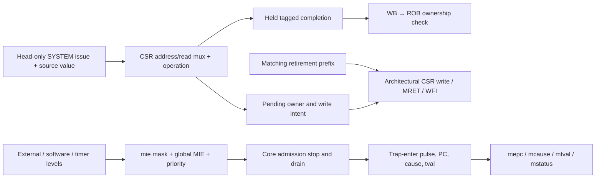

# Block 13: machine CSRs, precise trap state, and interrupt eligibility

This block is the serialized machine-mode system engine. It receives a SYSTEM instruction only
when the scheduler permits that instruction at the ROB head. It reads architectural CSR state,
returns a tagged completion, and retains any requested mutation until the same owner retires.

Completion and commitment are deliberately separate. A CSR result may reach its physical
register through WB while the CSR write intent is still pending. Recovery can then cancel the
uncommitted intent without rolling back an architectural CSR register.

## 1. Connections



The core coordinates draining and redirection. This module owns CSR contents, eligibility,
trap-target calculation, system completion, and committed MRET/WFI effects. Interrupt inputs
are synchronous level signals; their sources own how long pending conditions remain asserted.

## 2. Signal ownership

| Signal | Width | Source → destination | Meaning |
|---|---:|---|---|
| clk_i, rst_ni | 1 each | Common system clock/reset → unit | Rising-edge state; active-low asynchronous reset |
| request_i | 364 | Scheduler/PRF → system unit | Original renamed SYSTEM instruction and source values |
| request_valid_i / request_ready_o | 1 each | Scheduler ↔ unit | One head instruction accepted when no intent/wait is pending |
| completion_o | 222 | Unit → WB | Old CSR value or fault, original destination intent, actual next PC |
| completion_valid_o / completion_ready_i | 1 each | Unit ↔ WB | Retained result and consumer acceptance |
| retire_valid_i | 2 | ROB → unit | Actual normal-retirement prefix, excluding trap events |
| retire_entry_i | Two ROB records | ROB → unit | Valid/complete owner and operation metadata used for matching |
| irq_external_i / irq_software_i / irq_timer_i | 1 each | Synchronous interrupt sources → unit | Live machine pending levels |
| interrupt_pending_o | 1 | Unit → core control | At least one globally and locally enabled interrupt |
| interrupt_cause_o | 32 | Unit → core control | Highest-priority eligible machine interrupt cause |
| trap_enter_i | 1 | Precise core boundary → unit | Commit trap state at this edge |
| trap_pc_i / trap_cause_i / trap_tval_i | 32 each | Core → unit | Saved PC, cause, and fault-specific information |
| trap_target_o | 32 | Unit → ROB/recovery control | Direct or vectored mtvec target for the supplied cause |
| wfi_wait_o | 1 | Unit → front-end control | A committed WFI is waiting for a locally enabled pending level |
| cancel_i / cancel_done_o | 1 each | Recovery control ↔ unit | Remove uncommitted owner/result and acknowledge at the edge |
| quiescent_o | 1 | Unit → recovery control | No pending SYSTEM owner or completion remains |
| protocol_error_o | 1 | Unit → diagnostics | Misrouted/busy issue or inconsistent retirement ownership |

WFI waiting and quiescence are distinct. A committed WFI can leave the unit quiescent while the
front end waits. The clock and cycle counter continue operating.

## 3. Implemented CSR state and access rules

| CSR/group | Address | Implemented behavior |
|---|---|---|
| mstatus | 0x300 | MIE bit 3 and MPIE bit 7 stored; MPP reads machine mode 3; other unsupported bits fixed |
| misa | 0x301 | Fixed RV32 I/M value 0x40001100; Z-extension presence is documented separately |
| mie / mip | 0x304 / 0x344 | Enable mask supports MSIP/MTIP/MEIP bits 3/7/11; mip reads live input levels |
| mtvec | 0x305 | Four-byte base; mode 0 direct or 1 vectored, other mode writes become direct |
| mstatush | 0x310 | Fixed zero for this little-endian machine-only implementation |
| mcountinhibit | 0x320 | CY bit 0 and IR bit 2 supported |
| mscratch | 0x340 | 32-bit software scratch register |
| mepc / mcause / mtval | 0x341–0x343 | Stored trap state; mepc low two bits clear |
| mcycle / mcycleh | 0xb00 / 0xb80 | Low/high halves of a 64-bit cycle counter |
| minstret / minstreth | 0xb02 / 0xb82 | Low/high halves of a 64-bit normal-retirement counter |
| mvendorid, marchid, mimpid, mhartid, mconfigptr | 0xf11–0xf15 | Read-only identification values, currently zero |

Writes to fixed WARL/hardware-only fields such as misa, mstatush, and mip are accepted without
changing their fixed/live values. Writes to truly read-only identification CSRs fault. An
unsupported CSR address faults even for a read-only CSRRS operation.

All six Zicsr operations are decoded. CSRRW/CSRRWI always request a write. CSRRS/CSRRC suppress
the write only when their encoded source is x0; a nonzero register containing numeric zero still
requests a write and therefore faults on a read-only CSR. Immediate set/clear forms suppress
writing when zimm is zero. The returned value is the old CSR value sampled at issue.

## 4. Circuit and retirement timing

The hardware consists of CSR registers, address decode/read multiplexers, bitwise set/clear
logic, counter adders, and pending-owner/result registers. One owner remains reserved after its
completion is consumed, until matching retirement, cancellation, or trap entry removes it.

| Edge | Example CSRRW mscratch event | Architectural effect |
|---|---|---|
| E0 | Accept request; read old mscratch and capture new value/owner | No mscratch change |
| E1 or later | WB captures the held completion | Old value can proceed toward PRF/ROB acceptance |
| Later retirement edge | Full owner tag and operation metadata match | New mscratch commits; pending owner clears |
| Alternative cancellation edge | Recovery discards the uncommitted intent | Previous committed mscratch remains |

Retirement matching checks the full ROB identity, physical destination intent, SYSTEM operation,
CSR address, and CSR operation. Invalid prefixes/entries and mismatched ownership are diagnosed;
raw execution completion is never a CSR commit signal.

## 5. Counters and same-edge priority

mcycle increments on each active clock unless CY is inhibited. minstret adds the number of
valid completed nonfaulting records in the accepted retirement prefix, up to two. A trap or
interrupt event is not a retired instruction. Trace order counts architectural events, so its
number need not equal minstret.

A write to either half of mcycle or minstret replaces that counter's entire implicit update for
that edge. The selected half receives the software value; the other half keeps its **pre-edge**
value. This matters when the low half was 0xffffffff: an implicit carry must not accidentally
alter the preserved half during a simultaneous CSR write. Directed carry/write tests check it.

Counter inhibition changes take effect from the newly committed mask on subsequent edges.
Cancellation clears speculative intent, while architectural counters and previously committed
CSR values remain intact.

## 6. Traps, interrupt priority, MRET, and WFI

Eligible interrupts require mstatus.MIE and the matching mie bit. Priority is external, then
software, then timer. Pending bits can be observed through mip even when masked.

On trap_enter, the unit saves the aligned trap PC in mepc, stores mcause/mtval, copies MIE into
MPIE, and clears MIE. This trap update has priority over competing local state updates. The
core supplies the precise PC: the faulting instruction for a synchronous exception, or the next
unexecuted architectural PC after interrupt draining.

For mtvec=0x201, base=0x200 and mode=1. An external interrupt cause 11 selects 0x22c; a
synchronous illegal-instruction exception still selects 0x200. The target is calculated from
the supplied cause before trap state is captured.

MRET's completion carries mepc as its actual next PC. At retirement it restores MIE from MPIE
and sets MPIE. The production recovery path flushes younger work and restarts at the saved PC.
ECALL and EBREAK produce exception completions with causes 11 and 3; they cannot retire normally.

WFI sets waiting state only when it commits. A locally enabled pending interrupt clears that
wait even if global MIE is zero. In that case execution can resume without taking an interrupt;
if global eligibility is also true, core control drains and enters the trap.

A faulting SYSTEM owner can still be pending when its ROB entry takes a synchronous trap.
trap_enter/cancel removes it; waiting for that owner to become empty before issuing its trap
would deadlock. Interrupt entry instead waits for admitted normal work to drain first.

## 7. Tests and waveforms

The current block-13 report records **511 checks, zero failures**. It covers six CSR forms,
read-only/unsupported faults, encoded-x0 versus zero-value semantics, commit versus completion,
held responses, cancellation, fixed WARL values, counter halves/carry/write priority, dual
retirement, inhibition, interrupt masks/priority, direct/vectored traps, MRET, WFI, and system
exception generation.

```sh
python3 scripts/run_checks.py --block 13 --waves
```

Watch request-ready, pending_q, response_valid_q, matching retire_valid, and commit_owner for a
CSR write. For counters, distinguish issue-time read data from later retirement-time updates.
For interrupts, inspect mip, mie_q, mie_global_q, interrupt_pending_o, trap_enter, mepc_q,
mcause_q, and the two MIE/MPIE bits. WFI should stop admission while clk continues toggling.

These checks prove the local system-unit contracts. Core-level draining, recovery, bus ordering,
and actual peripheral interrupt paths are exercised by separate integration tests; consult the
block-15 evidence for their scope. No test count is a formal correctness or ISA-certification claim.

## 8. Interview questions

**Why retain write intent after the completion leaves?** The old CSR value can complete before
architectural retirement. The requested mutation must still wait for its precise commit boundary.

**Why is CSRRS with x1=0 different from CSRRS with rs1=x0?** The ISA suppresses writing based on
the encoded register name. The former still requests a write; the latter is a pure CSR read.

**Why is mip separate from mie?** mip describes pending source levels; mie selects local enables.
Global MIE is the final mask used for trap eligibility.

**Why does WFI wake while global MIE is clear?** Waiting and trap-taking have different enable
conditions. A locally enabled pending source can wake execution without globally enabling a trap.

**Why preserve the other pre-edge counter half on a write?** A CSR write overrides the implicit
increment. Keeping an incremented carry would combine two effects into an unintended value.

**Does cancel restore committed CSRs?** They were never speculatively modified. Cancel removes
the pending owner/result while committed state stays available.
