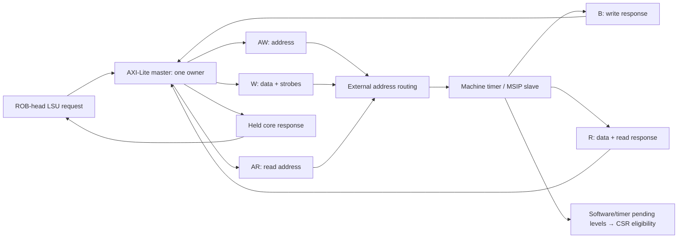

# Block 14: AXI4-Lite data transport and machine timer

This block supplies two custom RTL components. rv32_axi_lite_master translates the LSU's single
request/response port into AXI4-Lite. rv32_machine_timer is a separate AXI4-Lite slave containing
machine software-interrupt and timer registers. A surrounding fabric chooses the target slave;
that address routing is separate from either module.

The master transfers one 32-bit word transaction at a time. Byte/halfword selection is already
encoded by the LSU's shifted data and four byte strobes. Memory ordering still comes from the
ROB-head permission in block 12, rather than from AXI arbitration.

## 1. Connections



AW and W are independent channels. Either may transfer first. B is the completion of the write;
accepting its address/data alone does not finish the LSU instruction. AR accepts a read address,
then R returns its data/status. All channels use the common clock and active-low reset.

## 2. Signal ownership and widths

| Master-side signal/group | Width | Source → destination | Meaning |
|---|---:|---|---|
| request_i | 69 | LSU → master | Write bit, aligned byte address, data, four strobes |
| request_valid_i / request_ready_o | 1 each | LSU ↔ master | Capture one complete core transaction in IDLE |
| response_o | 33 | Master → LSU | 32-bit read data and architectural error flag |
| response_valid_o / response_ready_i | 1 each | Master ↔ LSU | Retained result and consumption |
| m_axi_awaddr_o / m_axi_awprot_o | 32 / 3 | Master → fabric/slave | Captured write address; PROT=001 privileged data |
| m_axi_awvalid_o / m_axi_awready_i | 1 each | Master ↔ slave | Independent write-address acceptance |
| m_axi_wdata_o / m_axi_wstrb_o | 32 / 4 | Master → slave | Captured data and byte enables |
| m_axi_wvalid_o / m_axi_wready_i | 1 each | Master ↔ slave | Independent write-data acceptance |
| m_axi_bresp_i / m_axi_bvalid_i / m_axi_bready_o | 2 / 1 / 1 | Slave ↔ master | Write status and consumption |
| m_axi_araddr_o / m_axi_arprot_o | 32 / 3 | Master → slave | Captured read address and attributes |
| m_axi_arvalid_o / m_axi_arready_i | 1 each | Master ↔ slave | Read-address acceptance |
| m_axi_rdata_i / m_axi_rresp_i | 32 / 2 | Slave → master | Returned data and read status |
| m_axi_rvalid_i / m_axi_rready_o | 1 each | Slave ↔ master | Read-response acceptance |
| busy_o | 1 | Master → status | The current request or core response is still owned |
| protocol_error_o | 1 | Master → diagnostics | Misaligned accepted core request or unexpected response type |

The timer uses corresponding s_axi_* ports in the opposite direction. It has no core request
port: it observes AXI transfers, retains write-address/data and response state, and exports
software_irq_o and timer_irq_o as one-bit synchronous levels.

## 3. Master state and stable transactions

The master state machine is IDLE → READ or WRITE → RESPONSE → IDLE. IDLE captures the entire
core request. WRITE has separate aw_pending_q and w_pending_q bits; READ has ar_pending_q.
A channel's VALID drops only after its own transfer, while its captured payload remains stable.

Example with address arriving first:

| Edge/interval | AW channel | W channel | Ownership/result |
|---|---|---|---|
| E0 | Core request captured | Core request captured | Master owns one store |
| E1 | AWVALID/AWREADY transfer | WREADY low | AW pending clears; W payload holds |
| E2 | AWVALID low | Still stalled | No core completion |
| E3 | Already accepted | W transfers | Both portions are now accepted |
| E4 or later | No new address | No new data | B response is accepted when available |
| Following interval | — | — | Core RESPONSE holds final status until LSU accepts it |

W-first works symmetrically. The master accepts B only after both portions have transferred,
and R after AR. A core response stall retains its data/error and excludes another core request.
The design does not refill on the core response-pop edge; it returns to IDLE first.

A misaligned core word request completes locally with error and no AXI transfer. Any AXI response
other than OKAY (00) becomes a core error. In particular EXOKAY is not used as a successful
exclusive operation by this AXI-Lite bridge. The LSU converts the error into its owner's load/
store access fault and precise tval.

## 4. Timer address map and register circuits

The slave decodes the low 16 address bits. A surrounding router assigns it the selected region,
0x02000000–0x0200ffff; the module itself does not select a global system address region.

| Offset | Selected full address | Register | Access behavior |
|---|---|---|---|
| 0x0000 | 0x02000000 | MSIP | Bit 0 stored; byte strobe 0 permits its update |
| 0x4000 | 0x02004000 | mtimecmp[31:0] | Four byte enables update selected low-half bytes |
| 0x4004 | 0x02004004 | mtimecmp[63:32] | Four byte enables update selected high-half bytes |
| 0xbff8 | 0x0200bff8 | mtime[31:0] | Selected low-half bytes written; a strobed write overrides the tick |
| 0xbffc | 0x0200bffc | mtime[63:32] | Selected high-half bytes written; a strobed write overrides the tick |

mtime and mtimecmp are 64-bit registers. A 64-bit incrementer advances mtime each active clock.
An unsigned comparator asserts timer_irq when mtime >= mtimecmp. MSIP drives software_irq.
Reset sets mtime/MSIP to zero and mtimecmp to all ones, keeping the interrupt outputs inactive.
There is no divider: one timer tick means one provided system-clock edge.

A write to MSIP or mtimecmp does not stop the normal mtime tick. A write with any asserted strobe
to an mtime half preserves the other pre-edge bytes and replaces that edge's tick. An all-zero
strobe write leaves the timer ticking normally.

## 5. Slave timing, snapshots, and errors

The timer has one address holding register, one write-data/strobe holding register, one B
response slot, and one R response slot. AWREADY and WREADY are independent. Only after both
halves have been retained does the next write edge update a register and create BVALID.
B response backpressure prevents a new write from replacing that response.

A read snapshots the selected register at AR acceptance. RDATA/RRESP then remain unchanged
while RREADY is low, even as mtime continues incrementing. If a read and write/tick occur on
the same edge, the read captures the pre-edge register value.

Invalid offsets or non-word-aligned accesses return SLVERR (10). An invalid write has no
register-write effect; mtime still performs its ordinary tick. The returned error stays held
until its response handshake.

Each 32-bit access to a 64-bit timer register is separate. Software can use a high/low/high
read sequence to detect rollover, and an appropriate high/low/high compare-write sequence to
avoid transient thresholds. The hardware has no combined atomic 64-bit bus transaction.

## 6. Tests and waveform guidance

The current block-14 report records **862 checks, zero failures**. It connects the real master
and timer with independently delayed channels, and also directly probes the slave. Coverage
includes AW-first/W-first/both, B/R holding, non-OKAY status propagation, misaligned/unmapped
register accesses, byte strobes, software IRQ, timer halves/carry, compare thresholds, and reset
with occupied channels.

```sh
python3 scripts/run_checks.py --block 14 --waves
```

Watch AWVALID/AWREADY and WVALID/WREADY separately; seeing one handshake must not clear the
other pending bit. Follow aw_address_q/w_data_q into commit_write, then BVALID. For reads, compare
the accepted read snapshot with r_data_q during several timer ticks and a stalled R channel.
Finally follow the master response into LSU completion rather than equating it with the earlier
AXI request handshake.

The separate portable core/AXI test executes real RAM programs through this master and the
actual timer slave, including peripheral-triggered software/timer interrupts and MRET handlers.
Those end-to-end checks belong to the block-15 evidence, not this unit count. The test fabric is
a behavioral address router; firmware and FPGA/IP integration remain outside the selected scope.
Simulation establishes the exercised contracts, not formal proof or FPGA timing closure.

## 7. Interview questions

**Why separate AW and W pending bits?** AXI permits either address or data to be backpressured
independently. One combined handshake would lose a portion or repeat an accepted portion.

**Why does the store wait for B?** B communicates the endpoint's final write status. Merely
accepting AW and W cannot establish successful completion.

**Why snapshot mtime at AR?** The timer changes every cycle. A retained R response needs one
stable value even if the consumer delays acceptance.

**Why is MSIP cleared through memory rather than by writing mip?** mip reflects the external
pending input. This timer's stored MSIP bit is the source of that level.

**Where is global address routing?** Outside these modules. The timer decodes register offsets,
while the fabric selects which slave owns a full address region.

**Does an AXI error directly write mcause?** The master returns an error; LSU records an owned
fault completion, and the ROB/core later enters the precise trap.

## Complete AXI master

Source: `rtl/rv32_axi_lite_master.sv`.

```systemverilog
// One-outstanding data-port bridge. AW and W remain independent until both transfer.
`timescale 1ns / 1ps
module rv32_axi_lite_master
  import rv32_ooo_pkg::*;
(
  input logic clk_i, rst_ni,
  input logic request_valid_i,
  output logic request_ready_o,
  input data_request_t request_i,
  output logic response_valid_o,
  input logic response_ready_i,
  output memory_response_t response_o,
  output word_t m_axi_awaddr_o,
  output logic [2:0] m_axi_awprot_o,
  output logic m_axi_awvalid_o,
  input logic m_axi_awready_i,
  output word_t m_axi_wdata_o,
  output logic [3:0] m_axi_wstrb_o,
  output logic m_axi_wvalid_o,
  input logic m_axi_wready_i,
  input logic [1:0] m_axi_bresp_i,
  input logic m_axi_bvalid_i,
  output logic m_axi_bready_o,
  output word_t m_axi_araddr_o,
  output logic [2:0] m_axi_arprot_o,
  output logic m_axi_arvalid_o,
  input logic m_axi_arready_i,
  input word_t m_axi_rdata_i,
  input logic [1:0] m_axi_rresp_i,
  input logic m_axi_rvalid_i,
  output logic m_axi_rready_o,
  output logic busy_o,
  output logic protocol_error_o
);
  typedef enum logic [1:0] {IDLE, READ, WRITE, RESPONSE} state_e;
  state_e state_q;
  data_request_t request_q;
  memory_response_t response_q;
  logic aw_pending_q, w_pending_q, ar_pending_q;

  assign request_ready_o = rst_ni && state_q == IDLE;
  assign response_valid_o = rst_ni && state_q == RESPONSE;
  assign response_o = response_valid_o ? response_q : memory_response_t'('0);
  assign busy_o = state_q != IDLE;
  assign m_axi_awaddr_o = request_q.address;
  assign m_axi_wdata_o = request_q.wdata;
  assign m_axi_wstrb_o = request_q.wstrb;
  assign m_axi_araddr_o = request_q.address;
  assign m_axi_awprot_o = 3'b001; // Privileged, secure data access in machine mode.
  assign m_axi_arprot_o = 3'b001;
  assign m_axi_awvalid_o = rst_ni && state_q == WRITE && aw_pending_q;
  assign m_axi_wvalid_o = rst_ni && state_q == WRITE && w_pending_q;
  assign m_axi_bready_o = rst_ni && state_q == WRITE && !aw_pending_q && !w_pending_q;
  assign m_axi_arvalid_o = rst_ni && state_q == READ && ar_pending_q;
  assign m_axi_rready_o = rst_ni && state_q == READ && !ar_pending_q;
  assign protocol_error_o = rst_ni
    && ((request_valid_i && request_ready_o && |request_i.address[1:0])
        || (m_axi_bvalid_i && state_q != WRITE)
        || (m_axi_rvalid_i && state_q != READ));

  always_ff @(posedge clk_i or negedge rst_ni) begin
    if (!rst_ni) begin
      state_q <= IDLE;
      request_q <= '0;
      response_q <= '0;
      aw_pending_q <= 0;
      w_pending_q <= 0;
      ar_pending_q <= 0;
    end else begin
      case (state_q)
        IDLE: if (request_valid_i && request_ready_o) begin
          request_q <= request_i;
          response_q <= '0;
          if (|request_i.address[1:0]) begin
            response_q.error <= 1;
            state_q <= RESPONSE;
          end else if (request_i.write) begin
            aw_pending_q <= 1;
            w_pending_q <= 1;
            state_q <= WRITE;
          end else begin
            ar_pending_q <= 1;
            state_q <= READ;
          end
        end
        WRITE: begin
          if (m_axi_awvalid_o && m_axi_awready_i) aw_pending_q <= 0;
          if (m_axi_wvalid_o && m_axi_wready_i) w_pending_q <= 0;
          if (m_axi_bvalid_i && m_axi_bready_o) begin
            response_q.rdata <= '0;
            response_q.error <= m_axi_bresp_i != 2'b00;
            state_q <= RESPONSE;
          end
        end
        READ: begin
          if (m_axi_arvalid_o && m_axi_arready_i) ar_pending_q <= 0;
          if (m_axi_rvalid_i && m_axi_rready_o) begin
            response_q.rdata <= m_axi_rdata_i;
            response_q.error <= m_axi_rresp_i != 2'b00;
            state_q <= RESPONSE;
          end
        end
        RESPONSE: if (response_valid_o && response_ready_i) state_q <= IDLE;
        default: state_q <= IDLE;
      endcase
    end
  end
endmodule
```

## Complete machine timer

Source: `rtl/rv32_machine_timer.sv`.

```systemverilog
// AXI4-Lite machine timer/MSIP peripheral. No speculative core access may reach this slave.
`timescale 1ns / 1ps
module rv32_machine_timer
  import rv32_ooo_pkg::*;
(
  input logic clk_i, rst_ni,
  input word_t s_axi_awaddr_i,
  input logic [2:0] s_axi_awprot_i,
  input logic s_axi_awvalid_i,
  output logic s_axi_awready_o,
  input word_t s_axi_wdata_i,
  input logic [3:0] s_axi_wstrb_i,
  input logic s_axi_wvalid_i,
  output logic s_axi_wready_o,
  output logic [1:0] s_axi_bresp_o,
  output logic s_axi_bvalid_o,
  input logic s_axi_bready_i,
  input word_t s_axi_araddr_i,
  input logic [2:0] s_axi_arprot_i,
  input logic s_axi_arvalid_i,
  output logic s_axi_arready_o,
  output word_t s_axi_rdata_o,
  output logic [1:0] s_axi_rresp_o,
  output logic s_axi_rvalid_o,
  input logic s_axi_rready_i,
  output logic timer_irq_o,
  output logic software_irq_o
);
  logic [63:0] mtime_q, mtime_d, mtimecmp_q, mtimecmp_d;
  logic msip_q, msip_d;
  logic aw_held_q, w_held_q, b_valid_q, r_valid_q;
  word_t aw_address_q, w_data_q, r_data_q;
  logic [3:0] w_strobes_q;
  logic [1:0] b_response_q, r_response_q;
  logic commit_write, write_address_valid, read_address_valid;
  word_t read_value;

  assign s_axi_awready_o = rst_ni && !aw_held_q && !b_valid_q;
  assign s_axi_wready_o = rst_ni && !w_held_q && !b_valid_q;
  assign s_axi_bvalid_o = rst_ni && b_valid_q;
  assign s_axi_bresp_o = b_response_q;
  assign s_axi_arready_o = rst_ni && !r_valid_q;
  assign s_axi_rvalid_o = rst_ni && r_valid_q;
  assign s_axi_rdata_o = r_data_q;
  assign s_axi_rresp_o = r_response_q;
  assign timer_irq_o = rst_ni && mtime_q >= mtimecmp_q;
  assign software_irq_o = rst_ni && msip_q;
  assign commit_write = aw_held_q && w_held_q && !b_valid_q;

  always_comb begin
    write_address_valid = aw_address_q[1:0] == 0;
    case (aw_address_q[15:0])
      16'h0000, 16'h4000, 16'h4004, 16'hbff8, 16'hbffc: begin end
      default: write_address_valid = 0;
    endcase
    read_address_valid = s_axi_araddr_i[1:0] == 0;
    read_value = '0;
    case (s_axi_araddr_i[15:0])
      16'h0000: read_value = {31'b0, msip_q};
      16'h4000: read_value = mtimecmp_q[31:0];
      16'h4004: read_value = mtimecmp_q[63:32];
      16'hbff8: read_value = mtime_q[31:0];
      16'hbffc: read_value = mtime_q[63:32];
      default: read_address_valid = 0;
    endcase
    if (!read_address_valid) read_value = '0;

    mtime_d = mtime_q + 64'd1;
    mtimecmp_d = mtimecmp_q;
    msip_d = msip_q;
    if (commit_write && write_address_valid) begin
      case (aw_address_q[15:0])
        16'h0000: if (w_strobes_q[0]) msip_d = w_data_q[0];
        16'h4000: for (int lane = 0; lane < 4; lane++)
          if (w_strobes_q[lane]) mtimecmp_d[lane*8 +: 8] = w_data_q[lane*8 +: 8];
        16'h4004: for (int lane = 0; lane < 4; lane++)
          if (w_strobes_q[lane]) mtimecmp_d[32+lane*8 +: 8] = w_data_q[lane*8 +: 8];
        16'hbff8: if (|w_strobes_q) begin
          mtime_d = mtime_q; // A strobed software write takes priority over this tick.
          for (int lane = 0; lane < 4; lane++)
            if (w_strobes_q[lane]) mtime_d[lane*8 +: 8] = w_data_q[lane*8 +: 8];
        end
        16'hbffc: if (|w_strobes_q) begin
          mtime_d = mtime_q;
          for (int lane = 0; lane < 4; lane++)
            if (w_strobes_q[lane]) mtime_d[32+lane*8 +: 8] = w_data_q[lane*8 +: 8];
        end
        default: begin end
      endcase
    end
  end

  always_ff @(posedge clk_i or negedge rst_ni) begin
    if (!rst_ni) begin
      mtime_q <= 0;
      mtimecmp_q <= 64'hffff_ffff_ffff_ffff;
      msip_q <= 0;
      aw_held_q <= 0;
      w_held_q <= 0;
      b_valid_q <= 0;
      r_valid_q <= 0;
      aw_address_q <= 0;
      w_data_q <= 0;
      w_strobes_q <= 0;
      b_response_q <= 0;
      r_response_q <= 0;
      r_data_q <= 0;
    end else begin
      mtime_q <= mtime_d;
      mtimecmp_q <= mtimecmp_d;
      msip_q <= msip_d;
      if (s_axi_bvalid_o && s_axi_bready_i) b_valid_q <= 0;
      if (s_axi_awvalid_i && s_axi_awready_o) begin
        aw_address_q <= s_axi_awaddr_i;
        aw_held_q <= 1;
      end
      if (s_axi_wvalid_i && s_axi_wready_o) begin
        w_data_q <= s_axi_wdata_i;
        w_strobes_q <= s_axi_wstrb_i;
        w_held_q <= 1;
      end
      if (commit_write) begin
        aw_held_q <= 0;
        w_held_q <= 0;
        b_valid_q <= 1;
        b_response_q <= write_address_valid ? 2'b00 : 2'b10;
      end
      if (s_axi_rvalid_o && s_axi_rready_i) r_valid_q <= 0;
      if (s_axi_arvalid_i && s_axi_arready_o) begin
        r_valid_q <= 1;
        r_data_q <= read_value; // Snapshot before this edge's timer tick/write.
        r_response_q <= read_address_valid ? 2'b00 : 2'b10;
      end
    end
  end
endmodule
```

## AXI/timer tests

Source: `tb/tb_block14.sv`.

```systemverilog
// AXI master/timer tests with independent channel delays and a direct slave probe.
`timescale 1ns / 1ps
module tb_block14;
  import rv32_ooo_pkg::*;
  logic clk = 0, rst_n = 1;
  logic req_valid, req_ready, rsp_valid, rsp_ready, busy, master_error;
  data_request_t request;
  memory_response_t response;
  word_t awaddr, wdata, araddr, rdata;
  logic [2:0] awprot, arprot;
  logic [3:0] wstrb;
  logic awvalid, awready, wvalid, wready, bvalid, bready;
  logic arvalid, arready, rvalid, rready;
  logic [1:0] bresp, rresp;
  logic gate_aw, gate_w, gate_b, gate_ar, gate_r, direct;
  logic inject_b, inject_r;
  logic [1:0] injected_bresp, injected_rresp;
  word_t t_awaddr, t_wdata, t_araddr, t_rdata;
  logic [2:0] t_awprot, t_arprot;
  logic [3:0] t_wstrb;
  logic t_awvalid, t_awready, t_wvalid, t_wready, t_bvalid, t_bready;
  logic t_arvalid, t_arready, t_rvalid, t_rready;
  logic [1:0] t_bresp, t_rresp;
  word_t d_awaddr, d_wdata, d_araddr;
  logic [3:0] d_wstrb;
  logic d_awvalid, d_wvalid, d_bready, d_arvalid, d_rready;
  logic timer_irq, software_irq;
  integer checks = 0, failures = 0, n, watchdog;
  word_t result, earlier, later;
  logic [1:0] result_error;

  rv32_axi_lite_master master (
    .clk_i(clk), .rst_ni(rst_n), .request_valid_i(req_valid), .request_ready_o(req_ready),
    .request_i(request), .response_valid_o(rsp_valid), .response_ready_i(rsp_ready),
    .response_o(response), .m_axi_awaddr_o(awaddr), .m_axi_awprot_o(awprot),
    .m_axi_awvalid_o(awvalid), .m_axi_awready_i(awready), .m_axi_wdata_o(wdata),
    .m_axi_wstrb_o(wstrb), .m_axi_wvalid_o(wvalid), .m_axi_wready_i(wready),
    .m_axi_bresp_i(bresp), .m_axi_bvalid_i(bvalid), .m_axi_bready_o(bready),
    .m_axi_araddr_o(araddr), .m_axi_arprot_o(arprot), .m_axi_arvalid_o(arvalid),
    .m_axi_arready_i(arready), .m_axi_rdata_i(rdata), .m_axi_rresp_i(rresp),
    .m_axi_rvalid_i(rvalid), .m_axi_rready_o(rready), .busy_o(busy),
    .protocol_error_o(master_error)
  );
  rv32_machine_timer timer (
    .clk_i(clk), .rst_ni(rst_n), .s_axi_awaddr_i(t_awaddr), .s_axi_awprot_i(t_awprot),
    .s_axi_awvalid_i(t_awvalid), .s_axi_awready_o(t_awready), .s_axi_wdata_i(t_wdata),
    .s_axi_wstrb_i(t_wstrb), .s_axi_wvalid_i(t_wvalid), .s_axi_wready_o(t_wready),
    .s_axi_bresp_o(t_bresp), .s_axi_bvalid_o(t_bvalid), .s_axi_bready_i(t_bready),
    .s_axi_araddr_i(t_araddr), .s_axi_arprot_i(t_arprot), .s_axi_arvalid_i(t_arvalid),
    .s_axi_arready_o(t_arready), .s_axi_rdata_o(t_rdata), .s_axi_rresp_o(t_rresp),
    .s_axi_rvalid_o(t_rvalid), .s_axi_rready_i(t_rready),
    .timer_irq_o(timer_irq), .software_irq_o(software_irq)
  );

  // Mask both valid and ready at each inserted delay, preserving one real handshake.
  assign t_awaddr = direct ? d_awaddr : awaddr;
  assign t_awprot = direct ? 3'b001 : awprot;
  assign t_awvalid = direct ? d_awvalid : awvalid && gate_aw;
  assign awready = !direct && gate_aw && t_awready;
  assign t_wdata = direct ? d_wdata : wdata;
  assign t_wstrb = direct ? d_wstrb : wstrb;
  assign t_wvalid = direct ? d_wvalid : wvalid && gate_w;
  assign wready = !direct && gate_w && t_wready;
  assign t_bready = direct ? d_bready : bready && gate_b;
  assign bvalid = !direct && gate_b && t_bvalid;
  assign bresp = inject_b ? injected_bresp : t_bresp;
  assign t_araddr = direct ? d_araddr : araddr;
  assign t_arprot = direct ? 3'b001 : arprot;
  assign t_arvalid = direct ? d_arvalid : arvalid && gate_ar;
  assign arready = !direct && gate_ar && t_arready;
  assign t_rready = direct ? d_rready : rready && gate_r;
  assign rvalid = !direct && gate_r && t_rvalid;
  assign rdata = t_rdata;
  assign rresp = inject_r ? injected_rresp : t_rresp;

  task automatic check(input logic condition, input string label_text);
    begin
      checks = checks + 1;
      if (condition !== 1'b1) begin
        failures = failures + 1;
        if (failures <= 30) $display("FAIL: %s time=%0t", label_text, $time);
      end
    end
  endtask
  task automatic edge_step;
    begin #1; clk = 1; #1; clk = 0; #1; end
  endtask
  task automatic controls;
    begin
      req_valid = 0; rsp_ready = 0; request = '0;
      gate_aw = 1; gate_w = 1; gate_b = 1; gate_ar = 1; gate_r = 1;
      direct = 0; inject_b = 0; inject_r = 0; injected_bresp = 0; injected_rresp = 0;
      d_awaddr = 0; d_wdata = 0; d_wstrb = 0; d_araddr = 0;
      d_awvalid = 0; d_wvalid = 0; d_bready = 0; d_arvalid = 0; d_rready = 0;
    end
  endtask
  task automatic reset_all;
    begin
      controls; rst_n = 0; #2;
      check(!req_ready && !rsp_valid && !awvalid && !wvalid && !arvalid && !rready && !bready,
            "reset masks every master transfer");
      check(!t_bvalid && !t_rvalid && !timer_irq && !software_irq,
            "reset clears slave responses and interrupts");
      rst_n = 1; #1;
      check(req_ready && !busy, "master returns to idle after reset");
    end
  endtask
  task automatic core_request(input logic write_access, input word_t address, value,
                              input logic [3:0] strobes);
    begin
      request.write = write_access; request.address = address;
      request.wdata = value; request.wstrb = strobes; req_valid = 1;
      #1; check(req_ready, "idle bridge accepts a core request");
      edge_step; req_valid = 0;
      check(busy && !req_ready, "one outstanding transaction excludes new core acceptance");
    end
  endtask
  task automatic finish_core(input logic expected_error);
    memory_response_t saved;
    begin
      watchdog = 0;
      while (!rsp_valid && watchdog < 30) begin edge_step; watchdog = watchdog + 1; end
      check(rsp_valid && watchdog < 30, "core response arrives within timeout");
      check(response.error == expected_error,
            "AXI response code propagates as architectural error");
      saved = response; result = response.rdata;
      for (integer hold = 0; hold < 3; hold++) begin
        edge_step;
        check(rsp_valid && response == saved && !req_ready,
              "core result remains stable under response backpressure");
      end
      rsp_ready = 1; edge_step; rsp_ready = 0;
      check(req_ready && !rsp_valid && !busy, "response consumed once before next transaction");
      check(!master_error, "legal AXI traffic produces no bridge diagnostic");
    end
  endtask
  task automatic write_core(input word_t address, value, input logic [3:0] strobes,
                            input integer ordering, input logic expected_error);
    begin
      gate_aw = 0; gate_w = 0; gate_b = 0;
      core_request(1, address, value, strobes);
      for (integer hold = 0; hold < 3; hold++) begin
        check(awvalid && wvalid && awaddr == address && wdata == value && wstrb == strobes,
              "write address/data/strobes remain stable before independent acceptance");
        check(!rsp_valid, "a write is not complete before its B response"); edge_step;
      end
      if (ordering == 0) begin
        gate_aw = 1; edge_step;
        check(!awvalid && wvalid, "AW may transfer before W");
        repeat (2) edge_step;
        gate_w = 1; edge_step;
      end else if (ordering == 1) begin
        gate_w = 1; edge_step;
        check(awvalid && !wvalid, "W may transfer before AW");
        repeat (2) edge_step;
        gate_aw = 1; edge_step;
      end else begin gate_aw = 1; gate_w = 1; edge_step; end
      repeat (3) begin
        edge_step; check(!rsp_valid, "delayed B response delays core completion");
      end
      gate_b = 1; finish_core(expected_error);
    end
  endtask
  task automatic read_core(input word_t address, input logic expected_error);
    word_t snapshot;
    begin
      gate_ar = 0; gate_r = 0;
      core_request(0, address, 0, 0);
      repeat (3) begin
        check(arvalid && araddr == address && !rsp_valid,
              "read address is stable while AR is blocked"); edge_step;
      end
      gate_ar = 1; edge_step;
      check(!arvalid && t_rvalid && !rsp_valid, "AR acceptance creates a held slave snapshot");
      snapshot = t_rdata;
      repeat (3) begin
        edge_step;
        check(t_rvalid && t_rdata == snapshot && !rsp_valid,
              "timer read snapshot remains stable while its counter continues");
      end
      gate_r = 1; finish_core(expected_error);
      check(result == snapshot, "read response preserves the exact accepted slave snapshot");
    end
  endtask
  task automatic direct_write(input word_t address, value, input logic [3:0] strobes,
                              input logic [1:0] expected_response);
    begin
      direct = 1; d_awaddr = address; d_wdata = value; d_wstrb = strobes;
      d_awvalid = 1; d_wvalid = 0;
      #1; check(t_awready, "direct slave probe accepts address independently");
      edge_step; d_awvalid = 0;
      repeat (2) edge_step;
      check(!t_bvalid, "address alone cannot cause a write response");
      d_wvalid = 1; #1; check(t_wready, "late write data is independently accepted");
      edge_step; d_wvalid = 0;
      watchdog = 0;
      while (!t_bvalid && watchdog < 10) begin edge_step; watchdog = watchdog + 1; end
      check(t_bvalid && t_bresp == expected_response, "slave reports expected write status");
      repeat (3) begin edge_step; check(t_bvalid && t_bresp == expected_response,
                                      "B payload remains stable until BREADY"); end
      d_bready = 1; edge_step; d_bready = 0; direct = 0;
    end
  endtask
  task automatic direct_read(input word_t address, input logic [1:0] expected_response);
    word_t snapshot;
    begin
      direct = 1; d_araddr = address; d_arvalid = 1;
      #1; check(t_arready, "direct read address accepts while read slot is empty");
      edge_step; d_arvalid = 0; snapshot = t_rdata;
      check(t_rvalid && t_rresp == expected_response, "slave reports expected read status");
      repeat (3) begin edge_step; check(t_rvalid && t_rdata == snapshot
          && t_rresp == expected_response, "R status/data stay stable until RREADY"); end
      result = t_rdata;
      d_rready = 1; edge_step; d_rready = 0; direct = 0;
    end
  endtask

  initial begin #100000; $fatal(1, "AXI/timer verification timed out"); end
  initial begin
    if ($test$plusargs("waves")) begin
      $dumpfile("build/block14/block14.vcd"); $dumpvars(0, tb_block14);
    end
    reset_all;
    read_core(TIMER_BASE, 0); check(result == 0, "MSIP resets clear");
    read_core(TIMER_BASE + 32'h4000, 0); check(result == 32'hffffffff, "compare low resets max");
    read_core(TIMER_BASE + 32'h4004, 0); check(result == 32'hffffffff, "compare high resets max");
    check(!timer_irq && awprot == 1 && arprot == 1, "reset timer is masked by max compare");

    write_core(TIMER_BASE, 1, 1, 0, 0); check(software_irq, "MSIP sets software interrupt");
    write_core(TIMER_BASE, 0, 2, 1, 0); check(software_irq, "other byte lanes preserve MSIP");
    read_core(TIMER_BASE, 0); check(result == 1, "MSIP exposes only bit zero");
    write_core(TIMER_BASE, 0, 1, 2, 0); check(!software_irq, "MSIP clears on enabled byte zero");
    write_core(TIMER_BASE + 32'h4000, 32'h11223344, 15, 0, 0);
    write_core(TIMER_BASE + 32'h4004, 32'haabbccdd, 15, 1, 0);
    read_core(TIMER_BASE + 32'h4000, 0); check(result == 32'h11223344, "compare low readback");
    read_core(TIMER_BASE + 32'h4004, 0); check(result == 32'haabbccdd, "compare high readback");
    write_core(TIMER_BASE + 32'h4000, 32'h99ffbbff, 5, 2, 0);
    read_core(TIMER_BASE + 32'h4000, 0);
    check(result == 32'h11ff33ff, "byte strobes modify only selected compare bytes");
    write_core(TIMER_BASE + 32'h4004, 0, 0, 0, 0);
    read_core(TIMER_BASE + 32'h4004, 0); check(result == 32'haabbccdd, "zero strobes are no-op");

    write_core(TIMER_BASE + 32'h1234, 32'hdeadbeef, 15, 1, 1);
    read_core(TIMER_BASE + 32'h1234, 1); check(result == 0, "unmapped read returns zero/error");
    direct_write(TIMER_BASE + 32'h4002, 0, 15, 2);
    direct_read(TIMER_BASE + 32'hbff9, 2); check(result == 0, "unaligned read returns zero");
    read_core(TIMER_BASE + 32'h4000, 0);
    check(result == 32'h11ff33ff, "invalid writes cannot alter a mapped register");

    for (n = 1; n < 4; n++) begin
      inject_b = 1; injected_bresp = n; write_core(TIMER_BASE, 0, 1, n % 3, 1); inject_b = 0;
      inject_r = 1; injected_rresp = n; read_core(TIMER_BASE, 1); inject_r = 0;
    end

    write_core(TIMER_BASE + 32'hbffc, 32'h12345678, 15, 0, 0);
    write_core(TIMER_BASE + 32'hbff8, 32'hffff0000, 15, 1, 0);
    read_core(TIMER_BASE + 32'hbffc, 0); check(result == 32'h12345678, "mtime high half writes");
    read_core(TIMER_BASE + 32'hbff8, 0); earlier = result;
    repeat (40) edge_step;
    read_core(TIMER_BASE + 32'hbff8, 0); later = result;
    check(later > earlier && later - earlier >= 40, "mtime advances independently of bus stalls");
    write_core(TIMER_BASE + 32'hbffc, 32'hab000000, 8, 2, 0);
    read_core(TIMER_BASE + 32'hbffc, 0); check(result == 32'hab345678, "mtime high byte strobe");
    write_core(TIMER_BASE + 32'hbff8, 32'haa000000, 8, 0, 0);
    read_core(TIMER_BASE + 32'hbff8, 0);
    check((result & 32'hff000000) == 32'haa000000, "mtime low byte strobes preserve other bytes");

    write_core(TIMER_BASE + 32'hbffc, 32'h13572468, 15, 1, 0);
    write_core(TIMER_BASE + 32'hbff8, 32'hfffffff0, 15, 0, 0);
    repeat (40) edge_step;
    read_core(TIMER_BASE + 32'hbffc, 0);
    check(result == 32'h13572469, "mtime low-word overflow carries into the high half");

    write_core(TIMER_BASE + 32'h4004, 0, 15, 1, 0);
    write_core(TIMER_BASE + 32'h4000, 0, 15, 0, 0);
    check(timer_irq, "mtime >= mtimecmp asserts timer interrupt");
    write_core(TIMER_BASE + 32'h4000, 32'hffffffff, 15, 1, 0);
    write_core(TIMER_BASE + 32'h4004, 32'hffffffff, 15, 0, 0);
    check(!timer_irq, "future compare value clears pending timer interrupt");
    write_core(TIMER_BASE + 32'hbffc, 0, 15, 1, 0);
    write_core(TIMER_BASE + 32'hbff8, 0, 15, 0, 0);
    write_core(TIMER_BASE + 32'h4004, 0, 15, 1, 0);
    write_core(TIMER_BASE + 32'h4000, 200, 15, 0, 0);
    check(!timer_irq, "future near compare starts with interrupt low");
    watchdog = 0;
    while (!timer_irq && watchdog < 250) begin edge_step; watchdog = watchdog + 1; end
    check(timer_irq && watchdog < 250, "timer reaches the programmed threshold");
    read_core(TIMER_BASE + 32'hbff8, 0); check(result >= 200, "interrupt threshold matches mtime");

    // Illegal core word address is rejected locally without issuing AXI.
    request = '0; request.address = TIMER_BASE + 2; req_valid = 1; #1;
    check(req_ready && master_error, "unaligned core request is diagnosed before AXI");
    edge_step; req_valid = 0;
    check(rsp_valid && response.error && !arvalid && !awvalid && !wvalid,
          "unaligned request creates one local error response");
    rsp_ready = 1; edge_step; rsp_ready = 0;

    // Reset aborts a globally reset partial bus transaction and both retained slave channels.
    gate_aw = 1; gate_w = 0; core_request(1, TIMER_BASE, 1, 1); edge_step;
    reset_all;
    direct = 1; d_awvalid = 1; d_wvalid = 1; d_awaddr = TIMER_BASE;
    d_wdata = 1; d_wstrb = 1; edge_step; d_awvalid = 0; d_wvalid = 0; edge_step;
    d_arvalid = 1; d_araddr = TIMER_BASE; edge_step; d_arvalid = 0;
    check(t_bvalid && t_rvalid, "slave can independently retain B and R responses");
    reset_all;
    $display("BLOCK14 SUMMARY: %0d checks, %0d failures", checks, failures);
    if (failures) $fatal(1, "AXI/timer checks failed");
    $finish;
  end
endmodule
```
