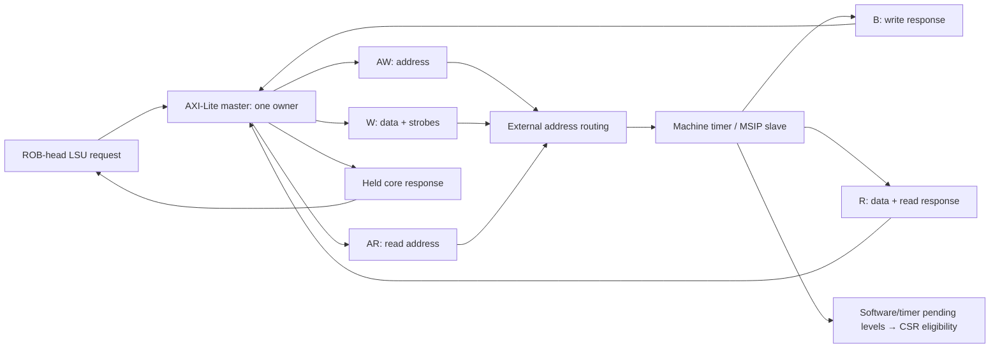

# Block 14: AXI4-Lite data transport and machine timer

This block supplies two custom RTL components. rv32_axi_lite_master translates the LSU's single
request/response port into AXI4-Lite. rv32_machine_timer is a separate AXI4-Lite slave containing
machine software-interrupt and timer registers. A surrounding fabric chooses the target slave;
that address routing is separate from either module.

The master transfers one 32-bit word transaction at a time. Byte/halfword selection is already
encoded by the LSU's shifted data and four byte strobes. Memory ordering still comes from the
ROB-head permission in block 12, rather than from AXI arbitration.

## 1. Connections



AW and W are independent channels. Either may transfer first. B is the completion of the write;
accepting its address/data alone does not finish the LSU instruction. AR accepts a read address,
then R returns its data/status. All channels use the common clock and active-low reset.

## 2. Signal ownership and widths

| Master-side signal/group | Width | Source → destination | Meaning |
|---|---:|---|---|
| request_i | 69 | LSU → master | Write bit, aligned byte address, data, four strobes |
| request_valid_i / request_ready_o | 1 each | LSU ↔ master | Capture one complete core transaction in IDLE |
| response_o | 33 | Master → LSU | 32-bit read data and architectural error flag |
| response_valid_o / response_ready_i | 1 each | Master ↔ LSU | Retained result and consumption |
| m_axi_awaddr_o / m_axi_awprot_o | 32 / 3 | Master → fabric/slave | Captured write address; PROT=001 privileged data |
| m_axi_awvalid_o / m_axi_awready_i | 1 each | Master ↔ slave | Independent write-address acceptance |
| m_axi_wdata_o / m_axi_wstrb_o | 32 / 4 | Master → slave | Captured data and byte enables |
| m_axi_wvalid_o / m_axi_wready_i | 1 each | Master ↔ slave | Independent write-data acceptance |
| m_axi_bresp_i / m_axi_bvalid_i / m_axi_bready_o | 2 / 1 / 1 | Slave ↔ master | Write status and consumption |
| m_axi_araddr_o / m_axi_arprot_o | 32 / 3 | Master → slave | Captured read address and attributes |
| m_axi_arvalid_o / m_axi_arready_i | 1 each | Master ↔ slave | Read-address acceptance |
| m_axi_rdata_i / m_axi_rresp_i | 32 / 2 | Slave → master | Returned data and read status |
| m_axi_rvalid_i / m_axi_rready_o | 1 each | Slave ↔ master | Read-response acceptance |
| busy_o | 1 | Master → status | The current request or core response is still owned |
| protocol_error_o | 1 | Master → diagnostics | Misaligned accepted core request or unexpected response type |

The timer uses corresponding s_axi_* ports in the opposite direction. It has no core request
port: it observes AXI transfers, retains write-address/data and response state, and exports
software_irq_o and timer_irq_o as one-bit synchronous levels.

## 3. Master state and stable transactions

The master state machine is IDLE → READ or WRITE → RESPONSE → IDLE. IDLE captures the entire
core request. WRITE has separate aw_pending_q and w_pending_q bits; READ has ar_pending_q.
A channel's VALID drops only after its own transfer, while its captured payload remains stable.

Example with address arriving first:

| Edge/interval | AW channel | W channel | Ownership/result |
|---|---|---|---|
| E0 | Core request captured | Core request captured | Master owns one store |
| E1 | AWVALID/AWREADY transfer | WREADY low | AW pending clears; W payload holds |
| E2 | AWVALID low | Still stalled | No core completion |
| E3 | Already accepted | W transfers | Both portions are now accepted |
| E4 or later | No new address | No new data | B response is accepted when available |
| Following interval | — | — | Core RESPONSE holds final status until LSU accepts it |

W-first works symmetrically. The master accepts B only after both portions have transferred,
and R after AR. A core response stall retains its data/error and excludes another core request.
The design does not refill on the core response-pop edge; it returns to IDLE first.

A misaligned core word request completes locally with error and no AXI transfer. Any AXI response
other than OKAY (00) becomes a core error. In particular EXOKAY is not used as a successful
exclusive operation by this AXI-Lite bridge. The LSU converts the error into its owner's load/
store access fault and precise tval.

## 4. Timer address map and register circuits

The slave decodes the low 16 address bits. A surrounding router assigns it the selected region,
0x02000000–0x0200ffff; the module itself does not select a global system address region.

| Offset | Selected full address | Register | Access behavior |
|---|---|---|---|
| 0x0000 | 0x02000000 | MSIP | Bit 0 stored; byte strobe 0 permits its update |
| 0x4000 | 0x02004000 | mtimecmp[31:0] | Four byte enables update selected low-half bytes |
| 0x4004 | 0x02004004 | mtimecmp[63:32] | Four byte enables update selected high-half bytes |
| 0xbff8 | 0x0200bff8 | mtime[31:0] | Selected low-half bytes written; a strobed write overrides the tick |
| 0xbffc | 0x0200bffc | mtime[63:32] | Selected high-half bytes written; a strobed write overrides the tick |

mtime and mtimecmp are 64-bit registers. A 64-bit incrementer advances mtime each active clock.
An unsigned comparator asserts timer_irq when mtime >= mtimecmp. MSIP drives software_irq.
Reset sets mtime/MSIP to zero and mtimecmp to all ones, keeping the interrupt outputs inactive.
There is no divider: one timer tick means one provided system-clock edge.

A write to MSIP or mtimecmp does not stop the normal mtime tick. A write with any asserted strobe
to an mtime half preserves the other pre-edge bytes and replaces that edge's tick. An all-zero
strobe write leaves the timer ticking normally.

## 5. Slave timing, snapshots, and errors

The timer has one address holding register, one write-data/strobe holding register, one B
response slot, and one R response slot. AWREADY and WREADY are independent. Only after both
halves have been retained does the next write edge update a register and create BVALID.
B response backpressure prevents a new write from replacing that response.

A read snapshots the selected register at AR acceptance. RDATA/RRESP then remain unchanged
while RREADY is low, even as mtime continues incrementing. If a read and write/tick occur on
the same edge, the read captures the pre-edge register value.

Invalid offsets or non-word-aligned accesses return SLVERR (10). An invalid write has no
register-write effect; mtime still performs its ordinary tick. The returned error stays held
until its response handshake.

Each 32-bit access to a 64-bit timer register is separate. Software can use a high/low/high
read sequence to detect rollover, and an appropriate high/low/high compare-write sequence to
avoid transient thresholds. The hardware has no combined atomic 64-bit bus transaction.

## 6. Tests and waveform guidance

The current block-14 report records **862 checks, zero failures**. It connects the real master
and timer with independently delayed channels, and also directly probes the slave. Coverage
includes AW-first/W-first/both, B/R holding, non-OKAY status propagation, misaligned/unmapped
register accesses, byte strobes, software IRQ, timer halves/carry, compare thresholds, and reset
with occupied channels.

```sh
python3 scripts/run_checks.py --block 14 --waves
```

Watch AWVALID/AWREADY and WVALID/WREADY separately; seeing one handshake must not clear the
other pending bit. Follow aw_address_q/w_data_q into commit_write, then BVALID. For reads, compare
the accepted read snapshot with r_data_q during several timer ticks and a stalled R channel.
Finally follow the master response into LSU completion rather than equating it with the earlier
AXI request handshake.

The separate portable core/AXI test executes real RAM programs through this master and the
actual timer slave, including peripheral-triggered software/timer interrupts and MRET handlers.
Those end-to-end checks belong to the block-15 evidence, not this unit count. The test fabric is
a behavioral address router; firmware and FPGA/IP integration remain outside the selected scope.
Simulation establishes the exercised contracts, not formal proof or FPGA timing closure.

## 7. Interview questions

**Why separate AW and W pending bits?** AXI permits either address or data to be backpressured
independently. One combined handshake would lose a portion or repeat an accepted portion.

**Why does the store wait for B?** B communicates the endpoint's final write status. Merely
accepting AW and W cannot establish successful completion.

**Why snapshot mtime at AR?** The timer changes every cycle. A retained R response needs one
stable value even if the consumer delays acceptance.

**Why is MSIP cleared through memory rather than by writing mip?** mip reflects the external
pending input. This timer's stored MSIP bit is the source of that level.

**Where is global address routing?** Outside these modules. The timer decodes register offsets,
while the fabric selects which slave owns a full address region.

**Does an AXI error directly write mcause?** The master returns an error; LSU records an owned
fault completion, and the ROB/core later enters the precise trap.
