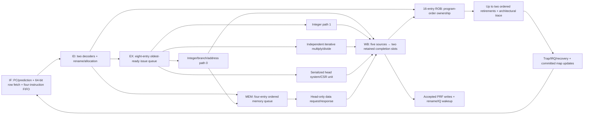

# Block 15: complete core composition and end-to-end verification

This block connects the previously tested architectural modules into the production two-issue
RV32IM_Zicsr_Zifencei machine-mode core. Instructions now enter from memory, execute through
renaming/scheduling and real functional units, complete through the shared writeback path,
and retire through the ROB. The same production recovery controller handles restarts.

Two top-level boundaries are supplied. rv32_ooo_core exposes instruction-row and data-word
handshakes. rv32_ooo_axi_top wraps the instruction side with the native BRAM adapter and the
data side with the AXI4-Lite master. Memory storage, address decoding/fabric, clock/reset
creation, and board peripherals remain external. Firmware and FPGA/IP integration were
removed from scope; the retained FPGA targets are documented in vivado_target.md.

## 1. Five logical sections with genuine out-of-order execution



These are logical responsibilities, not a fixed five-clock instruction latency. Queues and
multicycle units allow a younger independent ADD to complete while an older DIV runs. RAW
consumers still wait for the correct physical value. WAR/WAW name dependencies are removed
by renaming; completion can be out of order while retirement stays in program order.

The fixed configuration has 32 architectural registers, 64 physical identities, four PRF read
ports, two PRF write ports, a 16-entry ROB, eight issue entries, four memory entries, and four
buffered instructions. Dispatch, issue, completion acceptance, and retirement are each at
most two instructions/results per cycle. Dependencies, branch recovery, ordered memory, and
serialized instructions can reduce achieved throughput.

## 2. Core interface signals

| Signal | Width | Source → destination | Meaning |
|---|---:|---|---|
| clk_i, rst_ni | 1 each | External clock/reset → all core blocks | Common clock domain and active-low asynchronous reset |
| predict_enable_i | 1 | Configuration → fetch/predictor | Enable prediction or return sequential next PCs |
| halt_i | 1 | External control → admission | Stop new admission/fetch offers while older admitted work drains |
| instruction_request_valid_o / ready_i | 1 each | Fetch ↔ instruction endpoint | Accept one aligned row request |
| instruction_request_address_o | 32 | Fetch → instruction endpoint | Eight-byte-aligned byte address |
| instruction_response_valid_i / ready_o | 1 each | Instruction endpoint ↔ fetch | Transfer its one matching outstanding response |
| instruction_response_data_i / instruction_response_error_i | 64, 1 | Instruction endpoint → fetch | Two instruction words or an instruction-access error |
| data_request_valid_o / ready_i | 1 each | LSU ↔ data endpoint | Transfer one head-authorized access |
| data_request_o | 69 | LSU → data endpoint | Write flag, word-aligned address, 32-bit data, four byte strobes |
| data_response_valid_i / ready_o | 1 each | Data endpoint ↔ LSU | Transfer the matching load/store completion |
| data_response_i | 33 | Data endpoint → LSU | 32-bit read value and error flag |
| irq_external_i, irq_software_i, irq_timer_i | 1 each | Synchronous interrupt sources → machine state | Hardware pending inputs, qualified by CSR masks/enables |
| trace_o | 666 | Registered event recorder → debug/test | Two 333-bit ordered retirement/trap/interrupt records |
| empty_o | 1 | Back-end ownership → external control | No admitted ROB/IQ/execution/writeback/system/data-engine work remains |
| protocol_error_o | 1 | Combined module diagnostics → external checks | A malformed handshake, ownership, or atomic-dispatch condition occurred |

empty_o describes the admitted back end. A read-only fetch offer/response or prefetched FIFO
contents can remain when halt stops admission. halt is therefore a drain control, not a reset
of architectural state or an assertion that native instruction traffic disappeared immediately.
Interrupt inputs must already be synchronous to clk_i; this RTL boundary does not synchronize
asynchronous board pins.

## 3. Portable native-instruction/AXI wrapper

rv32_ooo_axi_top supplies these instruction pins: bram_block_i, bram_enable_o, a 13-bit native
row address, and 64-bit bram_data_i. The external native output must implement the single-stage,
enable-held memory contract from block 9. The wrapper exposes the proposed row address even
before enable so a shared-memory collision hold can be computed without enable/address feedback.

Its data side exposes 32-bit AXI-Lite AW/AR addresses, three-bit PROT fields, 32-bit W/R data,
four WSTRB bits, two-bit B/R responses, and independent valid/ready channels. The core's data
request remains incomplete until the adapter receives the actual B or R response. There is
one outstanding data transaction. The wrapper does not instantiate a vendor interconnect,
RAM generator, UART, GPIO, or clocking IP.

| Wrapper signals | Width | Source → destination | Circuit/interface purpose |
|---|---:|---|---|
| bram_block_i | 1 | External shared-memory collision control → native adapter | Hold a new read; an older response may still be consumed |
| bram_enable_o, bram_address_o | 1, 13 | Native adapter → synchronous RAM | Sample one of 8,192 eight-byte rows on an enabled edge |
| bram_data_i | 64 | RAM's held output → native adapter | Payload associated with that enabled edge |
| m_axi_awaddr_o / awprot_o / awvalid_o | 32, 3, 1 | Data adapter → fabric | Retained write address and attributes until AWREADY |
| m_axi_wdata_o / wstrb_o / wvalid_o | 32, 4, 1 | Data adapter → fabric | Retained write payload until WREADY, independently of AW |
| m_axi_bresp_i / bvalid_i / bready_o | 2, 1, 1 | Fabric ↔ data adapter | Actual store completion and access-error status |
| m_axi_araddr_o / arprot_o / arvalid_o | 32, 3, 1 | Data adapter → fabric | Retained read address and attributes until ARREADY |
| m_axi_rdata_i / rresp_i / rvalid_i / rready_o | 32, 2, 1, 1 | Fabric ↔ data adapter | Actual load payload and access-error status |

Each omitted ready partner is one bit. A valid transfer occurs only on a rising edge with
both valid and ready high. The sender holds valid and its payload while the receiver stalls.
In particular, an accepted write address does not imply that write data was accepted, and
neither acceptance permits the store to retire before its write response.

The AXI integration test connects this wrapper to a modeled shared RAM/fabric and the actual
custom timer slave. Those are executable testbench connections; a particular FPGA block design
or peripheral fabric is not implied by the wrapper itself.

## 4. Atomic dispatch and result ownership

Both fetched records pass through real decoder instances. Rename, ROB, IQ, and LSU agree on
the same accepted prefix. A memory instruction must have an available memory entry as well
as its ROB/IQ/physical resources. If only the older instruction can be admitted, fetch compacts
the retained suffix into the next cycle's lane 0.

The scheduler supplies physical source tags to the four PRF read ports. Completion bypass
provides accepted values on that same issue edge. Port 0 system instructions are intercepted
into the serialized CSR unit rather than accidentally entering the integer ALU. Memory
operations use integer-path address preparation, not an immediate speculative bus access.

Five retained completion producers feed two arbiter slots: integer 0, integer 1,
multiply/divide, LSU, and system/CSR. The ROB checks full tag/generation, destination, decoded
write intent, and incomplete live ownership. Only accepted nonfaulting nonzero-register results
write the PRF and wake dependents. An accepted fault still completes its ROB entry for a trap.

## 5. What changes at retirement

Retirement, rather than physical completion, updates committed rename mappings, releases the
replaced physical identity, increments the retirement counter, applies pending CSR writes,
and trains the predictor. The registered trace reports this ordered architectural sequence.
A trace order number counts trap/interrupt events too; it is not the same quantity as minstret,
which counts successfully retired instructions.

A branch mismatch is recorded at completion. New admission stops, but work older than that
branch can still reach retirement. When the selected boundary retires, cancellation removes
remaining speculative producers/results before map/queue restoration. A jump's valid link
value commits before its younger mappings are discarded.

An older synchronous exception has priority over a younger known branch redirect. A faulting
instruction cannot commit its GPR value or memory trace effect. All younger memory operations
remain preparations in the queue, because a real data transaction requires the live incomplete
ROB head. This is the central protection against wrong-path peripheral reads and writes.

## 6. Precise traps, MRET, WFI, and interrupt drain

The core maintains architectural_next_pc from ordered architectural events. It does not save
the speculative fetch PC when an interrupt is taken. On interrupt eligibility, admission stops;
already admitted instructions and outstanding data transactions drain. Eligibility is checked
again when the back end becomes empty, with external → software → timer priority.

The machine unit saves mepc/mcause/mtval and updates interrupt-enable state at entry. Direct
mtvec uses its base; vectored interrupts use base + 4×cause. The core injects a separate
interrupt event into the trace only at that empty boundary. MRET commits the restored status
and restarts fetching from the saved mepc through production recovery.

WFI uses no gated clock. A locally enabled pending interrupt can wake it even if global MIE
prevents interrupt entry; with global MIE enabled, the drained machine takes the interrupt
and later resumes the next unexecuted instruction. A pending interrupt can also disappear
because an already-admitted CSR instruction disables it during drain; the core must then
continue without taking a stale request.

FENCE relies on the head-ordered memory policy. FENCE.I additionally invalidates prediction,
clears prefetched instruction state through recovery, and restarts after older stores have
completed. The AXI test modifies executable RAM, confirms the old word had been prefetched,
then checks that FENCE.I causes the new instruction to execute.

## 7. Cycle examples

Consider these three instructions after renaming has assigned distinct physical destinations:

```asm
div x5, x1, x2
add x6, x3, x4
add x7, x5, x6
```

The following is a representative sequence of clock opportunities, rather than a claim about
fixed divider latency or fetch alignment. Two eligible instructions can issue together; the
younger ADD can also issue on a later edge if a port or input was initially unavailable.

| Clock opportunity | EX/completion state | ROB/architectural state |
|---|---|---|
| A | Ready DIV starts; independent ADD may issue on the other available path | DIV remains older than both ADDs |
| B, a later edge | ADD completion is accepted while DIV is still busy | x6's physical result becomes ready, but ADD cannot retire past DIV |
| C through D | Dependent ADD still waits for DIV's physical source tag | No new committed x5/x6 mapping yet |
| E | DIV completion is accepted; its physical value is broadcast | Dependent ADD may wake; head becomes complete |
| F and later | Dependent ADD executes when both source values and a port are ready | DIV and independent ADD may retire as a two-entry ordered prefix |

The readiness bits and tag comparators enable the bypass. The head pointer and completion bits
prevent it from changing architectural order. Exact edges can move with completion arbitration;
the invariant is that the independent ADD can finish first while DIV still retires first.

For the production loop with four iterations, architectural values finish at x1=0, x2=12,
x3=13. The block-15 test records 16 events including its final serialized WFI:

| Configuration | Test cycles | Recoveries | Architectural result |
|---|---:|---:|---|
| Prediction disabled | 51 | 3 | Same 16 events and final register values |
| Prediction enabled | 42 | 2 | Same 16 events and final register values |

These counts belong to this specific RAM/response/test setup. Block 10's smaller test harness
has different timing and does not replace production-controller verification.

For a precise interrupt during DIV, the signal sequence is:

1. DIV is already executing when an enabled IRQ becomes pending.
2. Admission stops. DIV and any admitted dependents continue; no instruction is skipped.
3. After all admitted retirements/data responses, the core rechecks eligibility and records
   the architectural next PC in mepc.
4. Trap entry selects mtvec, recovery cancels/clears remaining speculative fetch state, and
   the handler reads actual trap CSRs using normal instructions.
5. MRET returns to that next unexecuted PC. The architectural reference detects any duplicate
   or missing retirement.

The fault-priority test adds a younger known branch mismatch and a younger DIV behind an older
faulting load. With a short delayed response, DIV is cancelled while running; with a longer
response it completes speculatively first. In both cases the older load fault wins, neither
wrong-path MMIO nor younger retirement occurs, and the squashed branch does not train prediction.

## 8. Verification evidence and its scope

The recorded block-15 suite passes **29,474 checks, zero failures** across three testbenches:

| Testbench | Checks | Evidence |
|---|---:|---|
| tb_block15 | 20,515 | 16 RAM-fed programs against independent instruction/register/memory reference |
| tb_core_traps | 7,677 | 25 precise-fault, interrupt, WFI, and competing-recovery scenarios |
| tb_core_axi | 1,282 | Seven actual core/AXI/native-memory/timer integration programs |

The arithmetic/reference suite covers all integer operation families, all eight M operations,
six branch comparisons, JAL/JALR link effects, repeated destinations/RAW chains, byte/halfword
loads/stores, randomized operand versions and memory traffic, CSR forms, FENCE/FENCE.I,
x0 protection, and ROB/IQ/memory-queue exhaustion. It also checks a later-resolving older
misprediction replacing a younger known recovery boundary.

The trap suite executes handlers from memory and compares architectural PC, instruction,
GPR values, CSR values, trap cause/tval, return targets, and stamped event order. It includes
illegal instructions, ECALL/EBREAK, unsupported/read-only CSR accesses, alignment/access
faults, all three interrupt causes in direct/vectored modes, interrupt drain during DIV/load,
priority/recheck behavior, both WFI enable cases, and wrong-path side-effect suppression.

The AXI suite applies independent AW/W/AR backpressure, holds responses, checks exactly-once
stores, bus-error traps, wrong-path MMIO suppression, self-modifying code plus FENCE.I, and
actual software/timer interrupts programmed and cleared through the custom AXI timer slave.

```sh
python3 scripts/run_checks.py --block 15
python3 scripts/run_checks.py --block 15 --waves
```

reports/block15_results.json lists each case scope and exact compiled-source hashes. The
encoded programs live in self-checking testbenches; no external compiler is required to run
these hardware tests. They are not a firmware-delivery package.

These results are directed/generated simulation evidence, not official ACT4 certification,
exhaustive formal verification, or proof that every possible program/interleaving is correct.
Vivado synthesis, fit, timing, DRC, and bitstream generation have not been run. The retained
50 MHz clock setting is a target, not a measured implementation result.

## 9. Reading the integrated waveforms

In build/block15/block15.vcd, follow fetched instruction records, rename_fire, issue_fire,
physical source/destination identities, accepted completions, retire_fire, and trace.order.
Compare a younger completed ADD with the still-incomplete older DIV at the ROB head.

In build/core_traps/core_traps.vcd, inspect IRQ inputs, irq_pending, admission_hold,
architectural_next_pc_q, ROB occupancy, active data response, irq_take/trap_fire, CSR trap
state, cancel/apply, and the handler's CSR-read retirements. The stale/mispredicted fetch PC
must never replace the architectural interrupt boundary.

In build/core_axi/core_axi.vcd, follow source memory instructions through LSU request,
AW/W acceptance, B response, accepted completion, and retirement. For reads, separate AR
acceptance from R return. During FENCE.I, compare the old prefetched word with the modified
RAM word and the instruction that actually retires after refetch.

Waveform filenames and optional recording behavior are controlled by the testbenches. A
passing printed summary is accompanied by a timeout and self-checking assertions; examining
only a plausible waveform is not the verification strategy.

## 10. Interview questions

**What makes this genuinely out of order?** A younger ready instruction can issue and
complete before an older waiting/multicycle instruction. The ROB still commits in order.

**What distinguishes completion from retirement?** Completion makes a speculative result
available. Retirement changes the committed architectural state and frees the replaced mapping.

**Why can a store address be ready long before its bus request?** Address preparation is
speculative and harmless; external memory/peripheral effects are restricted to the ROB head.

**Why serialize CSR instructions?** They observe/change architectural machine state and may
alter interrupt eligibility or next PC. Their effects must not become visible out of order.

**Why is interrupt draining necessary?** Saving a boundary while admitted work later commits
could skip or repeat instructions on return. Draining establishes one next-unexecuted PC.

**How is FENCE.I more than a no-op?** The implementation must discard old instruction
prefetch/prediction state and restart after prior writes complete, so new code is refetched.

**Does empty_o mean the fetch port is idle?** No. It reports admitted back-end quiescence;
a read-only offer/response or FIFO contents may still exist.

**Does passing this suite guarantee silicon correctness?** No. It provides reproducible
functional evidence for the stated tests. Broader architecture testing, formal work, and
implementation analysis address additional questions.

## Complete assembled two-issue core

Source: `rtl/rv32_ooo_core.sv`.

```systemverilog
// Custom two-issue RV32IM machine-mode core. Five logical sections use explicit queues.
// Instruction storage and data transport are external handshake endpoints.
`timescale 1ns / 1ps
module rv32_ooo_core
  import rv32_ooo_pkg::*;
(
  input logic clk_i, rst_ni,
  input logic predict_enable_i, halt_i,
  output logic instruction_request_valid_o,
  input logic instruction_request_ready_i,
  output word_t instruction_request_address_o,
  input logic instruction_response_valid_i,
  output logic instruction_response_ready_o,
  input fetch_row_t instruction_response_data_i,
  input logic instruction_response_error_i,
  output logic data_request_valid_o,
  input logic data_request_ready_i,
  output data_request_t data_request_o,
  input logic data_response_valid_i,
  output logic data_response_ready_o,
  input memory_response_t data_response_i,
  input logic irq_external_i, irq_software_i, irq_timer_i,
  output retire_trace_pair_t trace_o,
  output logic empty_o,
  output logic protocol_error_o
);
  logic [1:0] front_valid, rename_ready, rename_fire, rob_ready, rob_fire;
  logic [1:0] iq_ready, iq_fire, src1_ready, src2_ready, wb_valid;
  logic [1:0] wb_ready, wb_accepted, wb_rejected, head_valid, head_complete;
  logic [1:0] head_ready, retire_fire, trap_fire, write_enable, issue_fire, cluster_issue_fire;
  logic [1:0] alu_valid, alu_ready, wb_raw_valid, broadcast_valid, writeback_occupancy;
  decoded_pair_t decoded;
  renamed_pair_t renamed, retiring;
  completion_sources_t sources;
  logic [4:0] source_valid, source_ready;
  logic writeback_done, writeback_quiescent, writeback_error;
  completion_pair_t wb_raw, broadcast, wb, alu_completion;
  completion_t md_completion, lsu_completion, csr_completion;
  phys_reg_t write0_addr, write1_addr;
  word_t write0_data, write1_data;
  rob_tag_pair_t tags;
  rob_entry_pair_t heads;
  retire_trace_pair_t events, trace_events, trace;
  execute_packet_pair_t issued;
  memory_entry_t memory;
  phys_reg_t r00, r01, r10, r11, committed_phys;
  word_t v00, v01, v10, v11, mispredict_pc;
  phys_mask_t free_mask, ready_mask;
  phys_count_t free_count;
  rob_index_t head_index, query_age;
  rob_count_t rob_occupancy;
  issue_count_t iq_occupancy;
  logic [ISSUE_DEPTH-1:0] occupied;
  rob_tag_t mispredict_tag;
  logic alu0_available, alu1_available, md_available, memory_available;
  logic md_valid, md_ready, memory_valid, apply, cancel, cancel_done;
  logic [2:0] cluster_busy;
  logic cluster_quiescent, cluster_error, wb_allow, admission_hold;
  logic rename_done, rob_done, iq_done, rename_error, rob_error, iq_error;
  logic trace_error, write_error, recovery, mispredict, serial_pending, fault_pending;
  logic query_live, full, empty;
  logic [1:0] fetched_valid, fetched_fire;
  fetch_pair_t fetched;
  fetch_count_t fetch_occupancy;
  logic fetch_transaction, fetch_stale, fetch_fault, fetch_error, redirect_done;
  word_t prediction_pc0, prediction_pc1, redirect_pc;
  prediction_pair_t prediction;
  logic [1:0] counter0, counter1;
  logic predictor_invalidate, invalidate_done, predictor_error;
  logic lsu_prepare_ready, lsu_completion_valid, lsu_flush_done, lsu_quiescent, lsu_error;
  logic [1:0] lsu_dispatch_ready, lsu_dispatch_fire;
  logic [2:0] lsu_occupancy;
  logic csr_request_ready, csr_completion_valid, csr_cancel_done, csr_quiescent, csr_error;
  logic irq_pending, irq_take, wfi_wait, port0_system;
  word_t irq_cause, csr_trap_target, csr_trap_pc, csr_trap_cause, csr_trap_tval;
  logic synchronous_trap, recovery_request, recovery_busy, recovery_done;
  logic restart0, restart1;
  word_t recovery_target, architectural_next_pc_q;
  rob_entry_t fault_owner;

  assign wb_allow = 1'b1;
  assign admission_hold = halt_i || recovery_busy || irq_pending || wfi_wait;
  assign front_valid = rst_ni && !admission_hold ? fetched_valid : 2'b00;
  assign head_ready = rst_ni && !recovery_busy ? 2'b11 : 2'b00;
  assign port0_system = issued.lane0.uop.decoded.op_class == UOP_SYSTEM;
  assign cluster_issue_fire = {issue_fire[1], issue_fire[0] && !port0_system};
  assign trace_o = trace;
  assign empty_o = empty && iq_occupancy == 0 && cluster_quiescent
                   && writeback_quiescent && lsu_quiescent && csr_quiescent;
  assign irq_take = rst_ni && !halt_i && !recovery_busy && irq_pending && empty_o;
  assign synchronous_trap = |trap_fire;
  assign fault_owner = trap_fire[0] ? heads.lane0 : heads.lane1;
  assign csr_trap_pc = synchronous_trap ? fault_owner.uop.decoded.fetch.pc
                                       : architectural_next_pc_q;
  assign csr_trap_cause = synchronous_trap ? fault_owner.exception.cause : irq_cause;
  assign csr_trap_tval = synchronous_trap ? fault_owner.exception.tval : 32'b0;

  function automatic logic needs_restart(input rob_entry_t entry);
    needs_restart = entry.control_flow.mispredicted
      || (entry.uop.decoded.op_class == UOP_SYSTEM
          && (entry.uop.decoded.system_op == SYS_MRET
              || entry.uop.decoded.system_op == SYS_FENCE_I));
  endfunction
  assign restart0 = retire_fire[0] && needs_restart(heads.lane0);
  assign restart1 = retire_fire[1] && needs_restart(heads.lane1);
  assign recovery_request = !recovery_busy
                            && (synchronous_trap || irq_take || restart0 || restart1);
  assign recovery_target = synchronous_trap || irq_take ? csr_trap_target
                            : restart0 ? heads.lane0.control_flow.next_pc
                                       : heads.lane1.control_flow.next_pc;
  assign predictor_invalidate = (retire_fire[0]
      && heads.lane0.uop.decoded.system_op == SYS_FENCE_I)
      || (retire_fire[1] && heads.lane1.uop.decoded.system_op == SYS_FENCE_I);

  // An interrupt is a separate precise event after all admitted instructions drain.
  always_comb begin
    trace_events = events;
    if (irq_take) begin
      trace_events = '0;
      trace_events.lane0.valid = 1'b1;
      trace_events.lane0.trap = 1'b1;
      trace_events.lane0.interrupt = 1'b1;
      trace_events.lane0.pc = architectural_next_pc_q;
      trace_events.lane0.next_pc = csr_trap_target;
      trace_events.lane0.cause = irq_cause;
    end
  end
  always_ff @(posedge clk_i or negedge rst_ni) begin
    if (!rst_ni) architectural_next_pc_q <= RESET_PC;
    else begin
      if (trace_events.lane0.valid) architectural_next_pc_q <= trace_events.lane0.next_pc;
      if (trace_events.lane1.valid) architectural_next_pc_q <= trace_events.lane1.next_pc;
    end
  end

  rv32_recovery_controller recovery_control (
    .clk_i(clk_i), .rst_ni(rst_ni), .request_i(recovery_request), .target_i(recovery_target),
    .units_quiescent_i(cluster_quiescent && writeback_quiescent && lsu_quiescent && csr_quiescent),
    .cancel_ack_i(cancel_done && writeback_done && csr_cancel_done),
    .cancel_o(cancel), .apply_o(apply), .redirect_pc_o(redirect_pc),
    .busy_o(recovery_busy), .done_o(recovery_done)
  );
  rv32_fetch fetch (
    .clk_i(clk_i), .rst_ni(rst_ni), .enable_i(!admission_hold && !mispredict),
    .redirect_i(apply), .redirect_pc_i(redirect_pc), .redirect_done_o(redirect_done),
    .predict_enable_i(predict_enable_i), .prediction_pc0_o(prediction_pc0),
    .prediction_pc1_o(prediction_pc1), .prediction_i(prediction),
    .request_valid_o(instruction_request_valid_o), .request_ready_i(instruction_request_ready_i),
    .request_address_o(instruction_request_address_o),
    .response_valid_i(instruction_response_valid_i),
    .response_ready_o(instruction_response_ready_o),
    .response_data_i(instruction_response_data_i), .response_error_i(instruction_response_error_i),
    .fetch_valid_o(fetched_valid), .fetch_ready_i(rename_fire), .fetch_o(fetched),
    .fetch_fire_o(fetched_fire), .occupancy_o(fetch_occupancy),
    .transaction_pending_o(fetch_transaction), .stale_pending_o(fetch_stale),
    .fault_pending_o(fetch_fault), .protocol_error_o(fetch_error)
  );
  rv32_branch_predictor predictor (
    .clk_i(clk_i), .rst_ni(rst_ni), .enable_i(predict_enable_i),
    .query_pc0_i(prediction_pc0), .query_pc1_i(prediction_pc1), .prediction_o(prediction),
    .retire_valid_i(retire_fire), .retire_entry_i(heads), .invalidate_i(predictor_invalidate),
    .invalidate_done_o(invalidate_done), .query0_counter_o(counter0), .query1_counter_o(counter1),
    .protocol_error_o(predictor_error)
  );
  rv32_decoder decoder0 (.fetch_i(fetched.lane0), .decoded_o(decoded.lane0));
  rv32_decoder decoder1 (.fetch_i(fetched.lane1), .decoded_o(decoded.lane1));

  rv32_rename rename (
    .clk_i(clk_i), .rst_ni(rst_ni), .dispatch_valid_i(front_valid),
    .dispatch_resources_ready_i(rob_ready & iq_ready & lsu_dispatch_ready), .decoded_i(decoded),
    .dispatch_rob_tag_i(tags), .dispatch_ready_o(rename_ready), .dispatch_fire_o(rename_fire),
    .renamed_o(renamed), .src1_ready_o(src1_ready), .src2_ready_o(src2_ready),
    .completion_valid_i(broadcast_valid), .completion_i(broadcast),
    .retire_valid_i(retire_fire), .retire_uop_i(retiring),
    .recover_i(apply), .recover_done_o(rename_done),
    .committed_query_arch_i(5'd0), .committed_query_phys_o(committed_phys),
    .free_mask_o(free_mask), .ready_mask_o(ready_mask), .free_count_o(free_count),
    .protocol_error_o(rename_error)
  );
  assign retiring.lane0 = heads.lane0.uop;
  assign retiring.lane1 = heads.lane1.uop;
  rv32_reorder_buffer rob (
    .clk_i(clk_i), .rst_ni(rst_ni), .dispatch_hold_i(admission_hold),
    .dispatch_valid_i(rename_fire), .dispatch_uop_i(renamed),
    .dispatch_ready_o(rob_ready), .dispatch_fire_o(rob_fire), .dispatch_tag_o(tags),
    .completion_valid_i(wb_valid), .completion_i(wb), .completion_ready_o(wb_ready),
    .completion_accepted_o(wb_accepted), .completion_rejected_o(wb_rejected),
    .head_valid_o(head_valid), .head_complete_o(head_complete), .head_entry_o(heads),
    .head_ready_i(head_ready), .head_trap_target_i(csr_trap_target),
    .retire_fire_o(retire_fire), .trap_fire_o(trap_fire), .retirement_event_o(events),
    .recovery_required_o(recovery), .mispredict_pending_o(mispredict),
    .mispredict_tag_o(mispredict_tag), .mispredict_next_pc_o(mispredict_pc),
    .serial_pending_o(serial_pending), .fault_pending_o(fault_pending),
    .flush_i(apply), .flush_done_o(rob_done), .query_tag_i(wb.lane0.rob_tag),
    .query_live_o(query_live), .query_age_o(query_age), .head_index_o(head_index),
    .occupancy_o(rob_occupancy), .full_o(full), .empty_o(empty), .protocol_error_o(rob_error)
  );
  rv32_physical_regfile prf (
    .clk_i(clk_i), .rst_ni(rst_ni),
    .read0_rs1_i(r00), .read0_rs2_i(r01),
    .read1_rs1_i(r10), .read1_rs2_i(r11),
    .read0_data1_o(v00), .read0_data2_o(v01),
    .read1_data1_o(v10), .read1_data2_o(v11),
    .write_enable_i(write_enable), .write0_addr_i(write0_addr),
    .write1_addr_i(write1_addr), .write0_data_i(write0_data),
    .write1_data_i(write1_data), .write_conflict_o(write_error)
  );
  rv32_issue_queue iq (
    .clk_i(clk_i), .rst_ni(rst_ni), .dispatch_hold_i(admission_hold),
    .issue_hold_i(recovery || recovery_busy),
    .dispatch_valid_i(rename_fire), .dispatch_uop_i(renamed),
    .dispatch_src1_ready_i(src1_ready), .dispatch_src2_ready_i(src2_ready),
    .dispatch_ready_o(iq_ready), .dispatch_fire_o(iq_fire),
    .completion_valid_i(broadcast_valid), .completion_i(broadcast),
    .rob_head_valid_i(head_valid[0]), .rob_head_index_i(head_index),
    .rob_head_tag_i(heads.lane0.uop.rob_tag),
    .mispredict_pending_i(mispredict), .mispredict_tag_i(mispredict_tag),
    .alu0_ready_i(alu0_available), .alu1_ready_i(alu1_available),
    .muldiv_ready_i(md_available), .memory_ready_i(memory_available),
    .system_ready_i(csr_request_ready),
    .issue_fire_o(issue_fire), .issue_packet_o(issued),
    .read0_rs1_o(r00), .read0_rs2_o(r01), .read1_rs1_o(r10), .read1_rs2_o(r11),
    .read0_data1_i(v00), .read0_data2_i(v01),
    .read1_data1_i(v10), .read1_data2_i(v11),
    .flush_i(apply), .flush_done_o(iq_done), .occupancy_o(iq_occupancy),
    .occupied_mask_o(occupied), .protocol_error_o(iq_error)
  );
  rv32_execution_cluster execute (
    .clk_i(clk_i), .rst_ni(rst_ni), .issue_fire_i(cluster_issue_fire), .issue_packet_i(issued),
    .alu0_ready_o(alu0_available), .alu1_ready_o(alu1_available),
    .muldiv_ready_o(md_available), .memory_ready_o(memory_available),
    .alu_completion_valid_o(alu_valid), .alu_completion_ready_i(alu_ready),
    .alu_completion_o(alu_completion), .muldiv_completion_valid_o(md_valid),
    .muldiv_completion_ready_i(md_ready), .muldiv_completion_o(md_completion),
    .memory_valid_o(memory_valid), .memory_ready_i(lsu_prepare_ready), .memory_o(memory),
    .cancel_i(cancel), .cancel_done_o(cancel_done), .busy_o(cluster_busy),
    .quiescent_o(cluster_quiescent), .protocol_error_o(cluster_error)
  );
  rv32_trace_recorder recorder (
    .clk_i(clk_i), .rst_ni(rst_ni), .event_i(trace_events), .trace_o(trace),
    .protocol_error_o(trace_error)
  );

  // ROB ownership checks gate all speculative register effects.
  assign wb = wb_raw;
  assign wb_valid = wb_raw_valid & {2{wb_allow}};
  assign source_valid = {csr_completion_valid, lsu_completion_valid, md_valid, alu_valid};
  assign alu_ready = source_ready[1:0];
  assign md_ready = source_ready[2];
  always_comb begin
    sources = '0;
    sources.alu0_result = alu_completion.lane0;
    sources.alu1_result = alu_completion.lane1;
    sources.muldiv_result = md_completion;
    // Memory and serialized system units share the retained completion path.
    sources.memory_result = lsu_completion;
    sources.system_result = csr_completion;
  end
  rv32_writeback writeback (
    .clk_i(clk_i), .rst_ni(rst_ni), .source_valid_i(source_valid),
    .source_ready_o(source_ready), .sources_i(sources), .rob_head_index_i(head_index),
    .rob_completion_valid_o(wb_raw_valid),
    .rob_completion_ready_i(wb_ready & {2{wb_allow}}), .rob_completion_o(wb_raw),
    .rob_completion_accepted_i(wb_accepted),
    .broadcast_valid_o(broadcast_valid), .broadcast_o(broadcast),
    .write_enable_o(write_enable), .write0_addr_o(write0_addr), .write1_addr_o(write1_addr),
    .write0_data_o(write0_data), .write1_data_o(write1_data),
    .cancel_i(cancel), .cancel_done_o(writeback_done), .quiescent_o(writeback_quiescent),
    .occupancy_o(writeback_occupancy), .protocol_error_o(writeback_error)
  );

  rv32_load_store_unit lsu (
    .clk_i(clk_i), .rst_ni(rst_ni),
    .dispatch_valid_i(rename_fire), .dispatch_uop_i(renamed),
    .dispatch_ready_o(lsu_dispatch_ready), .dispatch_fire_o(lsu_dispatch_fire),
    .prepare_valid_i(memory_valid), .prepare_ready_o(lsu_prepare_ready), .prepare_i(memory),
    .head_valid_i(head_valid[0]), .head_complete_i(head_complete[0]),
    .head_tag_i(heads.lane0.uop.rob_tag),
    .data_request_valid_o(data_request_valid_o), .data_request_ready_i(data_request_ready_i),
    .data_request_o(data_request_o), .data_response_valid_i(data_response_valid_i),
    .data_response_ready_o(data_response_ready_o), .data_response_i(data_response_i),
    .completion_valid_o(lsu_completion_valid), .completion_ready_i(source_ready[3]),
    .completion_o(lsu_completion), .flush_i(apply), .flush_done_o(lsu_flush_done),
    .quiescent_o(lsu_quiescent), .occupancy_o(lsu_occupancy), .protocol_error_o(lsu_error)
  );
  rv32_csr_file machine (
    .clk_i(clk_i), .rst_ni(rst_ni),
    .request_valid_i(issue_fire[0] && port0_system), .request_ready_o(csr_request_ready),
    .request_i(issued.lane0), .completion_valid_o(csr_completion_valid),
    .completion_ready_i(source_ready[4]), .completion_o(csr_completion),
    .retire_valid_i(retire_fire), .retire_entry_i(heads),
    .irq_external_i(irq_external_i), .irq_software_i(irq_software_i), .irq_timer_i(irq_timer_i),
    .interrupt_pending_o(irq_pending), .interrupt_cause_o(irq_cause),
    .trap_enter_i(synchronous_trap || irq_take), .trap_pc_i(csr_trap_pc),
    .trap_cause_i(csr_trap_cause), .trap_tval_i(csr_trap_tval), .trap_target_o(csr_trap_target),
    .wfi_wait_o(wfi_wait), .cancel_i(cancel), .cancel_done_o(csr_cancel_done),
    .quiescent_o(csr_quiescent), .protocol_error_o(csr_error)
  );
  assign protocol_error_o = rename_error || rob_error || iq_error || trace_error || write_error
      || cluster_error || writeback_error || fetch_error || predictor_error || lsu_error
      || csr_error || (rename_fire != rob_fire) || (rename_fire != iq_fire)
      || (rename_fire != lsu_dispatch_fire) || (rename_fire != fetched_fire);
endmodule
```

## Complete portable AXI wrapper

Source: `rtl/rv32_ooo_axi_top.sv`.

```systemverilog
// Portable core boundary: native synchronous instruction RAM and AXI4-Lite data.
// Clocks, reset generation, address decoding, RAM and peripherals are external.
`timescale 1ns / 1ps
module rv32_ooo_axi_top
  import rv32_ooo_pkg::*;
(
  input logic clk_i, rst_ni,
  input logic predict_enable_i, halt_i,
  input logic irq_external_i, irq_software_i, irq_timer_i,
  input logic bram_block_i,
  output logic bram_enable_o,
  output logic [BRAM_FETCH_ADDR_W-1:0] bram_address_o,
  input fetch_row_t bram_data_i,
  output word_t m_axi_awaddr_o,
  output logic [2:0] m_axi_awprot_o,
  output logic m_axi_awvalid_o,
  input logic m_axi_awready_i,
  output word_t m_axi_wdata_o,
  output logic [3:0] m_axi_wstrb_o,
  output logic m_axi_wvalid_o,
  input logic m_axi_wready_i,
  input logic [1:0] m_axi_bresp_i,
  input logic m_axi_bvalid_i,
  output logic m_axi_bready_o,
  output word_t m_axi_araddr_o,
  output logic [2:0] m_axi_arprot_o,
  output logic m_axi_arvalid_o,
  input logic m_axi_arready_i,
  input word_t m_axi_rdata_i,
  input logic [1:0] m_axi_rresp_i,
  input logic m_axi_rvalid_i,
  output logic m_axi_rready_o,
  output retire_trace_pair_t trace_o,
  output logic empty_o,
  output logic protocol_error_o
);
  logic instruction_valid, instruction_ready, instruction_response_valid;
  logic instruction_response_ready, instruction_error, instruction_pending, instruction_protocol;
  word_t instruction_address;
  fetch_row_t instruction_data;
  logic data_valid, data_ready, data_response_valid, data_response_ready;
  data_request_t data_request;
  memory_response_t data_response;
  logic core_error, data_error, data_busy;

  rv32_ooo_core core (
    .clk_i(clk_i), .rst_ni(rst_ni), .predict_enable_i(predict_enable_i), .halt_i(halt_i),
    .instruction_request_valid_o(instruction_valid),
    .instruction_request_ready_i(instruction_ready),
    .instruction_request_address_o(instruction_address),
    .instruction_response_valid_i(instruction_response_valid),
    .instruction_response_ready_o(instruction_response_ready),
    .instruction_response_data_i(instruction_data),
    .instruction_response_error_i(instruction_error),
    .data_request_valid_o(data_valid), .data_request_ready_i(data_ready),
    .data_request_o(data_request), .data_response_valid_i(data_response_valid),
    .data_response_ready_o(data_response_ready), .data_response_i(data_response),
    .irq_external_i(irq_external_i), .irq_software_i(irq_software_i), .irq_timer_i(irq_timer_i),
    .trace_o(trace_o), .empty_o(empty_o), .protocol_error_o(core_error)
  );
  rv32_instruction_adapter instruction_port (
    .clk_i(clk_i), .rst_ni(rst_ni), .request_valid_i(instruction_valid),
    .request_ready_o(instruction_ready), .request_address_i(instruction_address),
    .response_valid_o(instruction_response_valid), .response_ready_i(instruction_response_ready),
    .response_data_o(instruction_data), .response_error_o(instruction_error),
    .bram_block_i(bram_block_i), .bram_enable_o(bram_enable_o), .bram_address_o(bram_address_o),
    .bram_data_i(bram_data_i), .transaction_pending_o(instruction_pending),
    .protocol_error_o(instruction_protocol)
  );
  rv32_axi_lite_master data_port (
    .clk_i(clk_i), .rst_ni(rst_ni), .request_valid_i(data_valid), .request_ready_o(data_ready),
    .request_i(data_request), .response_valid_o(data_response_valid),
    .response_ready_i(data_response_ready), .response_o(data_response),
    .m_axi_awaddr_o(m_axi_awaddr_o), .m_axi_awprot_o(m_axi_awprot_o),
    .m_axi_awvalid_o(m_axi_awvalid_o), .m_axi_awready_i(m_axi_awready_i),
    .m_axi_wdata_o(m_axi_wdata_o), .m_axi_wstrb_o(m_axi_wstrb_o),
    .m_axi_wvalid_o(m_axi_wvalid_o), .m_axi_wready_i(m_axi_wready_i),
    .m_axi_bresp_i(m_axi_bresp_i), .m_axi_bvalid_i(m_axi_bvalid_i),
    .m_axi_bready_o(m_axi_bready_o), .m_axi_araddr_o(m_axi_araddr_o),
    .m_axi_arprot_o(m_axi_arprot_o), .m_axi_arvalid_o(m_axi_arvalid_o),
    .m_axi_arready_i(m_axi_arready_i), .m_axi_rdata_i(m_axi_rdata_i),
    .m_axi_rresp_i(m_axi_rresp_i), .m_axi_rvalid_i(m_axi_rvalid_i),
    .m_axi_rready_o(m_axi_rready_o), .busy_o(data_busy), .protocol_error_o(data_error)
  );
  assign protocol_error_o = core_error || instruction_protocol || data_error;
endmodule
```

## Complete architectural reference testbench

Source: `tb/tb_block15.sv`.

```systemverilog
// Full core verification. Instructions enter through memory, not decoded injection.
`timescale 1ns / 1ps
module tb_block15;
  import rv32_ooo_pkg::*;
  logic clk = 0, rst_n = 1, predict_enable = 1, halt = 0;
  logic i_valid, i_ready, i_rsp_valid, i_rsp_ready, i_error;
  word_t i_address;
  fetch_row_t i_data;
  logic d_valid, d_ready, d_rsp_valid, d_rsp_ready;
  data_request_t d_request;
  memory_response_t d_response;
  logic irq_external = 0, irq_software = 0, irq_timer = 0;
  retire_trace_pair_t trace;
  logic empty, protocol_error;
  word_t memory [0:RAM_WORDS-1];
  word_t reference_memory [0:RAM_WORDS-1];
  word_t reference_csrs [0:4095];
  retire_trace_t baseline [0:63];
  logic i_pending = 0, d_pending = 0;
  integer i_delay = 0, d_delay = 0, instruction_latency = 0, data_latency = 2;
  fetch_row_t i_saved;
  logic i_saved_error;
  memory_response_t d_saved;
  logic allow_i = 1, allow_d = 1;
  integer checks = 0, failures = 0, cycles = 0, retired = 0;
  integer requests = 0, stores = 0, mmio_reads = 0, mmio_writes = 0;
  integer recovery_count = 0, trap_count = 0, interrupt_count = 0;
  integer current_case = 0, watchdog, n;
  integer expected_requests = 0, expected_stores = 0;
  integer expected_mmio_reads = 0, expected_mmio_writes = 0;
  integer cursor, selector, round_index, rd_index, rs1_index, rs2_index, compare_mode = 0;
  integer mode, funct, operand_index;
  integer case_count = 0;
  integer max_rob = 0, max_iq = 0, max_memory = 0;
  logic random_stalls = 0;
  logic younger_redirect_seen = 0, older_redirect_seen = 0;
  word_t registers [0:31];
  word_t expected_pc = 0, finish_pc = 32'hffffffff;
  logic finished = 0;
  word_t rng = 32'hc001face;

  rv32_ooo_core dut (
    .clk_i(clk), .rst_ni(rst_n), .predict_enable_i(predict_enable), .halt_i(halt),
    .instruction_request_valid_o(i_valid), .instruction_request_ready_i(i_ready),
    .instruction_request_address_o(i_address), .instruction_response_valid_i(i_rsp_valid),
    .instruction_response_ready_o(i_rsp_ready), .instruction_response_data_i(i_data),
    .instruction_response_error_i(i_error), .data_request_valid_o(d_valid),
    .data_request_ready_i(d_ready), .data_request_o(d_request),
    .data_response_valid_i(d_rsp_valid), .data_response_ready_o(d_rsp_ready),
    .data_response_i(d_response), .irq_external_i(irq_external),
    .irq_software_i(irq_software), .irq_timer_i(irq_timer), .trace_o(trace),
    .empty_o(empty), .protocol_error_o(protocol_error)
  );
  assign i_rsp_valid = i_pending && i_delay == 0;
  assign i_ready = rst_n && allow_i && (!i_pending || (i_rsp_valid && i_rsp_ready));
  assign i_data = i_saved;
  assign i_error = i_saved_error;
  assign d_rsp_valid = d_pending && d_delay == 0;
  assign d_ready = rst_n && allow_d && !d_pending;
  assign d_response = d_saved;

  function automatic word_t op_i(input integer imm, rs1, funct3, rd, opcode);
    op_i = ((imm & 4095) << 20) | (rs1 << 15) | (funct3 << 12) | (rd << 7) | opcode;
  endfunction
  function automatic word_t op_r(input integer funct7, rs2, rs1, funct3, rd);
    op_r = (funct7 << 25) | (rs2 << 20) | (rs1 << 15) | (funct3 << 12) | (rd << 7) | 7'h33;
  endfunction
  function automatic word_t op_b(input integer imm, rs2, rs1, funct3);
    op_b = (((imm >> 12) & 1) << 31) | (((imm >> 5) & 63) << 25) | (rs2 << 20)
      | (rs1 << 15) | (funct3 << 12) | (((imm >> 1) & 15) << 8)
      | (((imm >> 11) & 1) << 7) | 7'h63;
  endfunction
  function automatic word_t op_s(input integer imm, rs2, rs1, funct3);
    op_s = (((imm >> 5) & 127) << 25) | (rs2 << 20) | (rs1 << 15)
      | (funct3 << 12) | ((imm & 31) << 7) | 7'h23;
  endfunction
  function automatic word_t op_j(input integer imm, rd);
    op_j = (((imm >> 20) & 1) << 31) | (((imm >> 1) & 1023) << 21)
      | (((imm >> 11) & 1) << 20) | (((imm >> 12) & 255) << 12) | (rd << 7) | 7'h6f;
  endfunction
  task automatic check(input logic condition, input string text_label);
    begin
      checks++;
      if (condition !== 1'b1) begin
        failures++;
        if (failures < 40) $display("FAIL case%0d cycle%0d: %s", current_case, cycles, text_label);
      end
    end
  endtask

  // Initial minimal architectural interpreter. Later cases extend CSR/trap checking.
  task automatic observe(input retire_trace_t event_record);
    word_t instruction, a, b, immediate, result, next_pc, address, raw, store_data;
    word_t csr_old, csr_operand, csr_value;
    logic [3:0] store_strobes;
    integer rd, rs1, rs2, funct3, opcode, address_index, shift, csr_address;
    logic writes, taken, csr_write;
    logic signed [63:0] sa, sb, product;
    logic [63:0] unsigned_product;
    begin
      if (event_record.valid) begin
        check(!finished, "no event follows the program terminator");
        check(event_record.order == retired, "trace order is consecutive");
        check(event_record.pc == expected_pc, "retirement PC follows architectural control flow");
        instruction = reference_memory[expected_pc >> 2];
        check(event_record.instruction == instruction, "retired instruction matches program");
        if (compare_mode == 1 && retired < 64) baseline[retired] = event_record;
        if (compare_mode == 2 && retired < 64)
          check(event_record == baseline[retired],
                "prediction preserves the full retirement trace");
        opcode = instruction[6:0]; funct3 = instruction[14:12];
        rd = instruction[11:7]; rs1 = instruction[19:15]; rs2 = instruction[24:20];
        a = registers[rs1]; b = registers[rs2];
        immediate = {{20{instruction[31]}},instruction[31:20]};
        result = 0; next_pc = expected_pc + 4; writes = 0; taken = 0;
        address = 0; raw = 0; store_data = 0; store_strobes = 0;
        csr_old = 0; csr_operand = 0; csr_value = 0; csr_write = 0;
        address_index = 0; shift = 0; csr_address = instruction[31:20];
        check(!event_record.trap && !event_record.interrupt,
              "arithmetic case has no trap/interrupt");
        case (opcode)
          7'h13: begin
            writes = 1;
            case (funct3)
              0: result = a + immediate;
              2: result = $signed(a) < $signed(immediate);
              3: result = a < immediate;
              4: result = a ^ immediate;
              6: result = a | immediate;
              7: result = a & immediate;
              1: result = a << instruction[24:20];
              5: begin
                if (instruction[30]) result = $signed(a) >>> instruction[24:20];
                else result = a >> instruction[24:20];
              end
            endcase
          end
          7'h33: begin
            writes = 1; sa = {{32{a[31]}},a}; sb = {{32{b[31]}},b};
            product = sa * sb; unsigned_product = {32'b0,a} * {32'b0,b};
            if (instruction[31:25] == 1) begin
              case (funct3)
                0: result = unsigned_product[31:0];
                1: result = product[63:32];
                2: begin sb = {32'b0,b}; product = sa * sb; result = product[63:32]; end
                3: result = unsigned_product[63:32];
                4: begin
                  if (b == 0) result = 32'hffffffff;
                  else begin sa = sa / sb; result = sa[31:0]; end
                end
                5: result = b == 0 ? 32'hffffffff : a / b;
                6: begin
                  if (b == 0) result = a;
                  else begin sa = sa % sb; result = sa[31:0]; end
                end
                7: result = b == 0 ? a : a % b;
              endcase
            end else case (funct3)
              0: result = instruction[30] ? a - b : a + b;
              1: result = a << b[4:0];
              2: result = $signed(a) < $signed(b);
              3: result = a < b;
              4: result = a ^ b;
              5: begin
                if (instruction[30]) result = $signed(a) >>> b[4:0];
                else result = a >> b[4:0];
              end
              6: result = a | b;
              7: result = a & b;
            endcase
          end
          7'h37: begin writes = 1; result = {instruction[31:12],12'b0}; end
          7'h17: begin writes = 1; result = expected_pc + {instruction[31:12],12'b0}; end
          7'h63: begin
            immediate = {{19{instruction[31]}},instruction[31],instruction[7],
                         instruction[30:25],instruction[11:8],1'b0};
            case (funct3)
              0: taken = a == b;
              1: taken = a != b;
              4: taken = $signed(a) < $signed(b);
              5: taken = $signed(a) >= $signed(b);
              6: taken = a < b;
              7: taken = a >= b;
            endcase
            if (taken) next_pc = expected_pc + immediate;
          end
          7'h6f: begin
            writes = 1; result = next_pc;
            immediate = {{11{instruction[31]}},instruction[31],instruction[19:12],
                         instruction[20],instruction[30:21],1'b0};
            next_pc = expected_pc + immediate;
          end
          7'h67: begin writes = 1; result = next_pc; next_pc = (a + immediate) & 32'hfffffffe; end
          7'h03: begin
            address = a + immediate; shift = (address % 4) * 8;
            check(address < RAM_BYTES || address == 32'h10000000,
                  "nonfaulting load uses a mapped address");
            raw = address < RAM_BYTES ? reference_memory[address >> 2] : 32'h12345678;
            raw = raw >> shift; writes = 1;
            case (funct3)
              0: result = {{24{raw[7]}},raw[7:0]};
              1: result = {{16{raw[15]}},raw[15:0]};
              2: result = raw;
              4: result = {24'b0,raw[7:0]};
              5: result = {16'b0,raw[15:0]};
              default: check(0, "legal load size");
            endcase
            check(!event_record.memory_write && event_record.memory_address == address,
                  "load completion reports its effective byte address");
            expected_requests++;
            if (address == 32'h10000000) expected_mmio_reads++;
          end
          7'h23: begin
            immediate = {{20{instruction[31]}},instruction[31:25],instruction[11:7]};
            address = a + immediate; shift = (address % 4) * 8;
            store_data = b << shift;
            case (funct3)
              0: store_strobes = 4'b0001 << (address % 4);
              1: store_strobes = 4'b0011 << (address % 4);
              2: store_strobes = 4'b1111;
              default: check(0, "legal store size");
            endcase
            check(event_record.memory_write && event_record.memory_address == address
                  && event_record.memory_wdata == store_data
                  && event_record.memory_wstrb == store_strobes,
                  "store address, lanes, and data match independent architectural values");
            expected_requests++;
            if (address < RAM_BYTES) begin
              expected_stores++;
              for (integer byte_lane = 0; byte_lane < 4; byte_lane++)
                if (store_strobes[byte_lane]) reference_memory[address >> 2][byte_lane*8 +: 8]
                    = store_data[byte_lane*8 +: 8];
            end else begin
              check(address == 32'h10000000, "nonfaulting store uses mapped address");
              expected_mmio_writes++;
            end
          end
          7'h0f: check(funct3 == 0 || funct3 == 1, "FENCE/FENCE.I encoding is supported");
          7'h73: begin
            if (funct3 == 0) check(instruction == 32'h10500073, "case terminates with WFI");
            else begin
              csr_old = reference_csrs[csr_address];
              if (csr_address == CSR_MISA) csr_old = MISA_VALUE;
              if (csr_address >= CSR_MVENDORID) csr_old = 0;
              csr_operand = funct3[2] ? rs1 : a;
              csr_value = csr_old; csr_write = 1; writes = 1; result = csr_old;
              case (funct3)
                1,5: csr_value = csr_operand;
                2,6: begin csr_value = csr_old | csr_operand; csr_write = rs1 != 0; end
                3,7: begin csr_value = csr_old & ~csr_operand; csr_write = rs1 != 0; end
                default: check(0, "supported CSR operation");
              endcase
              if (csr_write) begin
                case (csr_address)
                  CSR_MSTATUS: reference_csrs[csr_address] = 32'h1800 | (csr_value & 32'h88);
                  CSR_MIE: reference_csrs[csr_address] = csr_value & 32'h888;
                  CSR_MTVEC: reference_csrs[csr_address] = (csr_value & 32'hfffffffc)
                    | ((csr_value & 3) == 1 ? 1 : 0);
                  CSR_MEPC: reference_csrs[csr_address] = csr_value & 32'hfffffffc;
                  CSR_MCOUNTINHIBIT: reference_csrs[csr_address] = csr_value & 5;
                  CSR_MISA,CSR_MIP,CSR_MSTATUSH: begin end
                  default: reference_csrs[csr_address] = csr_value;
                endcase
              end
            end
          end
          default: check(0, "interpreter supports every instruction in this case");
        endcase
        if (writes && rd != 0) begin
          check(event_record.rd == rd && event_record.rd_value == result,
                "destination/value match independent instruction semantics");
          registers[rd] = result;
        end else check(event_record.rd == 0, "nonwriter cannot publish a destination");
        check(event_record.next_pc == next_pc, "resolved next PC matches reference");
        if (opcode != 7'h23) check(!event_record.memory_write, "only stores trace memory writes");
        expected_pc = next_pc;
        retired++;
        if (event_record.pc == finish_pc) begin finished = 1; halt = 1; end
      end
    end
  endtask

  task automatic step;
    logic ih, ir, dh, dr;
    data_request_t request;
    logic [3:0] store_strobes;
    word_t store_data;
    word_t accepted_instruction_address;
    begin
      #1;
      ih = i_valid && i_ready; ir = i_rsp_valid && i_rsp_ready;
      accepted_instruction_address = i_address;
      dh = d_valid && d_ready; dr = d_rsp_valid && d_rsp_ready; request = d_request;
      store_strobes = request.wstrb;
      store_data = request.wdata;
      check(!protocol_error, "all composed protocol diagnostics remain clear");
      if (dut.rob_occupancy > max_rob) max_rob = dut.rob_occupancy;
      if (dut.iq_occupancy > max_iq) max_iq = dut.iq_occupancy;
      if (dut.lsu_occupancy > max_memory) max_memory = dut.lsu_occupancy;
      if (dh) check(dut.head_valid[0] && !dut.head_complete[0]
                    && (dut.heads.lane0.uop.decoded.op_class == UOP_LOAD
                        || dut.heads.lane0.uop.decoded.op_class == UOP_STORE),
                    "every data request belongs to the oldest incomplete instruction");
      if (dut.apply) recovery_count++;
      if (dut.mispredict && dut.mispredict_pc == 24) younger_redirect_seen = 1;
      if (dut.mispredict && dut.mispredict_pc == 32) older_redirect_seen = 1;
      #1; clk = 1; #1;
      if (ir) i_pending = 0; else if (i_pending && i_delay > 0) i_delay--;
      if (ih) begin
        i_pending = 1; i_delay = instruction_latency;
        i_saved_error = accepted_instruction_address >= RAM_BYTES;
        i_saved = i_saved_error ? 64'b0
          : {memory[(accepted_instruction_address >> 2)+1],
             memory[accepted_instruction_address >> 2]};
      end
      if (dr) d_pending = 0; else if (d_pending && d_delay > 0) d_delay--;
      if (dh) begin
        requests++; d_pending = 1; d_delay = data_latency; d_saved = '0;
        if (request.address < RAM_BYTES) begin
          d_saved.rdata = memory[request.address >> 2];
          if (request.write) begin
            stores++;
            for (integer lane = 0; lane < 4; lane++)
              if (store_strobes[lane]) memory[request.address >> 2][lane*8 +: 8]
                  = store_data[lane*8 +: 8];
          end
        end else if (request.address == 32'h10000000) begin
          if (request.write) mmio_writes++; else mmio_reads++;
          d_saved.rdata = 32'h12345678;
        end else begin d_saved.error = 1; d_saved.rdata = 0; end
      end
      observe(trace.lane0); observe(trace.lane1);
      clk = 0; cycles++;
      if (random_stalls) begin
        rng = {rng[30:0],rng[31]^rng[21]^rng[1]^rng[0]};
        allow_i = rng[0] || rng[1]; allow_d = rng[2] || rng[3];
        instruction_latency = rng[5:4]; data_latency = rng[7:6];
      end
    end
  endtask
  task automatic reset_case(input integer id);
    begin
      halt = 1; rst_n = 0; current_case = id; finished = 0; cycles = 0;
      retired = 0; expected_pc = 0; requests = 0; stores = 0; mmio_reads = 0; mmio_writes = 0;
      trap_count = 0; interrupt_count = 0; recovery_count = 0;
      expected_requests = 0; expected_stores = 0;
      expected_mmio_reads = 0; expected_mmio_writes = 0;
      max_rob = 0; max_iq = 0; max_memory = 0;
      younger_redirect_seen = 0; older_redirect_seen = 0;
      irq_external = 0; irq_software = 0; irq_timer = 0;
      i_pending = 0; d_pending = 0; i_delay = 0; d_delay = 0;
      allow_i = 1; allow_d = 1; instruction_latency = 0; data_latency = 2;
      for (integer i = 0; i < RAM_WORDS; i++) memory[i] = NOP_INSTRUCTION;
      for (integer i = 0; i < 32; i++) registers[i] = 0;
      for (integer i = 0; i < 4096; i++) reference_csrs[i] = 0;
      reference_csrs[CSR_MSTATUS] = 32'h1800;
      #2;
    end
  endtask
  task automatic run_case;
    begin
      for (integer i = 0; i < RAM_WORDS; i++) reference_memory[i] = memory[i];
      rst_n = 1; halt = 0; watchdog = 0;
      while (!finished && watchdog < 20000) begin step; watchdog++; end
      check(finished, "program reaches its terminator within timeout");
      check(requests == expected_requests && stores == expected_stores
            && mmio_reads == expected_mmio_reads && mmio_writes == expected_mmio_writes,
            "every data-side transaction matches a retired architectural access exactly once");
      check(failures == 0, "program has no architectural mismatch");
      case_count++;
      $display("BLOCK15 CASE %0d: %0d events, %0d cycles, %0d requests, %0d recoveries",
               current_case,retired,cycles,requests,recovery_count);
    end
  endtask
  task automatic emit(input word_t instruction);
    begin memory[cursor] = instruction; cursor++; end
  endtask
  task automatic end_program;
    begin finish_pc = cursor * 4; emit(32'h10500073); run_case; end
  endtask
  initial begin
    if ($test$plusargs("waves")) begin
      $dumpfile("build/block15/block15.vcd"); $dumpvars(0,tb_block15);
    end
    #3000000; $fatal(1,"Full core timed out");
  end
  initial begin
    for (mode = 0; mode < 2; mode++) begin
      reset_case(mode + 1); predict_enable = mode; compare_mode = mode == 0 ? 1 : 2;
      memory[0] = op_i(4,0,0,1,7'h13);
      memory[1] = op_i(0,0,0,2,7'h13);
      memory[2] = op_i(3,2,0,2,7'h13);
      memory[3] = op_i(-1,1,0,1,7'h13);
      memory[4] = op_b(-8,0,1,1);
      memory[5] = op_i(1,2,0,3,7'h13);
      memory[6] = 32'h10500073;
      finish_pc = 24; run_case;
      check(registers[1] == 0 && registers[2] == 12 && registers[3] == 13,
            "production recovery executes the loop and preserves architectural values");
    end
    compare_mode = 0; predict_enable = 1;

    // All RV32M operations, repeated versions of destinations, and immediate consumers.
    reset_case(3); cursor = 0;
    emit(32'h800000b7); // LUI x1,0x80000: minimum signed integer.
    emit(op_i(-1,0,0,2,7'h13));
    emit(op_i(0,0,0,3,7'h13));
    emit(op_i(33,0,0,4,7'h13));
    for (selector = 0; selector < 8; selector++) begin
      emit(op_r(1,2,1,selector,5));
      emit(op_r(0,5,4,0,6));
      emit(op_r(1,3,1,selector,5));
      emit(op_r(0,5,6,4,7));
      emit(op_r(1,4,2,selector,5));
      emit(op_r(0,5,7,0,7));
    end
    end_program;

    // Six branch comparisons with signed/unsigned boundary operands, taken and not-taken.
    reset_case(4); cursor = 0;
    emit(op_i(-1,0,0,1,7'h13)); emit(op_i(1,0,0,2,7'h13));
    emit(32'h800001b7); emit(32'h80000237); emit(op_i(-1,4,0,4,7'h13));
    for (selector = 0; selector < 6; selector++) begin
      case (selector)
        0: funct = 0; 1: funct = 1; 2: funct = 4;
        3: funct = 5; 4: funct = 6; default: funct = 7;
      endcase
      for (operand_index = 0; operand_index < 5; operand_index++) begin
        rs1_index = operand_index % 4 + 1;
        rs2_index = (operand_index + selector) % 4 + 1;
        emit(op_b(8,rs2_index,rs1_index,funct));
        emit(op_i(1,7,0,7,7'h13));
        emit(op_i(2,8,0,8,7'h13));
      end
    end
    end_program;

    // Direct/indirect link effects survive recovery, including rd == rs1 for JALR.
    reset_case(5);
    memory[0] = op_j(8,5); memory[1] = op_i(999,0,0,6,7'h13);
    memory[2] = op_i(1,5,0,6,7'h13); memory[3] = op_i(25,0,0,7,7'h13);
    memory[4] = op_i(0,7,0,7,7'h67); memory[5] = op_i(999,0,0,6,7'h13);
    memory[6] = op_i(1,7,0,9,7'h13); memory[7] = 32'h00001517;
    memory[8] = 32'h800005b7; memory[9] = 32'h10500073;
    finish_pc = 36; run_case;

    // Head-only memory transactions with byte strobes, sign extension, and RAW dependencies.
    reset_case(6); cursor = 0; random_stalls = 1;
    emit(32'h00006fb7); // x31=0x6000 data base, separate from the program.
    emit(32'h807f00b7); emit(op_i(-128,1,0,1,7'h13));
    emit(op_s(0,1,31,2));
    for (operand_index = 0; operand_index < 4; operand_index++) begin
      emit(op_i(operand_index,31,0,2,7'h03));
      emit(op_i(operand_index,31,4,3,7'h03));
      emit(op_r(0,3,2,0,4));
    end
    emit(op_i(0,31,1,5,7'h03)); emit(op_i(0,31,5,6,7'h03));
    emit(op_i(2,31,1,7,7'h03)); emit(op_i(2,31,5,8,7'h03));
    emit(op_s(5,1,31,0)); emit(op_s(6,1,31,1));
    emit(op_i(4,31,2,9,7'h03));
    emit(32'h0000000f); end_program;

    // A younger wrong-path MMIO load/store must not issue while an older DIV delays recovery.
    reset_case(7); cursor = 0;
    emit(op_i(100,0,0,1,7'h13)); emit(op_i(4,0,0,2,7'h13)); emit(32'h100001b7);
    emit(op_r(1,2,1,4,5)); emit(op_b(12,0,0,0));
    emit(op_s(0,1,3,2)); emit(op_i(0,3,2,6,7'h03));
    emit(op_i(1,5,0,7,7'h13)); end_program;
    check(mmio_reads == 0 && mmio_writes == 0, "wrong-path peripherals have no side effects");

    // Full-core CSR dependencies and all six forms, without relying on unit-level injection.
    reset_case(8); cursor = 0;
    emit(op_i(32'h55,0,0,1,7'h13)); emit(op_i(CSR_MSCRATCH,1,1,2,7'h73));
    emit(op_i(CSR_MSCRATCH,2,6,3,7'h73)); emit(op_i(CSR_MSCRATCH,1,7,4,7'h73));
    emit(op_i(CSR_MSCRATCH,5,5,5,7'h73)); emit(op_i(CSR_MSCRATCH,1,2,6,7'h73));
    emit(op_i(CSR_MSCRATCH,1,3,7,7'h73)); emit(op_i(CSR_MSCRATCH,0,2,8,7'h73));
    emit(op_i(CSR_MISA,0,2,9,7'h73)); emit(op_i(CSR_MVENDORID,0,2,10,7'h73));
    emit(32'h0000100f); end_program;

    // Random register versions/RAW/WAR/WAW and mixed integer/M/memory instructions.
    for (round_index = 0; round_index < 4; round_index++) begin
      reset_case(9 + round_index); cursor = 0; predict_enable = round_index[0];
      emit(32'h00006fb7);
      for (rd_index = 1; rd_index < 16; rd_index++) begin
        rng = {rng[30:0],rng[31]^rng[21]^rng[1]^rng[0]};
        emit((rng & 32'hfffff000) | (rd_index << 7) | 7'h37);
        emit(op_i(rng[11:0],rd_index,0,rd_index,7'h13));
      end
      for (n = 0; n < 240; n++) begin
        rng = {rng[30:0],rng[31]^rng[21]^rng[1]^rng[0]};
        rd_index = rng[4:0] == 31 ? 0 : rng[4:0];
        rs1_index = rng[9:5]; rs2_index = rng[14:10]; selector = rng[17:15];
        case (rng[21:18] % 6)
          0: emit(op_r(0,rs2_index,rs1_index,selector,rd_index));
          1: emit(op_r(1,rs2_index,rs1_index,selector,rd_index));
          2: begin
            if (selector == 1 || selector == 5)
              emit(op_i(rng[4:0],rs1_index,selector,rd_index,7'h13));
            else emit(op_i(rng[11:0],rs1_index,selector,rd_index,7'h13));
          end
          3: emit(op_s((rng[5:2] * 4),rs2_index,31,2));
          4: emit(op_i((rng[5:2] * 4),31,2,rd_index,7'h03));
          5: emit(op_r(selector[0] ? 32 : 0,rs2_index,rs1_index,0,rd_index));
        endcase
      end
      end_program;
    end
    random_stalls = 0;
    reset_case(13); cursor = 0;
    emit(32'h800000b7); emit(op_i(-1,0,0,2,7'h13));
    emit(op_i(33,0,0,3,7'h13));
    for (selector = 0; selector < 8; selector++) begin
      emit(op_r(0,3,1,selector,4));
      if (selector == 0 || selector == 5) emit(op_r(32,3,1,selector,5));
      if (selector == 1 || selector == 5) begin
        emit(op_i(31,1,selector,6,7'h13));
        if (selector == 5) emit(op_i(32'h41f,1,selector,7,7'h13));
      end else emit(op_i(-2048,1,selector,6,7'h13));
      emit(op_r(0,6,4,0,4));
    end
    emit(op_i(2047,0,0,8,7'h13)); emit(op_i(1,0,0,0,7'h13));
    emit(op_r(0,0,0,0,9)); end_program;
    check(registers[0] == 0 && registers[9] == 0, "x0 remains constant through real execution");

    // Fill ROB/IQ behind an older DIV, then fill the memory queue without issuing early.
    reset_case(14); cursor = 0;
    emit(op_i(100,0,0,1,7'h13)); emit(op_i(3,0,0,2,7'h13));
    emit(op_r(1,2,1,4,5));
    for (selector = 0; selector < 7; selector++) emit(op_i(selector,5,0,6+selector,7'h13));
    for (selector = 0; selector < 12; selector++) emit(op_i(selector,20,0,20,7'h13));
    end_program;
    check(max_rob == ROB_DEPTH && max_iq == ISSUE_DEPTH,
          "full-core ROB and issue-queue exhaustion recover without lost instructions");
    reset_case(15); cursor = 0;
    emit(32'h00006fb7); emit(op_i(100,0,0,1,7'h13)); emit(op_i(3,0,0,2,7'h13));
    emit(op_r(1,2,1,4,5));
    for (selector = 0; selector < 8; selector++) emit(op_i(selector*4,31,2,6+selector,7'h03));
    end_program;
    check(max_memory == MEMORY_DEPTH, "full memory queue stalls admission and drains in order");
    reset_case(16);
    memory[0] = op_i(100,0,0,1,7'h13); memory[1] = op_i(4,0,0,2,7'h13);
    memory[2] = op_r(1,2,1,4,5);
    memory[3] = op_b(20,0,5,1); // Older branch waits on DIV and targets PC32.
    memory[4] = op_b(8,0,0,0); // Younger branch resolves first and targets PC24.
    memory[5] = op_i(999,0,0,6,7'h13); memory[6] = op_i(999,0,0,7,7'h13);
    memory[7] = op_j(12,0); memory[8] = op_i(7,0,0,6,7'h13);
    memory[9] = op_i(1,5,0,7,7'h13); memory[10] = 32'h10500073;
    finish_pc = 40; run_case;
    check(younger_redirect_seen && older_redirect_seen && registers[6] == 7 && registers[7] == 26,
          "later-resolving older misprediction replaces the younger recovery boundary");
    $display("BLOCK15 PROGRAMS: %0d",case_count);
    $display("BLOCK15 SUMMARY: %0d checks, %0d failures",checks,failures);
    if (failures) $fatal(1,"Full core failed");
    $finish;
  end
endmodule
```

## Complete precise-trap and interrupt testbench

Source: `tb/tb_core_traps.sv`.

```systemverilog
// Precise-trap/interrupt composition through the real core and native instruction adapter.
// The architectural reference below is independent of physical tags and recovery internals.
`timescale 1ns / 1ps
module tb_core_traps;
  import rv32_ooo_pkg::*;

  logic clk = 0, rst_n = 1, halt = 0;
  logic i_valid, i_ready, i_rsp_valid, i_rsp_ready, i_error;
  word_t i_address;
  fetch_row_t i_data, bram_data = 0;
  logic bram_enable, adapter_pending, adapter_error;
  logic [BRAM_FETCH_ADDR_W-1:0] bram_address;
  logic d_valid, d_ready, d_rsp_valid, d_rsp_ready, d_pending = 0;
  data_request_t d_request;
  memory_response_t d_response, saved_response;
  logic irq_external = 0, irq_software = 0, irq_timer = 0;
  retire_trace_pair_t trace;
  logic empty, protocol_error;
  word_t memory [0:RAM_WORDS-1];
  word_t reference_regs [0:31];
  word_t reference_pc, ref_status, ref_mie, ref_mtvec, ref_mepc, ref_mcause, ref_mtval;
  word_t expected_sync_pc, expected_sync_cause, expected_sync_tval, finish_pc;
  logic sync_expected, allow_interrupt, finished, injected;
  logic saw_younger_redirect, saw_younger_div_busy, saw_younger_div_result;
  integer d_delay = 0, data_latency = 5;
  integer checks = 0, failures = 0, total_cycles = 0, case_number = 0;
  integer events_seen, normal_seen, sync_seen, irq_seen, memory_requests;
  integer mmio_reads, mmio_writes, maximum_memory_queue, wfi_seen;
  integer n, mode, watchdog, irq_profile, expected_mmio_reads, expected_mmio_writes;
  logic captured_request;
  data_request_t accepted_request;

  rv32_ooo_core dut (
    .clk_i(clk), .rst_ni(rst_n), .predict_enable_i(1'b1), .halt_i(halt),
    .instruction_request_valid_o(i_valid), .instruction_request_ready_i(i_ready),
    .instruction_request_address_o(i_address), .instruction_response_valid_i(i_rsp_valid),
    .instruction_response_ready_o(i_rsp_ready), .instruction_response_data_i(i_data),
    .instruction_response_error_i(i_error), .data_request_valid_o(d_valid),
    .data_request_ready_i(d_ready), .data_request_o(d_request),
    .data_response_valid_i(d_rsp_valid), .data_response_ready_o(d_rsp_ready),
    .data_response_i(d_response), .irq_external_i(irq_external),
    .irq_software_i(irq_software), .irq_timer_i(irq_timer), .trace_o(trace),
    .empty_o(empty), .protocol_error_o(protocol_error)
  );
  rv32_instruction_adapter adapter (
    .clk_i(clk), .rst_ni(rst_n), .request_valid_i(i_valid), .request_ready_o(i_ready),
    .request_address_i(i_address), .response_valid_o(i_rsp_valid),
    .response_ready_i(i_rsp_ready), .response_data_o(i_data), .response_error_o(i_error),
    .bram_block_i(1'b0), .bram_enable_o(bram_enable), .bram_address_o(bram_address),
    .bram_data_i(bram_data), .transaction_pending_o(adapter_pending),
    .protocol_error_o(adapter_error)
  );
  always_ff @(posedge clk) begin
    if (bram_enable) bram_data <= {memory[{bram_address, 1'b1}],
                                  memory[{bram_address, 1'b0}]};
  end
  assign d_ready = rst_n && !d_pending;
  assign d_rsp_valid = d_pending && d_delay == 0;
  assign d_response = saved_response;

  function automatic word_t op_i(input integer imm, rs1, funct3, rd, opcode);
    op_i = ((imm & 4095) << 20) | (rs1 << 15) | (funct3 << 12) | (rd << 7) | opcode;
  endfunction
  function automatic word_t op_r(input integer funct7, rs2, rs1, funct3, rd);
    op_r = (funct7 << 25) | (rs2 << 20) | (rs1 << 15) | (funct3 << 12) | (rd << 7) | 7'h33;
  endfunction
  function automatic word_t op_s(input integer imm, rs2, rs1, funct3);
    op_s = (((imm >> 5) & 127) << 25) | (rs2 << 20) | (rs1 << 15)
           | (funct3 << 12) | ((imm & 31) << 7) | 7'h23;
  endfunction
  function automatic word_t op_b(input integer imm, rs2, rs1, funct3);
    op_b = (((imm >> 12) & 1) << 31) | (((imm >> 5) & 63) << 25)
           | (rs2 << 20) | (rs1 << 15) | (funct3 << 12)
           | (((imm >> 1) & 15) << 8) | (((imm >> 11) & 1) << 7) | 7'h63;
  endfunction
  function automatic word_t op_j(input integer imm, rd);
    op_j = (((imm >> 20) & 1) << 31) | (((imm >> 1) & 1023) << 21)
           | (((imm >> 11) & 1) << 20) | (((imm >> 12) & 255) << 12)
           | (rd << 7) | 7'h6f;
  endfunction
  function automatic word_t csr(input integer address, funct3, source, rd);
    csr = (address << 20) | (source << 15) | (funct3 << 12) | (rd << 7) | 7'h73;
  endfunction
  function automatic word_t architectural_register(input integer index);
    phys_reg_t physical;
    begin
      physical = dut.rename.committed_q[index];
      architectural_register = physical == 0 ? 0 : dut.prf.values_q[physical];
    end
  endfunction

  task automatic check(input logic condition, input string label_text);
    begin
      checks = checks + 1;
      if (condition !== 1'b1) begin
        failures = failures + 1;
        if (failures <= 45)
          $display("FAIL case%0d cycle%0d pc=%h: %s", case_number,
                   total_cycles, reference_pc, label_text);
      end
    end
  endtask

  function automatic word_t read_reference_csr(input logic [11:0] address);
    case (address)
      CSR_MSTATUS: read_reference_csr = ref_status;
      CSR_MIE: read_reference_csr = ref_mie;
      CSR_MTVEC: read_reference_csr = ref_mtvec;
      CSR_MEPC: read_reference_csr = ref_mepc;
      CSR_MCAUSE: read_reference_csr = ref_mcause;
      CSR_MTVAL: read_reference_csr = ref_mtval;
      CSR_MISA: read_reference_csr = MISA_VALUE;
      CSR_MIP: read_reference_csr = (irq_external ? 32'h800 : 0)
                                  | (irq_software ? 32'h8 : 0) | (irq_timer ? 32'h80 : 0);
      default: read_reference_csr = 0;
    endcase
  endfunction

  task automatic write_reference_csr(input logic [11:0] address, input word_t value);
    begin
      case (address)
        CSR_MSTATUS: ref_status = 32'h1800 | (value & 32'h88);
        CSR_MIE: ref_mie = value & 32'h888;
        CSR_MTVEC: ref_mtvec = (value & 32'hfffffffc) | (value[1:0] == 1 ? 1 : 0);
        CSR_MEPC: ref_mepc = value & 32'hfffffffc;
        CSR_MCAUSE: ref_mcause = value;
        CSR_MTVAL: ref_mtval = value;
        default: begin end
      endcase
    end
  endtask

  task automatic observe(input retire_trace_t event_record);
    word_t instruction, result, next_pc, immediate, operand, old_csr, value;
    word_t expected_cause, expected_tval, destination, enabled_pending;
    integer opcode, funct3, rd, rs1, rs2;
    logic writes, csr_write;
    begin
      if (event_record.valid) begin
        check(!finished, "no architectural event follows the serialized final WFI");
        check(event_record.order == events_seen,
              "architectural trace order has no gaps or repeats");
        check(event_record.pc == reference_pc, "precise event uses the next architectural PC");
        events_seen = events_seen + 1;
        if (event_record.trap) begin
          check(event_record.rd == 0 && !event_record.memory_write,
                "a trap does not write a destination or publish a store");
          if (event_record.interrupt) begin
            check(allow_interrupt, "this scenario permits an interrupt after admitted work drains");
            check(!sync_expected, "an older synchronous fault precedes a pending interrupt");
            enabled_pending = ref_mie & ((irq_external ? 32'h800 : 0)
                              | (irq_software ? 32'h8 : 0) | (irq_timer ? 32'h80 : 0));
            check(ref_status[3] && enabled_pending != 0,
                  "interrupt eligibility is rechecked at entry");
            if (enabled_pending[11]) expected_cause = CAUSE_IRQ_EXTERNAL;
            else if (enabled_pending[3]) expected_cause = CAUSE_IRQ_SOFTWARE;
            else expected_cause = CAUSE_IRQ_TIMER;
            expected_tval = 0;
            irq_seen = irq_seen + 1;
            check(dut.rob_occupancy == 0 && dut.cluster_quiescent && dut.lsu_quiescent
                  && dut.writeback_quiescent && dut.csr_quiescent && !d_pending,
                  "interrupt entry occurs only after admitted execution and data traffic drain");
          end else begin
            check(sync_expected && event_record.pc == expected_sync_pc,
                  "only the intended faulting instruction creates a synchronous trap");
            expected_cause = expected_sync_cause;
            expected_tval = expected_sync_tval;
            sync_expected = 0;
            sync_seen = sync_seen + 1;
          end
          check(event_record.cause == expected_cause && event_record.tval == expected_tval,
                "trap cause and fault address/instruction match the architectural reference");
          destination = ref_mtvec & 32'hfffffffc;
          if (event_record.interrupt && ref_mtvec[1:0] == 1)
            destination = destination + ((expected_cause & 32'h7fffffff) << 2);
          check(event_record.next_pc == destination,
                "direct/vectored mtvec selects the exact target");
          ref_mepc = reference_pc;
          ref_mcause = expected_cause;
          ref_mtval = expected_tval;
          ref_status[7] = ref_status[3];
          ref_status[3] = 0;
          reference_pc = destination;
          if (event_record.interrupt) begin
            irq_external = 0; irq_software = 0; irq_timer = 0;
          end
        end else begin
          instruction = event_record.instruction;
          check(reference_pc < RAM_BYTES && instruction == memory[reference_pc >> 2],
                "normal retirement matches the RAM instruction at the reference PC");
          opcode = instruction[6:0]; funct3 = instruction[14:12];
          rd = instruction[11:7]; rs1 = instruction[19:15]; rs2 = instruction[24:20];
          result = 0; writes = 0; next_pc = reference_pc + 4;
          immediate = {{20{instruction[31]}}, instruction[31:20]};
          case (opcode)
            7'h13: begin
              check(funct3 == 0, "trap-suite integer fixture uses ADDI");
              result = reference_regs[rs1] + immediate; writes = 1;
            end
            7'h37: begin result = {instruction[31:12], 12'b0}; writes = 1; end
            7'h33: begin
              check(instruction[31:25] == 1 && funct3 == 4, "long-operation fixture uses DIV");
              result = $signed(reference_regs[rs1]) / $signed(reference_regs[rs2]); writes = 1;
            end
            7'h03: begin
              value = reference_regs[rs1] + immediate;
              check(funct3 == 2 && value[1:0] == 0 && value < RAM_BYTES,
                    "successful memory fixture is an aligned LW");
              result = memory[value >> 2]; writes = 1;
            end
            7'h23: begin
              immediate = {{20{instruction[31]}}, instruction[31:25], instruction[11:7]};
              value = reference_regs[rs1] + immediate;
              check(funct3 == 2 && event_record.memory_write
                    && event_record.memory_address == value
                    && event_record.memory_wstrb == 4'b1111
                    && event_record.memory_wdata == reference_regs[rs2],
                    "successful store trace publishes the correct address/data exactly once");
            end
            7'h6f: begin
              immediate = {{11{instruction[31]}}, instruction[31], instruction[19:12],
                           instruction[20], instruction[30:21], 1'b0};
              result = reference_pc + 4; writes = 1; next_pc = reference_pc + immediate;
            end
            7'h73: begin
              if (instruction == 32'h30200073) begin
                next_pc = ref_mepc;
                ref_status[3] = ref_status[7]; ref_status[7] = 1;
              end else if (instruction == 32'h10500073) begin
                wfi_seen = wfi_seen + 1;
              end else begin
                check(funct3 != 0, "normal system fixture is CSR, MRET, or WFI");
                old_csr = read_reference_csr(instruction[31:20]);
                operand = funct3[2] ? word_t'(rs1) : reference_regs[rs1];
                csr_write = 0; value = old_csr;
                case (funct3)
                  1, 5: begin csr_write = 1; value = operand; end
                  2, 6: begin csr_write = rs1 != 0; value = old_csr | operand; end
                  3, 7: begin csr_write = rs1 != 0; value = old_csr & ~operand; end
                  default: check(0, "fixture has a supported CSR operation");
                endcase
                result = old_csr; writes = 1;
                if (csr_write) write_reference_csr(instruction[31:20], value);
              end
            end
            default: check(0, "no unexpected instruction retires in trap suite");
          endcase
          check(event_record.next_pc == next_pc, "normal control flow and MRET target are correct");
          if (writes && rd != 0) begin
            check(event_record.rd == rd && event_record.rd_value == result,
                  "retired GPR value matches the architectural reference");
            reference_regs[rd] = result;
          end else check(event_record.rd == 0,
                         "nonwriters and x0 do not alter an architectural GPR");
          reference_regs[0] = 0;
          normal_seen = normal_seen + 1;
          reference_pc = next_pc;
          if (event_record.pc == finish_pc && instruction == 32'h10500073) begin
            finished = 1; halt = 1;
          end
        end
      end
    end
  endtask

  task automatic step;
    logic response_transfer;
    logic [3:0] byte_enable;
    word_t store_data;
    begin
      #1;
      check(!protocol_error && !adapter_error, "legal core/adapter traffic has no protocol error");
      if (case_number == 33 || case_number == 34) begin
        if (d_pending && d_delay > 0 && dut.mispredict) saw_younger_redirect = 1;
        if (d_pending && dut.mispredict && dut.cluster_busy[2]) saw_younger_div_busy = 1;
        if (dut.md_valid) saw_younger_div_result = 1;
      end
      if (dut.lsu_occupancy > maximum_memory_queue) maximum_memory_queue = dut.lsu_occupancy;
      captured_request = d_valid && d_ready;
      accepted_request = d_request; // Capture before the edge can advance the owner's state.
      byte_enable = accepted_request.wstrb;
      store_data = accepted_request.wdata;
      response_transfer = d_rsp_valid && d_rsp_ready;
      #1; clk = 1; #1; clk = 0;
      if (response_transfer) d_pending = 0;
      else if (d_pending && d_delay > 0) d_delay = d_delay - 1;
      if (captured_request) begin
        memory_requests = memory_requests + 1;
        saved_response = '0;
        if (accepted_request.address >= RAM_BYTES) begin
          saved_response.error = 1;
          if (accepted_request.write) mmio_writes = mmio_writes + 1;
          else mmio_reads = mmio_reads + 1;
        end else begin
          saved_response.rdata = memory[accepted_request.address >> 2];
          if (accepted_request.write) begin
            for (integer lane = 0; lane < 4; lane++) begin
              if (byte_enable[lane])
                memory[accepted_request.address >> 2][lane*8 +: 8]
                  = store_data[lane*8 +: 8];
            end
          end
        end
        d_pending = 1; d_delay = data_latency;
      end
      #1;
      observe(trace.lane0); observe(trace.lane1);
      total_cycles = total_cycles + 1;
    end
  endtask

  task automatic reset_case;
    begin
      halt = 0; rst_n = 0; clk = 0;
      irq_external = 0; irq_software = 0; irq_timer = 0;
      d_pending = 0; d_delay = 0; saved_response = '0; bram_data = 0;
      reference_pc = 0; ref_status = 32'h1800; ref_mie = 0; ref_mtvec = 0;
      ref_mepc = 0; ref_mcause = 0; ref_mtval = 0;
      events_seen = 0; normal_seen = 0; sync_seen = 0; irq_seen = 0;
      memory_requests = 0; mmio_reads = 0; mmio_writes = 0;
      maximum_memory_queue = 0; wfi_seen = 0; finished = 0; injected = 0;
      saw_younger_redirect = 0; saw_younger_div_busy = 0; saw_younger_div_result = 0;
      sync_expected = 0; allow_interrupt = 0;
      finish_pc = 32'hffffffff;
      expected_mmio_reads = 0; expected_mmio_writes = 0;
      for (integer i = 0; i < 32; i++) reference_regs[i] = 0;
      for (integer i = 0; i < RAM_WORDS; i++) memory[i] = NOP_INSTRUCTION;
      #2; rst_n = 1; #1;
    end
  endtask

  task automatic install_handler(input logic synchronous_fault);
    begin
      // Direct and each supported vectored entry all lead to the same readable body.
      memory['h100 >> 2] = op_j('h180 - 'h100, 0);
      memory['h10c >> 2] = op_j('h180 - 'h10c, 0);
      memory['h11c >> 2] = op_j('h180 - 'h11c, 0);
      memory['h12c >> 2] = op_j('h180 - 'h12c, 0);
      memory['h180 >> 2] = csr(CSR_MCAUSE, 2, 0, 15);
      memory['h184 >> 2] = csr(CSR_MEPC, 2, 0, 16);
      memory['h188 >> 2] = csr(CSR_MTVAL, 2, 0, 17);
      memory['h18c >> 2] = csr(CSR_MSTATUS, 2, 0, 18);
      if (synchronous_fault) begin
        memory['h190 >> 2] = op_i(24, 0, 0, 19, 'h13);
        memory['h194 >> 2] = csr(CSR_MEPC, 1, 19, 0);
        memory['h198 >> 2] = 32'h30200073;
      end else memory['h190 >> 2] = 32'h30200073;
    end
  endtask

  task automatic run_until_finished(input integer limit_cycles);
    begin
      watchdog = 0;
      while (!finished && watchdog < limit_cycles) begin step; watchdog = watchdog + 1; end
      check(finished, "program returns through MRET and reaches its serialized WFI terminator");
      for (integer i = 0; i < 5; i++) step;
      check(empty && !d_pending, "terminated program drains all admitted work and transactions");
      for (integer i = 0; i < 32; i++)
        check(architectural_register(i) == reference_regs[i],
              "committed physical mapping retains every architectural GPR");
    end
  endtask

  task automatic setup_interrupt_program(input integer vector_mode, profile);
    begin
      install_handler(0);
      memory[0] = op_i('h100 + vector_mode, 0, 0, 1, 'h13);
      memory[1] = csr(CSR_MTVEC, 1, 1, 0);
      memory[2] = op_i(-1912, 0, 0, 2, 'h13); // Low supported bits are 0x888.
      memory[3] = csr(CSR_MIE, 1, 2, 0);
      memory[4] = csr(CSR_MSTATUS, 6, 8, 0);
      if (profile == 1) begin
        memory[5] = op_i('h700, 0, 0, 3, 'h13);
        memory[6] = op_i(0, 3, 2, 5, 'h03);
        memory[7] = op_i(1, 5, 0, 6, 'h13);
        memory[8] = op_s(4, 6, 3, 2);
        memory['h700 >> 2] = 32'h12345678;
      end else begin
        memory[5] = op_i(100, 0, 0, 3, 'h13);
        memory[6] = op_i(4, 0, 0, 4, 'h13);
        memory[7] = op_r(1, 4, 3, 4, 5);
        memory[8] = op_i(1, 5, 0, 6, 'h13);
      end
      for (integer pc = 36; pc < 'h8c; pc = pc + 4)
        memory[pc >> 2] = op_i(pc, 0, 0, 7, 'h13);
      memory['h8c >> 2] = csr(CSR_MIE, 5, 0, 0);
      memory['h90 >> 2] = 32'h10500073;
      finish_pc = 'h90;
      allow_interrupt = 1;
    end
  endtask

  initial begin
    if ($test$plusargs("waves")) begin
      $dumpfile("build/core_traps/core_traps.vcd");
      $dumpvars(0, tb_core_traps);
    end
    #1000000; $fatal(1, "Core trap/interrupt test timed out");
  end

  initial begin
    // Every handler reads actual trap CSRs through instructions, then resumes via MRET.
    for (mode = 0; mode < 11; mode++) begin
      case_number = mode; reset_case; install_handler(1);
      memory[0] = op_i('h100, 0, 0, 1, 'h13);
      memory[1] = csr(CSR_MTVEC, 1, 1, 0);
      memory[2] = 32'h10000537; // LUI x10,0x10000: a visible wrong-path MMIO base.
      expected_sync_pc = 12; expected_sync_cause = CAUSE_ILLEGAL_INSTR;
      expected_sync_tval = 32'hffffffff;
      case (mode)
        0: memory[3] = 32'hffffffff;
        1: begin memory[3] = 32'h00000073; expected_sync_cause = CAUSE_ECALL_M;
                 expected_sync_tval = 0; end
        2: begin memory[3] = 32'h00100073; expected_sync_cause = CAUSE_BREAKPOINT;
                 expected_sync_tval = 12; end
        3: begin memory[3] = op_i(1, 0, 2, 9, 'h03);
                 expected_sync_cause = CAUSE_LOAD_MISALIGNED; expected_sync_tval = 1; end
        4: begin memory[3] = op_s(2, 0, 0, 2);
                 expected_sync_cause = CAUSE_STORE_MISALIGNED; expected_sync_tval = 2; end
        5: begin memory[3] = csr('h777, 2, 0, 9); expected_sync_tval = memory[3]; end
        6: begin memory[3] = op_j(2, 9); expected_sync_cause = CAUSE_INSTR_MISALIGNED;
                 expected_sync_tval = 14; end
        7: begin memory[3] = op_j('h10000 - 12, 0); expected_sync_pc = 'h10000;
                 expected_sync_cause = CAUSE_INSTR_ACCESS; expected_sync_tval = 'h10000; end
        8: begin memory[3] = op_i(0, 10, 2, 9, 'h03);
                 expected_sync_cause = CAUSE_LOAD_ACCESS; expected_sync_tval = 'h10000000;
                 expected_mmio_reads = 1; end
        9: begin memory[3] = op_s(0, 0, 10, 2);
                 expected_sync_cause = CAUSE_STORE_ACCESS; expected_sync_tval = 'h10000000;
                 expected_mmio_writes = 1; end
        10: begin
          // A nonzero encoded rs1 is still a CSR write when its stored value is zero.
          memory[3] = csr(CSR_MVENDORID, 2, 7, 9);
          expected_sync_tval = memory[3];
        end
      endcase
      memory[4] = op_s(0, 0, 10, 2);      // Wrong-path write must never reach the data endpoint.
      memory[5] = op_i(0, 10, 2, 11, 'h03); // Wrong-path MMIO read must also stay speculative.
      memory[6] = 32'h10500073;
      finish_pc = 24; sync_expected = 1;
      run_until_finished(900);
      check(sync_seen == 1 && irq_seen == 0 && !sync_expected,
            "exactly one synchronous trap is handled and returned");
      check(mmio_reads == expected_mmio_reads && mmio_writes == expected_mmio_writes,
            "only the intended faulting access reaches MMIO; all younger accesses are suppressed");
      check(reference_regs[9] == 0 && reference_regs[11] == 0,
            "fault destinations and wrong-path load destinations remain uncommitted");
    end

    // Interrupts asserted during a long operation must drain all admitted work first.
    for (irq_profile = 0; irq_profile < 8; irq_profile++) begin
      case_number = 20 + irq_profile; reset_case;
      setup_interrupt_program(irq_profile == 1 || irq_profile == 3
                              || irq_profile == 4 || irq_profile == 5 || irq_profile == 7,
                              irq_profile == 3 ? 1 : 0);
      data_latency = irq_profile == 3 ? 14 : 5;
      watchdog = 0;
      while (!injected && watchdog < 300) begin
        if ((irq_profile != 3 && dut.cluster_busy[2])
            || (irq_profile == 3 && d_pending && d_delay > 0)) begin
          irq_external = irq_profile == 0 || irq_profile == 4;
          irq_software = irq_profile == 0 || irq_profile == 1 || irq_profile == 3
                         || irq_profile == 6 || irq_profile == 7;
          irq_timer = irq_profile == 0 || irq_profile == 2 || irq_profile == 5 || irq_profile == 7;
          injected = 1;
        end
        step; watchdog = watchdog + 1;
      end
      check(injected, "test asserted an IRQ during the intended outstanding operation");
      run_until_finished(1400);
      check(irq_seen == 1 && sync_seen == 0,
            "one enabled prioritized interrupt returns without skipped or duplicate instructions");
      check(mmio_reads == 0 && mmio_writes == 0, "IRQ recovery creates no wrong-path MMIO access");
    end

    // Eligibility can disappear while an admitted CSR instruction drains behind DIV.
    case_number = 30; reset_case; setup_interrupt_program(0, 0);
    memory[8] = csr(CSR_MSTATUS, 7, 8, 0);
    memory[9] = op_i(1, 5, 0, 6, 'h13);
    memory[10] = csr(CSR_MIE, 5, 0, 0);
    memory[11] = 32'h10500073; finish_pc = 44; allow_interrupt = 0;
    watchdog = 0;
    while (!injected && watchdog < 300) begin
      if (dut.cluster_busy[2] && dut.serial_pending) begin irq_software = 1; injected = 1; end
      step; watchdog = watchdog + 1;
    end
    check(injected, "global-disable CSR was admitted before interrupt-drain started");
    run_until_finished(1000);
    check(irq_seen == 0 && !ref_status[3] && reference_regs[6] == 26,
          "eligibility is rechecked after CSR drain; a withdrawn interrupt is not taken");

    // A synchronous head fault wins first; a still-pending IRQ is reconsidered after MRET.
    case_number = 32; reset_case; install_handler(1);
    memory[0] = op_i('h100, 0, 0, 1, 'h13);
    memory[1] = csr(CSR_MTVEC, 1, 1, 0);
    memory[2] = op_i(8, 0, 0, 2, 'h13);
    memory[3] = csr(CSR_MIE, 1, 2, 0);
    memory[4] = csr(CSR_MSTATUS, 6, 8, 0);
    memory[5] = 32'h10000537;
    memory[6] = 32'h00000073;
    memory[7] = op_s(0, 0, 10, 2);
    memory[8] = op_i(0, 10, 2, 11, 'h03);
    memory[10] = 32'h10500073;
    memory['h190 >> 2] = op_i(40, 0, 0, 19, 'h13);
    finish_pc = 40; sync_expected = 1; allow_interrupt = 1;
    expected_sync_pc = 24; expected_sync_cause = CAUSE_ECALL_M; expected_sync_tval = 0;
    watchdog = 0;
    while (!injected && watchdog < 300) begin
      if (dut.machine.pending_q && dut.machine.owner_q.decoded.system_op == SYS_ECALL) begin
        irq_software = 1; injected = 1;
      end
      step; watchdog = watchdog + 1;
    end
    check(injected, "IRQ becomes pending after the synchronous fault owner has issued");
    run_until_finished(1400);
    check(sync_seen == 1 && irq_seen == 1 && mmio_reads == 0 && mmio_writes == 0,
          "fault entry wins, MRET rechecks pending IRQ, and neither path admits wrong MMIO");

    // A younger known redirect must never outrank an older faulting memory instruction.
    for (mode = 0; mode < 2; mode++) begin
      case_number = 33 + mode; reset_case; install_handler(1);
      memory[0] = op_i('h100, 0, 0, 1, 'h13);
      memory[1] = csr(CSR_MTVEC, 1, 1, 0);
      memory[2] = 32'h10000537;
      memory[3] = op_i(100, 0, 0, 3, 'h13);
      memory[4] = op_i(3, 0, 0, 4, 'h13);
      memory[5] = op_i(0, 10, 2, 9, 'h03);
      memory[6] = op_b(16, 0, 0, 0); // Cold taken branch resolves before older load returns.
      memory[7] = op_r(1, 4, 3, 4, 5);
      memory[8] = op_s(0, 0, 10, 2);
      memory[9] = op_i(0, 10, 2, 11, 'h03);
      memory[10] = op_s(0, 0, 10, 2); // Even the branch's real target is still younger.
      memory[11] = op_i(0, 10, 2, 11, 'h03);
      memory[12] = 32'h10500073;
      memory['h190 >> 2] = op_i(48, 0, 0, 19, 'h13);
      finish_pc = 48; sync_expected = 1;
      expected_sync_pc = 20; expected_sync_cause = CAUSE_LOAD_ACCESS;
      expected_sync_tval = 'h10000000;
      data_latency = mode == 0 ? 16 : 44;
      run_until_finished(1400);
      check(saw_younger_redirect && saw_younger_div_busy,
            "younger branch misprediction and active DIV coexist before the older fault returns");
      check(saw_younger_div_result == (mode == 1),
            "delay variants cover cancelling running DIV and discarding a completed younger DIV");
      check(sync_seen == 1 && irq_seen == 0 && mmio_reads == 1 && mmio_writes == 0,
            "older load faults precisely and no younger path reaches the peripheral endpoint");
      check(maximum_memory_queue >= 2,
            "younger wrong-path memory entries were actually admitted behind the faulting load");
      check(reference_regs[5] == 0 && reference_regs[9] == 0 && reference_regs[11] == 0,
            "neither fault destination nor cancelled/completed younger results commit");
      check(dut.predictor.pht_q[6] == 2'b01 && dut.predictor.btb_q[6] == '0,
            "a squashed younger branch never trains prediction at retirement");
    end

    // WFI may wake on locally enabled pending IRQ even when global MIE disables trap entry.
    for (mode = 0; mode < 2; mode++) begin
      case_number = 40 + mode; reset_case; install_handler(0);
      memory[0] = op_i('h100, 0, 0, 1, 'h13);
      memory[1] = csr(CSR_MTVEC, 1, 1, 0);
      memory[2] = op_i(8, 0, 0, 2, 'h13);
      memory[3] = csr(CSR_MIE, 1, 2, 0);
      if (mode == 1) begin
        memory[4] = csr(CSR_MSTATUS, 6, 8, 0);
        memory[5] = 32'h10500073;
        memory[6] = op_i(55, 0, 0, 5, 'h13);
        memory[7] = csr(CSR_MIE, 5, 0, 0);
        memory[8] = 32'h10500073; finish_pc = 32;
      end else begin
        memory[4] = 32'h10500073;
        memory[5] = op_i(55, 0, 0, 5, 'h13);
        memory[6] = csr(CSR_MIE, 5, 0, 0);
        memory[7] = 32'h10500073; finish_pc = 28;
      end
      allow_interrupt = mode == 1;
      watchdog = 0;
      while (!dut.wfi_wait && watchdog < 300) begin step; watchdog = watchdog + 1; end
      check(watchdog < 300 && wfi_seen == 1, "first WFI commits and waits with an ungated clock");
      for (n = 0; n < 5; n++) step;
      check(wfi_seen == 1 && reference_regs[5] == 0,
            "WFI admits no younger instruction before wake");
      irq_software = 1; injected = 1;
      if (mode == 0) begin
        watchdog = 0;
        while (reference_regs[5] != 55 && watchdog < 300) begin step; watchdog = watchdog + 1; end
        irq_software = 0;
      end
      run_until_finished(1000);
      check(irq_seen == mode && reference_regs[5] == 55 && wfi_seen == 2,
            "WFI wake respects global trap enable and resumes exactly the next instruction");
    end

    $display("CORE_TRAPS COVERAGE: 11 faults, 8 IRQ profiles, fault/redirect priority, WFI");
    $display("CORE_TRAPS SUMMARY: %0d checks, %0d failures", checks, failures);
    if (failures) $fatal(1, "Full-core trap/interrupt verification failed");
    $finish;
  end
endmodule
```

## Complete AXI-connected processor testbench

Source: `tb/tb_core_axi.sv`.

```systemverilog
// Portable full-core AXI integration. The slave below is an independent test model.
`timescale 1ns / 1ps
module tb_core_axi;
  import rv32_ooo_pkg::*;
  logic clk = 0, rst_n = 1, halt, empty, protocol_error;
  logic bram_enable, bram_block;
  logic [BRAM_FETCH_ADDR_W-1:0] bram_address;
  fetch_row_t bram_data = 0;
  word_t awaddr, wdata, araddr, rdata;
  logic [2:0] awprot, arprot;
  logic [3:0] wstrb;
  logic awvalid, awready, wvalid, wready, bvalid, bready;
  logic arvalid, arready, rvalid, rready;
  logic [1:0] bresp, rresp;
  logic timer_write, timer_read, gate_aw, gate_w, gate_ar, gate_b, gate_r;
  logic timer_awready, timer_wready, timer_bvalid, timer_arready, timer_rvalid;
  logic timer_irq, software_irq;
  word_t timer_rdata;
  logic [1:0] timer_bresp, timer_rresp;
  integer timer_writes, timer_reads, expected_timer_writes, expected_timer_reads;
  retire_trace_pair_t trace;
  word_t memory [0:RAM_WORDS-1];
  logic aw_seen, w_seen, b_pending, r_pending;
  word_t saved_awaddr, saved_wdata, saved_rdata;
  logic [3:0] saved_wstrb;
  logic [1:0] saved_bresp, saved_rresp;
  integer write_delay, read_delay, cycles, aw_wait, w_wait, ar_wait;
  integer writes, reads, fault_writes, mmio_accesses, aw_first, w_first;
  integer aw_stalls, w_stalls, ar_stalls, b_holds, r_holds;
  logic previous_aw_stall, previous_w_stall, previous_ar_stall;
  word_t held_awaddr, held_wdata, held_araddr;
  logic [3:0] held_wstrb;
  logic old_instruction_read;
  word_t expected_pc [0:63], expected_instruction [0:63], expected_value [0:63];
  word_t expected_next_pc [0:63], expected_cause [0:63], expected_tval [0:63];
  arch_reg_t expected_rd [0:63];
  logic expected_trap [0:63], expected_interrupt [0:63];
  integer expected_count, observed_count, checks = 0, failures = 0;
  integer case_number, watchdog, expected_writes, expected_reads, expected_fault_writes;
  localparam word_t FAULT_ADDRESS = 32'h0000_0600;

  rv32_ooo_axi_top dut (
    .clk_i(clk), .rst_ni(rst_n), .predict_enable_i(1'b1), .halt_i(halt),
    .irq_external_i(1'b0), .irq_software_i(software_irq), .irq_timer_i(timer_irq),
    .bram_block_i(bram_block), .bram_enable_o(bram_enable),
    .bram_address_o(bram_address), .bram_data_i(bram_data),
    .m_axi_awaddr_o(awaddr), .m_axi_awprot_o(awprot),
    .m_axi_awvalid_o(awvalid), .m_axi_awready_i(awready), .m_axi_wdata_o(wdata),
    .m_axi_wstrb_o(wstrb), .m_axi_wvalid_o(wvalid), .m_axi_wready_i(wready),
    .m_axi_bresp_i(bresp), .m_axi_bvalid_i(bvalid), .m_axi_bready_o(bready),
    .m_axi_araddr_o(araddr), .m_axi_arprot_o(arprot),
    .m_axi_arvalid_o(arvalid), .m_axi_arready_i(arready),
    .m_axi_rdata_i(rdata), .m_axi_rresp_i(rresp), .m_axi_rvalid_i(rvalid),
    .m_axi_rready_o(rready), .trace_o(trace), .empty_o(empty),
    .protocol_error_o(protocol_error)
  );

  // This test fabric has one outstanding master; its saved AW/AR address stays stable
  // until the response, so data/response routing remains fixed even when W arrives first.
  assign timer_write = awaddr[31:16] == 16'h0200;
  assign timer_read = araddr[31:16] == 16'h0200;
  assign gate_aw = aw_wait >= ((writes + fault_writes) % 2 == 0 ? 1 : 4);
  assign gate_w = w_wait >= ((writes + fault_writes) % 2 == 0 ? 4 : 1);
  assign gate_ar = ar_wait >= 2;
  assign gate_b = cycles % 7 >= 3;
  assign gate_r = cycles % 5 >= 2;
  assign awready = rst_n && gate_aw && (timer_write ? timer_awready : !aw_seen && !b_pending);
  assign wready = rst_n && gate_w && (timer_write ? timer_wready : !w_seen && !b_pending);
  assign arready = rst_n && gate_ar && (timer_read ? timer_arready : !r_pending);
  assign bvalid = rst_n && gate_b && (timer_write ? timer_bvalid : b_pending);
  assign bresp = timer_write ? timer_bresp : saved_bresp;
  assign rvalid = rst_n && gate_r
                  && (timer_read ? timer_rvalid : r_pending && read_delay == 0);
  assign rdata = timer_read ? timer_rdata : saved_rdata;
  assign rresp = timer_read ? timer_rresp : saved_rresp;
  rv32_machine_timer timer (
    .clk_i(clk), .rst_ni(rst_n), .s_axi_awaddr_i(awaddr), .s_axi_awprot_i(awprot),
    .s_axi_awvalid_i(awvalid && timer_write && gate_aw), .s_axi_awready_o(timer_awready),
    .s_axi_wdata_i(wdata), .s_axi_wstrb_i(wstrb),
    .s_axi_wvalid_i(wvalid && timer_write && gate_w), .s_axi_wready_o(timer_wready),
    .s_axi_bresp_o(timer_bresp), .s_axi_bvalid_o(timer_bvalid),
    .s_axi_bready_i(bready && timer_write && gate_b),
    .s_axi_araddr_i(araddr), .s_axi_arprot_i(arprot),
    .s_axi_arvalid_i(arvalid && timer_read && gate_ar), .s_axi_arready_o(timer_arready),
    .s_axi_rdata_o(timer_rdata), .s_axi_rresp_o(timer_rresp), .s_axi_rvalid_o(timer_rvalid),
    .s_axi_rready_i(rready && timer_read && gate_r),
    .timer_irq_o(timer_irq), .software_irq_o(software_irq)
  );
  // RAM read/write collisions are handled outside the portable core adapter.
  assign bram_block = aw_seen && w_seen && write_delay == 0
    && saved_awaddr < RAM_BYTES && saved_awaddr != FAULT_ADDRESS
    && saved_awaddr[15:3] == bram_address;

  always_ff @(posedge clk or negedge rst_n) begin
    if (!rst_n) begin
      aw_seen <= 0; w_seen <= 0; b_pending <= 0; r_pending <= 0;
      saved_awaddr <= 0; saved_wdata <= 0; saved_wstrb <= 0;
      saved_bresp <= 0; saved_rdata <= 0; saved_rresp <= 0;
      write_delay <= -1; read_delay <= 0; cycles <= 0; aw_wait <= 0; w_wait <= 0; ar_wait <= 0;
      writes <= 0; reads <= 0; fault_writes <= 0; mmio_accesses <= 0;
      aw_first <= 0; w_first <= 0; old_instruction_read <= 0;
      timer_writes <= 0; timer_reads <= 0;
    end else begin
      cycles <= cycles + 1;
      if (awvalid && !awready) aw_wait <= aw_wait + 1;
      if (wvalid && !wready) w_wait <= w_wait + 1;
      if (arvalid && !arready) ar_wait <= ar_wait + 1;
      if (bram_enable) begin
        bram_data <= {memory[int'(bram_address)*2+1], memory[int'(bram_address)*2]};
        if (case_number == 4 && bram_address == 3 && memory[6] == 32'h00100613)
          old_instruction_read <= 1;
      end
      if (awvalid && awready) begin
        aw_wait <= 0;
        if (!timer_write) begin
          saved_awaddr <= awaddr; aw_seen <= 1;
          if (!w_seen && !(wvalid && wready)) aw_first <= aw_first + 1;
        end
      end
      if (wvalid && wready) begin
        w_wait <= 0;
        if (!timer_write) begin
          saved_wdata <= wdata; saved_wstrb <= wstrb; w_seen <= 1;
          if (!aw_seen && !(awvalid && awready)) w_first <= w_first + 1;
        end
      end
      if (aw_seen && w_seen && !b_pending) begin
        if (write_delay < 0) write_delay <= 3;
        else if (write_delay > 0) write_delay <= write_delay - 1;
        else begin
          saved_bresp <= 0;
          if (saved_awaddr == FAULT_ADDRESS) begin
            saved_bresp <= 2'b10; fault_writes <= fault_writes + 1;
          end else if (saved_awaddr >= RAM_BYTES || |saved_awaddr[1:0]) begin
            saved_bresp <= 2'b11; mmio_accesses <= mmio_accesses + 1;
          end else begin
            for (integer lane = 0; lane < 4; lane++)
              if (saved_wstrb[lane])
                memory[saved_awaddr >> 2][lane*8 +: 8] <= saved_wdata[lane*8 +: 8];
            writes <= writes + 1;
          end
          b_pending <= 1; aw_seen <= 0; w_seen <= 0; write_delay <= -1;
        end
      end
      if (bvalid && bready && !timer_write) b_pending <= 0;
      if (bvalid && bready && timer_write) timer_writes <= timer_writes + 1;
      if (arvalid && arready) ar_wait <= 0;
      if (arvalid && arready && timer_read) timer_reads <= timer_reads + 1;
      if (arvalid && arready && !timer_read) begin
        r_pending <= 1; read_delay <= 3; reads <= reads + 1;
        saved_rresp <= 0;
        if (araddr == FAULT_ADDRESS) begin saved_rresp <= 2'b10; saved_rdata <= 32'hbad0cafe; end
        else if (araddr >= RAM_BYTES || |araddr[1:0]) begin
          saved_rresp <= 2'b11; saved_rdata <= 0; mmio_accesses <= mmio_accesses + 1;
        end else saved_rdata <= memory[araddr >> 2];
      end
      if (r_pending && read_delay > 0) read_delay <= read_delay - 1;
      if (rvalid && rready && !timer_read) r_pending <= 0;
    end
  end

  function automatic word_t immediate_op(input integer rd, rs1, immediate, funct3);
    immediate_op = ((immediate & 4095) << 20) | (rs1 << 15) | (funct3 << 12)
                   | (rd << 7) | 7'h13;
  endfunction
  function automatic word_t load_op(input integer rd, rs1, immediate, funct3);
    load_op = ((immediate & 4095) << 20) | (rs1 << 15) | (funct3 << 12)
              | (rd << 7) | 7'h03;
  endfunction
  function automatic word_t store_op(input integer rs2, rs1, immediate, funct3);
    store_op = (((immediate >> 5) & 127) << 25) | (rs2 << 20) | (rs1 << 15)
               | (funct3 << 12) | ((immediate & 31) << 7) | 7'h23;
  endfunction
  function automatic word_t branch_op(input integer rs1, rs2, immediate, funct3);
    branch_op = (((immediate >> 12) & 1) << 31) | (((immediate >> 5) & 63) << 25)
                | (rs2 << 20) | (rs1 << 15) | (funct3 << 12)
                | (((immediate >> 1) & 15) << 8) | (((immediate >> 11) & 1) << 7) | 7'h63;
  endfunction
  function automatic word_t csr_op(input integer rd, rs1, address, funct3);
    csr_op = (address << 20) | (rs1 << 15) | (funct3 << 12) | (rd << 7) | 7'h73;
  endfunction

  task automatic check(input logic condition, input string label_text);
    begin
      checks = checks + 1;
      if (condition !== 1'b1) begin
        failures = failures + 1;
        if (failures < 35)
          $display("FAIL: %s case=%0d cycle=%0d time=%0t", label_text, case_number, cycles, $time);
      end
    end
  endtask
  task automatic expected(input word_t pc, input integer rd, input word_t value, next_pc);
    begin
      expected_pc[expected_count] = pc;
      expected_instruction[expected_count] = memory[pc >> 2];
      expected_rd[expected_count] = rd;
      expected_value[expected_count] = value;
      expected_next_pc[expected_count] = next_pc;
      expected_trap[expected_count] = 0; expected_interrupt[expected_count] = 0;
      expected_cause[expected_count] = 0;
      expected_tval[expected_count] = 0;
      expected_count = expected_count + 1;
    end
  endtask
  task automatic trap_expected(input word_t pc, cause, address);
    begin
      expected(pc, 0, 0, 256);
      expected_trap[expected_count-1] = 1;
      expected_cause[expected_count-1] = cause;
      expected_tval[expected_count-1] = address;
    end
  endtask
  task automatic interrupt_expected(input word_t pc, cause);
    begin
      expected(pc, 0, 0, 256);
      expected_instruction[expected_count-1] = 0;
      expected_trap[expected_count-1] = 1;
      expected_interrupt[expected_count-1] = 1;
      expected_cause[expected_count-1] = cause;
    end
  endtask
  task automatic observe_event(input retire_trace_t event_record);
    integer index;
    begin
      index = observed_count;
      check(index < expected_count, "retirement belongs to the test program");
      if (index < expected_count) begin
        check(event_record.order == index && event_record.pc == expected_pc[index],
              "architectural order and PC match expected control flow");
        check(event_record.instruction == expected_instruction[index],
              "instruction bits match the expected committed program");
        check(event_record.rd == expected_rd[index]
              && event_record.rd_value == expected_value[index],
              "architectural result matches expected arithmetic/load/CSR value");
        check(event_record.next_pc == expected_next_pc[index]
              && event_record.trap == expected_trap[index]
              && event_record.interrupt == expected_interrupt[index],
              "next PC and precise trap event match reference");
        if (case_number == 0 && event_record.pc == 12)
          check(event_record.memory_write && event_record.memory_address == 512
                && event_record.memory_wstrb == 4'b1111
                && event_record.memory_wdata == 32'h80ff7f01, "word-store retirement trace");
        else if (case_number == 0 && event_record.pc == 44)
          check(event_record.memory_write && event_record.memory_address == 513
                && event_record.memory_wstrb == 4'b0010
                && event_record.memory_wdata == 32'h00005500, "byte-store retirement trace");
        else if (case_number == 0 && event_record.pc == 48)
          check(event_record.memory_write && event_record.memory_address == 514
                && event_record.memory_wstrb == 4'b1100
                && event_record.memory_wdata == 32'h00550000, "halfword-store retirement trace");
        else if (case_number == 4 && event_record.pc == 12)
          check(event_record.memory_write && event_record.memory_address == 24
                && event_record.memory_wstrb == 4'b1111
                && event_record.memory_wdata == 32'h02a00613, "executable-memory store trace");
        else if (case_number == 5 && (event_record.pc == 28 || event_record.pc == 256))
          check(event_record.memory_write && event_record.memory_address == 32'h02000000
                && event_record.memory_wstrb == 4'b1111
                && event_record.memory_wdata == (event_record.pc == 28 ? 1 : 0),
                "MSIP store trace matches peripheral write");
        else if (case_number == 6 && (event_record.pc == 24 || event_record.pc == 28
                                     || event_record.pc == 260 || event_record.pc == 264))
          check(event_record.memory_write && event_record.memory_wstrb == 4'b1111
                && event_record.memory_address ==
                  ((event_record.pc == 28 || event_record.pc == 264) ? 32'h02004004 : 32'h02004000)
                && event_record.memory_wdata == (event_record.pc >= 260 ? 32'hffffffff : 0),
                "mtimecmp store trace matches selected low/high word");
        else check(!event_record.memory_write, "nonstore retirement has no store side effect");
        if (expected_trap[index]) begin
          check(event_record.cause == expected_cause[index]
                && event_record.tval == expected_tval[index] && !event_record.memory_write,
                "AXI error becomes a precise fault without store trace effects");
        end
      end
      observed_count = observed_count + 1;
    end
  endtask
  task automatic step;
    begin
      #1;
      check(!protocol_error, "composed core/adapter has no protocol violation");
      if (previous_aw_stall)
        check(awvalid && awaddr == held_awaddr,
              "AW payload holds through independent backpressure");
      if (previous_w_stall)
        check(wvalid && wdata == held_wdata && wstrb == held_wstrb,
              "W payload holds through independent backpressure");
      if (previous_ar_stall)
        check(arvalid && araddr == held_araddr, "AR payload holds through backpressure");
      previous_aw_stall = awvalid && !awready;
      previous_w_stall = wvalid && !wready;
      previous_ar_stall = arvalid && !arready;
      held_awaddr = awaddr; held_wdata = wdata; held_wstrb = wstrb; held_araddr = araddr;
      if (previous_aw_stall) aw_stalls = aw_stalls + 1;
      if (previous_w_stall) w_stalls = w_stalls + 1;
      if (previous_ar_stall) ar_stalls = ar_stalls + 1;
      if (b_pending && !bvalid) b_holds = b_holds + 1;
      if (r_pending && read_delay == 0 && !rvalid) r_holds = r_holds + 1;
      if (awvalid && awready) check(awprot == 3'b001, "AW is a privileged data request");
      if (arvalid && arready) check(arprot == 3'b001, "AR is a privileged data request");
      #1; clk = 1; #1;
      if (trace.lane0.valid) observe_event(trace.lane0);
      if (trace.lane1.valid) observe_event(trace.lane1);
      if (observed_count >= expected_count) halt = 1;
      clk = 0; #1;
    end
  endtask
  task automatic start_case;
    begin
      halt = 1; clk = 0; rst_n = 0; #2;
      expected_count = 0; observed_count = 0;
      expected_timer_writes = 0; expected_timer_reads = 0;
      previous_aw_stall = 0; previous_w_stall = 0; previous_ar_stall = 0;
      aw_stalls = 0; w_stalls = 0; ar_stalls = 0; b_holds = 0; r_holds = 0;
      for (integer i = 0; i < RAM_WORDS; i++) memory[i] = NOP_INSTRUCTION;
    end
  endtask
  task automatic run_case;
    begin
      rst_n = 1; halt = 0; #1; watchdog = 0;
      while (observed_count < expected_count && watchdog < 3000) begin
        step; watchdog = watchdog + 1;
      end
      check(observed_count == expected_count && watchdog < 3000, "all expected events retire");
      halt = 1;
      for (integer i = 0; i < 8; i++) step;
      check(empty && !b_pending && !r_pending && !aw_seen && !w_seen
            && !timer_bvalid && !timer_rvalid,
            "backend and AXI ownership drain after program completion");
      check(writes == expected_writes && reads == expected_reads
            && fault_writes == expected_fault_writes && mmio_accesses == 0
            && timer_writes == expected_timer_writes && timer_reads == expected_timer_reads,
            "AXI transactions occur exactly once and no wrong-path MMIO reaches the bus");
      $display("CORE_AXI CASE %0d: %0d events, %0d cycles, RAM W/R=%0d/%0d, timer W/R=%0d/%0d",
               case_number, observed_count, cycles, writes, reads, timer_writes, timer_reads);
    end
  endtask

  initial begin
    if ($test$plusargs("waves")) begin
      $dumpfile("build/core_axi/core_axi.vcd");
      $dumpvars(0, tb_core_axi);
    end
    #200000; $fatal(1, "Core AXI test timed out");
  end
  initial begin
    case_number = 0; start_case;
    memory[0] = immediate_op(1, 0, 512, 0);
    memory[1] = (32'h80ff8 << 12) | (2 << 7) | 7'h37;
    memory[2] = immediate_op(2, 2, -255, 0);
    memory[3] = store_op(2, 1, 0, 2);
    memory[4] = load_op(3, 1, 0, 0); memory[5] = load_op(4, 1, 2, 0);
    memory[6] = load_op(5, 1, 3, 4); memory[7] = load_op(6, 1, 2, 1);
    memory[8] = load_op(7, 1, 2, 5); memory[9] = load_op(8, 1, 0, 2);
    memory[10] = immediate_op(9, 0, 85, 0);
    memory[11] = store_op(9, 1, 1, 0); memory[12] = store_op(9, 1, 2, 1);
    memory[13] = load_op(10, 1, 0, 2);
    memory[14] = (9 << 20) | (10 << 15) | (11 << 7) | 7'h33;
    memory[15] = 32'h10500073;
    expected(0, 1, 512, 4); expected(4, 2, 32'h80ff8000, 8);
    expected(8, 2, 32'h80ff7f01, 12); expected(12, 0, 0, 16);
    expected(16, 3, 1, 20); expected(20, 4, 32'hffffffff, 24);
    expected(24, 5, 128, 28); expected(28, 6, 32'hffff80ff, 32);
    expected(32, 7, 32'h80ff, 36); expected(36, 8, 32'h80ff7f01, 40);
    expected(40, 9, 85, 44); expected(44, 0, 0, 48); expected(48, 0, 0, 52);
    expected(52, 10, 32'h00555501, 56); expected(56, 11, 32'h00555556, 60);
    expected(60, 0, 0, 64);
    expected_writes = 3; expected_reads = 7; expected_fault_writes = 0; run_case;
    check(memory[128] == 32'h00555501, "byte/halfword strobes preserve unselected RAM bytes");
    check(aw_stalls > 0 && w_stalls > 0 && ar_stalls > 0 && aw_first > 0 && w_first > 0,
          "AW-first, W-first, and every request-channel stall occurred");

    case_number = 1; start_case;
    memory[0] = (32'h10000 << 12) | (2 << 7) | 7'h37;
    memory[1] = immediate_op(1, 0, 1, 0);
    memory[2] = branch_op(1, 1, 12, 0);
    memory[3] = store_op(1, 2, 0, 2); memory[4] = immediate_op(3, 0, 99, 0);
    memory[5] = immediate_op(3, 0, 7, 0); memory[6] = 32'h10500073;
    expected(0, 2, 32'h10000000, 4); expected(4, 1, 1, 8); expected(8, 0, 0, 20);
    expected(20, 3, 7, 24); expected(24, 0, 0, 28);
    expected_writes = 0; expected_reads = 0; run_case;

    for (case_number = 2; case_number < 4; case_number++) begin
      start_case;
      memory[0] = immediate_op(1, 0, 256, 0); memory[1] = csr_op(0, 1, CSR_MTVEC, 1);
      memory[2] = (32'h10000 << 12) | (4 << 7) | 7'h37;
      memory[3] = immediate_op(2, 0, FAULT_ADDRESS, 0);
      memory[4] = case_number == 2 ? load_op(3, 2, 0, 2) : store_op(1, 2, 0, 2);
      memory[5] = store_op(1, 4, 0, 2);
      memory[64] = csr_op(5, 0, CSR_MCAUSE, 2);
      memory[65] = csr_op(6, 0, CSR_MTVAL, 2);
      memory[66] = csr_op(7, 0, CSR_MEPC, 2); memory[67] = 32'h10500073;
      expected(0, 1, 256, 4); expected(4, 0, 0, 8);
      expected(8, 4, 32'h10000000, 12); expected(12, 2, FAULT_ADDRESS, 16);
      trap_expected(16, case_number == 2 ? CAUSE_LOAD_ACCESS : CAUSE_STORE_ACCESS, FAULT_ADDRESS);
      expected(256, 5, case_number == 2 ? CAUSE_LOAD_ACCESS : CAUSE_STORE_ACCESS, 260);
      expected(260, 6, FAULT_ADDRESS, 264); expected(264, 7, 16, 268);
      expected(268, 0, 0, 272);
      expected_writes = 0; expected_reads = case_number == 2 ? 1 : 0;
      expected_fault_writes = case_number == 3 ? 1 : 0; run_case;
      check(memory[FAULT_ADDRESS >> 2] == NOP_INSTRUCTION,
            "failed AXI write leaves memory unchanged");
    end

    case_number = 4; start_case;
    memory[0] = immediate_op(1, 0, 24, 0);
    memory[1] = (32'h02a00 << 12) | (2 << 7) | 7'h37;
    memory[2] = immediate_op(2, 2, 12'h613, 0); memory[3] = store_op(2, 1, 0, 2);
    memory[4] = 32'h0000100f; memory[5] = immediate_op(13, 0, 7, 0);
    memory[6] = immediate_op(12, 0, 1, 0); memory[7] = 32'h10500073;
    expected(0, 1, 24, 4); expected(4, 2, 32'h02a00000, 8);
    expected(8, 2, 32'h02a00613, 12); expected(12, 0, 0, 16);
    expected(16, 0, 0, 20); expected(20, 13, 7, 24);
    expected(24, 12, 42, 28); expected_instruction[6] = 32'h02a00613;
    expected(28, 0, 0, 32);
    expected_writes = 1; expected_reads = 0; expected_fault_writes = 0; run_case;
    check(old_instruction_read, "old target instruction was prefetched before FENCE.I refetch");
    check(memory[6] == 32'h02a00613, "FENCE.I test modified executable shared RAM");

    // Program the actual AXI timer slave, take a precise interrupt, clear it in
    // the handler, and return to a peripheral read before the final WFI.
    for (case_number = 5; case_number < 7; case_number++) begin
      start_case;
      memory[0] = immediate_op(1, 0, 256, 0); memory[1] = csr_op(0, 1, CSR_MTVEC, 1);
      memory[2] = ((case_number == 5 ? 32'h02000 : 32'h02004) << 12) | (2 << 7) | 7'h37;
      memory[3] = immediate_op(3, 0, case_number == 5 ? 8 : 128, 0);
      memory[4] = csr_op(0, 3, CSR_MIE, 1); memory[5] = csr_op(0, 8, CSR_MSTATUS, 6);
      if (case_number == 5) begin
        memory[6] = immediate_op(4, 0, 1, 0); memory[7] = store_op(4, 2, 0, 2);
      end else begin
        memory[6] = store_op(0, 2, 0, 2); memory[7] = store_op(0, 2, 4, 2);
      end
      memory[8] = 32'h10500073; memory[9] = load_op(9, 2, 0, 2);
      memory[10] = immediate_op(5, 0, 77, 0); memory[11] = 32'h10500073;
      if (case_number == 5) begin
        memory[64] = store_op(0, 2, 0, 2); memory[65] = csr_op(6, 0, CSR_MCAUSE, 2);
        memory[66] = csr_op(7, 0, CSR_MEPC, 2); memory[67] = 32'h30200073;
      end else begin
        memory[64] = immediate_op(4, 0, -1, 0); memory[65] = store_op(4, 2, 0, 2);
        memory[66] = store_op(4, 2, 4, 2); memory[67] = csr_op(6, 0, CSR_MCAUSE, 2);
        memory[68] = csr_op(7, 0, CSR_MEPC, 2); memory[69] = 32'h30200073;
      end
      expected(0, 1, 256, 4); expected(4, 0, 0, 8);
      expected(8, 2, case_number == 5 ? 32'h02000000 : 32'h02004000, 12);
      expected(12, 3, case_number == 5 ? 8 : 128, 16);
      expected(16, 0, 0, 20); expected(20, 0, 0, 24);
      expected(24, case_number == 5 ? 4 : 0, case_number == 5 ? 1 : 0, 28);
      expected(28, 0, 0, 32); expected(32, 0, 0, 36);
      interrupt_expected(36, case_number == 5 ? CAUSE_IRQ_SOFTWARE : CAUSE_IRQ_TIMER);
      if (case_number == 5) begin
        expected(256, 0, 0, 260); expected(260, 6, CAUSE_IRQ_SOFTWARE, 264);
        expected(264, 7, 36, 268); expected(268, 0, 0, 36);
        expected_timer_writes = 2;
      end else begin
        expected(256, 4, 32'hffffffff, 260); expected(260, 0, 0, 264);
        expected(264, 0, 0, 268); expected(268, 6, CAUSE_IRQ_TIMER, 272);
        expected(272, 7, 36, 276); expected(276, 0, 0, 36);
        expected_timer_writes = 4;
      end
      expected(36, 9, case_number == 5 ? 0 : 32'hffffffff, 40);
      expected(40, 5, 77, 44); expected(44, 0, 0, 48);
      expected_timer_reads = 1;
      expected_writes = 0; expected_reads = 0; expected_fault_writes = 0; run_case;
      check(!software_irq && !timer_irq, "handler clears the actual peripheral pending interrupt");
    end

    $display("CORE_AXI SUMMARY: %0d checks, %0d failures", checks, failures);
    if (failures) $fatal(1, "Core AXI integration failed");
    $finish;
  end
endmodule
```
