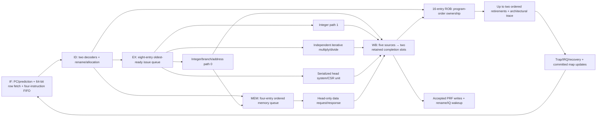

# Block 15: complete core composition and end-to-end verification

This block connects the previously tested architectural modules into the production two-issue
RV32IM_Zicsr_Zifencei machine-mode core. Instructions now enter from memory, execute through
renaming/scheduling and real functional units, complete through the shared writeback path,
and retire through the ROB. The same production recovery controller handles restarts.

Two top-level boundaries are supplied. rv32_ooo_core exposes instruction-row and data-word
handshakes. rv32_ooo_axi_top wraps the instruction side with the native BRAM adapter and the
data side with the AXI4-Lite master. Memory storage, address decoding/fabric, clock/reset
creation, and board peripherals remain external. Firmware and FPGA/IP integration were
removed from scope; the retained FPGA targets are documented in vivado_target.md.

## 1. Five logical sections with genuine out-of-order execution



These are logical responsibilities, not a fixed five-clock instruction latency. Queues and
multicycle units allow a younger independent ADD to complete while an older DIV runs. RAW
consumers still wait for the correct physical value. WAR/WAW name dependencies are removed
by renaming; completion can be out of order while retirement stays in program order.

The fixed configuration has 32 architectural registers, 64 physical identities, four PRF read
ports, two PRF write ports, a 16-entry ROB, eight issue entries, four memory entries, and four
buffered instructions. Dispatch, issue, completion acceptance, and retirement are each at
most two instructions/results per cycle. Dependencies, branch recovery, ordered memory, and
serialized instructions can reduce achieved throughput.

## 2. Core interface signals

| Signal | Width | Source → destination | Meaning |
|---|---:|---|---|
| clk_i, rst_ni | 1 each | External clock/reset → all core blocks | Common clock domain and active-low asynchronous reset |
| predict_enable_i | 1 | Configuration → fetch/predictor | Enable prediction or return sequential next PCs |
| halt_i | 1 | External control → admission | Stop new admission/fetch offers while older admitted work drains |
| instruction_request_valid_o / ready_i | 1 each | Fetch ↔ instruction endpoint | Accept one aligned row request |
| instruction_request_address_o | 32 | Fetch → instruction endpoint | Eight-byte-aligned byte address |
| instruction_response_valid_i / ready_o | 1 each | Instruction endpoint ↔ fetch | Transfer its one matching outstanding response |
| instruction_response_data_i / instruction_response_error_i | 64, 1 | Instruction endpoint → fetch | Two instruction words or an instruction-access error |
| data_request_valid_o / ready_i | 1 each | LSU ↔ data endpoint | Transfer one head-authorized access |
| data_request_o | 69 | LSU → data endpoint | Write flag, word-aligned address, 32-bit data, four byte strobes |
| data_response_valid_i / ready_o | 1 each | Data endpoint ↔ LSU | Transfer the matching load/store completion |
| data_response_i | 33 | Data endpoint → LSU | 32-bit read value and error flag |
| irq_external_i, irq_software_i, irq_timer_i | 1 each | Synchronous interrupt sources → machine state | Hardware pending inputs, qualified by CSR masks/enables |
| trace_o | 666 | Registered event recorder → debug/test | Two 333-bit ordered retirement/trap/interrupt records |
| empty_o | 1 | Back-end ownership → external control | No admitted ROB/IQ/execution/writeback/system/data-engine work remains |
| protocol_error_o | 1 | Combined module diagnostics → external checks | A malformed handshake, ownership, or atomic-dispatch condition occurred |

empty_o describes the admitted back end. A read-only fetch offer/response or prefetched FIFO
contents can remain when halt stops admission. halt is therefore a drain control, not a reset
of architectural state or an assertion that native instruction traffic disappeared immediately.
Interrupt inputs must already be synchronous to clk_i; this RTL boundary does not synchronize
asynchronous board pins.

## 3. Portable native-instruction/AXI wrapper

rv32_ooo_axi_top supplies these instruction pins: bram_block_i, bram_enable_o, a 13-bit native
row address, and 64-bit bram_data_i. The external native output must implement the single-stage,
enable-held memory contract from block 9. The wrapper exposes the proposed row address even
before enable so a shared-memory collision hold can be computed without enable/address feedback.

Its data side exposes 32-bit AXI-Lite AW/AR addresses, three-bit PROT fields, 32-bit W/R data,
four WSTRB bits, two-bit B/R responses, and independent valid/ready channels. The core's data
request remains incomplete until the adapter receives the actual B or R response. There is
one outstanding data transaction. The wrapper does not instantiate a vendor interconnect,
RAM generator, UART, GPIO, or clocking IP.

| Wrapper signals | Width | Source → destination | Circuit/interface purpose |
|---|---:|---|---|
| bram_block_i | 1 | External shared-memory collision control → native adapter | Hold a new read; an older response may still be consumed |
| bram_enable_o, bram_address_o | 1, 13 | Native adapter → synchronous RAM | Sample one of 8,192 eight-byte rows on an enabled edge |
| bram_data_i | 64 | RAM's held output → native adapter | Payload associated with that enabled edge |
| m_axi_awaddr_o / awprot_o / awvalid_o | 32, 3, 1 | Data adapter → fabric | Retained write address and attributes until AWREADY |
| m_axi_wdata_o / wstrb_o / wvalid_o | 32, 4, 1 | Data adapter → fabric | Retained write payload until WREADY, independently of AW |
| m_axi_bresp_i / bvalid_i / bready_o | 2, 1, 1 | Fabric ↔ data adapter | Actual store completion and access-error status |
| m_axi_araddr_o / arprot_o / arvalid_o | 32, 3, 1 | Data adapter → fabric | Retained read address and attributes until ARREADY |
| m_axi_rdata_i / rresp_i / rvalid_i / rready_o | 32, 2, 1, 1 | Fabric ↔ data adapter | Actual load payload and access-error status |

Each omitted ready partner is one bit. A valid transfer occurs only on a rising edge with
both valid and ready high. The sender holds valid and its payload while the receiver stalls.
In particular, an accepted write address does not imply that write data was accepted, and
neither acceptance permits the store to retire before its write response.

The AXI integration test connects this wrapper to a modeled shared RAM/fabric and the actual
custom timer slave. Those are executable testbench connections; a particular FPGA block design
or peripheral fabric is not implied by the wrapper itself.

## 4. Atomic dispatch and result ownership

Both fetched records pass through real decoder instances. Rename, ROB, IQ, and LSU agree on
the same accepted prefix. A memory instruction must have an available memory entry as well
as its ROB/IQ/physical resources. If only the older instruction can be admitted, fetch compacts
the retained suffix into the next cycle's lane 0.

The scheduler supplies physical source tags to the four PRF read ports. Completion bypass
provides accepted values on that same issue edge. Port 0 system instructions are intercepted
into the serialized CSR unit rather than accidentally entering the integer ALU. Memory
operations use integer-path address preparation, not an immediate speculative bus access.

Five retained completion producers feed two arbiter slots: integer 0, integer 1,
multiply/divide, LSU, and system/CSR. The ROB checks full tag/generation, destination, decoded
write intent, and incomplete live ownership. Only accepted nonfaulting nonzero-register results
write the PRF and wake dependents. An accepted fault still completes its ROB entry for a trap.

## 5. What changes at retirement

Retirement, rather than physical completion, updates committed rename mappings, releases the
replaced physical identity, increments the retirement counter, applies pending CSR writes,
and trains the predictor. The registered trace reports this ordered architectural sequence.
A trace order number counts trap/interrupt events too; it is not the same quantity as minstret,
which counts successfully retired instructions.

A branch mismatch is recorded at completion. New admission stops, but work older than that
branch can still reach retirement. When the selected boundary retires, cancellation removes
remaining speculative producers/results before map/queue restoration. A jump's valid link
value commits before its younger mappings are discarded.

An older synchronous exception has priority over a younger known branch redirect. A faulting
instruction cannot commit its GPR value or memory trace effect. All younger memory operations
remain preparations in the queue, because a real data transaction requires the live incomplete
ROB head. This is the central protection against wrong-path peripheral reads and writes.

## 6. Precise traps, MRET, WFI, and interrupt drain

The core maintains architectural_next_pc from ordered architectural events. It does not save
the speculative fetch PC when an interrupt is taken. On interrupt eligibility, admission stops;
already admitted instructions and outstanding data transactions drain. Eligibility is checked
again when the back end becomes empty, with external → software → timer priority.

The machine unit saves mepc/mcause/mtval and updates interrupt-enable state at entry. Direct
mtvec uses its base; vectored interrupts use base + 4×cause. The core injects a separate
interrupt event into the trace only at that empty boundary. MRET commits the restored status
and restarts fetching from the saved mepc through production recovery.

WFI uses no gated clock. A locally enabled pending interrupt can wake it even if global MIE
prevents interrupt entry; with global MIE enabled, the drained machine takes the interrupt
and later resumes the next unexecuted instruction. A pending interrupt can also disappear
because an already-admitted CSR instruction disables it during drain; the core must then
continue without taking a stale request.

FENCE relies on the head-ordered memory policy. FENCE.I additionally invalidates prediction,
clears prefetched instruction state through recovery, and restarts after older stores have
completed. The AXI test modifies executable RAM, confirms the old word had been prefetched,
then checks that FENCE.I causes the new instruction to execute.

## 7. Cycle examples

Consider these three instructions after renaming has assigned distinct physical destinations:

```asm
div x5, x1, x2
add x6, x3, x4
add x7, x5, x6
```

The following is a representative sequence of clock opportunities, rather than a claim about
fixed divider latency or fetch alignment. Two eligible instructions can issue together; the
younger ADD can also issue on a later edge if a port or input was initially unavailable.

| Clock opportunity | EX/completion state | ROB/architectural state |
|---|---|---|
| A | Ready DIV starts; independent ADD may issue on the other available path | DIV remains older than both ADDs |
| B, a later edge | ADD completion is accepted while DIV is still busy | x6's physical result becomes ready, but ADD cannot retire past DIV |
| C through D | Dependent ADD still waits for DIV's physical source tag | No new committed x5/x6 mapping yet |
| E | DIV completion is accepted; its physical value is broadcast | Dependent ADD may wake; head becomes complete |
| F and later | Dependent ADD executes when both source values and a port are ready | DIV and independent ADD may retire as a two-entry ordered prefix |

The readiness bits and tag comparators enable the bypass. The head pointer and completion bits
prevent it from changing architectural order. Exact edges can move with completion arbitration;
the invariant is that the independent ADD can finish first while DIV still retires first.

For the production loop with four iterations, architectural values finish at x1=0, x2=12,
x3=13. The block-15 test records 16 events including its final serialized WFI:

| Configuration | Test cycles | Recoveries | Architectural result |
|---|---:|---:|---|
| Prediction disabled | 51 | 3 | Same 16 events and final register values |
| Prediction enabled | 42 | 2 | Same 16 events and final register values |

These counts belong to this specific RAM/response/test setup. Block 10's smaller test harness
has different timing and does not replace production-controller verification.

For a precise interrupt during DIV, the signal sequence is:

1. DIV is already executing when an enabled IRQ becomes pending.
2. Admission stops. DIV and any admitted dependents continue; no instruction is skipped.
3. After all admitted retirements/data responses, the core rechecks eligibility and records
   the architectural next PC in mepc.
4. Trap entry selects mtvec, recovery cancels/clears remaining speculative fetch state, and
   the handler reads actual trap CSRs using normal instructions.
5. MRET returns to that next unexecuted PC. The architectural reference detects any duplicate
   or missing retirement.

The fault-priority test adds a younger known branch mismatch and a younger DIV behind an older
faulting load. With a short delayed response, DIV is cancelled while running; with a longer
response it completes speculatively first. In both cases the older load fault wins, neither
wrong-path MMIO nor younger retirement occurs, and the squashed branch does not train prediction.

## 8. Verification evidence and its scope

The recorded block-15 suite passes **29,474 checks, zero failures** across three testbenches:

| Testbench | Checks | Evidence |
|---|---:|---|
| tb_block15 | 20,515 | 16 RAM-fed programs against independent instruction/register/memory reference |
| tb_core_traps | 7,677 | 25 precise-fault, interrupt, WFI, and competing-recovery scenarios |
| tb_core_axi | 1,282 | Seven actual core/AXI/native-memory/timer integration programs |

The arithmetic/reference suite covers all integer operation families, all eight M operations,
six branch comparisons, JAL/JALR link effects, repeated destinations/RAW chains, byte/halfword
loads/stores, randomized operand versions and memory traffic, CSR forms, FENCE/FENCE.I,
x0 protection, and ROB/IQ/memory-queue exhaustion. It also checks a later-resolving older
misprediction replacing a younger known recovery boundary.

The trap suite executes handlers from memory and compares architectural PC, instruction,
GPR values, CSR values, trap cause/tval, return targets, and stamped event order. It includes
illegal instructions, ECALL/EBREAK, unsupported/read-only CSR accesses, alignment/access
faults, all three interrupt causes in direct/vectored modes, interrupt drain during DIV/load,
priority/recheck behavior, both WFI enable cases, and wrong-path side-effect suppression.

The AXI suite applies independent AW/W/AR backpressure, holds responses, checks exactly-once
stores, bus-error traps, wrong-path MMIO suppression, self-modifying code plus FENCE.I, and
actual software/timer interrupts programmed and cleared through the custom AXI timer slave.

```sh
python3 scripts/run_checks.py --block 15
python3 scripts/run_checks.py --block 15 --waves
```

reports/block15_results.json lists each case scope and exact compiled-source hashes. The
encoded programs live in self-checking testbenches; no external compiler is required to run
these hardware tests. They are not a firmware-delivery package.

These results are directed/generated simulation evidence, not official ACT4 certification,
exhaustive formal verification, or proof that every possible program/interleaving is correct.
Vivado synthesis, fit, timing, DRC, and bitstream generation have not been run. The retained
50 MHz clock setting is a target, not a measured implementation result.

## 9. Reading the integrated waveforms

In build/block15/block15.vcd, follow fetched instruction records, rename_fire, issue_fire,
physical source/destination identities, accepted completions, retire_fire, and trace.order.
Compare a younger completed ADD with the still-incomplete older DIV at the ROB head.

In build/core_traps/core_traps.vcd, inspect IRQ inputs, irq_pending, admission_hold,
architectural_next_pc_q, ROB occupancy, active data response, irq_take/trap_fire, CSR trap
state, cancel/apply, and the handler's CSR-read retirements. The stale/mispredicted fetch PC
must never replace the architectural interrupt boundary.

In build/core_axi/core_axi.vcd, follow source memory instructions through LSU request,
AW/W acceptance, B response, accepted completion, and retirement. For reads, separate AR
acceptance from R return. During FENCE.I, compare the old prefetched word with the modified
RAM word and the instruction that actually retires after refetch.

Waveform filenames and optional recording behavior are controlled by the testbenches. A
passing printed summary is accompanied by a timeout and self-checking assertions; examining
only a plausible waveform is not the verification strategy.

## 10. Interview questions

**What makes this genuinely out of order?** A younger ready instruction can issue and
complete before an older waiting/multicycle instruction. The ROB still commits in order.

**What distinguishes completion from retirement?** Completion makes a speculative result
available. Retirement changes the committed architectural state and frees the replaced mapping.

**Why can a store address be ready long before its bus request?** Address preparation is
speculative and harmless; external memory/peripheral effects are restricted to the ROB head.

**Why serialize CSR instructions?** They observe/change architectural machine state and may
alter interrupt eligibility or next PC. Their effects must not become visible out of order.

**Why is interrupt draining necessary?** Saving a boundary while admitted work later commits
could skip or repeat instructions on return. Draining establishes one next-unexecuted PC.

**How is FENCE.I more than a no-op?** The implementation must discard old instruction
prefetch/prediction state and restart after prior writes complete, so new code is refetched.

**Does empty_o mean the fetch port is idle?** No. It reports admitted back-end quiescence;
a read-only offer/response or FIFO contents may still exist.

**Does passing this suite guarantee silicon correctness?** No. It provides reproducible
functional evidence for the stated tests. Broader architecture testing, formal work, and
implementation analysis address additional questions.
